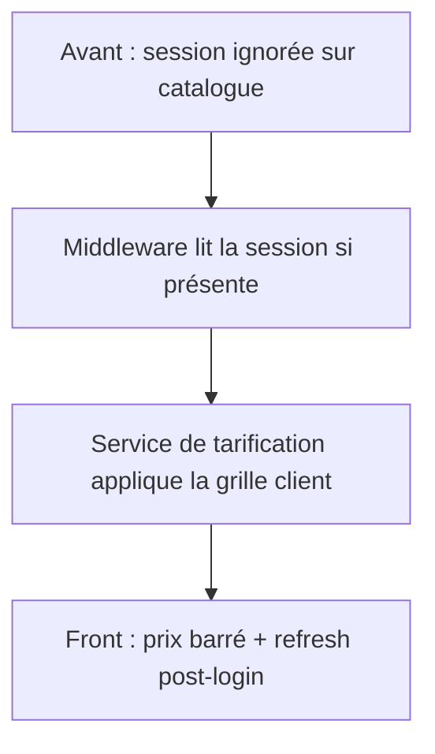

# Daily Logs — concaténation

Généré le 2026-10-20 18:28.

Nombre de fichiers : 156


---

<!-- 01- Février 2026/2026-02-02.md -->

# 📅 Lundi 2 Février 2026 - Pré-démarrage mission

## 🧠 Humeur & contexte

Pré-démarrage mission, en attente du permis de travail. Journée setup et documentation.

---

## 🎯 Objectifs du jour

- [ ] Non documenté

---

## 💡 Découverte du jour

L'audit révèle un gap classique PME : sécurité périmétrique correcte, mais dette technique massive en interne (PHP 5.6 EOL depuis 7 ans) → le syndrome **"forteresse avec fondations pourries"**.

---

## ✅ Réalisations

### Vault Obsidian Midbec-Journey — structure & documentation
*Pré-démarrage : poser le vault, l'arborescence et les notes de cadrage avant le build.*

- Suivi de mission centralisé dans un vault Obsidian dédié — création du vault « Midbec-Journey »
- Arborescence de travail prête à l’emploi — 7 dossiers et fichiers de base pour classement et routine
- Plus de 15 risques critiques infrastructure identifiés et consignés avant toute implémentation — rédaction de `infrastructure-audit.md`
- Mission cadrée par écrit (contexte, objectifs, timeline) — note `mission-overview.md` pour aligner périmètre et tempo
- Stack legacy vs cible et décisions techniques à trancher documentées — note `tech-stack.md` comme base d’arbitrage
- Habitude de suivi quotidien amorcée — routine de daily log en place

---

## 🧠 Ce que j'ai appris

- **Documentation** : documenter **avant** de démarrer évite l'oubli et pose une base de référence solide
- **Solo dev** : solo dev = ownership complet des décisions d'architecture → documenter les **"pourquoi"** autant que les "quoi" et les "comment" ?

---

## ⚠️ Points de vigilance

- Rien de bloquant aujourd'hui, focus entier sur le setup — maintenir ce focus tant qu'aucun blocage externe n'apparaît

---

## ⏭️ Next steps

- [x] Remplir `team-structure.md` (Patrick + organigramme)
- [x] Créer note `migration-react.md` dans `02-Projects/`
- [x] Setup environnement dev local (Bun + TypeScript + Tailwind)

---

## ⚡ Énergie

Bonne forme : fondations posées, prêt à démarrer — vault, structure et premières notes de cadrage livrés.


---

<!-- 02 - Mars 2026/2026-03-09.md -->

# 📅 Lundi 9 Mars 2026 - 🎉 Jour 1 à Midbec

## 🧠 Humeur & contexte

Premier jour officiel. Permis reçu, mission lancée. Accueil chaleureux.

---

## 🎯 Objectifs du jour

- [ ] Non documenté

---

## 💡 Découverte du jour

**Go Micro** : framework Go pour microservices, à évaluer vs Gin classique → brouillon tech (non publié)

**UnoPIM** : PIM open-source Laravel, potentiellement pertinent pour gérer 2M+ pièces → brouillon tech (non publié)

---

## ✅ Réalisations

### Onboarding — vault et intégration
*Premier jour : documentation de mission et repères sur place.*

- Journal de mission disponible et à jour sur le poste pro — clone du vault Obsidian, synchronisation OK
- Intégration sur place : repères humains et organisation — tour des lieux, équipe et Patrick

### Environnement de dev — outils et base front
*Chaîne prête et audit du template existant.*

- Chaîne d'outils de développement opérationnelle — Git, Node.js, IDE configurés
- Base front existante entièrement cartographiée — audit du template RedParts (assistant IA)
- Stack moderne validée avec l'infra — React + TypeScript + Tailwind confirmés avec Patrick

### Veille — pistes outils catalogue
*Pistes notées pour la suite.*

- Deux pistes d'outils notées pour la suite — Go Micro et UnoPIM à explorer

---

## 🧠 Ce que j'ai appris

- **Template RedParts** : bien architecturé mais 100% automobile → chantier de migration de contenu, pas de réécriture d'architecture
- **Couche API** : injectable ; passer de fake-api à un backend Go = zéro impact sur l'UI → grosse opportunité
- **Patrick** : personnalité joviale et excentrique, relation de confiance immédiate. Collaboration dev ↔ ops sera fluide.

---

## ⚠️ Points de vigilance

- Pas de staging environment visible → migration progressive à planifier soigneusement
- Template sur Next.js 11 → upgrade à prévoir
- Système "Garage" automobile omniprésent dans tout le template → à supprimer/remplacer intégralement

---

## ⏭️ Next steps

- [ ] Explorer l'API Ogasys (endpoints, limites, comportements)
- [ ] Créer note projet `migration-react.md` avec plan basé sur l'audit RedParts
- [ ] Évaluer la pertinence de UnoPIM pour le catalogue

---

## ⚡ Énergie

Template RedParts = game changer : plutôt que de partir de zéro, base solide héritée ; enthousiasme fort toute la journée.


---

<!-- 02 - Mars 2026/2026-03-10.md -->

# 📅 Mardi 10 Mars 2026 - Jour 2 à Midbec

**Contexte** : Premier vrai jour de dev. Accès aux repos, tests front et back, migration stack lancée.

---

## ✅ Réalisations

- Parcours front et back vérifié de bout en bout — repos clonés, tests manuels via Postman
- Framework Next porté sur une base récente sans changer le métier — passage 11 → 15.1.7
- Styles, état global et data-fetching alignés sur la cible — Tailwind v4, Zustand v5, TanStack Query v5
- API backend à nouveau démarrable en local — ajout du point d’entrée Go manquant à la racine du module
- Cause du 401 sur `GET /api/me` isolée (collision de clés de contexte Go) — correctif prêt, application différée, suivi dans la doc stack

---

## 💡 Ce que j'ai appris

- Next.js 15.2.x introduit une régression sur Pages Router → 15.1.7 est la dernière version stable fiable, à surveiller
- Découper la migration en phases distinctes (stack / contenu / UI) permet de livrer de la valeur à chaque étape sans bloquer sur un chantier monolithique
- Un point d’entrée Go manquant à la racine = dette silencieuse qui aurait coûté des heures plus tard → bon réflexe de tester tôt avec Postman

---

## ⚠️ Points de vigilance

- Redux / Sass / Bootstrap toujours en place → migration = session dédiée à planifier
- Bug `GET /api/me` : fix identifié, pas encore appliqué
- Tailwind v4 + Sass coexistent temporairement → à nettoyer lors de la session migration UI

---

## 📋 Demain

- [ ] Appliquer le fix context key collision → tester `GET /api/me` avec Postman
- [ ] Commencer la suppression du système "Garage" (composants, Redux slice, pages)
- [ ] Setup GitLab CI/CD : pipeline de base sur `develop`

---

**Énergie** : 8/10 — Moins d'excitation que hier, plus d'exécution. Les décisions sont prises, maintenant c'est du craft.


---

<!-- 02 - Mars 2026/2026-03-11.md -->

# 📅 Mercredi 11 Mars 2026 - Jour 3 à Midbec

**Contexte** : Arrivé en retard à cause du froid — voiture complètement givrée, détour obligatoire par Dollarama pour un ice scrapper. Première vraie journée d'hiver canadien.

---

## ✅ Réalisations

- Accès GitLab sécurisé depuis le bureau — clé SSH configurée
- React et TypeScript portés sur les dernières versions du projet
- État global unifié sur Zustand — migration complète des slices Redux
- Chargement de données standardisé — hooks maison remplacés par TanStack Query
- Arbre npm allégé — dépendances obsolètes retirées pendant la migration
- Environ une trentaine de pages alignées sur la nouvelle stack état / data
- Deux régressions subtiles Zustand / TanStack Query corrigées — stabilité après migration

---

## 💡 Ce que j'ai appris

- Nettoyer les dépendances obsolètes en même temps qu'une migration évite d'accumuler de la dette invisible.
- Migrer sans casser les interfaces publiques, c'est la clé pour un refactor indolore
- Deux pièges subtils débusqués sur Zustand et TanStack Query, bonne montée en compréhension des deux outils.
- Le site que je modernise n'a pas été touché depuis 2015 et avant ça, depuis 1982. Je suis littéralement la première mise à jour sérieuse en 50 ans. Énorme ligne de CV.

---

## ⚠️ Points de vigilance

- Un bug API non corrigé encore en suspens → priorité demain.
- Reste encore du travail de nettoyage CSS (Bootstrap / Sass) à planifier.
- Le rendu visuel est temporairement perturbé, mais l'app tourne. Je vais d'abord finir la migration d'outils avec de fix le CSS.

---

## 📋 Demain

- [ ] Corriger et valider le bug API
- [ ] Commencer la suppression du système "Garage"
- [ ] Supprimer Bootstrap / Sass au profit de Tailwind
- [ ] Setup GitLab CI/CD pipeline de base (après migration techno) : ESLint, TypeScript compiler, Prettier, Jest, Playwright/Cypress, Lighthouse CI

---

**Énergie** : 7/10 — Journée amputée par le retard, mais le travail avance proprement.


---

<!-- 02 - Mars 2026/2026-03-12.md -->

# 📅 Jeudi 12 Mars 2026 - Jour 4 à Midbec

**Contexte** : Arrivé plus tendu que d’habitude, entre les préoccupations financières, tout ce qu’il reste à régler pour mon installation, et le fait d’avoir probablement pris froid. Petite victoire morale du jour : je devais enfin avoir Internet.

---

## ✅ Réalisations

- PIM UnoPim en place côté infra, chaîne ERP en préparation — Patrick installe et prépare script de sync/scraping ; revue d’architecture à suivre après push
- Sessions IA front mieux cadrées — règles Cursor pour limiter dérives et modifications hors scope
- Dépendance Reactstrap retirée sur modale et tooltip — remplacements minimaux maison (`Modal`, `UncontrolledTooltip`)
- Application toujours utilisable après retrait Reactstrap — quelques écarts visuels temporaires acceptés
- Dette SCSS réduite sur le périmètre « front réel » — large passe de nettoyage ciblée
- Thèmes header démo plus injectés globalement — suppression des variantes `classic` / `mobile-two` encore chargées
- Fichiers SCSS orphelins ou purement démo supprimés — dont `block-map`, `contacts`, variantes de header
- Variables SCSS globales obsolètes purgées — moins de bruit hérité dans la feuille de style
- Point d’ancrage logo RedParts desktop identifié dans le code — composant logo du header desktop
- Travail CSS structuré (audit → plan → ciblage → action) — fin de l’itération « à l’aveugle » sur le legacy

---

## 💡 Ce que j'ai appris

- Une migration front propre ne consiste pas seulement à “faire disparaître les erreurs”, mais à réduire méthodiquement la surface legacy encore réellement chargée.
- Retirer `Reactstrap` sans casser le front confirme qu’une grande partie de l’ancienne couche UI peut être remplacée progressivement par des composants simples et maîtrisés.
- À ce stade, supprimer du SCSS mort n’apporte plus forcément de changement visuel immédiat : le vrai prochain levier est désormais le styling réel des composants encore visibles.
- Planifier avant d’agir évite de perdre du temps à nettoyer des zones non prioritaires ou déjà sans impact réel.
- J’avance sur un chantier de modernisation profonde, sur une base qui n’avait manifestement pas connu de vraie remise à niveau depuis très longtemps : c’est lourd, mais très formateur.

---

## ⚠️ Points de vigilance

- Le bug API reste en suspens et n’a toujours pas été traité.
- La stack cible n’est pas encore totalement atteinte tant que `Bootstrap`, `Sass` et plusieurs dépendances legacy existent encore dans le projet.
- Le rendu visuel reste partiellement perturbé : le front tourne, mais la finition UI est encore incomplète.
- Le branding `RedParts` est encore présent à plusieurs endroits ; il faudra bien séparer ce chantier du nettoyage technique pour ne pas mélanger les objectifs.

---

## 📋 Demain

- [ ] Auditer les dépendances legacy encore présentes dans `package.json`
- [ ] Décider lesquelles peuvent être supprimées immédiatement et lesquelles doivent rester temporairement
- [ ] Continuer la sortie progressive de `Bootstrap` / `Sass` au profit de `Tailwind`
- [ ] Cibler un lot UI réel visible à nettoyer en priorité : header, search, footer ou product-card
- [ ] Recenser les occurrences restantes de `RedParts` hors logo
- [ ] Reprendre le bug API une fois le périmètre technique du front stabilisé

---

**Énergie** : 6/10 — Journée mentalement plus lourde, mais bonne progression technique et surtout meilleure méthode de travail.


---

<!-- 02 - Mars 2026/2026-03-13.md -->

# 📅 Vendredi 13 Mars 2026 - Fin de ma première semaine à Midbec

**Contexte** : Je suis arrivé plus léger qu'hier. J'ai mieux dormi, fait de la self affirmation, bu un smoothie protéiné : je suis prêt à itérer aujourd'hui.

Petite chose intéressante de la journée : Patrick m'a proposé de venir déjeuner tous les vendredis avec un ami à lui qui est SFE à Toronto. C'est bon pour le projet North Star.

---

## ✅ Réalisations

- Routine réseau hebdo acceptée avec Patrick (déjeuner vendredi + contact SFE Toronto).

### Côté technique

- i18n compatible React 19 sur tout le code applicatif — migration `FormattedMessage` → `intl.formatMessage`, plus d’usage JSX problématique dans le dépôt front legacy
- Types du menu mobile alignés sur les refs React — `containerRef` corrigé (`RefObject` cohérent avec `useRef<HTMLDivElement>(null)`)
- Build toujours rouge mais causes cartographiées — conflit `ReactPortal` / `ReactNode` et double `@types/react` ; correctifs typage/cast tentés sur le composant panneau menu mobile, plan d’action noté pour lundi

---

## 💡 Ce que j'ai appris

### Côté technique

- En React 19, les types JSX et les refs sont plus stricts ; `FormattedMessage` (composant de `react-intl`) n’est plus reconnu comme composant JSX valide, d’où la migration vers `useIntl()` + `formatMessage()`.
- Un projet peut avoir plusieurs copies de `@types/react` (racine + sous-dépendance de `@types/react-dom`), ce qui provoque des erreurs « Type X is not assignable to type X » entre `ReactPortal` et `ReactNode`.

---

## ⚠️ Points de vigilance

### Côté technique

- Le build ne passe toujours pas à cause du panneau menu mobile (types `ReactPortal` vs `ReactNode`). À traiter en priorité lundi.
- Vérifier après correction du build qu’aucune régression sur le menu mobile (portals, navigation entre panneaux).

---

## 📋 Semaine prochaine

- [ ] **Lundi – Build / ReactPortal** : exécuter la to-do list ci-dessous pour débloquer le build.
- [ ] Auditer les dépendances legacy encore présentes dans le manifeste npm/bun
- [ ] Décider lesquelles peuvent être supprimées immédiatement et lesquelles doivent rester temporairement
- [ ] Continuer la sortie progressive de `Bootstrap` / `Sass` au profit de `Tailwind`
- [ ] Cibler un lot UI réel visible à nettoyer en priorité : header, search, footer ou product-card
- [ ] Recenser les occurrences restantes de `RedParts` hors logo
- [ ] Reprendre le bug API une fois le périmètre technique du front stabilisé

---

## 🔧 To-do Lundi — Isoler et résoudre l’erreur de build (ReactPortal)

**Erreur actuelle** : échec TypeScript sur le panneau menu mobile — `ReactPortal` n'est pas assignable à `ReactNode`, typique d'une double définition des types React (souvent `@types/react` dupliqué via la chaîne `@types/react-dom`).

**Blocs à enchaîner** :

| # | Tâche | Détail |
|---|--------|--------|
| 1 | **Confirmer la duplication** | Vérifier dans l'arbre des dépendances installées si plusieurs versions de `@types/react` coexistent et les comparer. |
| 2 | **Option A — Résolutions** | Si duplication confirmée : ajouter `overrides` (npm) ou `resolutions` (bun) dans le manifeste des deps pour forcer une seule version de `@types/react` partout. Puis réinstaller et relancer le build front. |
| 3 | **Option B — Wrapper createPortal** | Créer une fonction du type `renderPortal(children, container): React.ReactNode` qui appelle `ReactDOM.createPortal(children, container)` et retourne le résultat avec un typage unifié, utilisée dans le composant panneau menu mobile à la place de l'appel direct. |
| 4 | **Option C — Cast / typage local** | Si A et B ne suffisent pas : cast plus ciblé ou fichier `.d.ts` local pour unifier les types de portal. |
| 5 | **Valider** | Build du front et vérif menu (portals, navigation) sans régression. |

**Fichiers concernés** :  
composant panneau menu mobile ; manifeste des dépendances (si Option A).

---

**Énergie** : 7/10 — C'était un bon début de mission, j'ai setup mon environnement et je me suis organisé.


---

<!-- 02 - Mars 2026/2026-03-16.md -->

# 📅 Lundi 16 Mars 2026 - Début de ma deuxième semaine

**Contexte** : Je suis toujours enrhumé, mais j’ai pris mes habitudes : nouvelle routine, nouveau mode de vie.  
Objectif de la semaine : commencer à apporter des modifications visibles sur le site, en refondant le header et la home bloc par bloc.  
Petite quête secondaire : je me suis créé une carte de fidélité Optimum, ça me servira quand je mettrai de l’essence.

---

## ✅ Réalisations

### Côté technique

- Topbar entièrement pilotée par Tailwind, sans conflit Sass immédiat — feuille `_topbar.scss` retirée, styles portés par les composants topbar et dropdown, modifications visibles dès le JSX
- Bandeaux header clarifiés (services rapides vs actions utilisateur) — barre rouge (téléphone, compte, suivi, panier) et barre grise (langue FR/EN uniquement, plus de comparateur ni de devise hors CAD)
- Focus visuel réduit à Topbar + logo pour la suite du chantier — reste du header commenté dans le shell header legacy (megamenu, search, indicateurs)

---

## 💡 Ce que j'ai appris

### Côté technique

- Le thème RedParts repose lourdement sur des **“schemes” Sass** (mixins, variables) qui peuvent écraser les styles Tailwind tant qu’ils sont actifs. Neutraliser ces blocs au niveau du composant (`_topbar.scss`) est une bonne stratégie pour reprendre progressivement le contrôle avec Tailwind.  
- Le dropdown de langue hérite aussi de ce système (positionnement, hover, etc.) : il faut parfois ajuster à la fois le composant React (classes Tailwind) et les résidus SCSS pour obtenir un comportement propre (alignement du menu sous le label).

---

## ⚠️ Points de vigilance

### Côté technique

- Le reste du header (navbar, search, indicateurs) est encore piloté par le CSS / Sass legacy ; la transition devra se faire composant par composant, comme pour la Topbar, pour éviter les régressions visuelles.  
- Les routes et contenus exacts côté FR/EN (URL localisées, texte marketing précis pour les liens “Connexion au compte”, “Ouvrir un compte”, etc.) ne sont pas encore finalisés : pour l’instant, on utilise les clés existantes de `react-intl` comme base.

---

## 📋 Demain / suite de la semaine

- [ ] Stabiliser le design définitif de la Topbar desktop (couleurs finales Midbec, tailles, espacement, hovertates cohérents avec la charte).  
- [ ] Réintroduire progressivement les éléments du header (navigation principale, recherche, indicateurs compte/panier) en **Tailwind**, en coupant au passage les dépendances à Bootstrap/Sass.  
- [ ] Commencer à penser la structure de la future home (`components/home/*`) en réutilisant le header simplifié comme base.  
- [ ] Continuer à repérer et isoler les morceaux de thème RedParts (CSS, wording, images) encore visibles pour les remplacer à terme.

---

**Énergie** : 6/10 — Toujours malade, mais j’ai posé les premiers vrais jalons visibles de la refonte (Topbar Tailwind + simplification du header), ce qui donne une bonne base pour la suite de la semaine.


---

<!-- 02 - Mars 2026/2026-03-17.md -->

# 📅 Mardi 17 Mars 2026 - Journée solo

**Contexte** : Patrick est en rendez-vous médical aujourd’hui, je suis seul au bureau. Ambiance calme, bonne énergie, je reprends la salle de sport ce soir, ça aide aussi côté motivation.  
Objectif de la journée : commencer la vraie refonte du header Midbec dans le nouveau shell Next/Tailwind.

---

## ✅ Réalisations

### Côté technique

- Application servie dans un shell Next/Tailwind 2.0 — nouveau layout racine branché dans le point d’entrée Pages Router, header legacy neutralisé sans le supprimer
- Topbar Midbec reconstruite sans Bootstrap/SCSS — barre supérieure en Tailwind v4, segments rouge/noir (navigation métier + entreprise/contact/langue), pleine largeur et séparation visuelle claire
- Liens topbar lisibles malgré le CSS global hérité — `text-white` forcé sur les `AppLink` en attendant le retrait des styles RedParts/Bootstrap
- Zone logo + recherche amorcée dans des composants dédiés — barre principale introduite, marque sortie du shell header legacy
- Slogan aligné sur l’offre Midbec — clé i18n `TEXT_SLOGAN` orientée électroménager plutôt qu’automobile

### Organisation & pilotage
- Semaine de refonte header planifiée dans la todo liste projet — bilan du jour + prochaines étapes marque, navbar, alignement et dettes

---

## 💡 Ce que j'ai appris

### Côté technique

- La bascule vers un shell Next/Tailwind propre est beaucoup plus fluide une fois que le header legacy est isolé : en branchant un `Layout` 2.0 dès maintenant, tout le travail de refonte du header se fait dans un environnement « propre », sans avoir à jongler avec les anciens layouts. 

- Rebuilder `HeaderTopbar` from scratch en Tailwind v4 permet de sortir rapidement des contraintes Bootstrap/SCSS et de coller directement à l’identité visuelle Midbec (rouge/noir, liens i18n, structure claire gauche/droite).

---

## ⚠️ Points de vigilance

### Côté technique

- Les styles globaux hérités de RedParts/Bootstrap (par exemple la couleur par défaut des `<a>`) imposent encore des overrides comme `text-white` ; il faudra planifier un nettoyage progressif pour éviter la multiplication des classes « temporaires ».  

- `HeaderMainBar` et les futurs composants (`HeaderBrand`, `HeaderNavbar`) devront rester cohérents avec la nouvelle topbar (rythme, couleurs, espaces) pour ne pas recréer un patchwork de styles.  

- L’ancien header legacy est encore présent dans le code : même s’il est neutralisé aujourd’hui, il faudra le supprimer proprement une fois la refonte suffisamment avancée.

---

## 📋 Demain / suite de la semaine

- [ ] Démarrer `HeaderBrand` (logo PNG + tagline i18n, centré, cliquable vers `/`).  
- [ ] Commencer le squelette de `HeaderNavbar` (menu principal desktop-first) en réutilisant les routes Midbec déjà posées dans la topbar.  
- [ ] Commencer à planifier le nettoyage des styles globaux (notamment la couleur des `<a>` héritée de RedParts) pour pouvoir retirer les `!text-white` et autres overrides temporaires.  
- [ ] Continuer à mettre à jour `TODO-List.md` pour suivre précisément l’avancement de la refonte du header.

---

**Énergie** : 7/10 — Journée concentrée et productive, avec un vrai saut qualitatif : le header Midbec 2.0 commence à exister concrètement (nouvelle topbar, shell Next/Tailwind en place), et la roadmap pour la suite est claire (brand, navbar, nettoyage des styles legacy).


---

<!-- 02 - Mars 2026/2026-03-18.md -->

# 📅 Mercredi 18 Mars 2026 - Retour de salle de sport

**Contexte** : C'est ma première journée de travail post-gym : les courbatures vont m’attraper… mais c’est pour mon bien.

Hier j’ai pu constater que la moyenne d’âge des clients est assez élevée : entre 40 et 60 ans. Et la plupart viennent en sachant déjà ce dont ils ont besoin.
Il faut donc un parcours utilisateur **straight to the point**, avec des composants **simples** et **très clairs**, sans étapes inutiles, pour une UX optimale (notamment au niveau du header et de la navigation).

---

## ✅ Réalisations

### Côté technique
- Marque Midbec visible et cliquable sur la topbar — bloc « pill » `HeaderBrand` avec centrage ajusté
- Entrée « Recherche par modèle » accessible depuis la zone rouge — ajout dans `HeaderTopbar` sans retirer les autres liens
- Header à nouveau affiché correctement en prod-like — assemblage `Header` (Topbar + Brand + Navbar), suppression du masquage legacy `.header { display:none }`
- Barre d’actions rapides (wishlist, compte, panier) lisible sur fond blanc — `HeaderNavbar` avec alignements et z-index ajustés pour éviter les chevauchements avec la marque

### Organisation & pilotage
- Feuille de route header actualisée dans `TODO-List.md` — navbar v1 = bande + actions à droite ; recherche par modèle ancrée en topbar ; section 5 pour compteurs panier/wishlist, `useUser`, puis dropdowns `AccountMenu` / `Dropcart`

---

## 💡 Ce que j'ai appris

### Côté technique
- Structurer le header en composants dédiés (`Brand`, `Topbar`, `Navbar`) rend les ajustements visuels et l’alignement UX beaucoup plus “pilotables” : moins de patchwork, plus de cohérence.
- Pour cette audience, réduire la charge cognitive passe aussi par une UI qui reste claire **sans dépendre du survol** : les actions doivent être visibles et compréhensibles dès le premier regard.

---

## ⚠️ Points de vigilance

### Côté technique
- Les actions à droite sont encore **hardcodées** : il faudra basculer vite sur les données (comptage Wishlist/Panier, total, et logique `useUser`) pour éviter une UI qui “promet” mais ne reflète pas la réalité.
- Les collisions d’empilement (décalages/z-index) entre `HeaderBrand` et `HeaderNavbar` doivent rester surveillées à chaque ajustement de spacing.
- Les textes i18n et placeholders (notamment côté brand) doivent être traités comme des éléments structurants, pas comme du “plus tard”.

---

## 📋 Demain / suite de la semaine
- [ ] `HeaderBrand` : placeholder PNG.
- [ ] `HeaderBrand` : i18n du slogan.
- [ ] Wishlist : afficher compteur.
- [ ] Panier : afficher compteur et/ou total (`cart.total`).
- [ ] Auth : remplacer “Compte” hardcodé par logique `useUser`.
- [ ] (v1 suivante) Dropdowns : brancher `AccountMenu` et `Dropcart` derrière les icônes.

---

**Énergie** : 7/10 — Journée la plus productive so far : gros avancement concret sur le header, avec une UX plus lisible et plus “straight to the point”.


---

<!-- 02 - Mars 2026/2026-03-19.md -->

# 📅 Jeudi 19 Mars 2026 - Premier salaire

**Contexte** : Premier salaire reçu ✅ (partiel). Belle étape ; j'ai commencé à structurer mon organisation côté budget.
D'ici la fin du mois, le rythme sera plus confortable.

Petite observation technique : à chaque nouveau commit, le projet démarre plus vite.
On est passé d'environ 16 secondes à ~4 secondes de démarrage (métrique intéressante à conserver pour le CV).

Side note : je suis encore bien courbaturé de ma séance PUSH de mardi.

---

## ✅ Réalisations

- Header découpé en blocs clairs (topbar, marque, navbar) — poursuite du refactor `HeaderTopbar` / `HeaderBrand` / `HeaderNavbar`
- Alignement vertical recherche, logo et icônes stabilisé — itérations grid/flex sur la hauteur perçue de la navbar et le placement à droite
- Clics utilisateur mieux cadrés sur les icônes — surfaces interactives réduites pour coller aux usages desktop
- Feedback visuel des icônes allégé — suppression du fond au survol, conformément à la demande
- Ajustements fins validés visuellement — captures d’écran pour caler `translate`, `margin-bottom` et hauteur de bande
- Décision d’architecture documentée — `HeaderBrand` reste un composant isolé (SRP) plutôt que fusionné dans `HeaderNavbar`

---

## 💡 Ce que j'ai appris

- `translateY` décale visuellement un élément sans le sortir du flux : la hauteur "réelle" continue d'impacter le layout parent.
- Un alignement stable devient difficile quand on empile des compensations (`-translate`, `-mb`) sans ancrage structurel clair.
- Pour les SVG inline, le comportement baseline peut créer des effets visuels inattendus sur les zones cliquables.
- En UI header complexe, il vaut mieux verrouiller d'abord la géométrie (hauteurs/axes), puis peaufiner les détails visuels.
- **Single Responsibility Principle (SRP) — premier contact concret :** un composant doit avoir une seule raison de changer. `HeaderBrand` ne fait qu'une chose — afficher le logo comme lien home — et c'est suffisant pour justifier son existence en fichier isolé. Ce principe fait partie de SOLID, que je croiserai naturellement au fil de la mission.
- **Corollaire pratique :** sur un CV senior, SOLID ne se liste pas — il se prouve à travers des décisions d'architecture concrètes.

---

## ⚠️ Points de vigilance

- Éviter d'empiler les hacks de positionnement (risque de régression à chaque micro-changement).
- Nettoyer les styles de debug (`bg-green-500`, bordures de repérage) avant validation finale.
- Vérifier la cohérence desktop/mobile une fois l'axe desktop stabilisé.
- Attention aux styles globaux legacy qui peuvent fausser le rendu local des composants header.

---

## 📋 Demain / suite de la semaine

- Finaliser l'alignement du bottom `HeaderNavbar` vs `HeaderBrand`.
- Stabiliser la position verticale finale des icônes sans workaround fragile.
- Valider l'alignement gauche/droite sur un même axe visuel.
- Nettoyer les classes de debug.
- Repasser rapidement sur la TODO pour passer les items "UI header" en done dès validation.
- Ensuite : reprendre la connexion progressive des actions (wishlist / compte / panier) au store/endpoints.

---

**Énergie** : 7/10 - Bonne progression malgré la fatigue physique ; les fondations du header sont en place. Premier salaire encaissé, premier principe SOLID intégré. Bonne journée.


---

<!-- 02 - Mars 2026/2026-03-20.md -->

# 📅 Vendredi 20 Mars 2026 - Nouveau joujou

Cursor AI a sorti son nouveau modèle : **Composer 2**
Ce modèle se veut orienté code-only et d'après Terminal-Bench 2 il domine avec 61.7 devant Claude Opus 4.6 (58.0), et loin devant Composer 1.5 (47.9).

Il serait apparemment un meilleur rapport qualité / prix, je vais donc le tester ça aujourd'hui et si c'est vraiment utile, je vais l'intégrer à mon workflow.

Side note : Mes ischios brûlent et je choque des gens à la salle de sport (L'égo boost est tentant mais restons concentré).

---

## ✅ Réalisations

- Header Midbec structuré en trois blocs cohérents — `HeaderTopbar`, `HeaderNavbar`, `HeaderBrand`
- Silhouette header figée (hauteurs, logo à cheval topbar/navbar) — géométrie stabilisée avant polish
- Jeu d’icônes header homogène et dimensionné — passage des SVG implicites ~150px à `react-icons` sur le périmètre header
- Recherche pièces structurée en trois critères — catégorie, marque, numéro de pièce
- Actions compte / favoris / panier explicites pour l’utilisateur — libellés texte à la manière RedParts
- Changement de langue FR/EN opérationnel — `useLocale` / `useSetLocale`
- Stratégie produit validée avec Patrick — conserver le template RedParts comme base et moderniser la stack par-dessus
- Ligne de départ repo réinitialisée sur une base template propre — branche de base, template copié et poussé sur le dépôt front
- Dette UI principale identifiée — Bootstrap encore présent dans le template, migration progressive vers stack moderne à planifier

---

## 💡 Ce que j'ai appris

- **Un scope = un prompt** — principe adopté définitivement pour Cursor
- Structure d'un bon prompt Cursor : fichier ciblé → état actuel → état voulu → contraintes
- `position: absolute` n'est fiable que si le parent a une hauteur fixe
- `min-w-0` est obligatoire sur un `flex-1` input en contexte flex
- SVG sans dimensions explicites = 150px par défaut navigateur
- `items-end` sur un parent flex pousse le contenu vers la frontière basse → risque de chevauchement
- Diagnostiquer avec DevTools **avant** de prompter — ne jamais prompter à l'aveugle
- `clip-path: polygon()` pour les formes à coins coupés en CSS

---

## ⚠️ Points de vigilance

- Le template RedParts utilise Bootstrap — il faudra migrer progressivement vers Tailwind v4
- L'erreur `localStorage.getItem is not a function` = usage SSR à corriger (Next.js)
- Le `.claude/worktrees` se verrouille sous Windows — fermer Cursor ne suffit pas toujours, passer par `cmd //c rmdir`
- La branche `feat/redparts-base` est le nouveau point de départ — ne pas merger sur `main` avant validation

---

## 📋 Lundi / suite

- Corriger l'erreur `localStorage` SSR sur le template RedParts
- Faire tourner `bun dev` proprement sur le template
- Planifier la migration Bootstrap → Tailwind v4 (progressive, composant par composant)
- Mettre en place l'architecture front-end propre sur la base du template
- Reprendre la migration React 19 + TypeScript 5.8 + Zustand v5 + TanStack Query v5

---

**Énergie** : 8/10 - Bonne journée malgré les ischios 💪


---

<!-- 02 - Mars 2026/2026-03-23.md -->

# 📅 Lundi 23 Mars 2026 - Retour à zéro

Bon, on repart à zéro : après avoir échangé avec Patrick nous avons convenu de garder le template RedParts et de viser un rendu **quasiment pixel-perfect**. L'objectif est donc d'aligner toute la stack et les dépendances en conséquence.

Avec mon nouveau workflow **Claude (Planification) → Cursor (Exécutant)**, ça va aller bien plus vite et rester bien plus propre.

**Side note :** Composer 2, le dernier modèle de Cursor AI, est un excellent exécutant. Il faut lui indiquer correctement ce que je veux, et c'est là que Claude rentre en jeu.

---

## ✅ Réalisations

- Header desktop spaceship avancé vers Tailwind v4 et tokens — topbar, recherche, panneaux, dropcart, compte, indicateurs portés dans `tailwind.css`
- Ciblage de style plus fiable via le DOM — attribut `data-midbec-header` sur `Header` pour ne plus dépendre seulement des classes globales
- Dropdowns topbar stylés de façon prévisible — `data-topbar-dropdown`, utilitaires + variables, liens forcés lisibles (`text-white`, hover souligné) malgré le SCSS de base
- Parcours recherche modernisé et SCSS mort retiré — `data-midbec-search`, panneaux `data-search-panel` / `data-open`, suggestions en Tailwind ; imports `_suggestions`, `_vehicle-picker`, `_indicator`, etc. supprimés
- Panneau d’indicateurs sorti du vieux BEM — `data-indicator-panel` + tokens, abandon de `_indicator.scss`
- Paramètres boutique cohérents — CAD uniquement, locales fr/en avec défaut fr, correctifs clics sur `DropdownLanguage`, direction `ltr` via `useDirection`
- Géométrie spaceship (grille, skew, barre de recherche) centralisée en grande partie dans Tailwind — couleurs fines encore en SCSS spaceship avec variables `--search-ship-*` / `--midbec-*`
- Régression critique corrigée : header desktop réaffiché — conflit `@layer` vs règle hors couche `.header { display: none }` ; `display: grid` rétabli côté SCSS spaceship ≥ lg ; commentaire ajouté dans `tailwind.css` pour éviter la récidive

---

## 💡 Ce que j'ai appris

- **`@layer` vs pas de layer** : une règle hors couche peut écraser une règle dans `@layer` même avec une spécificité plus faible — à garder en tête sur tout ce qui touche `display` sur `.header` et les composants globaux.
- **Data attributes sur le DOM** (`data-midbec-header`, `data-midbec-search`, `data-topbar-dropdown`, etc.) : bon compromis pour migrer du BEM / Bootstrap sans tout casser d'un coup.
- **Séparer géométrie (Tailwind / CSS central) et thème par variante (SCSS compilé)** : évite de dupliquer les maps `$search-spaceship-*` en CSS statique tout en gardant spaceship-two / three viables.

---

## ⚠️ Points de vigilance

- **Classic header + search classic** : pas au même niveau de migration que spaceship.
- **`vehicles-list`** : encore du SCSS partagé hors header à traiter.
- **Bootstrap** : toujours dans la chaîne globale — retrait prévu plus tard (phase 5).
- **Build / ESLint** : des erreurs peuvent déjà exister dans le repo ; ne pas confondre avec des régressions header.

---

## 📋 Demain / suite

- [ ] Revue visuelle spaceship (largeurs 992–1200 / 1200–1400).
- [ ] Poursuivre phase 2 : classic, ou mobile / footer selon le plan validé avec Patrick.
- [ ] Continuer le plan Bootstrap → Tailwind composant par composant.
- [ ] `localStorage` SSR, `bun dev` propre, stack React 19 / TS / Zustand / TanStack.

---

**Énergie** : 7/10


---

<!-- 02 - Mars 2026/2026-03-24.md -->

# 📅 Mardi 24 Mars 2026 - On continue sur la lancée

Au programme : continuer la migration du header vers Tailwind.
Le workflow Claude → Cursor (Composer 2) est redoutablement efficace.

**Side note :** Arrivé en retard à cause du trafic — pas mon truc.
**Découverte honteuse du jour :** on peut changer de CLI dans le terminal. 🤦

---

## ✅ Réalisations

- Périmètre header clarifié — layout spaceship seul actif, classic explicitement hors scope
- Accord cadre avec Patrick — SCSS conservé pour infra/thème, classes Bootstrap retirées du JSX header
- Menus compte et panier sans classes Bootstrap — entrées compte et mini-panier passés en Tailwind
- Fuites Bootstrap réduites hors header — formulaires checkout et widgets de filtres nettoyés (une ligne chacun)
- JSX header quasiment sans Bootstrap — trois fichiers encore concernés relevés et laissés pour workstreams mobile/shop/garage
- Rendu spaceship affiné — topbar (gaps, `whitespace-nowrap`, padding vertical), slogan logo (`max-w-fit mx-auto`), largeurs centre header sur trois breakpoints dans `tailwind.css`, alignement vertical des icônes indicateurs en cours

---

## ⏸️ Hors scope — Bootstrap résiduel

- Header mobile (workstream mobile) — classes responsive Bootstrap résiduelles
- Sidebar boutique (workstream shop) — idem
- Modal sélection véhicule (workstream garage) — idem

---

## 🔜 Demain

- Finaliser les fixes visuels du header spaceship
- Audit manifeste des dépendances — dépendances obsolètes post-migration
- Rendre le header utilisable en prod


---

<!-- 02 - Mars 2026/2026-03-25.md -->

# 📅 Mercredi 25 Mars 2026 - Impression de déjà-vu et header bouclé

Énorme impression de déjà-vu aujourd'hui — de l'écran aux lignes de code.
J'ai l'impression d'avoir déjà vécu exactement cette situation.

Au programme : clôturer la partie header / contact côté produit, attaquer
le body, et trancher des questions d'architecture qui traînaient.

**Découverte du jour :** le header React n'embarque plus Bootstrap en JSX,
mais le Sass tire encore les mixins / variables Bootstrap pour compiler —
ce n'est pas la même dette que les classes `d-md-none`.

---

## ✅ Réalisations du jour

### Header / Contact
- Accès aux succursales simplifié depuis la topbar — lien i18n « Succursales » vers `/contact` à la place du dropdown, avant le sélecteur de langue
- Page contact réellement informative — stub remplacé par coordonnées, cartes succursale et liens vers les fiches publiques existantes
- Couverture linguistique du contact élargie — clés FR/EN/RU, `NAV_CONTACT` en russe, libellé topbar ajusté
- Préférence succursale persistée supprimée — retrait du sélecteur de branche en topbar et du stockage local associé
- Header sans classes Bootstrap en JSX confirmé — audit noté ; mixins/variables Sass Bootstrap encore nécessaires à la compilation, à traiter plus tard

### Body — première passe (working tree)
- Direction Next.js arrêtée sur l’App Router — nouvelles routes sous l’arborescence `app/` de Next.js, Pages Router écarté
- Parcours e-commerce principaux ouverts (listing, fiche produit, panier, compte, login)
- Écrans client posés pour catalogue et panier — composants listing, catégorie, produit, contenu panier
- Navigation migrée vers l’API App Router — `next/navigation` côté client sur shell boutique et compte
- Mise en page shop/checkout moins couplée à Bootstrap — utilitaires responsive Tailwind à la place des helpers display Bootstrap dans sidebar et formulaires checkout
- Menu langue se ferme comme attendu — visibilité du panneau branchée sur l’état UI
- URLs centralisées alignées sur les nouvelles routes — module d’URLs et helpers de routing mis à jour
- Build production vert sur le lot du jour — `npx next build --no-lint` en exit 0

### Automatisation IA
- Travail mécanique délégué à Cursor sous contrôle humain — migrations `next/router`, routes, classes Bootstrap ; arbitrage et validation des diffs avant merge
- Plusieurs heures estimées gagnées — sur tâches répétitives à faible valeur ajoutée

---

## ⏸️ Hors scope — volontairement pas traité

- **Migration Redux shop → Zustand** : store shop intact jusqu'au
  branchement API Go — une seule migration au lieu de deux
- **Fake API** : reste en place pour la phase UI ; remplacement par
  l'API Go prévu en phase suivante
- **Migration SCSS → Tailwind** : chantier distinct, après stabilisation
  de l'UI
- **Fiches succursales** : renvoi vers `midbec.com` pour l'instant
- **Adresses complètes** : à enrichir quand les sources sont figées

---

## 🔜 Demain

- Remplacer les slides RedParts par les assets Midbec (`BlockSlideshow`)
- Continuer la QA visuelle des parcours montés aujourd'hui
  (home → catalogue → fiche produit → panier, login → compte)
- Commit groupé du working tree avec message structuré
- Si besoin : enchaîner sur les blocs home (BlockFeatures, BlockBanners,
  BlockCategories)


---

<!-- 02 - Mars 2026/2026-03-26.md -->

# 📅 Jeudi 26 Mars 2026 - Body + carrousel 🎠

### 🧠 Humeur & contexte

Grosse fatigue ce matin. L'installation prend de l'énergie, le rythme est soutenu, mais l'excitation est là. Patrick est sur tous les fronts — solo aux fourneaux aujourd'hui. Chocolat chaud hier soir : approuvé. ☕

---

### 💡 Découverte du jour

Mon workflow **scope → audit → prompt chirurgical → exécution IA** est validé par les chiffres : une feature complète de bout en bout en **2h**. La préparation de la veille (scope défini, contexte documenté) est ce qui rend ça possible. Je décide, l'IA exécute.

---

### ✅ Réalisations du jour

- Hero home livré de bout en bout en ~2h — `BlockSlider` en Tailwind avec i18n, CTA, pastilles et animations (scope préparé la veille)
- Locale persistée côté navigateur et SEO cohérent — cookie `NEXT_LOCALE` écrit depuis la locale Redux via middleware ; `RootLayout` (Server Component) lit `cookies()`, fixe `lang` sur `<html>` et métadonnées par défaut FR si cookie absent/invalide
- Header spaceship visuellement aligné sur la grille — topbar et navbar calés sur les colonnes (bords, `space-between`, menu centré à gauche), recherche en bandeau plein largeur sans skew hérité (`!important` sur `.search__box`)
- Rythme vertical et hiérarchie du header spaceship affinés — espacements liens, bloc catégories, indicateurs, recherche plate sur le `form`
- Marges latérales des segments spaceship resserrées — `pl-2` / `pr-2` sur `spaceship-start` et `spaceship-end` ; variante classic inchangée
- Prochains chantiers identifiés — audit en cours sur vélocité de build et architecture globale

---

### 🔗 Fichiers touchés aujourd'hui

- Bloc carrousel home, page d'accueil, feuille Tailwind globale
- Fichiers i18n publics et assets carrousel

---


---

<!-- 02 - Mars 2026/2026-03-27.md -->

# 📅 Vendredi 27 Mars 2026 - Finalisation homepage et scope header bouclé

## 🧠 Humeur & contexte

Je suis de bonne humeur aujourd'hui, Maman va de mieux en mieux et moi j'ai pu
clarifier le scope avec Patrick. Ma première mission va être de finaliser la homepage.

---

## ✅ Réalisations

### Chantier header — scope complet bouclé

**Renommage & nettoyage architectural**
- Vocabulaire layout unifié « standard » — renommage spaceship → standard sur 29 fichiers (script bash)
- Layout `classic` retiré du projet — 34 fichiers SCSS et références TS nettoyés
- Variantes header orphelines supprimées — `variant-two` et `variant-three`

**Migration & styles**
- Première brique SCSS → Tailwind sur le header standard — styles clés migrés de `_header--standard.scss` vers `tailwind.css`
- Barre de recherche lisible sur fond blanc — couleur `#f5f5f5` → `#ffffff`
- Icônes de recherche centrées dans leur zone — `justify-content` passé de `flex-end` à `center`
- Topbar rouge et noire calées sur les bords — `pl-4`/`gap-6` à gauche, `pr-6`/`gap-6` à droite
- Indicateurs d’actions mieux positionnés — `grid-column: 4 / 6`, hauteur de ligne `minmax(80px, auto)` sur la rangée 2

**Contenu & i18n**
- Hiérarchie des liens topbar clarifiée — « Entreprise » déplacé de la bande rouge vers la bande noire
- Sélecteur de langue plus sobre et explicite — libellés « Langue : … » / « Language : … », sans drapeaux
- Titres d’onglets centralisés — module métadonnées site comme source unique
- Titre de page mis à jour sans rechargement — `document.title` synchronisé via `InternationalizationProvider`
- HTML et métadonnées alignés sur la locale serveur — `RootLayout` lit le cookie `NEXT_LOCALE`

---

### Scope 1 — Homepage amorcé

**Définition du scope avec Patrick**
- Périmètre homepage validé — Header, Slider, Services, FeaturedProducts, Popular Categories, Latest News, Special Offers, Footer

**Menu Catégories**
- Menu catégories aligné sur le site réel — passage de 6 entrées mockées à 18 catégories issues du site public, config départements du header mise à jour
- Traductions et routes catégories complétées — clés i18n FR/EN, helper URL catégorie, route dynamique produits par slug (Server Component)

**Veille technique**
- Next.js **16.2.1** repéré (22 mars 2026) — montée de version volontairement reportée après le Scope 1

---

### Chantier Succursales — scope complet

**Architecture & données**
- Données succursales unifiées — module unique (types, 8 succursales, descriptions multilingues, helpers) ; ancienne couche contact fusionnée dedans

**Routing App Router**
- Parcours succursales complet — liste + fiche détail statique (`generateStaticParams`, `generateMetadata`), ancienne route `/contact` retirée

**Composants**
- Liste et détail succursales utilisables — grille cliquable, fiche avec description i18n, adresse/contact, horaires, circulation entre fiches ; ancien contenu page contact retiré

**URL & navigation**
- Liens globaux pointent vers le nouveau module succursales — helpers d’URL succursales (liste + fiche) ; topbar, menu mobile, termes mis à jour

**i18n**
- Fichiers de traduction allégés — clés orphelines supprimées ; libellés liste succursales cohérents FR/EN

---

## 🧠 Learnings

- **Audit bash avant tout** — `grep`, `sed`, `git diff` ont sauvé plusieurs fois de relancer Cursor à l'aveugle
- **One scope = one prompt** — les prompts multi-scopes produisent systématiquement des régressions
- **Le CSS global écrase Tailwind** — toujours vérifier l'ordre de chargement avant d'ajouter `!important`
- **`grid-column` définit la zone, pas le nombre d'éléments** — comprendre la grille à 5 colonnes du header a débloqué tous les problèmes d'alignement
- **Server Component vs Client Component** — `RootLayout` ne peut pas lire Redux, la solution cookie est le seul pont propre
- **UI first** — monter la route avant de connecter l'API, valider le parcours utilisateur visuellement
- **Convention architecture** — un dossier = un composant principal + ses enfants à plat
- **Ne jamais laisser Cursor générer du contenu client** — les textes officiels doivent être saisis manuellement ou validés par le métier (Charles-Étienne)
- **`style` inline pour forcer la couleur sur les liens** — quand Bootstrap écrase `!text-white`, le style inline est le seul recours propre en attendant la suppression du CSS legacy

---

## ⚠️ Points de vigilance

- Le chantier SCSS→Tailwind est amorcé mais loin d'être terminé — une pochette SCSS dédiée au header reste à migrer
- La migration Redux→Zustand sur la locale est volontairement reportée — chantier state management à venir
- Les liens `/produits/[slug]` pointent vers une page template vide — connexion Go API à faire
- Next.js 16.2.1 disponible — montée de version à planifier après Scope 1
- Les descriptions des succursales sont générées par Cursor — à valider et remplacer par le contenu officiel avec Charles-Étienne (TODO dans le module données succursales)
- `style` inline sur les liens de la bande rouge — à nettoyer lors du chantier Bootstrap/Sass removal

---

## 🔜 Prochaines étapes

- Push de la branche de base front héritée du thème
- **Lundi — Succursales (suite)**
  - Ajouter les photos par succursale
  - Traductions EN des descriptions
  - Adapter le composant fiche succursale pour lire `description[locale]` via la locale active
  - Valider le contenu officiel des descriptions avec Charles-Étienne
- Continuer le Scope 1 Homepage — Slider, Services, FeaturedProducts, Popular Categories, Latest News, Special Offers, Footer
- Remplacer les slides RedParts placeholder par les vrais assets Midbec
- Planifier la montée Next.js 15 → 16 après livraison du Scope 1

---

## ⚡ Énergie

8/10 — Grosse journée productive, beaucoup de décisions architecturales prises avec
méthode. Le chantier succursales est bouclé à 90%. La base est propre et le Scope 1
est bien amorcé.


---

<!-- 02 - Mars 2026/2026-03-30.md -->

# 📅 Lundi 30 Mars 2026 - Succursales enrichies et page À propos

## 🧠 Humeur & contexte

Cette semaine va être courte, c'est une semaine de 4 jours en raison du férié de Vendredi. On va souffler un peu.

Side note : La self affirmation a un vrai impact, ça permet de commencer la journée dans un bon état d'esprit.

---

## ✅ Réalisations

- Parcours succursales enrichi pour l’utilisateur final — photos, codes postaux, cartes Google Maps, textes FR/EN sur `/succursales`
- Page « À propos » prête à la validation métier — hero, avantages, photo employé détourée, trois blocs à icônes sur `/infos`
- Deux pages métier majeures livrées dans la même journée — succursales + informations entreprise

---

## 🧠 Learnings

- Les images basse résolution ne passent pas en bannière - le layout côte-à-côte les valorise mieux
- Cursor peut inventer du contenu texte - toujours valider avec la source originale
- `next/image` avec `fill` + div wrapper à taille fixe = bonne approche pour contraindre des images de tailles variables
- Valider les assets disponibles AVANT de coder le composant

---

## ⚠️ Points de vigilance

- Saut de ligne hero FR sur `/infos` — à corriger dans un polish pass global
- Descriptions succursales à valider avec Charles-Étienne (non bloquant)
- Contenu `/infos` à valider avec Charles-Étienne avant mise en ligne

---

## 🎯 Prochaines étapes (Mardi 31 mars)

- [ ] Footer — audit + données réelles + succursales depuis le module données succursales
- [ ] Services, FeaturedProducts, Categories, News, Special Offers

---

## ⚡ Énergie
10/10 : Je suis content car j'ai carburé de fou aujourd'hui : 2 pages complètes en 1 journée !


---

<!-- 02 - Mars 2026/2026-03-31.md -->

# 📅 Mardi 31 Mars 2026 - Footer Midbec refactor complet

## 🧠 Humeur & contexte

Je suis de très bonne humeur.

Side note : journée hyper focus au travail — l'immersion était totale.

Découverte de la journée : **Encore** est un framework backend open-source pour TypeScript et Go qui automatise toute la couche infrastructure (DB, Pub/Sub, cron jobs, cache) directement depuis le code, sans YAML ni Docker Compose. Il inclut un dashboard local avec traces, API Explorer et diagrammes d'architecture générés automatiquement. Le plugin Cursor ajoute un serveur MCP pour donner à l'IA un contexte runtime de l'app (queries DB, appels API, traces) pendant le développement.

---

## ✅ Réalisations

### Footer Midbec — refactor complet
- Ancien footer RedParts cartographié puis dépouillé — 4 TSX / 4 SCSS, contenu fictif type « 715 Fake Street » retiré
- Footer allégé et fidèle à l’identité Midbec — suppression newsletter/contacts bruyants, logo blanc dédié (`logo-white.svg`), layout type Neat Barber (logo + 3 liens + barre copyright)
- Navigation pied de page utile — Accueil, Succursales, Informations branchés sur les vraies routes
- Liens légaux préparés puis activés — placeholders visuels pour `/politiques`, `/termes`, `/plan` puis routes créées et liens réels dans le copyright
- Code footer simplifié à l’essentiel — quatre imports dans le composant footer (React, AppLink, utilitaires layout, URLs)
- Travail versionné sur `feat/redparts-base` — commit poussé

### Pages légales — création + i18n complet
- Politique de confidentialité alignée sur le site public — `/politiques` alimentée depuis midbec.com
- Conditions générales publiées — `/termes` avec trois paragraphes dont clause caution **1000$**
- Plan du site navigable — `/plan` avec 11 liens vers les routes actives
- Bloc copyright relié aux vraies pages légales — passage des liens footer de l’état placeholder à `AppLink` actifs
- Couverture i18n étendue — **30+ clés** FR/EN (`PRIVACY_*`, `TERMS_*`, `SITEMAP_HERO_TITLE`, `NAV_*`, traduction EN littérale à valider)
- Même gabarit que `/infos` pour la maintenabilité — duo page shell + composant contenu sur chaque page légale
- **2 commits** poussés sur `feat/redparts-base` pour les pages légales

---

## 🧠 Learnings

- `filter: invert(1)` détruit les couleurs — le rouge Midbec serait devenu cyan. Solution : `logo-white.svg` dédié, fond transparent, rouge intact.
- Un composant logo dédié ne se réutilise pas juste pour partager une string statique (chemin d’image). Réutiliser un composant = partager du comportement, pas une constante.
- `NextImage` est un outil d'optimisation (lazy loading, formats modernes), pas de manipulation visuelle. Ça ne règle pas un problème de couleurs.
- Footer NEAT vs footer chargé : un footer est un rappel de navigation, pas une source d'information. Les 18 catégories de l'ancien Midbec = dette, pas un pattern.
- Lien désactivé (opacity, pas de href) > lien omis pour une route inexistante. Ça signale l'intention sans créer un lien mort.
- Les labels d'un plan du site sont du contenu traduisible, pas des strings statiques — même les noms de pages doivent passer par i18n.
- Contenu légal existant sur le site original → `curl` + extraction bash avant d'inventer quoi que ce soit. L'audit s'applique aussi au contenu, pas seulement au code.

---

## ⚠️ Points de vigilance

- Variante logo clair non référencée dans le composant logo principal — deux fichiers logo distincts à maintenir si l’identité change. Documenter dans les conventions d’éditeur du projet.
- Réseaux sociaux footer : en attente de confirmation Charles-Étienne.
- Bootstrap/Sass encore présent dans `_site-footer.scss` et `_footer-links.scss` — chantier déféré.
- Contenu des pages légales en anglais traduit littéralement — à valider avec Charles-Étienne avant mise en production.

---

## ⏭️ Next steps

- Valider visuellement les pages `/politiques`, `/termes`, `/plan` en FR et EN
- Confirmation Charles-Étienne : réseaux sociaux footer + contenu légal EN
- Documenter `logo-white.svg` dans `.cursorrules`
- Prochain scope : Homepage (Slider, FeaturedProducts, Popular Categories...)

---

## ⚡ Énergie
8/10 : Journée productive, un composant ainsi que 3 pages statiques finalisées aujourd'hui.


---

<!-- 03 - Avril 2026/2026-04-01.md -->

# 📅 Mercredi 1 Avril 2026 - ServicesBanner migration complète

## 🧠 Humeur & contexte

La bonne humeur n'est pas de sortie aujourd'hui — contexte perso un peu lourd, je garde la tête dans le boulot.

Side note : Ayant observé les bienfaits de la self-affirmation, j'ai décidé de pousser la chose plus loin : Je vais faire en sorte d'avoir un algorithme sain. Qui comporte uniquement ce que j'aime.

---

## ✅ Réalisations — Matin

### ServicesBanner — migration complète

- Bandeau services aligné sur le vocabulaire métier — `BlockFeatures` renommé en `ServicesBanner`, prop `layout` inutilisée retirée (YAGNI)
- Contenu marketing gouverné par i18n et SVG propres — 8 clés FR/EN, assets via `@svgr/webpack`
- Styles du bandeau sans SCSS dédié — `_block-features.scss` supprimé, équivalent Tailwind ; fichier `_shop-features.scss` réintégré au dépôt après détection d’un working tree vide vs 67 lignes en Git
- Libellés promo actualisés — clé `TEXT_SHOP_FEATURE_SALES_PROMOTIONS_TITLE`, EN « Sales & Promotions », FR « Soldes et rabais »
- Livraison groupée sur `feat/redparts-base` — ServicesBanner + footer déjà finalisé dans le même push

### Footer Midbec — push finalisé

- Footer et ServicesBanner publiés ensemble — même commit/push `feat/redparts-base`

---

## ✅ Réalisations — Après-midi

### FeaturedProducts — data fetching + UI

- Section produits phares alimentée par de vraies requêtes — hooks TanStack Query sur la home à la place des tableaux vides post-incident API
- Cache données partagé sur tout le site — `ReactQueryProvider` déplacé de `page.tsx` vers `layout.tsx` (`QueryClient` unique, comme `StoreProvider`)
- Couche requêtes boutique amorcée — `shop.queries.ts` avec quatre hooks (featured, latest, top rated, special offers), premier fichier de `src/lib/api/` en vue de l’API Go
- Home simplifiée — suppression du provider page-scopé et de `HomePageContent`, branchement direct des hooks
- Bannières hors charte retirées — `BlockBanners` enlevé de la page
- Titres de sections home traduisibles — cinq clés i18n ajoutées FR/EN
- En-têtes de section plus lisibles et marque Midbec — `SectionHeader` avec filet rouge `#e52727` et corps à 28px
- Carrousels contenus dans leur cadre — `overflow: hidden` rétabli sur carrousels produits et posts
- Mise en page « plein pot » optionnelle pour la vedette — prop `fullWidth` sur `BlockProductsCarousel`, activée pour FeaturedProducts seulement
- Commit poussé sur `feat/redparts-base`

---

## 🧠 Learnings

- **Externalisé ≠ dynamique** : contenu i18n = statique build-time. Pas de `useQuery`, pas de loading state. Confondre les deux = sur-engineer pour rien.
- **YAGNI en pratique** : une prop non utilisée dans tout le codebase n'existe pas — on la supprime sans hésiter, pas de "ça pourrait servir un jour".
- **Nommer par intention métier** : `BlockFeatures` est générique. `ServicesBanner` dit exactement ce que le composant représente dans le domaine. Un nouveau dev comprend au premier regard.
- **Prompts chirurgicaux — liste noire explicite** : une instruction générique "ne pas toucher aux autres fichiers" ne suffit pas. Il faut nommer explicitement les fichiers protégés. Cursor a embarqué `_shop-features.scss` hors scope malgré l'instruction générale.
- **`git diff --stat` avant chaque commit** : c'est le seul filet de sécurité réel. Cursor travaille sur le working tree complet — un fichier non stagé peut être embarqué dans son contexte.
- **`cat` vide ≠ fichier vide dans Git** : `_shop-features.scss` retournait vide en bash mais contenait 67 lignes dans le dépôt. Audit bash + `git status` ensemble = règle définitive.
- **Provider scope** : un `QueryClientProvider` dans une page = cache isolé par navigation. Il va dans `layout.tsx`, toujours. Un provider mal placé est un bug silencieux.
- **Lire le flux de données** : tracer `props → useMemo → JSX` permet d'identifier en 30s ce qu'un composant affiche ou non avec des données vides.
- **Ne pas réinventer** : `useDeferredData` (home-made) existait déjà — TanStack Query le remplace avec cache, deduplication et stale-while-revalidate. Le custom = dette.
- **UI first** : fake data → valider visuellement → brancher le vrai API. Évite de debugger deux problèmes simultanément.
- **Bug copié-collé = fix partout** : `overflow: hidden` manquant sur deux carousels identiques — quand un pattern est répété, chercher tous les autres usages avant de commiter.
- **Modifier sans casser** : prop optionnelle avec valeur par défaut = zéro impact sur les consommateurs existants.

---

## ⚠️ Points de vigilance

- Contenu `ServicesBanner` à valider avec Charles-Étienne avant go-live : montant livraison gratuite (actuellement 100 $), libellés des 4 items.
- `_shop-features.scss` stylait `ShopPageProduct.tsx` (`.shop-features__*`) — ce chantier est hors scope aujourd'hui, à traiter lors de la migration Bootstrap/Sass.
- Working tree sale au moment du prompt Cursor = risque de débordement de scope. Toujours commiter les chantiers terminés avant d'en démarrer un nouveau.
- `BlockCategories` ("Catégories populaires") n'utilise pas `SectionHeader` — pas de left-border rouge. À aligner lors du scope Popular Categories.
- Images produits fake trop grandes — à corriger demain (taille des cards `ProductCard`).
- `_section-header.scss` modifié dans le legacy SCSS — à migrer Tailwind lors du chantier Bootstrap/Sass.

---

## ⏭️ Next steps

- Réduire la taille des images dans `ProductCard` (trop grandes dans le carousel `grid-4`)
- Scope **Popular Categories** — audit + migration
- Valider contenu `ServicesBanner` avec Charles-Étienne
- Continuer chantier Bootstrap/Sass removal (dont `_shop-features.scss` → `ShopPageProduct.tsx`)
- `store/garage/` deletion
- CI/CD setup

---

## ⚡ Énergie

6/10 : Journée productive malgré un contexte perso un peu pesant. `ServicesBanner` + `FeaturedProducts` livrés proprement. Bonne leçon sur les prompts chirurgicaux, `git diff`, provider scope et UI first.


---

<!-- 03 - Avril 2026/2026-04-02.md -->

# 📅 Jeudi 2 Avril 2026 - BestSellers création et data fetching

## 🧠 Humeur & contexte

Humeur un peu plus normale aujourd'hui — **premier salaire complet reçu ✅**

Ça va mieux, je gère plus sereinement. On va pouvoir faire les courses ce week-end.

Side note : J'ai cassé mon grattoir à glace, je vais devoir en racheter un.

---

## ✅ Réalisations

### BestSellers — création + data fetching + UI

- Libellé « Meilleures ventes » enfin cohérent avec les données — section branchée sur un hook dédié au lieu de `useLatestProducts` (erreur sémantique corrigée)
- Chaîne fake API à jour de bout en bout — `getBestSellers` exposé sur `FakeShopApi` et consommé via `shopApi` / nouveau hook
- Hook `useBestSellers` ajouté — clé `['products', 'best-sellers']` dans `shop.queries.ts`
- Hook `useLatestProducts` laissé en place — aucun autre consommateur à migrer pour l’instant, suppression différée jusqu’à validation métier
- Home branchée sur les vrais « best sellers » — `page.tsx` utilise `useBestSellers` et la variable `bestSellers`
- Bloc BestSellers aligné visuellement sur FeaturedProducts — même option `fullWidth`
- Respiration verticale entre sections — `margin-bottom: 40px` sur `.block-products-carousel` avec TODO pour harmonisation globale Bootstrap/Sass

---

## 🧠 Learnings

- **Wrapper > copie** : si un composant générique répond au besoin via ses props, un wrapper léger est toujours la bonne réponse. Dupliquer = dette immédiate sans valeur ajoutée.
- **Auditer la chaîne avant d'écrire** : endpoint → api layer → hook → consommateur. Un maillon manquant dans le prompt = prompt raté. L'audit bash révèle `getBestSellers` déjà exposé sur `FakeShopApi` — le scope se réduit à deux fichiers au lieu de quatre.
- **Consommateurs avant renommage** : `grep -r` systématique avant tout renommage. Un hook à consommateur unique peut être renommé sans risque. Deux consommateurs = réflexion sur l'impact.
- **Patch local vs système global** : `margin-bottom` sur un seul composant est la bonne décision aujourd'hui. Ouvrir un chantier de design system pour un cas isolé = over-engineering hors contexte. Le bon fix au bon moment.
- **Sémantique du code** : `useLatestProducts` qui alimente "Meilleures ventes" est un mensonge dans le code. Nommer par intention métier, pas par implémentation technique.

---

## ⚠️ Points de vigilance

- `useLatestProducts` et `getLatestProducts` conservés — à supprimer uniquement si aucun autre scope ne les réclame
- `useBestSellers` pointe encore sur le fake server — à remplacer par l'endpoint Go API quand disponible
- `margin-bottom: 40px` est un patch local — spacing inter-sections à harmoniser globalement lors du chantier Bootstrap/Sass

---

## ⏭️ Next steps

- Scope **Popular Categories** — audit + migration
- Connecter `useBestSellers` au vrai endpoint Go API quand prêt
- Continuer chantier Bootstrap/Sass (harmonisation spacing inter-sections)
- `store/garage/` deletion
- CI/CD setup

---

## ⚡ Énergie

7/10 — Journée plus légère, tête reposée. BestSellers livré proprement du premier audit au commit. Bonne session d'audit méthodique.


---

<!-- 03 - Avril 2026/2026-04-06.md -->

# 📅 Lundi 6 Avril 2026 - Homepage et abonnement Cursor Pro+

## 🧠 Humeur & contexte

Le retour au bureau après un week-end de 3 jours est compliqué, mais ça va le faire.
Je commence à prendre mon rythme. 

Mais la semaine commence bien car j'ai mon abonnement Cursor Pro+, payé par l'entreprise ! 
Objectif de cette semaine : finaliser la homepage.
Il faudra juste que je pense à changer l'adresse mail afin de mettre celle de l'entreprise.

Side note : J'ai passé en revue ma première semaine de boulot à Midbec, et il y a des moments où j'ai eu des réflexes de junior. Sûrement par moment de flemme, ou envie d'aller au plus vite, je ne sais pas. 

Mais je dois travailler dessus.

## ✅ Réalisations — Matin

### 📰 Latest News — `BlockPosts.tsx`

**Audit**
- Section actualités déjà câblée sur la home — `BlockPosts` avec trois posts visibles, données factices `blogPosts.ts` conservées pour l’UI
- Contrat blog prêt pour plus tard — `BlogApi.getLatestPosts(limit)` sans hook TanStack pour l’instant

**Fix largeur (pattern fullWidth)**
- Carrousel d’actus retrouve sa largeur utile — carrousel sorti du `container` qui rognait Slick (`overflow: hidden` + marges négatives), en-tête de section restée dans le container (même approche que produits en `fullWidth`)

**Fix alignement gauche**
- Marges latérales du carrousel réalignées sur la grille page — padding responsive sur le wrapper après sortie du container

**🧠 Réflexe appris**
> Tout carousel Slick qui semble trop étroit →
> chercher `overflow: hidden` + marges négatives dans le SCSS
> avant de toucher quoi que ce soit d'autre.
> Le fix est architectural (sortir du container), pas CSS.

**Commit** : `fix(homepage): align BlockPosts carousel width with page layout`

---

## ✅ Réalisations — Après-midi

### 🏷️ Special Offers ✅

**Audit**
- Section promos sans sur-composant inutile — `BlockSale` écarté (timer et fond non nécessaires), `useSpecialOffers` + i18n FR/EN déjà là

**Fix**
- Offres spéciales en pleine largeur comme les autres blocs produits — `fullWidth` posé à la main sur `BlockProductsCarousel` (sans IA)
- Espacement vertical homogène sur la home — wrapper `space-y-8` à la place d’un `React.Fragment` sans classe

**🧠 Réflexes appris**
> YAGNI : ne pas utiliser un composant riche parce qu'il existe.
> Spacing global dans le consommateur > margin-bottom éparpillé dans chaque bloc.
> `React.Fragment` n'accepte pas de className — wrapper `<div>` obligatoire.

**Commit** : `feat(homepage): add Special Offers section and harmonize inter-section spacing`

---

## 📋 État Scope 1

| Composant | Statut |
|---|---|
| Header | ✅ |
| Slider | ✅ |
| ServicesBanner | ✅ |
| FeaturedProducts | ✅ |
| BestSellers | ✅ |
| Popular Categories | ⏸️ Stand-by |
| Latest News | ✅ |
| **Special Offers** | ✅ |
| Footer | ✅ |

---


## 🔜 Cet après-midi
Audit général du projet — état des lieux avant Special Offers.
Passe responsive mobile — homepage complète.


---

<!-- 03 - Avril 2026/2026-04-07.md -->

# 📅 Mardi 7 Avril 2026 - Télétravail obtenu et migration Tailwind

### 🧠 Humeur & contexte

Agacé et en stress : **démarches administratives en cours**. J'ai fait ce que je pouvais, j'ai les preuves pour chaque situation — maintenant j'attends.

**Petite victoire du jour : télétravail obtenu. 🎉**

---

### 🎯 Objectifs du jour

- [x] Chantier Tailwind migration — matin
- [x] Continuer migration Tailwind homepage — après-midi
- [ ] Responsive mobile — prochain scope, nouvelle branche

---

### ✅ Ce qui a été fait ce matin

**Chantier migration Tailwind**

- Blocs home critiques passés en utilitaires Tailwind — `ProductCard`, carrousels produits, `SectionHeader`, `Arrow`, `Layout` sans SCSS local dédié
- Dette SCSS homepage fortement réduite — **~60 fichiers** RedParts morts supprimés ; **95 fichiers touchés, +282 / −8 537 lignes** au total
- Démarrage dev Next.js mesuré plus rapide — **cold start ~3,4s** après le chantier
- Lot versionné — commit `chore: migrate homepage components to Tailwind, remove SCSS legacy dead code`

**CV — métriques à affiner**

- Formulations CV à rendre vérifiables — préciser la mesure « 16s → 4s », sourcer « 2M+ records », recentrer « AI-assisted » sur la supervision humaine
- Audit perf à planifier post-chantier — Lighthouse (LCP, TBT, CLS, taille bundle CSS)

---

### ✅ Ce qui a été fait cet après-midi

**Suite chantier Scope 2 — Migration Tailwind**

#### Méthodologie
- Chaque changement précédé d’un inventaire (`find`, `grep`, `cat`) — pas de prompt sans carte du repo
- Fichiers classés morts / à migrer / à reporter — commits séparés par workstream

#### Dead code supprimé — 28 fichiers, -1 715 lignes
- Grille commune et animations legacy retirées — `common/_animations.scss`, `common/_grid.scss`
- Composants UI génériques SCSS supprimés — 16 fichiers `components/_input-*`, `_alert`, `_breadcrumb`, `_card-table`, `_decor`, `_form*`, `_loading-bar`, `_modal`, `_pagination`, `_tags`, `_tooltip`, `_widget`
- SCSS footer et blocs header/produits obsolètes retirés — `_footer-links`, `_site-footer`, `_block-header*`, `_block-products-columns`
- Commit : `chore(scss): remove 28 dead code SCSS files, -1715 lines`

#### Migrations Tailwind
- Actualités et cartes post autonomes en Tailwind — `BlockPosts` / `PostCard` sans couplage BEM parent→enfant ; hauteur slides Slick corrigée via utilitaires sur `.slick-track` / `.slick-slide` ; prop `isList` pour le rendu liste
- Notation produit en SVG maîtrisé — `Rating.tsx` sans classes `rating*`, couleurs étoiles explicites, `StarIcon` isolé
- Carte produit et badges d’état unifiés en Tailwind — ratio image 4:3, tags couleur inline, `StatusBadge` par `colorMap`

#### Bug tracé (non bloquant)
- Footer non rendu après suppression `_site-footer.scss` — investigation planifiée sans bloquer le chantier

---

### 🧠 Réflexes du jour

- **Audit avant action** — tracer le graphe de dépendances avant de supprimer quoi que ce soit
- **Triage A/B/C** — dead code pur vs migration requise vs déféré : les traiter séparément
- **-1 715 lignes = valeur mesurable** — la dette technique a un coût réel sur la vélocité
- **Scope discipline** — ne jamais ouvrir un refactor global dans un chantier feature
- **`h-full` ne se propage pas** à travers des divs intermédiaires sans hauteur définie — `display: flex` sur toute la chaîne est obligatoire avec react-slick
- **Coupler parent→enfant via CSS est une dette** — `PostCard` doit se styler lui-même via ses props, pas dépendre des classes de son parent
- **Bug noté = bug tracé** — on ne dévie pas du chantier en cours, on note et on continue
- **Métriques défendables** — une métrique non vérifiable se retourne contre toi en entretien

---

### 📋 Prochaine session

- Continuer Scope 2 : `common/_base.scss`, `common/_document.scss`, `_btn.scss`, `_card.scss`, `_typography.scss`
- Bug footer à investiguer
- Couper le fil : commenter `index.scss` dans `layout.tsx` et valider visuellement
- Scope 3 : Responsive mobile (nouvelle branche)


---

<!-- 03 - Avril 2026/2026-04-08.md -->

# 📅 Mercredi 8 Avril 2026 - Scope 2 : migration Tailwind clôturée

## 🧠 Humeur & contexte

Assez fatigué aujourd'hui, contexte personnel assez pesant. Mais ça va aller, le remote work va beaucoup me soulager.

---

## 🎯 Objectifs du jour

- [x] Migrer `_base.scss` vers `@layer base`
- [x] Auditer et supprimer les fichiers SCSS dead code restants
- [x] Résoudre le bug Footer
- [x] Clôturer le Scope 2 dans son périmètre homepage
- [x] Mettre à jour le vault Obsidian

---

## 💡 Découverte du jour

Un composant peut être Tailwind à l'intérieur et garder un wrapper BEM accroché à un fichier SCSS supprimé. Le rendu tient tant que le SCSS existe — dès sa suppression, le composant devient invisible sans erreur explicite. Le grep de validation avant suppression est la seule défense contre ça.

---

## ✅ Réalisations

### Vault Obsidian — restructuration publique
*Mise à jour du vault pour clarifier les daily logs avant de rendre le repo public.*

- Restructuration du format de note — sections ordonnées, contenu sensible retiré
- Repo rendu public sur GitHub

### Scope 2 — migration Tailwind homepage
*Clôturer le périmètre homepage du Scope 2 : reset global, dead code, bug footer.*

- `_base.scss` migré vers `@layer base` dans `tailwind.css` — body, html, #__next, liens, `.header`/`.mobile-header` display:none préservé intentionnellement
- `_document.scss` supprimé — dead code confirmé par double grep
- Bug Footer résolu — `<div className="site-footer">` remplacé par `className="relative bg-[#333] text-[#9e9e9e]"`
- `_block-posts-carousel.scss` + `_container.scss` supprimés — dead code confirmé
- Audit complet des fichiers SCSS restants — tous catégorisés (déférés shop ou header)
- Fix gap PostCard carousel — `px-2` sur le wrapper de slide dans `BlockPosts.tsx`
- Section Catégories populaires commentée dans `page.tsx` — stand-by données Midbec

### ⚙️ Setup Cursor — accès multi-repo
- Cursor Pro+ configuré avec une seule fenêtre ouverte sur 3 dépôts simultanément : front, back, vault Obsidian du journal
- Avantage : prompts Cursor peuvent référencer le front, le back et les notes dans le même contexte sans changer de fenêtre

### 📱 Scope 3 — Responsive mobile (démarrage)
*Workstream A — composants homepage*

#### ServicesBanner ✅
- **Diagnostic** : classes Tailwind avec arbitrary breakpoints imbriqués (`max-[575.98px]:min-[400px]:...`) — non fiable avec le JIT Tailwind v4, source du layout cassé mobile
- **Fix** : réécriture complète mobile-first avec breakpoints standards uniquement (`sm:`, `md:`)
- **Layout cible** : colonne centrée sur mobile → ligne justifiée à partir de `sm` (640px)
- **Ratio corrigé** : `w-[calc((100%-3px)/4)]` pour 3 items → `w-1/3` sm+

#### PostCard — fix image Latest News (prompt prêt, exécution demain)
- **Diagnostic** : `h-full` sur `AppImage` sans hauteur définie sur le parent → image `1920x1080` prend sa hauteur naturelle, déborde sur mobile
- **Fix préparé** : `aspect-video` + `relative` sur le conteneur image, `absolute inset-0` sur `AppLink`

#### ProductCard — bugs identifiés (demain)
- Ratio `800x800` pleine largeur mobile → trop grand, contraindre `aspect-[4/3]`
- Icônes wishlist/compare visibles mobile → masquer avec `hidden sm:flex`

---

## 🧠 Ce que j'ai appris

- **Migration partielle = dette cachée** : un composant réécrit en Tailwind à l'intérieur peut garder un wrapper BEM legacy. Le bug reste dormant jusqu'à la suppression du SCSS correspondant — et il ne produit aucune erreur, juste un rendu invisible.
- **`@layer base` = destination naturelle des resets globaux** : Tailwind prévoit ce mécanisme exactement pour remplacer les `_base.scss` legacy sans casser la cascade. Pas de hack, pas de `!important`.
- **Dead code = grep vide** : double vérification (`-l` pour les fichiers, puis sans `-l` pour les lignes exactes) avant toute suppression. Un commentaire JSDoc n'est pas une utilisation active.
- **Grep de validation avant suppression SCSS** : chercher chaque classe dans les composants TSX est non-négociable avant de supprimer une feuille — même si le composant semble déjà migré.

---

## ⚠️ Points de vigilance

- `_image.scss`, `_rating.scss`, `_tag-badge.scss`, `_status-badge.scss` — BEM résiduel dans `ProductCard`, migration partielle intentionnelle. Doivent partir ensemble lors du chantier ProductCard/shop, couplage fort.
- Suppression finale `index.scss` + `bootstrap-core.scss` + `style.scss` — acte atomique post-shop+header. Ne pas anticiper.
- `common/_header.scss` + `header/*` + `mobile/*` — intouchables jusqu'au chantier mobile header.

---

## ⏭️ Next steps

- Créer la branche `feat/responsive-homepage` pour le Scope 3
- Auditer l'état responsive actuel de la homepage (Workstream A — composants, indépendant du header)
- Définir l'ordre de traitement : Slider → ServicesBanner → Carousels → Footer → Latest News / Special Offers

---

## ⚡ Énergie

Journée productive malgré la fatigue — Scope 2 homepage bouclé proprement, dette technique mesurée et documentée, zéro régression visuelle.

Session de déblocage. Merge catastrophique résolu méthodiquement, build propre en sortie. Le scope 3 peut démarrer.


---

<!-- 03 - Avril 2026/2026-04-09.md -->

# 📅 Jeudi 9 Avril 2026 - Scope 3 responsive mobile homepage

## 🧠 Humeur & contexte

Malade, pas beaucoup dormi. Journée à la maison. Malgré ça, session productive — le scope 3 a bien avancé. Quand on a la tête dans le code, le reste s'efface.

---

## 🎯 Objectifs

- Continuer le Scope 3 — responsive mobile homepage
- Nettoyer les références RedParts
- Avancer la migration SCSS → Tailwind

---

## 💡 Découverte du jour

**DevTools avant les hypothèses.** Trois itérations perdues sur le logo mobile faute d'avoir lu le computed style dès le départ. 30 secondes d'inspection dans l'onglet Computed = 1 fix certain. Sans ça, on devine — et deviner coûte cher en temps.

---

## ✅ Réalisations

### Scope 3 — Nettoyage RedParts

_Audit `grep` : 4 occurrences dans 3 fichiers_

- Remplacement `theme.ts`, `PageTitle.tsx`, `en.json` — `RedParts` → `Midbec`
- **Principe** : audit `grep` exhaustif avant de modifier — on ne chasse pas à l'aveugle

### Scope 3 — Header show/hide migré SCSS → Tailwind

_`_header.scss` = 2 règles uniquement, fichier entier supprimable_

- `Layout.tsx` : `xl:hidden` sur `MobileHeader`, `hidden xl:block` sur `Header`
- Suppression `_header.scss` + retrait import dans `style.scss`
- **Principe** : migrer le comportement, pas juste le style — comprendre ce que le SCSS _fait_ avant de le supprimer

### Scope 3 — Logo mobile Midbec

_SVG RedParts hardcodé inline dans `MobileLogo.tsx`_

- Remplacement par `next/image` + `logo-white.svg`
- Fix alignement : `height: auto` du reset Tailwind écrasait `height={40}` → `className="!h-10 mb-2.5"`
- **Principe** : `next/image` + reset global Tailwind = `height: auto` appliqué sur tous les `img`. `!h-*` pour forcer. À retenir pour tous les usages futurs.
- **Leçon** : un `mb` de compensation n'est pas forcément de la dette — parfois c'est la solution pragmatique validée visuellement

### Scope 3 — Slider masqué sur mobile

_1 seul consommateur : `page.tsx` ligne 65_

- Wrapper `<div className="hidden md:block">` — 1 ligne, 2 minutes
- **Principe** : "cacher sur mobile" est une décision UX, pas juste du CSS — valider que la page reste cohérente sans le composant

### Scope 3 — Footer centré mobile

_`justify-between` sans fallback mobile = layout cassé sur viewport étroit_

- `flex-col items-center sm:flex-row sm:justify-between` sur les deux rangées
- Copyright bar : `text-center sm:text-left` ajouté
- **Principe** : `justify-between` sans breakpoint mobile = dette responsive. Toujours penser mobile-first

### Scope 3 — PostCard layout mobile

_Problème dans `PostCard`, pas dans `BlockPosts`_

- Mode `list` : `w-[240px]` fixe sans fallback → texte compressé sur 363px
- Fix : `flex-col sm:flex-row`, image `w-full aspect-video` mobile, `sm:w-[280px] sm:aspect-auto` desktop
- **Principe** : chercher le vrai consommateur — un problème visuel dans un carousel n'est pas forcément dans le carousel

### Scope 3 — SectionHeader titre responsive

_`text-[28px]` fixe, titre trop large → flèches poussées hors axe_

- `text-[18px] sm:text-[28px]` — mobile-first, desktop inchangé
- **Principe** : tailles de texte = mobile-first. Partir petit, scaler vers le haut

### Scope 3 — ProductCard wishlist/compare masqués mobile

_Barre du bas : "Wishlist" + "Compare" compressés sur 363px_

- `React.Fragment` → wrapper `div`, boutons wishlist/compare dans `hidden sm:flex flex-col`
- "Add to cart" conservé sur tous les breakpoints
- **Principe** : masquer le container, pas les éléments individuellement — un point de contrôle

---

## 🧠 Ce que j'ai appris

**DevTools avant les hypothèses** : lire le computed style en 30 secondes > tester 3 hypothèses de fix. Non négociable.

**`w-[X]` fixe sans breakpoint** : dès qu'une largeur est hardcodée, se demander : que se passe-t-il sur 363px ? C'est la question responsive à se poser systématiquement.

**`git diff` avec grep `+/-`** : quand Cursor reformate un fichier entier (single → double quotes), confirmer en 30s que c'est cosmétique avant de commiter. Essentiel pour les code reviews.

**`next/image` + reset global Tailwind** : `height: auto` écrase les dimensions déclarées. `!h-*` pour forcer. Pattern à mémoriser.

**Chercher le bon niveau d'abstraction** : `React.Fragment` → `div` pour masquer un groupe. Ne pas modifier 3 éléments individuellement quand 1 container suffit.

---

## ⚠️ Vigilance

- `_shop-features.scss` : déjà absent de `style.scss` — vérifié ce soir
- Popular Categories toujours en stand-by — Top 6 à valider avec Charles-Étienne
- Lighthouse installé demain — mesurer les scores post-responsive (CV metric)

---

## ⏭️ Next steps

- Installer Lighthouse — première mesure performance/accessibilité
- Popular Categories — validation Top 6 avec Charles-Étienne
- Workstream B — migration Tailwind complète (mobile header, Bootstrap removal)

---

## ⚡ Énergie

Malade mais efficace. Les commits s'enchaînent proprement même quand le corps ne suit pas — c'est une bonne journée.


---

<!-- 03 - Avril 2026/2026-04-10.md -->

# 📅 Vendredi 10 Avril 2026 - Première journée en remote

## 🧠 Humeur & contexte

Première vraie journée en remote. Bonne énergie, liste bien définie en début de journée.
Un bug d'hydratation inattendu a bousculé le plan prévu et monopolisé une bonne partie de la session.

## 🎯 Objectifs

- Terminer le Workstream B : migration Tailwind `mobile/*` + `MobileHeader`
- Idéalement attaquer `Header.tsx` + `header/*`

## 💡 Découverte du jour

Si `"use client"` n'est pas ligne 1, le composant est traité comme Server Component et les hooks Redux crashent silencieusement sans erreur claire.

## ✅ Réalisations

### Mobile — Migration Tailwind

_6 composants migrés en séquence_

- `MobileMenuConveyor`, `MobileMenuPanel`, `MobileMenuPanelController` — BEM → Tailwind, `style` inline JS conservés
- `MobileMenuIndicators` — BEM → Tailwind, counter rouge `#ff3333` mappé
- `MobileMenu` — BEM → Tailwind, fix `"use client"` ligne 1, sélecteurs `[.mobile-menu--open_&]` pour cohabiter avec SCSS
- `MobileHeader` — Bootstrap `d-md-none` / `d-none d-md-block` retirés

### Fix AppSlick

_Bug préexistant résolu_

- `suppressHydrationWarning` ajouté sur le div slide — `process.browser` causait un mismatch SSR/client qui cassait les event handlers de tout l'arbre React

## 🧠 Ce que j'ai appris

**`"use client"` = ligne 1 absolue** : un commentaire eslint-disable avant suffit à casser le composant silencieusement en App Router.

**`[.classe-bem_&]` en Tailwind** : quand le SCSS gère encore l'état d'un composant via une classe BEM, les sélecteurs Tailwind conditionnels doivent matcher ce que le DOM produit réellement — pas une propriété CSS inline.

**Un bug d'hydratation casse tout l'arbre** : `AppSlick` avec `process.browser` était un bug préexistant qui rendait le debug confus. L'erreur React abandonne la réconciliation globale, pas seulement le composant fautif.

**`git stash` comme outil de bisect** : revert instantané pour confirmer si le bug vient de nos changements ou d'ailleurs. Réflexe à garder.

## ⚠️ Vigilance

- Toujours vérifier que `"use client"` est en ligne 1 sur les nouveaux composants client
- Les sélecteurs Tailwind conditionnels doivent matcher le contrat CSS réel du DOM

## ⏭️ Next steps

- Finaliser `MobileHeader.tsx` → Tailwind complet
- `Header.tsx` + `header/*` → Tailwind
- Suppression `bootstrap-core.scss`, `style.scss`, `index.scss`
- Lighthouse post-migration

## ⚡ Énergie

Bonne journée malgré le détour — résoudre un bug de fond sur 3h donne plus de satisfaction qu'une migration propre en 1h.


---

<!-- 03 - Avril 2026/2026-04-13.md -->

# 📅 Lundi 13 Avril 2026 - Premier début de semaine en remote

## 🧠 Humeur & contexte

Bosser en hybride change la vie : meilleur sommeil, meilleur équilibre de vie — top.

## 🎯 Objectifs du jour

- [x] UX drawer mobile — pattern Nike (compte / nav / langue)
- [x] Fix `MobileMenuLinks` — liens i18n résolus
- [x] Fix styles liens (couleur rouge, padding)

## 💡 Découverte du jour

Le réflexe "chercher le vrai consommateur" s'applique aussi aux bugs CSS : la couleur rouge des liens venait du `$link-color` SCSS global — pas du composant. Toujours remonter à la source avant de patcher.

## ✅ Réalisations

### Menu mobile — restructuration UX

_Drawer inutilisable : contenu entassé en haut, zone vide au milieu._

- Réorganisation `MobileMenu.tsx` — pattern Nike : bloc compte → nav principale → langue → indicateurs en bas
- `MobileMenuSettings` retiré du panel racine, langue intégrée inline via `MobileMenuPanelController`
- `MobileMenuLinks` fix `LinkTitle` — `titleMessageId` non résolu (liens apparaissaient vides)
- Fix styles `<AppLink>` / `<button>` : `text-inherit` + padding direct (contournement `$link-color` SCSS) avec `// TODO: Workstream B`
- Indicateurs (wishlist/compte/panier) fixés en bas du drawer

## 🧠 Ce que j'ai appris

**Principe** : avant de patcher un composant, identifier la couche responsable. Un `$link-color` SCSS global peut colorer tous les `<a>` du site sans qu'aucun composant en soit responsable. Patch local `text-inherit` + TODO = bonne décision dans un contexte de migration progressive.

## ⚠️ Points de vigilance

- Padding non uniforme dans le drawer — à aligner demain
- Doublon "Mon compte" (bloc compte + nav) — à régler demain
- Clé `TEXT_LANGUAGE` à vérifier dans `public/i18n/fr.json` avant exécution du prochain prompt

## ⏭️ Next steps

- [ ] Aligner tous les éléments sur la même colonne (padding uniforme)
- [ ] Supprimer le doublon "Mon compte"
- [ ] Vérifier clé `TEXT_LANGUAGE` dans `fr.json`

## ⚡ Énergie

Bonne journée de reprise en remote. Progression visible sur le drawer mobile, bonne discipline d'audit maintenue.


---

<!-- 03 - Avril 2026/2026-04-14.md -->

# 📅 Mardi 14 Avril 2026 - Retour au bureau

## 🧠 Humeur & contexte

Premier retour au bureau depuis ma nouvelle routine hybride, le sommeil est au top, je suis en forme, c'est nickel.

## 🎯 Objectifs du jour

- Finaliser le Scope 3 — responsive mobile
- Installer Lighthouse et établir la baseline

## 💡 Découverte du jour

`usePathname()` + `useEffect` est le pattern App Router pour fermer un menu drawer à la navigation — pas besoin de patcher chaque `onClick` individuellement.

## ✅ Réalisations

### Scope 3 — Finalisation menu mobile

_Doublon, i18n, icônes, fermeture navigation_

- Doublon "Mon compte" supprimé dans `mobileMenuLinks.ts` — bloc compte persistant conservé dans `MobileMenu.tsx` (rôle UX distinct)
- Clé `TEXT_LANGUAGE_MOBILE` ajoutée FR/EN — sélecteur langue branché sur `intl.formatMessage` au lieu d'un libellé fixe
- `MobileMenuIndicators` refactorisé : tab bar horizontale → liste verticale style Nike (Panier, Suivi de commande, Nos succursales) + icônes Lucide (`ShoppingCart`, `PackageSearch`, `Store`)
- `lucide-react` installé via `bun add` — tree-shaking, cohérence visuelle long terme
- Header mobile : ombre et bordures retirées — interface épurée
- Fix fermeture menu après navigation : `useEffect` sur `usePathname()` dans `MobileMenu.tsx`

### Lighthouse — Baseline établie

_Référence pré-migration Bootstrap/SCSS_

| Métrique | Score |
|---|---|
| 🔴 Performance | 55 |
| 🟡 Accessibility | 71 |
| 🟢 Best Practices | 96 |
| 🟢 SEO | 100 |

Métriques clés : FCP 2.5s · LCP 2.9s · **TBT 4,380ms ⚠️** · CLS 0.16 · SI 2.8s

## 🧠 Ce que j'ai appris

**Clé i18n par usage, pas par position** : `TEXT_LANGUAGE_MOBILE` > `TEXT_TOP_LINKS_LANGUAGE` — lisible dans n'importe quel contexte, sans ambiguïté.

**YAGNI sur les doublons UX** : deux éléments peuvent pointer la même URL et avoir des rôles architecturaux distincts. Supprimer le bon, c'est comprendre l'intention de chacun — pas juste observer l'UI.

**Timing onClick vs routeur** : quand un `onClick` fonctionne sur un élément statique mais pas sur un lien de navigation, le problème est toujours un décalage entre le store et le routeur. La solution n'est jamais de patcher chaque lien — c'est d'écouter `usePathname()`.

**TBT = indicateur principal performance** : 4,380ms révèle un main thread bloqué au démarrage. Cause directe : bundle Bootstrap + SCSS legacy. Argument concret pour accélérer le chantier de suppression.

## ⚠️ Points de vigilance

- Scores Lighthouse mesurés en dev mode — à re-mesurer après `bun run build` post-migration Bootstrap/SCSS
- `lucide-react` : toujours importer par nom, jamais l'import global

## ⏭️ Next steps

- Scope 4 — Authentification
- Chantier Bootstrap/Sass full removal (Workstream B)
- Popular Categories — validation Top 6 avec Charles-Étienne
- Lighthouse post-migration (objectif CV)

## ⚡ Énergie

Journée productive et fluide — le sommeil de qualité se ressent directement sur la concentration et la rigueur d'exécution.


---

<!-- 03 - Avril 2026/2026-04-15.md -->

# 📅 Mercredi 15 Avril 2026 - Premières interactions Front / Back

## 🧠 Humeur & contexte

Comme l'a dit Patrick, c'est le troisième Lundi de la semaine : Il ne fait que pleuvoir depuis Dimanche. 
On reste accroché malgré la fatigue de milieu de semaine, au programme de la journée : l'authentification.

## 🎯 Objectifs du jour

- Gérer les premières interactions en branchant l'authentification end-to-end entre le front Next.js et le back Gin.
- L'utilisateur doit pouvoir se connecter sans rechargement de page, et son état est conservé entre les sessions via cookie HttpOnly.

## 💡 Découverte du jour

- Les sliding token JWT : mécanisme qui repousse l'expiration de session à chaque interaction active. L'utilisateur ne se fait pas déconnecter tant qu'il utilise l'app. C'est une feature back, transparente côté front.

## ✅ Réalisations

### Scope 4 — Authentification client
*Branchement auth end-to-end entre Next.js et Go/Gin*
- Création de la branche `feat/auth` depuis `develop`
- Audit complet du back : routes, handlers, middleware, repositories, DB
- Test du flow complet via curl + Postman : register → verify → login → cookie `mb_session`
- Identification et remontée d'un bug Go : conflit de clé de contexte entre deux modules middleware causant un `401` silencieux sur `GET /api/me`
- Création de la couche API compte réelle : implémentation réelle de l’interface compte (`signIn`, `signOut`, `getMe`)
- Remplacement du fake par la couche réelle dans le point d’entrée client API
- Ajout de l'hydratation au mount dans `StoreProvider.tsx` : appel `getMe()` → `dispatch(userSetCurrent)`
- Blocage CORS identifié : fix attendu de Patrick demain

## 🧠 Ce que j'ai appris

**Audit avant tout** : on ne branche jamais deux couches sans avoir validé chaque couche indépendamment. Curl avant le front, DB avant le middleware, logs avant les hypothèses.

**Les cookies HttpOnly sont invisibles à JavaScript** : la seule façon de savoir si une session est active au refresh, c'est d'appeler `/api/me` au mount. Le front ne peut jamais lire le cookie directement.

**Les clés de contexte Go sont typées** : deux packages peuvent définir `type ctxKey int` avec la même valeur entière — Go les traite comme des clés distinctes. Un bug silencieux, zéro erreur de compilation.

## ⚠️ Points de vigilance

- CORS non configuré côté back : `credentials: true` obligatoire pour que le cookie `mb_session` soit transmis
- `/api/me` retourne seulement `webuser_id` : le nom de l'utilisateur n'est pas restauré après un refresh (déféré, décision produit)
- `getMe()` dans `StoreProvider` n'a pas de `.catch()` : une erreur réseau produit une promesse rejetée silencieuse (à corriger post-scope)

## ⏭️ Next steps

- Attendre le fix CORS de Patrick
- Tester le login end-to-end dans le browser
- Valider que le header affiche le bon état connecté/déconnecté
- Tester le logout

## ⚡ Énergie

Journée productive malgré la météo grise — on a creusé plus profond que prévu et trouvé un vrai bug d'architecture en chemin.


---

<!-- 03 - Avril 2026/2026-04-16.md -->

# 📅 Jeudi 16 Avril 2026 - On rentre dans le gros du chantier

## 🧠 Humeur & contexte

C'est un Jeudi très brumeux aujourd'hui, températures correctes mais on voit pas grand chose dehors.
Aujourd'hui on rentre dans le lard du projet, l'UI est ok : Mais ça a beau être joli, il faut que ça fonctionne !

## 🎯 Objectifs

- Gérer les CORS pour se connecter avec un login valide en front.
- Documenter le process.

## 💡 Découverte du jour

Les CORS sont une restriction navigateur uniquement — Postman ne les voit jamais parce que ce n'est pas un navigateur. Si une requête passe en Postman et échoue en front, c'est CORS. Le proxy Next.js (`rewrites`) est la solution structurelle correcte : une seule origine, zéro modification côté back.

## ✅ Réalisations

### Scope 4 — Fix CORS
*proxy Next.js / résolution cross-origin*
- Audit `next.config` + couche API compte réelle — l’URL de base pointait directement sur l’hôte API local sans proxy
- Ajout `rewrites` dans `next.config.ts` : `/api-proxy/:path*` → `http://localhost:8080/:path*`
- `BASE_URL` mis à jour → `/api-proxy` (fallback sans `.env`)
- Login front fonctionnel end-to-end — session cookie `mb_session` posé par le back ✅

### Scope 4 — Fix persistance session au refresh
*état loading Redux / guard AccountLayout*
- Diagnostic : `GET /api/me` retournait `401` — root cause : bug Go conflit clé contexte
- Ajout `loading: boolean` dans `IUserState`, `initialState.loading = true`, `loading: false` sur `USER_SET_CURRENT`
- `AccountLayout` : `if (loading) return null` avant le guard de redirect

### Fix back — conflit clé de contexte Go (handler profil)
*premier fix backend en entreprise*
- Diagnostic : le middleware d’auth écrivait l’identifiant web user avec un type de clé de contexte, et le handler profil le lisait avec un autre type de clé — en Go, deux types distincts pour la même valeur ne matchent jamais dans `context.Value`
- Fix : une seule paire getter/setter partagée pour l’ID utilisateur web
- Branche `fix/me-context-key` → MR → merge `develop` → `main`
- Validé Postman (profil renvoie l’identifiant utilisateur attendu) puis front (session persistante au refresh ✅)

## 🧠 Ce que j'ai appris

**CORS = restriction navigateur** : ne jamais ajouter `Access-Control-Allow-Origin: *` côté back pour régler un problème de dev. Le proxy Next.js simule la prod, supprime le cross-origin structurellement.

**Deux `type ctxKey int` dans deux packages Go = types incompatibles** : même valeur int sous-jacente, types différents → `context.Value()` retourne toujours `nil`. Compile sans erreur, échoue silencieusement à runtime. Une seule source de vérité pour les clés de contexte.

**Le pattern `loading / null / User`** : `null` seul ne distingue pas "pas encore chargé" de "définitivement absent". Dès qu'un état async gate un render, il faut un troisième état `loading`.

## ⚠️ Vigilance

- Doublon de helpers contexte utilisateur encore présent dans un autre fichier middleware — dead code à nettoyer (Patrick)
- `/api/me` ne renvoie pour l’instant qu’un sous-ensemble des champs — le nom user ne s'affiche pas après refresh. Hors scope MVP, documenté Scope 4 Étape 1
- Cookie `Secure: false` en dev — passer à `true` en production

## ⏭️ Next steps

- Scope 5 — Dashboard : audit routes back + pages front (Profil, Adresses, Commandes, Factures, Mot de passe)
- Enrichir `/api/me` quand Patrick valide
- Désarchiver page Avril 2026 dans Notion

## ⚡ Énergie

Journée dense et très satisfaisante — deux victoires concrètes visibles dans le navigateur, premier fix backend en entreprise validé en prod locale. Le brouillard dehors contrastait bien avec la clarté des diagnostics.


---

<!-- 03 - Avril 2026/2026-04-17.md -->

# 📅 Vendredi 17 Avril 2026 - Journée très compliquée

## 🧠 Humeur & contexte

Fin de semaine très compliquée, je n'ai pas pu être très productif aujourd'hui pour des raisons personnelles.
J'ai donc audité le code afin de préparer ma semaine pour le prochain scope.

## 🎯 Objectifs du jour

- Créer les branches Scope 5 (front + back)
- Auditer l'état du dashboard compte et des routes back disponibles

## 💡 Découverte du jour

Pas de découverte particulière.

## ✅ Réalisations

### Scope 5 — Initialisation / _Dashboard compte_ /

- Création de `feat/dashboard` (front) et `feat/account-dashboard-api` (back)
- Audit complet des pages `/compte/*` : toutes en démo UI vide
- Audit routeur back : seules les routes `/api/addresses` (GET/POST/PUT) sont disponibles
- Routes commandes, factures, mot de passe et profil enrichi absentes — bloquées côté Patrick
- Priorité confirmée : commencer par **Adresses** dès lundi

## 🧠 Ce que j'ai appris

**Principe** : Auditer les routes back _avant_ d'ouvrir un scope permet d'identifier les dépendances bloquantes immédiatement. Aligner avec Patrick en amont — pas juste les documenter — évite de démarrer du travail qui attendra de toute façon.

## ⚠️ Points de vigilance

- `/api/me` retourne un sous-ensemble minimal pour l'instant — page Profil bloquée
- Les types `IAddress` et `IOrder` sont calqués sur le legacy — à valider contre la vraie réponse back avant de coder
- Ne pas assumer la shape des réponses API sans un `curl` de confirmation

## ⏭️ Next steps

- Valider la shape réelle de `GET /api/addresses` (curl avec session active)
- Implémenter `getAddresses()`, `addAddress()`, `editAddress()` dans `RealAccountApi`
- Brancher la route Adresses côté App Router sur le vrai back
- Informer Patrick des routes manquantes (orders, invoices, change-password)

## ⚡ Énergie

Semaine difficile, mais l'audit posé calmement a permis d'arriver lundi avec un plan d'attaque clair.


---

<!-- 03 - Avril 2026/2026-04-20.md -->

# 📅 Lundi 20 Avril 2026 - Climat changeant

## 🧠 Humeur & contexte

Après un week-end chargé en émotions et en soleil, c'est la neige qui a décidé de revenir. Comme si elle m'avait manqué...
Au programme aujourd'hui, on va commencer le nouveau scope : Le Dashboard

## 🎯 Objectifs du jour

- [x] Créer et pusher les branches `feat/dashboard` (front) et `feat/account-dashboard-api` (back)
- [x] Auditer l'état complet du front et du back pour le Scope 5
- [x] Débloquer l'accès au dashboard (bypass garde auth temporaire)
- [x] Implémenter l'UI de la page Adresses avec données mock
- [ ] Styliser les cards d'adresses (en cours)

## 💡 Découverte du jour

Un composant partagé ne se modifie jamais pour les besoins d'une seule page — même pour un "petit" fix temporaire. Le bon réflexe : wrapper ou remplacer localement.

## ✅ Réalisations

### Scope 5 — Initialisation / _Branches + audit_ /

- Branches `feat/dashboard` et `feat/account-dashboard-api` créées et pushées
- Audit complet routeur + handlers : seules `GET/POST/PUT /api/addresses` disponibles
- Constat : `GET /api/addresses` retourne un tableau vide (TODO non implémenté côté back)
- `main.go` manquant récupéré depuis le bureau, déplacé à la racine, `DATABASE_URL` ajoutée au `.env`

### Scope 5 — Page Adresses / _UI mock complète_ /

- Création de la page Adresses du module compte
- Liste d'adresses avec cards, badge "Par défaut", boutons Modifier / Supprimer / Nouvelle adresse
- Formulaire dédié inline (sans `AddressForm`) — pays fixe Canada, dropdown province limité à QC/ON/NB/NS
- Radio button "Adresse de livraison par défaut" — une seule adresse default à la fois
- Confirmation `window.confirm` avant suppression
- Revert de `AddressForm.tsx` après modification accidentelle du composant partagé

## 🧠 Ce que j'ai appris

**Principe** : Auditer le handler Go en source of truth, pas seulement le routeur — une route déclarée ≠ une route implémentée. La liste d’adresses était exposée mais renvoyait une liste vide avec un TODO.

**Principe** : Ne jamais modifier un composant partagé (`AddressForm`, `AddressCard`) pour les besoins d'une seule page. Créer un composant ou formulaire dédié localement — zéro risque de régression sur le checkout ou d'autres pages.

**Principe** : Aligner avec Patrick sur les routes manquantes _avant_ de démarrer un scope, pas juste les documenter dans Notion.

## ⚠️ Points de vigilance

- `AccountLayout.tsx` : garde auth commentée temporairement pour dev UI — à rétablir avant merge
- `main.go` n'était pas commité — à surveiller que Patrick ne travaille pas sur une version divergente
- `DATABASE_URL` ajoutée manuellement au `.env` local — vérifier que Patrick a la même config
- `GET /api/addresses` non implémenté côté back — bloquer le wiring front jusqu'à résolution

## ⏭️ Next steps

- Finaliser le style des cards d'adresses
- Implémenter `getAddresses()`, `addAddress()`, `editAddress()` dans `RealAccountApi`
- Valider la shape réelle de `GET /api/addresses` une fois Patrick a complété le TODO
- Informer Patrick des routes manquantes (orders, invoices, change-password, profil enrichi)
- Rétablir la garde auth dans `AccountLayout.tsx` avant merge

## ⚡ Énergie

Journée productive malgré un contexte personnel difficile — l'audit rigoureux du matin a permis d'éviter plusieurs erreurs coûteuses en après-midi.


---

<!-- 03 - Avril 2026/2026-04-21.md -->

# 📅 Mardi 21 Avril 2026 - Retour au bureau et résolution de bug

## 🧠 Humeur & contexte

Retour au bureau, l'esprit est reposé, bien plus clair et affûté.
Aujourd'hui on va debug ce qui ne fonctionnait pas hier avec l'API et nous allons pouvoir continuer à itérer sur le dashboard et à le connecter à l'API.

Back to work !

## 🎯 Objectifs du jour

- [x] Identifier et corriger le problème de `main.go` manquant
- [x] Connecter le back avec le compte de test
- [x] Réactiver la garde d'auth dans `AccountLayout.tsx`
- [x] Styliser le menu de navigation du dashboard
- [x] Implémenter les cards sur la page Adresses
- [x] Implémenter les pages Profil, Commandes, Factures, Mot de passe
- [x] Centrer le layout du dashboard
- [x] Redirection post-login vers `/compte/profile`

## 💡 Découverte du jour

La convention Go standard pour l'entrypoint est `cmd/api/main.go` — pas à la racine. Deux `main.go` identiques qui coexistent dans le même repo, c'est un signal d'alarme immédiat : un seul doit survivre, et c'est celui qui respecte la convention du projet.

## ✅ Réalisations

### Scope 5 — Infra back / *main.go* /
- Identification de la cause racine : `main.go` absent de la branche home PC, présent dans `cmd/api/` au bureau
- Suppression du doublon à la racine — entrypoint canonique confirmé : `./cmd/api/main.go`
- Back lancé avec succès, connexion au compte de test validée

### Scope 5 — Auth / *AccountLayout.tsx* /
- Garde d'authentification rétablie (`if (!user) → redirect signIn`)
- TODO et bloc commenté supprimés proprement
- Redirection post-login vers `/compte/profile` au lieu de `/compte/dashboard`

### Scope 5 — Navigation / *AccountLayout.tsx* /
- Remplacement des classes `account-nav*` legacy (inexistantes en SCSS) par du Tailwind pur
- Sidebar en flux normal : fond `neutral-100`, bordure, liens avec état actif en rouge, séparateur avant Déconnexion
- Retour au layout flex classique après tentative `fixed` — superposition header/footer évitée
- Centrage du conteneur avec `mx-auto` — contenu aligné sous la barre de recherche

### Scope 5 — Page Adresses / *AccountPageAddresses.tsx* /
- Cards stylisées inline (sans `AddressCard`) : fond blanc, bordure, ombre, badge Par défaut
- Tél / courriel alignés à droite sur desktop
- Radio "Adresse de livraison par défaut" avec `accent-red-600`
- Boutons Modifier / Supprimer par card
- Fix overlay invisible causé par le breakout CSS — clics sur le menu rétablis

### Scope 5 — Page Profil / *AccountPageProfile.tsx* /
- Formulaire éditable avec deux sections : Entreprise (facultatif) + Client
- Pays fixe Canada, dropdown provinces limité à QC/ON/NB/NS
- `onSubmit` avec TODO en console — wiring API bloqué sur Patrick (payload `/api/me` incomplet)

### Scope 5 — Page Commandes / *AccountPageOrders.tsx* /
- Tableau paginé (5 par page) avec recherche par `# Commande` et `PO`
- Compteur de résultats + pagination numérotée
- Données mock 1


---

<!-- 03 - Avril 2026/2026-04-22.md -->

# 📅 Mercredi 22 Avril 2026 - Patrick déménage

## 🧠 Humeur & contexte

Patrick a décidé de déménager, il change de bureau pour avoir le sien désormais. Notre communication se fera principalement par Teams et en face à face.

D'un point de vue workflow ça ne change pas grand chose pour moi, le travail reste le même. Mais ça restait assez marquant pour le noter.

## 🎯 Objectifs du jour

- [x] Uniformiser les noms de dossiers du repo front en anglais
- [x] Auditer l'état du dashboard (Scope 5)
- [x] Identifier ce qui est connectable côté API addresses

## 💡 Découverte du jour

L'ERP Ogasys ne supporte qu'une seule adresse à la fois via un PUT global sur la ressource utilisateur web côté ERP. Pour contourner cette limitation, une table PostgreSQL dédiée sera créée côté back. Le schéma a été défini et transmis à Patrick.

La distinction B2C/B2B est pilotée par un champ client ERP : valeur sentinelle pour le compte grand public — ses adresses sont gérées entièrement dans notre PostgreSQL et envoyées à l'ERP uniquement au moment de la commande.

## ✅ Réalisations

### Audit front — Uniformisation des dossiers
*Vérification de la cohérence des noms de dossiers hors l’arborescence des routes Next avant renommage.*

- Audit complet des dossiers source — identification français vs anglais
- Décision validée : arborescence des routes publiques intouchée (URLs FR intentionnelles, marché QC)
- Plan de renommage établi : `fake-api` → `fake`, `infos` → `info`, `politiques` → `policies`, `termes` → `terms`
- Grep des imports affectés pour calibrer le prompt Cursor avec précision
- Scope 6 créé dans Notion : routing i18n (URLs bilingues) — chantier documenté, hors scope immédiat

### Renommage des dossiers — chore/rename-folders
*Uniformisation des noms de dossiers hors routes publiques en anglais, MR mergée sur la branche dashboard.*

- Branche `chore/rename-folders` créée depuis `feat/dashboard`
- Prompt Cursor exécuté — 4 dossiers renommés, imports mis à jour
- 3 bugs préexistants corrigés au passage (imports / props / point d’entrée API client)
- Build validé (`bun run build` — 33 pages, zéro erreur), MR #8 mergée

### Audit back — Dashboard & API addresses
*Cartographie de ce qui est réellement connectable avant de connecter le front.*

- Audit complet du module compte (UI) — 5 pages complètes avec fake data, pattern strangler fig respecté
- Identification des dettes : `useState` → TanStack Query (server state), `window.confirm` → modale, filtre client-side invalide avec pagination serveur
- Audit routeur et handlers adresses — liste d’adresses encore stub côté back (TODO)
- Lecture de la doc ERP Ogasys — limitation confirmée : une seule adresse par utilisateur
- Schéma de table PostgreSQL défini (16 champs) et transmis à Patrick via Teams

### Nettoyage — PROVINCES constant — chore/extract-provinces-constant
*Extraction de la constante dupliquée dans un fichier partagé.*

- Constante provinces extraite des formulaires adresse/profil vers un module partagé
- MR #9 mergée sur `feat/dashboard`

### Scope 7 — Suppression feature Garage/Vehicle — chore/remove-garage-vehicle
*Suppression complète d'une feature legacy du thème d'origine, sans utilité pour Midbec.*

- Scope 7 créé dans Notion avec cartographie complète des fichiers impactés
- Suppression en 9 groupes séquentiels avec build validé entre chaque
- Fichiers supprimés : store garage (5 fichiers), API vehicle, composants dédiés (VehiclePickerModal, VehicleForm, VehicleSelect, CompatibilityStatusBadge, FilterVehicle, BlockFinder), services, types, fake-server vehicle
- Nettoyage dans les composants encore liés au thème d’origine : recherche header, header mobile, listing boutique, grille produits, filtres, URLs, menu compte
- Build final validé — 32 pages, zéro erreur, zéro référence garage/vehicle restante
- MR en attente de merge

## 🧠 Ce que j'ai appris

- **Server state vs local state** : dès qu'une donnée vient ou ira d'une API, elle appartient à TanStack Query — pas à `useState`. `useState` est réservé à l'état purement UI (mode formulaire, toggle, etc.).
- **Filtre client-side avec pagination serveur** : filtrer sur les données en mémoire ne fonctionne que si on a la totalité des données. Dès qu'il y a pagination serveur, le filtre doit partir en query param.
- **Audit avant action** : lire la doc ERP avant de coder a permis d'identifier la limitation d'adresse unique — sans ça, on aurait conçu le front contre un modèle impossible.
- **Suppression de feature cross-cutting** : ne jamais supprimer à moitié. Une suppression partielle est pire que ne pas supprimer — elle crée de la confusion sans réduire la dette réelle. Procéder par groupes séquentiels avec build entre chaque.

## ⚠️ Points de vigilance

- `GetAddresses` côté back retourne toujours une liste vide — bloquant pour connecter la page Addresses, en attente de Patrick (table PostgreSQL + nouveaux endpoints)
- Bug `GET /api/me` (conflit clé contexte) toujours non résolu — en attente de Patrick
- `window.confirm` dans `AccountPageAddresses` — à remplacer par une modale avant le go-live
- MR Scope 7 (`chore/remove-garage-vehicle`) — à merger avant de commencer demain

## ⏭️ Next steps

- Merger la MR Scope 7
- Pull les changements de Patrick en back (`feat/account-dashboard-api`)
- Tester les nouveaux endpoints `/api/me` enrichi et `/api/addresses/*` via Postman
- Connecter le dashboard (Scope 5) une fois les endpoints validés

## ⚡ Énergie

Journée complète et dense — audit le matin, nettoyage l'après-midi. Trois MRs mergées, une feature legacy entièrement supprimée, et le terrain est propre pour connecter le dashboard demain.


---

<!-- 03 - Avril 2026/2026-04-23.md -->

# 📅 Jeudi 23 Avril 2026 - Première vraie API call

## 🧠 Humeur & contexte
Jeudi = jour de bureau dense, trafic chargé. Remarque reçue sur la discipline téléphone.
À intégrer comme habitude.

## 🎯 Objectifs
- [x] Pull les dernières updates du back et les intégrer (repo GitHub → GitLab)
- [x] Tester les nouveaux endpoints via Postman
- [x] Brancher l'API depuis le front
- [x] Terminer le dashboard et le rendre utilisable

## 💡 Découverte du jour
Quand deux repos partagent des commits (même ancienne base), le remplacement fichier par fichier est plus propre qu'un cherry-pick ou merge complexe — l'audit décide la stratégie, pas le réflexe de "préserver ce qui existe".

## ✅ Réalisations
### Intégration back Patrick — Scope 5 adresses
*Refacto complète architecture adresses B2C/B2B*
- Identification du commit de référence côté audit multi-dépôts (sans partager le hash)
- Remplacement de 5 fichiers + création du repository d’adresses via copie directe
- Couche client ERP web users enrichie (adresses expédition/facturation, téléphone)
- Application serveur branchée sur le nouveau repository
- Handler profil retourne données ERP + adresses selon type B2C/B2B
- 6 routes adresses opérationnelles : billing (1/user) + shipping (multiple)
- Build propre `go build ./...` — commit pushé sur `feat/account-dashboard-api`

### Wiring front — Dashboard compte complet
*Toutes les pages du dashboard branchées sur les routes disponibles*
- Page Adresses : billing + shipping séparés, modale confirmation suppression, toasts succès/erreur
- Page Profil : branché sur `/api/me`, section entreprise masquée B2C, adresse réelle depuis billing, formulaire éditable avec bouton save (unavailable state en attente `PUT /api/me`)
- Page Mot de passe : UI production-ready, en attente `POST /auth/change-password`
- Pages Commandes/Factures : UI mock en attente `GET /api/orders` + `GET /api/invoices`
- Fix proxy Next.js : `/api-proxy/api/*` → `http://localhost:8080/api/*`
- Types adresses migrés : `IBillingAddress`, `IShippingAddress` alignés sur le back Go
- Legacy `IAddress`/`IAddressData`/`IEditAddressData` dépréciés avec `@deprecated`

### Nettoyage & polish
*Suppression legacy + améliorations UX*
- Fix page login : credentials démo supprimés, bouton pleine largeur, margin-top ajouté
- AccountMenu : lien "Créer un compte" mort supprimé (`url.signUp()` → `/`)
- Intégration `GET /api/orders` de Patrick — back mergé sur `main`
- README front + back entièrement réécrits (stack actuelle, routes réelles, archi B2C/B2B)
- Page register créée (`/register`) — `POST /auth/register`, redirect vers `/login` au succès

## 🧠 Ce que j'ai appris
**Stratégie d'intégration** : quand l'implémentation existante est une dead-end (TODO vide, tableau vide retourné), remplacer directement plutôt que merger. L'audit décide la stratégie — pas le réflexe de "préserver ce qui existe".

**Ordre d'intégration** : toujours partir des types/fondations côté client ERP, puis repositories, puis wiring applicatif, puis handlers, puis router. Inverser l'ordre = erreurs de compilation en cascade.

**`errcheck` en Go** : ignorer le retour d'erreur d'un `ExecContext` dans une transaction = bug silencieux. La transaction passe en état abortée (`SQLSTATE 25P02`) et toutes les opérations suivantes échouent. Règle : si une fonction retourne `error`, on la gère — toujours.

**Audit avant suppression** : avant de retirer un lien ou un composant, toujours vérifier où il pointe (`url.signUp()` → `/`) — un lien mort mis en valeur est pire qu'un lien absent.

## ⚠️ Points de vigilance
- Bug login post-register à investiguer demain — probablement lié à la vérification email
- Expédition : `permission denied` SQL — GRANT manquant, signalé à Patrick
- `POST /auth/change-password`, `GET /api/invoices` — bloqués Patrick
- Identifiant utilisateur web tronqué dans les réponses JSON (précision JSON number) — à signaler pour sérialisation en chaîne côté API
- `PUT /api/me` inexistant — modification profil non fonctionnelle

## ⏭️ Next steps
- Audit dashboard — repérer les bugs
- CI/CD front + back — configurer CodeRabbit
- Bug login post-register — investigation

## ⚡ Énergie
Journée complète et très productive — dashboard branché matin + polish + register l'après-midi. Première vraie session front ↔ Go end-to-end réussie.


---

<!-- 03 - Avril 2026/2026-04-24.md -->

# 📅 Vendredi 24 Avril 2026 - DB non connectée

## 🧠 Humeur & contexte

Journée moins dense qu'hier mais j'ai quand même avancé. La configuration CI/CD est commencée, étant donné que Patrick ne m'a pas répondu, le debug est bloqué en attente de sa réponse.

## 🎯 Objectifs

- [x] Debug bug de connexion (PC maison)
- [x] Installer PostgreSQL en local
- [x] Configurer CodeRabbit sur les deux dépôts d’application
- [ ] Résoudre le 502 restant (bloqué — attend Patrick)

## 💡 Découverte du jour

Les fine-grained tokens GitLab ne couvrent pas toutes les API dont CodeRabbit a besoin — il faut un legacy token avec le scope `api`.

## ✅ Réalisations

### Debug — Connexion impossible depuis le PC maison

_Environnement local non configuré_

- Identifié la vraie cause du 502 : permission refusée sur une table d’authentification côté base — rôle sync applicatif sans droits suffisants
- Découvert un mismatch de schéma sur la table des sessions web : nom de colonne divergent entre le script de migration et le code d’accès aux sessions

### Setup — PostgreSQL local

_Indépendance vis-à-vis du serveur de Patrick_

- Installé PostgreSQL 18 sur le PC maison
- Créé la base locale et appliqué les migrations versionnées
- Corrigé le mismatch de nom de colonne côté migration locale pour aligner sur le code
- Ajouté `psql` au `~/.bashrc` pour persistance du PATH

### CI/CD — CodeRabbit

_Filet de sécurité pour dev solo_

- Legacy token GitLab configuré (scope `api`)
- Les deux dépôts connectés à CodeRabbit
- `.coderabbit.yaml` calibré et pushé sur les deux repos (perf en priorité front, sécurité en priorité back)

## 🧠 Ce que j'ai appris

**Principe** : Un 502 est toujours un symptôme, jamais la cause — il faut remonter jusqu'aux logs du serveur pour trouver l'erreur réelle.

**Principe** : Le schéma SQL et le code doivent être versionnés ensemble — un mismatch de nom de colonne entre migrations et code applicatif est un bug silencieux difficile à tracer en production.

**Principe** : Moindre privilège — chaque composant (DB user, token, API) doit avoir exactement les droits dont il a besoin, pas plus.

## ⚠️ Points de vigilance

- Table sessions : confirmer avec Patrick le nom de colonne canonique et mettre à jour les migrations en conséquence
- Table comptes appli : Patrick doit appliquer les `GRANT` nécessaires pour débloquer le login sur le serveur distant
- Le 502 restant au login n'est pas résolu — une erreur Go se produit après la session, origine inconnue

## ⏭️ Next steps

- Attendre retour Patrick (permissions DB + clarification schéma sessions)
- Documenter le setup environnement local dans Obsidian (note dédiée)
- Reprendre Scope 5 — wiring page Addresses dès que le login est fonctionnel

## ⚡ Énergie

Journée productive malgré les blocages externes — les avancées sur l'autonomie locale et CodeRabbit donnent une bonne base pour la semaine prochaine.


---

<!-- 03 - Avril 2026/2026-04-27.md -->

# 📅 Lundi 27 Avril 2026 - Communication is key

## 🧠 Humeur & contexte

Après un excellent week-end, je suis de retour au boulot. Et il s'avère qu'au final, Patrick n'avait pas vu ma demande Vendredi, je ne dois plus hésiter à insister quand j'ai besoin de quelque chose.

## 🎯 Objectifs

- Se connecter avec les logins de test depuis la maison
- Avancer sur le Scope 5 — Dashboard compte

## 💡 Découverte du jour

Pas de découverte particulière.

## ✅ Réalisations

### Debug — Environnement local / _Scope 5_

- Résolution du crash webpack Opera GX (cache browser corrompu)
- Identification de la cause racine du blocage login : comptes de test absents de l'ERP production
- Audit complet de la chaîne d'authentification : DB locale → ERP → session

## 🧠 Ce que j'ai appris

**Principe** : Un bug d'environnement peut ressembler à un bug de code. Avant de toucher au code, toujours valider que chaque dépendance externe (DB, ERP, VPN, services tiers) est accessible et correctement configurée. L'audit système prime sur l'audit code.

## ⚠️ Vigilance

- Ne pas assumer qu'un environnement local est identique à celui du bureau — documenter les dépendances externes explicitement
- Toujours vérifier que les comptes de test existent dans tous les systèmes impliqués (DB + ERP)

## ⏭️ Next steps

- Expliquer la situation à Patrick demain : créer un compte de test dans l'ERP + documenter l'architecture bureau pour la reproduire à domicile
- Reprendre le Scope 5 une fois l'environnement stabilisé

## ⚡ Énergie

Journée épuisante passée à déboguer l'environnement plutôt qu'à produire — mais la cause est identifiée et le plan est clair pour demain.


---

<!-- 03 - Avril 2026/2026-04-28.md -->

# 📅 Mardi 28 Avril 2026 - Full stack day

## 🧠 Humeur & contexte

De retour au bureau, aujourd'hui je prends le contrôle du backend. Je veux comprendre l'architecture et le fonctionnement de la DB afin de mieux auditionner les bugs.

## 🎯 Objectifs

- Comprendre l'environnement de développement de Midbec, afin de le reproduire chez moi.
- Connecter le form de profil au `PUT /api/me`.
- Mettre en place le routing i18n avec URLs bilingues (Scope 6).

## 💡 Découverte du jour

J'ai vu que Cursor 3 (2 avril 2026) introduit une nouvelle interface centrée sur les agents : l'Agent Window.

Cette feature permet de faire tourner plusieurs agents en parallèle sur différents environnements, accompagnée du modèle maison Composer 2. C'est très très orientée "vibe coding" et supervision à haut niveau, idéale pour déléguer massivement à des agents IA.

Pour un workflow comme le mien, axé qualité et contrôle, l'apport concret reste limité et gadget.

## ✅ Réalisations

### Debug — Environnement ERP / *Scope 5*
- Identification de la cause racine du bug de connexion à domicile : `APP_ENV=production` ajouté manuellement forçait le Go API sur l'ERP `/production/` où le compte de test n'existe pas
- Compris la distinction entre les deux environnements ERP : `/test/` (dev, sandbox) et `/production/` (données réelles)
- Confirmé que le compte de test existe dans l'environnement ERP sandbox et non en production
- Fix identifié : retirer `APP_ENV=production` du `.env` local à la maison

### API — Édition du profil / *Scope 5*
- Audit complet de la chaîne `GET /api/me` : middleware auth, handler, router, reqctx
- Résolution du faux 401 : doublon de cookie dans les headers Postman — pas un bug applicatif
- Implémentation de `PUT /api/me` côté Go : upsert des adresses de facturation en base locale, protégé par auth middleware
- Branchement front : `useMutation` TanStack Query + `invalidateQueries(['me'])` sur succès
- Fix pré-remplissage form : `prenom`/`nom`/`téléphone` depuis `bill_address` en priorité, fallback ERP

### Routing i18n — URLs bilingues / *Scope 6*
- Installation et configuration `next-intl@4.10.1`
- Restructuration des routes sous préfixe de locale — routes existantes préservées
- Routing `/en/` fonctionnel, FR par défaut sans préfixe (`localePrefix: 'as-needed'`)
- Synchronisation Redux ↔ URL locale via `StoreProvider`
- `DropdownLanguage` navigue vers la bonne URL via `router.replace` next-intl
- Footer traduit via `react-intl` — toutes les clés existaient déjà dans `fr.json` / `en.json`
- Standard établi : toutes les pages et features à venir ont leur clé dans les fichiers de traduction

## 🧠 Ce que j'ai appris

**Principe** : Une variable d'environnement mal configurée peut simuler un bug applicatif complexe. Avant de creuser dans le code, toujours valider que la config pointe sur le bon environnement — c'est la première ligne d'audit.

**Principe** : `/test/` et `/production/` ne sont pas des branches Git mais deux environnements exposés par le même serveur ERP. Le `.env` détermine lequel est utilisé. En dev, on ne touche jamais à `/production/`.

**Principe** : Un 401 ne signifie pas toujours un bug applicatif — valider d'abord que le client de test envoie correctement les credentials avant de fouiller le code.

**Principe** : `invalidateQueries` est préférable à `setQueryData` quand la réponse du mutation ne couvre pas la shape complète du cache. Forcer un refetch garantit la cohérence.

**Principe** : `PUT` vs `PATCH` — le verbe HTTP doit refléter le comportement réel de l'opération. `UpsertBilling` remplace tout → `PUT`. Ce n'est pas stylistique, c'est un contrat.

**Principe** : Mettre en place le routing i18n tôt dans le projet, avant l'intégration des données produit — migrer les URLs avec 500 pages indexées par Google est une catastrophe SEO.

## ⚠️ Vigilance

- Ne jamais ajouter `APP_ENV=production` en dev — la valeur par défaut `/test/` est intentionnelle
- Toujours vérifier la valeur par défaut d'une config avant de la surcharger
- `PUT` vs `PATCH` : le verbe HTTP doit refléter le comportement réel — `UpsertBilling` remplace tout, donc `PUT`
- Tout nouveau texte UI doit avoir sa clé dans `fr.json` + `en.json` — jamais de texte hardcodé

## ⏭️ Next steps

- Ce soir : retirer `APP_ENV=production` du `.env` à la maison et valider le login
- MR `feat/scope6-i18n-routing` → `develop` → `main`
- Scope 5 : en attente Patrick (`POST /auth/change-password`, `GET /api/orders`, `GET /api/invoices`)
- Scope 2 : chantier shop SCSS — prochain chantier de fond disponible
- Audit traduction globale du site — composants avec textes hardcodés restants

## ⚡ Énergie

Journée dense et productive — deux scopes livrés, backend et frontend touchés. Bonne dynamique entre audit méthodique et exécution chirurgicale.


---

<!-- 03 - Avril 2026/2026-04-29.md -->

# 📅 Mercredi 29 Avril 2026 - Parfois c'est tout bête

## 🧠 Humeur & contexte

Parfois la solution est bien plus simple que l'on ne l'imagine, et il faut juste prendre du recul pour la voir.

## 🎯 Objectifs

- Déléguer la création des routes manquantes à Patrick.
- Brancher `POST /api/change-password` côté front.
- Audit final du scope 2 : Scope 2 - Migration Tailwind.

## 💡 Découverte du jour

Résolution du bug de connexion à domicile qui durait depuis 3 jours. La cause : un `.env` local généré par IA, basé sur le contexte chaotique du projet (manque de documentation, ambiguïté des variables). La variable `APP_ENV=production` forçait le serveur API sur l’environnement ERP de production — où mon compte de test n'existe pas.

Ce fichier n'ayant jamais été push (`.gitignore`), personne ne pouvait voir le problème. La comparaison directe des deux `.env` (bureau vs maison) a suffi à identifier la divergence en 30 secondes.

**Leçon :** quand un bug d'environnement persiste, comparer les configs entre machines avant toute autre investigation. Un `.env` généré par IA sans documentation de référence est une source de dette silencieuse.

## ✅ Réalisations

### Debug — Bug `.env` maison / *Scope 5*
- Identification de la cause racine : `APP_ENV=production` dans le `.env` local à la maison
- Comparaison directe des deux `.env` (bureau vs maison) — divergence trouvée en 30 secondes
- Création d'un `.env.example` documenté dans le dépôt API pour éviter que ça se reproduise

### API — Mot de passe / *Scope 5*
- Audit du handler `ChangePassword` livré par Patrick sur `main`
- Correction URL front : `/auth/change-password` → `/api/change-password` (route dans le bloc `/api/`)
- Branchement `AccountPagePassword` sur `POST /api/change-password` via `useMutation` TanStack Query
- Reset du form sur succès, feedback erreur avec message serveur

### Historique des commandes / *Scope 5*
- Remplacement du type commande thème par le type aligné sur l’API ; ancien type isolé pour fake-server / legacy
- Hook liste commandes — pagination serveur via paramètres de requête
- Branchement de `AccountPageOrders` sur `useOrders` — suppression des mocks locaux
- Correction bug pagination : `totalPages` retourne `0` quand `count === 0` (suppression du `Math.max(1, ...)` défensif)

### Scope 5 dashboard — Bouclé ✅
- Commandes et factures branchées sur l'API réelle via l’ERP
- Pagination serveur fonctionnelle sur les deux pages
- Handler Go commandes validé : lit l’utilisateur depuis la session, interroge l’ERP, mappe la réponse

## 🧠 Ce que j'ai appris

**Principe** : Un `.env` généré par IA sans documentation de référence est une source de dette silencieuse. Toujours créer un `.env.example` documenté dès le début du projet.

**Principe** : Avant de chercher un bug dans le code, valider que la configuration pointe sur le bon environnement — et comparer les configs entre machines si le bug n'est reproductible qu'à un endroit.

**Principe** : Toujours vérifier la position d'une route dans le router avant de l'appeler depuis le front — une route dans le bloc `/api/` n'est pas sous `/auth/`.

**Principe** : `Math.max(1, x)` dans un calcul de pagination est un réflexe défensif qui peut masquer un état vide légitime. Protège contre les états invalides, pas contre les états vides légitimes.

## ⚠️ Vigilance

- Toujours vérifier le router Go avant d'écrire une URL de fetch côté front
- Un endpoint qui répond `200` avec `count: 0` n'est pas forcément cassé — vérifier les données avant de diagnostiquer le code

## ⏭️ Next steps

- Scope 5 dashboard ✅ Bouclé
- Merge `feat/dashboard` → `develop`
- Attaquer le Scope 2 — migration Tailwind (chantier shop SCSS)

## ⚡ Énergie

Très pris par quelques problèmes personnels, mais ça ira mieux demain. Au moins le dashboard est terminé : c'est l'essentiel.


---

<!-- 03 - Avril 2026/2026-04-30.md -->

# 📅 Jeudi 30 Avril 2026 - Scope 2 : Chantier Tailwind Migration

## 🧠 Humeur & contexte

Journée pluvieuse, mais le travail est brillant. 
Aujourd'hui c'est du boulot de fond qui va payer sur le long terme au sein du projet : Le SCSS / Bootstrap legacy.

La tête est reposée, l'esprit est tranquille.

## 🎯 Objectifs

- Auditer le projet afin de réveler les parties encore lourdement touchées par le legacy
- Définir une roadmap pour ce scope
- Lancer le chantier de suppression dead code (Catégorie A)

## 💡 Découverte du jour

`core.autocrlf=true` sur Git Bash Windows entre en conflit avec `.gitattributes eol=lf`. Le `--renormalize` appliqué trop tôt réécrit l'intégralité des line endings de tous les fichiers touchés — ce qui pollue le diff et rend le commit illisible. La bonne séquence : désactiver `autocrlf` en local (`git config core.autocrlf false`) avant de toucher aux fichiers, pas après.

## ✅ Réalisations

### Scope 2 — Audit & Roadmap
*Cartographie complète du legacy restant*
- Audit exhaustif du dossier styles : 9 419 lignes SCSS restantes, catégorisées en 4 groupes (dead code, à migrer, header/mobile, colonne vertébrale)
- Décision YAGNI validée : composants shop (248 classes BEM, 15 fichiers) non branchés dans les routes App Router actives → déférés, pas migrés
- Décision YAGNI validée : composants blocks RedParts (BlockZone, BlockSale, BlockBanners, etc.) → supprimés directement

### Scope 2 — Dead code supprimé
*Suppression Catégorie A — ~1 700 lignes retirées*
- 7 composants blocks supprimés : `BlockZone`, `BlockSale`, `BlockBanners`, `BlockReviews`, `BlockTeammates`, `BlockBrands`, `BlockCategories`
- 3 composants shared/blocks supprimés : `Timer`, `Decor`, `BlockHeader`
- 11 fichiers SCSS supprimés : `themes/theme-*` (×5), `mixins/_post-card`, `_arrow`, `_tag-badge`, `_status-badge`, `pages/_about--header--standard`, `blocks/_block-categories`
- Imports cassés résolus chirurgicalement : `ShopPageShop`, `ShopPageCategory`, `ShopPageProduct`, `_style.header.scss`, `style.scss`, `_product-card.scss`, `_tag-badge.scss`
- Build confirmé ✅ : `GET / 200 in 69ms`
- Lighthouse post-nettoyage : Performance 55 → 87 (+32), Best Practices 96, SEO 100

### Scope 2 — Migration Catégorie B (shop components)
*Audit + migration BEM → Tailwind, fichiers SCSS supprimés*
- Audit complet des blocks actifs (`BlockPosts`, `BlockProductsCarousel`, `BlockSlider`, `ServicesBanner`) → tous déjà Tailwind ✅
- Audit chaîne Bootstrap : confirmé que header/mobile restent déférés (Catégorie C) — entry points `_style.header.scss` + `_style.mobile.scss` branchés dans `layout.tsx`
- `_cart.scss` (128 lignes) + `_category-card.scss` (333 lignes) → supprimés (aucun consommateur React confirmé par grep)
- Régression détectée et corrigée : fichier liste produits retiré par erreur dans un commit précédent — import restauré dans la feuille SCSS d’entrée, mixin statut inliné dans la feuille carte produit
- `_products-view.scss` (80 lignes) → `ProductsView.tsx` migré Tailwind, fichier supprimé
- `_quickview.scss` (227 lignes) → `Quickview.tsx` migré Tailwind, fichier supprimé
- Build confirmé ✅ après chaque commit — `/shop` visuellement validé

## 🧠 Ce que j'ai appris

**Principe — Mapper l’arborescence `src/` en entier avant tout audit de consommateurs** : lister les dossiers de premier niveau est la première commande, pas une afterthought. Un audit limité aux dossiers `app` et `components` rate systématiquement `features`, `fake-server`, et autres — ce qui génère des imports cassés non détectés.

**Principe — Un `+` dans un diff de suppression = signal d'alarme immédiat** : Cursor inline du code pour éviter les erreurs de compilation (mixins inlinés dans `_tag-badge.scss`, `_product-card.scss`). Le `git diff` fichier par fichier sur les suspects est obligatoire — `git diff --stat` seul ne suffit pas.

**Principe — YAGNI appliqué concrètement** : 248 classes BEM dans des composants shop non branchés = zéro migration. On supprime ou on défère, on ne migre jamais du code mort.

## ⚠️ Vigilance

- Les imports cassés se propagent en cascade dans la chaîne SCSS — chaque suppression de mixin doit être suivie d'un grep sur tous les consommateurs dans le dossier styles
- `git add --renormalize .` sur un repo avec `autocrlf=true` réécrit les line endings de tous les fichiers staged — ne jamais lancer sans avoir désactivé `autocrlf` au préalable
- Cursor prend des décisions autonomes hors scope pour faire compiler le projet — toujours valider avec `git diff` complet avant de commit

## ⏭️ Next steps

- Migrer `_products-list.scss` (246 lignes, 18 consommateurs BEM)
- Migrer `_product--layout--full.scss` (660 lignes) + `_product--layout--sidebar.scss` (378 lignes) → page produit boutique
- Migrer `_checkout.scss`, `_product-form.scss`, `_review.scss`
- Suppression finale `index.scss` + `bootstrap-core.scss` + `style.scss` une fois Catégorie B terminée

## ⚡ Énergie

Matinée solide — chaque suppression confirme que l'audit rigoureux avant action évite les régressions. Le boulot de fond paie.


---

<!-- 04 - Mai 2026/2026-05-01.md -->

# 📅 Vendredi 1 Mai 2026 - Scope 2 : Chantier Tailwind Migration (suite)

## 🧠 Humeur & contexte

Rien de spécial aujourd'hui, on continue le scope 2.
Matinée productive — on enchaîne les migrations SCSS → Tailwind sans friction.
Après-midi dans la même dynamique : audit rigoureux avant chaque suppression, zéro régression.

## 🎯 Objectifs

- Migrer `_products-list.scss` (246 lignes, 18 consommateurs BEM)
- Migrer `_product.scss` + layouts `--full` et `--sidebar` (660+378 lignes)
- Suppression finale de `style.scss` si tout est migré

## 💡 Découverte du jour

Pas de découverte particulière.

## ✅ Réalisations

### Scope 2 — Migration Catégorie B (suite)

_~1 950 lignes SCSS supprimées, build vert à chaque étape_

- Fichiers SCSS produit / liste / checkout / avis : soit migrés vers Tailwind dans les composants concernés, soit supprimés avec nettoyage BEM si la chaîne n’est pas exposée en prod
- 5 × `components/` (`_btn`, `_image`, `_rating`, `_status-badge`, `_typography`) → supprimés, aucun consommateur actif confirmé par grep
- Fichier SCSS d’entrée réduit à une couche compat minimale

## 🧠 Ce que j'ai appris

**Principe — Migration vs suppression directe** : on migre BEM → Tailwind uniquement si le composant est branché dans les routes actives de l’app. Si le composant n'est pas actif en prod, on supprime le SCSS et on vide les classes BEM sans les remplacer. Migrer fidèlement du code mort = travail invisible sans valeur utilisateur.

**Principe — Les routes montées sont le juge de paix** : avant toute décision de stratégie sur un fichier SCSS, un grep sur les imports depuis les pages montées est la première commande. Le résultat détermine migration ou suppression — pas la complexité du SCSS.

**Principe — KISS appliqué aux sélecteurs imbriqués** : un SCSS avec matrice `gridLayout × layout` et sélecteurs `[data-*]` imbriqués ne se traduit pas proprement en Tailwind. Si le composant est inactif, on ne cherche pas à reproduire la complexité — on supprime.

## ⚠️ Vigilance

- Les composants hybrides (BEM + Tailwind sur la même ligne) sont le vrai risque dans un nettoyage — toujours mapper ligne par ligne avant de rédiger le prompt Cursor
- Un grep sur un nom partiel (`btn`, `rating`) retourne des faux positifs — toujours affiner sur la classe BEM exacte (`btn__`, `"btn"`) avant de classifier un fichier comme orphelin

## ⏭️ Next steps

- Catégorie C : migration `header/*` + `mobile/*` → Tailwind (chantier à part entière)
- Suppression `bootstrap-core.scss` + colonne vertébrale Bootstrap une fois header/mobile migrés
- Vérifier `components/_card.scss`, `_shop-features.scss`, `_tag-badge.scss` — probablement importés par `header/` ou `mobile/`
- Lighthouse audit post-migration

## ⚡ Énergie

Journée de fond efficace — l'audit systématique avant chaque suppression a éliminé toute régression et rendu chaque commit chirurgical.


---

<!-- 04 - Mai 2026/2026-05-04.md -->

# 📅 Lundi 4 Mai 2026 - Scope 2 : Chantier Tailwind Migration (suite)

## 🧠 Humeur & contexte

Journée pluvieuse mais journée d'audit. Le nettoyage continue.

## 🎯 Objectifs

- Passer en revue l'état du Scope 2
- Identifier et supprimer le dead code SCSS header
- Préparer le chantier search pour mardi

## 💡 Découverte du jour

L’attribut `data-midbec-header` n'est pas du legacy à supprimer — c’est le hook de layout qui remplace l’ancienne classe enveloppe header du thème. La grille complète du header vit dans la feuille Tailwind sous un sélecteur d’attribut dédié. Une feuille `_header.scss` vide traînait sans valeur.

## ✅ Réalisations

### Scope 2 — Dead code header

_Audit complet du bundle SCSS header avant toute action_

- Audit grep `header__`, `topbar__`, `logo__`, `main-menu__`, `megamenu__`, `menu__`, `phone__` — zéro consommateur TSX confirmé
- Suppression de 8 fichiers SCSS header (`_header`, `_logo`, `_topbar`, `_main-menu`, `_megamenu`, `_megamenu-links`, `_menu`, `_phone`) — **-781 lignes**
- Régression sur le bloc recherche détectée post-suppression — la feuille search header contenait encore des custom properties et un schéma couleur non migrés
- Restauration de cette feuille + mixins header associés + chaîne d’import layout — régression corrigée
- Commit : `chore(scss): remove header SCSS dead code, -781 lines`

## 🧠 Ce que j'ai appris

**Audit exhaustif par fichier** : vérifier chaque namespace BEM individuellement avant suppression. `search__` n'avait pas été couvert — une vérification manquante suffit à créer une régression.

**Un fichier SCSS peut être partiellement migré** : la géométrie dans Tailwind, les tokens calculés encore en SCSS. Supprimer sans vérifier les `--custom-properties` = régression silencieuse sur les couleurs.

**"If it ain't broke, don't fix it"** : le revert n'est pas un argument architectural — Git protège dans les deux cas. La vraie question est de réduire le risque de régression, pas de le fragmenter.

## ⚠️ Vigilance

- Feuille SCSS search header : migration incomplète — les couleurs du scheme input/button sont encore calculées depuis les variables SCSS. Ne pas supprimer avant migration complète mardi.
- Toujours grep chaque namespace BEM avant suppression, sans exception.

## ⏭️ Next steps

- **Mardi 6 mai — journée complète** : migration search header SCSS → tokens CSS dans Tailwind, suppression de la feuille et des mixins header devenus inutiles
- Suite : typo, boutons, cartes (à évaluer)
- Suite : chantier shop (liste produits, checkout, fiche produit, formulaire produit, avis)

## ⚡ Énergie

Journée méthodique et honnête — une régression attrapée à temps, un réflexe senior bien ancré.


---

<!-- 04 - Mai 2026/2026-05-05.md -->

# 📅 Mardi 5 Mai 2026 - Scope 2 : Chantier Tailwind Migration (suite et fin)

## 🧠 Humeur & contexte

Journée très compliquée émotionnellement, mais je tiens bon ! 

Climat plus chaud qu'hier, mais le ciel est toujours aussi gris.
Upgrade du jour : J'ai récupéré un nouveau casque ! Plus de confort et moins de maux de tête en fin de journée à cause des AirPods.

## 🎯 Objectifs

- Finaliser la migration du schéma barre de recherche (dernier lot SCSS header actif avant bascule Tailwind)
- Auditer et supprimer le dead code SCSS restant (components, shop, header)
- Clôturer le Scope 2 et merger dans `develop` puis `main`

## 💡 Découverte du jour

Patrick a utilisé Kiro pour tester une migration complète du SCSS restant en une seule passe. Le résultat était propre et exploitable — après review, sa version a été conservée et fusionnée. Outil pertinent pour les chantiers de suppression massive.

## ✅ Réalisations

### Scope 2 — Migration search scheme
*Dernier fichier SCSS header actif migré vers la feuille Tailwind globale*
- Résolution des valeurs SCSS compilées (variables du bloc recherche / expédition, schéma input/bouton/décor) — migration hardcodée dans Tailwind
- Suppression de la feuille SCSS dédiée recherche header + retrait de l’import chainé dans le layout racine
- Mixins header conservés temporairement pour le chantier mobile
- Commit de migration search → Tailwind

### Scope 2 — Dead code shop & components
*Audit systématique par namespace BEM avant toute suppression*
- Formulaire produit — classe BEM orpheline retirée du composant, aucun style défini
- Couche compat Bootstrap 4→5 — confirmée morte ; utilitaires screen-reader désormais couverts par Tailwind v4
- Fichiers SCSS typo/boutons/shop signalés comme déjà absents du disque — suivi Notion corrigé
- Commits de nettoyage BEM / couche compat

### Scope 2 — Clôture complète (Patrick + merge)
*Collaboration Patrick (Kiro) + review + fusion*
- Patrick livre via Kiro : suppression massive du SCSS résiduel (cartes, mobile, bootstrap d’entrée, thèmes, mixins) et migration des composants restants (cartes adresse, page commande réussie, navigation mobile, widgets)
- États de chargement carte migrés dans la feuille Tailwind
- Review et merge de sa branche, conflit résolu sur la feuille SCSS d’agrégation
- Suppression des dossiers vides devenus inutiles
- **Résultat final : une seule feuille CSS utilitaire dominante (~1,4k lignes)**
- MR migration Tailwind → `develop` → `main` ouverte

### Menu catégories — Icônes + nettoyage
*Nouveau chantier front ouvert en après-midi*
- Récupération des icônes PNG depuis le serveur legacy via SSH/SCP
- Normalisation des fichiers et placement sous `public/` (dossier icônes catégories)
- Champ optionnel d’icône sur le type lien département
- Wiring des ~18 icônes dans la config départements + rendu conditionnel dans le menu
- Suppression de "Planchers chauffants" (catégorie abandonnée)
- Retrait de "Catalogue" du menu principal (doublon avec le bouton Catalogue)
- Label FR menu ajusté (Catégories → Catalogue)

## 🧠 Ce que j'ai appris

**Audit exhaustif par namespace** : chaque fichier SCSS doit être audité individuellement avant suppression. Un namespace manqué (`search__`) suffit à créer une régression. La checklist : grep chaque classe BEM, vérifier les custom properties, tracer les dépendances transitives.

**Fallback ≠ valeur réelle** : `var(--search-ship-button-divider, transparent)` avait `transparent` comme fallback alors que la valeur compilée était `#ebebeb`. Toujours résoudre les variables SCSS avant de supprimer le fichier source.

**Kiro comme outil de suppression massive** : pertinent pour les chantiers où le périmètre est clair et l'audit préalable solide. La review reste indispensable — mais le gain de temps est réel.

**Assets legacy via SSH** : `scp -r` sur un CMS avec chemins hashés nécessite de descendre au niveau du dossier parent — les globs ne fonctionnent pas directement avec scp.

## ⚠️ Vigilance

- Bloc catégories page d’accueil — toujours en stand-by, dépend de Charles-Étienne
- Mobile header responsive — déféré, scope dédié à planifier
- Carte adresse dashboard utilise encore des classes BEM sans feuille dédiée — à confirmer visuellement lors du chantier dashboard
- Icônes manquantes (Outillages, Buanderie, Réfrigération domestique, Réfrigérants, Fabrication sur mesure) complétées avec SVGRepo — cohérence visuelle à valider en contexte réel

## ⏭️ Next steps

- Valider la MR côté Patrick puis merger dans `main`
- Définir le prochain scope front (dashboard ou autre chantier)
- Lighthouse audit post-migration SCSS

## ⚡ Énergie

Deux chantiers en une journée malgré un contexte émotionnel difficile — la rigueur tient même quand le moral flanche.


---

<!-- 04 - Mai 2026/2026-05-06.md -->

# 📅 Mercredi 6 Mai 2026 - Nouveaux horizons

## 🧠 Humeur & contexte

La pluie est de retour pour accompagner son ami le ciel gris.
Le traffic était très dense : très compliqué de rouler aujourd'hui.

Le scope 2 est terminé, j'en ai fini avec le CSS legacy. Maintenant on va pouvoir se focus sur une autre partie du projet.
Patrick est très content que j'ai pu avancé aussi vite, il est même surpris. Il pensait que ça prendrait beaucoup plus de temps.

Une nouvelle tâche m'a été rattachée : Je vais être en communication directe avec Part Smart, un prestataire américain.
J'ai maintenant plus de responsabilités. Je ressens de la fierté.

## 🎯 Objectifs

- Auditer les pages statiques restantes.
- Prendre connaissance du fonctionnement de Part Smart ainsi que de leur documentation.

## 💡 Découverte du jour

PartSmart est une plateforme web de lookup de pièces détachées éditée par Dealer Spike. Midbec y joue le rôle de **distributeur** : il configure les groupes d'utilisateurs (ses revendeurs), importe ses propres prix par catalogue, et les dealers soumettent leurs commandes directement via PartSmart. La documentation publique couvre l'interface utilisateur — les questions d'intégration technique (API, webhooks, sandbox) restent à clarifier directement avec eux.

## ✅ Réalisations

### Audit — Pages statiques
*Revue complète des pages statiques restantes du projet*
- Audit de toutes les entrées `page` sous l’arborescence App Router localisée — état réel documenté
- Résultat : `/infos`, `/plan`, `/politiques`, `/termes` déjà migrées proprement en Tailwind + react-intl
- `/produits-et-services`, `/speciaux` : stubs bloqués sur contenu métier (Charles-Étienne)

### Nettoyage — Suppression blog legacy
*Élimination du système blog RedParts inutilisé*
- Audit complet de toutes les références blog dans le codebase (`grep` multi-fichiers)
- Suppression de 28 fichiers et références : features, API, fake-server, data, types, composants
- `-1687 lignes` de code legacy éliminées, build propre validé
- MR mergée dans `develop` — branche `chore/remove-legacy`

### PartSmart — Prise de connaissance
*Découverte du prestataire et de son rôle dans l'environnement Midbec*
- Lecture de la documentation utilisateur et du Quick Start Guide
- Audit de l'interface admin : Users, Roles, Portal User Groups, Pricing
- Catalogues disponibles identifiés : Electrolux, Whirlpool 2024+, Whirlpool Legacy
- Aucune doc API disponible publiquement — DMS Agent = intégration desktop, hors scope Midbec
- Scope 8 créé sur Notion — Recherche par modèle

### PartSmart — Scope 8 lancé
*Identification du besoin et premier contact technique*
- Contexte clarifié avec Patrick : fusionner les deux formulaires de recherche legacy en un seul
- PartSmart retenu comme moteur de recherche unifié (modèle + pièce)
- Mail de relance envoyé au contact LeadVenture (Patrick en copie) — référence de ticket support
- Bloquant : réponse PartSmart sur doc API / swagger / sandbox

## 🧠 Ce que j'ai appris

**Auditer avant de supprimer** : ce qui semblait être une simple page stub (`/blog`) cachait un système entier de 28 fichiers interconnectés (API abstraite, fake-server, types, composants). Sans grep systématique, on risque de laisser des imports cassés ou de supprimer trop vite sans voir les dépendances. Le build final qui confirme 0 erreur est la seule validation qui compte.

**Lire la doc utilisateur ne suffit pas** : la doc publique PartSmart couvre l'interface end-user, pas l'intégration technique. Pour un prestataire SaaS B2B, toujours demander explicitement le swagger et les infos d'auth — ce n'est jamais exposé publiquement par défaut.

## ⚠️ Vigilance

- `/produits-et-services` et `/speciaux` restent des stubs — ne pas les toucher sans validation de Charles-Étienne
- PartSmart : ne pas supposer qu'une API REST complète existe avant confirmation directe avec eux
- Les clés i18n blog dans les fichiers FR/EN sont toujours présentes — à nettoyer dans un prochain passage

## ⏭️ Next steps

- Attendre réponse PartSmart (Dennis) sur la doc API — Scope 8 bloqué
- Nettoyer les clés i18n blog orphelines
- Nettoyer d'autres éléments legacy si identifiés

## ⚡ Énergie

Journée dense et productive — nouvelles responsabilités, nouveau scope, momentum solide malgré la météo et le trafic du matin.


---

<!-- 04 - Mai 2026/2026-05-07.md -->

# 📅 Jeudi 7 Mai 2026 - Documentation

## 🧠 Humeur & contexte

J'ai dû rester à la maison aujourd'hui pour des problèmes d'estomac, mais avec ma tâche du moment c'est relativement tranquille.

Aujourd'hui je découvre l'outil de PartSmart et je dois rédiger une documentation qui nous servira chez Midbec.

## 🎯 Objectifs

- Lire et analyser la documentation technique PartSmart reçue de LeadVenture
- Tester l'API via Postman (auth admin)
- Rédiger la documentation technique dans le dossier `docs/` du dépôt API

## 💡 Découverte du jour

PartSmart n'est pas une API REST classique — c'est un système d'embedding par iframe. Le contenu du catalogue (modèles, pièces, recherche) est entièrement rendu par PartSmart dans un iframe. Midbec ne contrôle que l'auth, le container, et les callbacks de panier. Le Swagger confirme que seuls 3 endpoints existent — tous liés à l'auth. Il n'existe aucun endpoint pour lister les modèles programmatiquement.

## ✅ Réalisations

### Scope 8 — Analyse doc PartSmart

_Déblocage du Scope 8 après réception des docs LeadVenture_

- Analyse complète de la documentation technique PartSmart (12 pages)
- Identification du flow d'auth en deux étapes : `Account/Authenticate` → `Account/PortalUserToken`
- Test Postman réussi sur `POST /api/v1/Account/Authenticate` — token admin obtenu (`expires_in: 10800`)
- Exploration du Swagger `partsmart.net/swagger` — confirmé : 3 endpoints uniquement, aucun endpoint modèles/catalogue
- Rédaction de deux notes Markdown — auth (flows, tokens, Postman) et intégration (embedding, deep link, panier, picklist)
- Commit docs poussé sur le dépôt API

### Scope 8 — Coordination externe

_Déblocage des dépendances LeadVenture_

- Mail envoyé à Shanice (LeadVenture) pour obtenir le `groupCode` PartSmart de Midbec
- Question posée sur l'existence d'un endpoint non documenté pour la liste des modèles

## 🧠 Ce que j'ai appris

**Lire avant de construire** : analyser la doc externe en entier avant d'écrire une ligne de code révèle des contraintes architecturales majeures. Ici, l'absence d'endpoint pour lister les modèles change complètement l'approche du Scope 8 — mieux vaut le savoir maintenant qu'après avoir construit quelque chose.

**Valider via Swagger avant de conclure** : la doc officielle peut être incomplète. Explorer le Swagger directement est la seule façon de confirmer ce qui existe vraiment côté API — et dans ce cas, ça a confirmé la limitation.

## ⚠️ Points de vigilance

- `groupCode` non trouvé — Patrick ne l'a pas, en attente de réponse de Shanice (LeadVenture)
- Le namespace `window.ARI` est réservé par PartSmart — ne pas le toucher côté frontend
- L'endpoint picklist export doit être sans auth selon la doc — risque sécurité à évaluer avant implémentation
- Credentials admin PartSmart à ne pas committer dans le repo

## ⏭️ Next steps

- Attendre réponse de Shanice : `groupCode` + confirmation sur la liste des modèles
- Tester `POST /api/v1/Account/PortalUserToken` une fois le `groupCode` obtenu
- Valider l'approche embedding avec Patrick une fois réponse de LeadVenture reçue
- Ouvrir la MR `chore/partsmart-docs` vers `develop`

## ⚡ Énergie

Journée tranquille malgré l'inconfort physique — le travail de documentation et d'exploration est bien adapté à un jour de télétravail forcé.


---

<!-- 04 - Mai 2026/2026-05-08.md -->

# 📅 Vendredi 8 Mai 2026 - PartSmart Client

## 🧠 Humeur & contexte

L'estomac va mieux, aujourd'hui je vais construire un client pour PartSmart pour Midbec.

## 🎯 Objectifs

- Valider l'embedding PartSmart dans un fichier HTML statique
- Construire le client Go PartSmart et l'endpoint `/partsmart/token`
- Tester le flow complet end-to-end avec le compte de service dédié

## 💡 Découverte du jour

Un compte de service dédié avec accès limité (rôle User) doit être créé pour les variables d'environnement de production — on n'utilise jamais un compte admin personnel dans une config serveur. Le compte de service catalogue remplace le compte perso pour l’auth PartSmart en prod.

## ✅ Réalisations

### Scope 8 — Validation embedding PartSmart

_Test visuel de l'iframe avant toute intégration stack_

- Création d’une page HTML locale de test avec token hardcodé
- Iframe PartSmart confirmée fonctionnelle dans le navigateur
- Branche de test pushée sur le dépôt front

### Scope 8 — Client Go PartSmart

_Implémentation du flow d'auth côté backend_

- Variables d’environnement PartSmart (base URL, identifiants) ajoutées à la config serveur
- Client HTTP PartSmart — pattern calqué sur le client ERP
- Méthodes d’auth admin et échange token portal implémentées avec gestion d'erreurs explicite
- Client branché dans la couche application serveur
- Handler public `GET /partsmart/token` + enregistrement route
- Compilation propre, test curl validé — token portal retourné en JSON ✅
- Compte de service créé dans PartSmart Admin (rôle User, groupe par défaut)
- Branche token pushée sur le dépôt API

## 🧠 Ce que j'ai appris

**Compte de service ≠ compte personnel** : en production, les credentials dans les variables d'environnement doivent appartenir à un compte dédié avec le minimum de permissions nécessaires — jamais un compte admin personnel. Si le compte est compromis, l'impact est limité.

**Isoler avant d'intégrer** : tester l'embedding dans un fichier HTML brut avant de toucher Next.js permet d'isoler les problèmes. Si ça marche en HTML statique, tout problème ultérieur vient forcément de notre intégration, pas de PartSmart.

## ⚠️ Points de vigilance

- `.env.local` avec les credentials PartSmart — ne jamais committer ce fichier
- Patrick doit ajouter `PARTSMART_USERNAME` et `PARTSMART_PASSWORD` sur le serveur avant la mise en prod
- Attendre la réponse de Shanice (LeadVenture) sur l'éventuel endpoint liste des modèles

## ⏭️ Next steps

- Lundi : page Next.js `/recherche-par-modele` qui fetch `GET /partsmart/token` et injecte le `stream.js`
- Ouvrir la MR token → `develop` sur le dépôt API
- Patrick : variables d'environnement PartSmart à ajouter sur le serveur

## ⚡ Énergie

Bonne journée malgré le début de semaine difficile — satisfait d'avoir un flow complet fonctionnel avant le weekend.


---

<!-- 04 - Mai 2026/2026-05-11.md -->

# 📅 Lundi 11 Mai 2026 - Nouveau chantier

## 🧠 Humeur & contexte

Douche froide, esprit affûté : Nouveau chantier

## 🎯 Objectifs

- Construire la page Next.js `/recherche-par-modele` avec embedding PartSmart
- Valider le flow complet : Go API → token → stream.js → iframe
- Débloquer le compte de service catalogue (rôle Admin)

## 💡 Découverte du jour

PartSmart exige un profil utilisateur complet avant d'afficher le catalogue — même pour un user anonyme. Le panneau "My Profile" s'ouvre automatiquement si `firstName`, `lastName`, `city`, `country` etc. sont manquants. L'UI admin PartSmart ne permet pas de compléter ces champs pour un portal user — c'est une limitation de leur système qu'on devra contourner autrement.

## ✅ Réalisations

### Scope 8 — Page Next.js PartSmart

_Première intégration frontend de l'iframe PartSmart_

- Création de la page recherche par modèle (App Router, locale)
- Fetch `GET /partsmart/token` au montage via `useEffect`
- Injection dynamique du `stream.js` via `next/script` avec `strategy="afterInteractive"`
- Page accessible publiquement, header Midbec présent ✅
- Token généré et reçu par le frontend ✅
- Branche embed pushée sur le dépôt front

### Scope 8 — Client Go PartSmart (ajustement)

_Ajout des champs de profil dans PortalUserToken_

- Champs profil (`firstName`, `lastName`, `businessName`) ajoutés au corps de requête token portal côté Go
- Mise à jour de la fonction d’échange token portal
- Handler mis à jour avec fallback anonyme complet
- Branche token pushée sur le dépôt API

### Scope 8 — Compte de service PartSmart

_Déblocage en attente_

- Compte de service créé avec rôle User — insuffisant pour l'API avancée
- Mail envoyé à PartSmart pour changer le rôle en Admin
- Temporairement : compte perso utilisé en dev

## 🧠 Ce que j'ai appris

**Tester avec un vrai compte avant de construire** : le comportement d'un portal user anonyme dans PartSmart n'est pas documenté — seuls les tests réels révèlent les contraintes (profil incomplet = panneau bloquant). La doc ne remplace pas l'expérimentation.

**Les variables d'environnement avec caractères spéciaux** : `export $(cat .env.local | xargs)` casse sur les mots de passe avec `!` ou autres caractères shell. Toujours utiliser les guillemets simples `'...'` pour passer des credentials en CLI.

## ⚠️ Points de vigilance

- L'iframe ne s'affiche pas encore correctement — le panneau "My Profile" de PartSmart s'ouvre au premier plan
- Compte de service toujours en attente de passage en Admin côté PartSmart
- `.env.local` avec credentials PartSmart — ne jamais committer

## ⏭️ Next steps

- Résoudre l'affichage de l'iframe (panneau "My Profile" bloquant)
- Attendre réponse de PartSmart sur le rôle du compte de service
- Tester le catalogue une fois l'iframe correctement affichée

## ⚡ Énergie

Journée dense et productive malgré les obstacles — satisfait d'avoir le flow complet fonctionnel même si l'affichage final reste à débloquer.


---

<!-- 04 - Mai 2026/2026-05-12.md -->

# 📅 Mardi 12 Mai 2026 - On continue les travaux

## 🧠 Humeur & contexte

Bonne journée en perspective. Retour au calme au bureau, le chantier continue. On va bosser front-first pour afficher l'iFrame — et finalement tout a été bouclé en une matinée.

## 🎯 Objectifs

- Afficher l'iFrame en front
- Gérer l'authentification en backend

## 💡 Découverte du jour

PartSmart exige un profil portal user complet (prénom, nom, adresse, ville, province, code postal, pays) avant d'afficher le catalogue — même pour un user anonyme. La solution : passer des valeurs placeholder hardcodées côté Go pour que le profil soit considéré complet dès la création. Sans ça, le panneau "My Profile" bloque l'accès au catalogue.

L'iframe PartSmart fait chuter le score Lighthouse Performance de 85 → 65 en desktop — elle charge Angular, ses propres assets et fonts dans le contexte de la page. Argument supplémentaire pour une API custom si PartSmart en propose une.

## ✅ Réalisations

### Scope 8 — Affichage iframe PartSmart
*Résolution du problème d'injection et de positionnement*
- Remplacement de `next/script` par injection manuelle via `useEffect` + `document.createElement` — le script doit être appendé directement dans le container div pour que l'iframe se positionne correctement
- Ajout middleware CORS dans l’API Go — le fetch entre deux origines localhost (ports front et API) était bloqué par le navigateur
- Variable d’environnement d’origine autorisée ajoutée à la config serveur
- Forçage hauteur iframe via CSS `!important` — PartSmart impose `156px` par défaut, contourné en ciblant l'iframe directement
- Masquage barre de recherche Midbec sur la page `/recherche-par-modele` via style injecté
- Lien "Recherche par modèle" ajouté et visible dans le menu principal

### Scope 8 — Profil user anonyme complet
*Déblocage du panneau "My Profile" PartSmart*
- Suppression des portal users de test (`anonymous`, `test-midbec`) dans PartSmart Admin
- Ajout des champs d’adresse complets dans le corps de requête du token portal côté client Go
- Mise à jour de la fonction qui échange le token portal avec les nouveaux paramètres
- Valeurs placeholder hardcodées pour le user anonyme (adresse siège)
- Catalogue PartSmart s'affiche sans aucune interaction utilisateur ✅
- Recherche validée sur un cas réel fabricant majeur — diagrams, pièces courantes, attributs ✅

### Scope 8 — Compte de service
*Changement de credentials*
- Fichier d’environnement local back mis à jour avec l’email du compte de service catalogue
- Mail envoyé à PartSmart pour passage en Admin de ce compte
- Mail envoyé à PartSmart pour clarifier l'existence d'une API REST custom (catalogues, modèles, pièces)

### Lighthouse audit
*Mesure de la performance avant/après intégration PartSmart*
- Desktop `/` en incognito : Performance 65, Accessibility 77, Best Practices 96, SEO 100
- Mobile `/` : Performance ~41 (extensions Chrome), score réel estimé 55-60
- Delta performance desktop : -20 points attribuables à l'iframe PartSmart
- FCP 0.7s, LCP 1.1s — très bons chiffres

### Responsive & fix navigation
*Correction redirection "Mon compte"*
- Identifié : l’URL « tableau de bord compte » pointait vers une route inexistante
- Corrigé vers la route racine compte dans le module central des URLs
- Branche `feat/responsive` mergée sur `develop`

## 🧠 Ce que j'ai appris

**Injection de scripts tiers dans React** : `next/script` injecte dans le `<head>` — les scripts qui créent des iframes à côté de leur tag doivent être injectés manuellement via `useEffect` dans le container cible, sinon l'iframe se retrouve hors du flux de la page.

**CORS en développement** : un fetch cross-origin entre deux localhost sur des ports différents est bloqué par le navigateur exactement comme en production. Toujours configurer le middleware CORS dès le départ, même en dev.

**Profils tiers incomplets bloquent le rendu** : quand on intègre un outil tiers via iframe, les contraintes de configuration de cet outil (profil utilisateur, groupes, permissions) peuvent bloquer complètement le rendu. Tester avec un compte propre et complet avant de construire l'intégration.

**Lighthouse en dev != prod** : les extensions Chrome faussent les scores. Toujours auditer en incognito. Le score mobile est systématiquement plus bas — Lighthouse simule une connexion 3G et un CPU limité.

## ⚠️ Points de vigilance

- Compte de service catalogue toujours en attente de passage en Admin côté PartSmart
- `.env.local` avec credentials PartSmart — ne jamais committer
- Les valeurs placeholder du user anonyme sont hardcodées dans le handler Go — à externaliser en config si elles changent
- Cart Integration PartSmart non implémentée — à faire une fois le panier Midbec fonctionnel
- Si PartSmart n'expose pas d'API REST custom → réévaluation du contrat avec Charles-Étienne

## ⏭️ Next steps

- Attendre réponse PartSmart : rôle Admin sur le compte de service + API REST custom
- Cross-device testing réel (iPhone, Android) sur `/recherche-par-modele`
- Cart Integration PartSmart une fois le panier Midbec fonctionnel
- Décision sur la suite du Scope 8 selon réponse PartSmart

## ⚡ Énergie

Journée dense et productive — Scope 8 bouclé en matinée, audit Lighthouse fait, responsive corrigé en après-midi. Bonne dynamique malgré les blockers externes.


---

<!-- 04 - Mai 2026/2026-05-13.md -->

# 📅 Mercredi 13 Mai 2026 - Mise en place d'un plan B pour l'API

## 🧠 Humeur & contexte

La journée s'annonce stratégique. PartSmart tarde à répondre — on ne les attend plus. Patrick et moi avons tranché : on va construire notre propre solution pour fetcher la liste des modèles. Je me sens responsable du chantier mais sans pression particulière.

## 🎯 Objectifs

- Trouver une alternative à l'iframe PartSmart
- Construire les endpoints de recherche côté Go
- Implémenter l'UI de recherche native Midbec

## 💡 Découverte du jour

En inspectant les requêtes réseau de l'iframe PartSmart via DevTools, j'ai découvert que PartSmart expose une API interne non documentée accessible avec notre Bearer token existant. Les usages principaux : recherche modèles, recherche pièces, fiche modèle avec sections IPL et images CDN, puis vue explosée avec hotspots.

La réponse IPL contient les coordonnées x/y/w/h de chaque pièce sur le diagramme — ce qui permet de construire une vue explosée interactive 100% native, sans iframe.

## ✅ Réalisations

### Scope 8 — API interne PartSmart découverte
*Reverse engineering de l'iframe via DevTools Network tab*
- Identification de plusieurs endpoints internes PartSmart via interception des requêtes XHR
- Validation via Postman — données structurées confirmées
- Codes catalogues fournisseur pertinents pour notre périmètre identifiés (fabricants majeurs)

### Scope 8 — Backend Go : endpoints de recherche
*Extension du client PartSmart + 4 nouveaux handlers*
- Méthodes client ajoutées (recherche modèles/pièces, fiche modèle, IPL) dans le package client PartSmart côté API
- Quatre handlers HTTP publics dédiés (proxy vers le catalogue tiers), routes enregistrées au routeur central
- Build propre, tous les endpoints validés en Postman ✅
- Branche API pushée sur le dépôt back

### Scope 8 — Frontend Next.js : UI de recherche native
*Remplacement complet de l'iframe par une UI React native*
- Composant recherche par modèle — autocomplétion (debounce 300ms), filtre fabricant côté client
- Composant recherche pièce — numéro ou libellé
- Types et normalisation partagés
- Page détail modèle — sélection IPL, vue explosée interactive (hotspots, lien image ↔ tableau)
- Correction du parsing de la réponse recherche modèles
- Correction filtre fabricant — mapping côté frontend plutôt que param de requête non supporté
- Patrick impressionné par la découverte de l'API interne ✅
- Branche UI pushée sur le dépôt front

## 🧠 Ce que j'ai appris

**Reverse engineering d'une iframe** : quand un outil tiers n'expose pas d'API documentée, inspecter les requêtes réseau de son iframe dans DevTools révèle souvent une API interne consommable. C'est une technique de senior — chercher avant de conclure qu'il n'y a rien.

**Chaining d'API** : les endpoints PartSmart sont conçus en cascade — chaque réponse fournit les identifiants nécessaires pour l'appel suivant. Il faut comprendre le flow complet avant de construire quoi que ce soit.

**Filtrage côté frontend vs query param** : quand une API ne supporte pas le filtrage par un critère métier, le filtre s'applique sur les résultats reçus, pas dans la requête. Passer le fabricant dans le query param PartSmart donnait des résultats vides.

## ⚠️ Points de vigilance

- Compte de service catalogue tiers toujours en attente de rôle Admin — identifiants personnels utilisés temporairement en dev uniquement
- Le token PartSmart est regénéré à chaque requête (2 appels réseau supplémentaires) — à cacher en mémoire côté Go avant la mise en prod
- L'API interne PartSmart n'est pas documentée — elle peut changer sans préavis
- Fix UI restants pour la semaine : suppression description dans dropdown, page détail à styler, comportement dropdown IPL

## ⏭️ Next steps

- Fix UI : supprimer description dans les résultats de recherche
- Styler la page détail modèle (route recherche par modèle dynamique)
- Tester le flow complet (recherche → clic → page détail → sélection plan → vue explosée)
- Ouvrir les MRs API + UI recherche vers `develop`
- Mettre à jour Notion Scope 8

## ⚡ Énergie

Journée exceptionnelle — la découverte de l'API interne PartSmart a tout changé. Partir d'un plan B incertain (Playwright + scraping) pour arriver à une intégration propre et performante en une journée, c'est satisfaisant. Patrick était impressionné — bonne dynamique pour la suite.


---

<!-- 04 - Mai 2026/2026-05-14.md -->

# 📅 Jeudi 14 Mai 2026 - De développeur à réel ingénieur

## 🧠 Humeur & contexte
Au vu du chantier actuel sur lequel je travaille, je suis devenu un vrai architecte logiciel.
L'ingénierie du projet se dessine de plus en plus dans mon esprit et je sais exactement comment je veux que ça fonctionne.

Le programme de ce scope était très chargé, mais j'ai géré. La seule vraie contrainte reste le manque de documentation et la clarté des informations côté PartSmart.

## 🎯 Objectifs
- Finir le polish UI de la page détail modèle
- Tester le flow complet recherche → IPL → panier
- Ouvrir les MRs feat/partsmart-search-api et feat/partsmart-search-ui
- Investiguer pourquoi l'API PartSmart retourne des résultats vides

## 💡 Découverte du jour
Le site legacy n'appelle pas l'API PartSmart directement — il appelle son propre backend RPC qui interroge une base de données interne synchronisée avec PartSmart. Il n'y a probablement pas d'API REST publique consommable côté LeadVenture.

## ✅ Réalisations

### Scope 8 — Polish UI page détail modèle
*Remplacement de l'affichage brut par une UI structurée et cohérente avec le reste du site*
- Card marque/modèle (pattern BranchListContent) positionnée en haut à gauche
- Dropdown IPL aligné en haut à droite, premier plan chargé automatiquement
- Suppression des pièces fréquentes (bruit UX)
- Zoom/pan sur le diagramme IPL via react-zoom-pan-pinch
- Hotspots : affichage uniquement du repère sélectionné
- Bouton + Panier sur chaque ligne de pièce (UI first, backend à brancher)
- Colonnes Remplacement + Prix avec placeholders
- Suppression de GE et Maytag (catalogues non disponibles dans PartSmart)

### Scope 8 — Investigation API PartSmart
*Diagnostic du retour vide sur la recherche modèles côté fournisseur*
- Token portal généré correctement, handler Go fonctionnel, 200 OK
- Découverte : le legacy utilise sa propre DB, pas un appel live PartSmart
- Bloquant confirmé : en attente réponse LeadVenture (mail du 12 mai)

### MRs
- feat/partsmart-search-ui → develop ✅ mergée
- feat/partsmart-search-api → develop ✅ mergée

## 🧠 Ce que j'ai appris
**Principe** : Avant de conclure à un bug dans son propre code, auditer le comportement de la source de données. Le retour `[]` de PartSmart n'était pas un bug Go — c'était une contrainte externe non documentée. L'inspection du trafic réseau du site legacy a permis de trancher en 5 minutes ce qu'on aurait pu déboguer pendant des heures.

## ⚠️ Vigilance
- Ne pas afficher de colonnes vides sans intention claire — chaque placeholder doit avoir une date de résolution connue
- Le token endpoint admin (serveur) ≠ token portal utilisateur — ne pas les confondre dans les tests curl
- `e.stopPropagation()` obligatoire quand un bouton est dans un élément cliquable parent

## ⏭️ Next steps
- [ ] Attendre réponse LeadVenture : API REST PartSmart + rôle Admin sur le compte de service
- [ ] Scope 9 — Moteur de recherche Midbec (header search unifié modèle/pièce)
- [ ] SSH laptop + Patrick desktop
- [ ] GitLab CI/CD

## ⚡ Énergie
Journée dense et productive — la vision architecture se cristallise, les décisions viennent plus vite et les diagnostics sont plus précis.


---

<!-- 04 - Mai 2026/2026-05-15.md -->

# 📅 Vendredi 15 Mai 2026 - Optimisation Backend

## 🧠 Humeur & contexte

Pour cette fin de semaine nous allons optimiser le backend, c'est le seul levier d'action que j'ai pour le moment étant donné que je n'ai pas de visibilité sur la répartition des produits chez Midbec.

## 🎯 Objectifs

- Identifier les opportunités d'optimisation du backend Go
- Implémenter le cache des tokens PartSmart

## 💡 Découverte du jour

Chaque requête PartSmart déclenchait 2 appels HTTP en série avant de répondre au frontend (Authenticate + PortalUserToken), alors que les tokens ont une durée de vie de 3 heures. Un cache en mémoire thread-safe élimine ces appels redondants sur les requêtes suivantes.

## ✅ Réalisations

### Scope 8 — Optimisation client PartSmart

_Cache mémoire pour les tokens d'authentification PartSmart_

- Ajout d'un verrou en mémoire + trois niveaux de cache dans le client HTTP PartSmart : token admin (TTL 50 min), token portal anonyme (TTL basé sur `expires_in`), tokens portal par user authentifié (TTL 30 min)
- Renouvellement automatique 5 minutes avant expiration
- Résultat mesuré en Postman : 819ms → 6ms (−99.3%) sur les appels répétés

## 🧠 Ce que j'ai appris

**Principe** : Un token avec une durée de vie de 3 heures ne devrait jamais être régénéré à chaque requête. Le cache en mémoire est la solution la plus simple — pas de Redis, pas de base de données, juste un struct protégé par un mutex. KISS appliqué à la performance.

**Principe** : La métrique de performance n'a de valeur que si elle est mesurée et reproductible. 819ms → 6ms est défendable en interview parce qu'elle est mesurée, expliquée techniquement, et liée à une décision d'architecture précise.

## ⚠️ Vigilance

- Le mutex est tenu pendant tout l'appel HTTP — acceptable en charge normale, à surveiller si le renouvellement devient un goulot en pic de charge
- Le cache `userPortalTokens` grossit indéfiniment si beaucoup d'users différents se connectent — à nettoyer avec un TTL ou un LRU si nécessaire en production

## ⏭️ Next steps

- Attendre réponse LeadVenture (API REST PartSmart + rôle Admin sur le compte de service catalogue)
- Scope 9 — Moteur de recherche Midbec (Mardi)

## ⚡ Énergie

Fin de semaine productive — une optimisation propre, mesurable, et défendable. Le genre de travail qui compte sur un CV.


---

<!-- 04 - Mai 2026/2026-05-19.md -->

# 📅 Mardi 19 Mai 2026 - Retour de férié

## 🧠 Humeur & contexte

Retour reposé après 3 jours off. Bonne énergie pour démarrer le Scope 9, le plus visible côté UX depuis le début du projet.

## 🎯 Objectifs

- Démarrer le Scope 9 — recherche unifiée dans le header
- Construire l'UI-first avec fake data avant de brancher les vrais endpoints

## 💡 Découverte du jour

Pas de découverte particulière.

## ✅ Réalisations

### Scope 9 — Recherche unifiée header (UI-first)

_Refonte du composant de recherche header — sélecteur de mode + autocomplete sur fake data_

- Audit du composant existant — branché sur une couche boutique mock (thème d’origine), pas encore sur la logique métier
- Jeu de données statiques (modèles / pièces) pour l’UI-first
- Refonte — sélecteur mode, debounce 300ms, dropdown autocomplete, redirect routing
- Itération UI sélecteur — texte → icônes inline → dropdown avec icône mode actif + ChevronDown
- Résultat final : dropdown propre `WashingMachine` / `Wrench`, UX non intrusive dans la barre

## 🧠 Ce que j'ai appris

**Principe** : UI-first ne veut pas dire "n'importe quoi". Les fake data doivent refléter exactement la forme des vraies données (identifiants catalogue / modèle / pièce) pour que le branchement réel soit chirurgical — pas un refactor.

**Principe** : Quand un prompt Cursor produit un résultat inattendu (toggle au lieu de deux boutons), auditer avant de corriger — `grep` et `sed -n` pour lire l'état réel du fichier, pas supposer.

## ⚠️ Vigilance

- Le dropdown mode réutilise le hook global de clic extérieur — vérifier que la fermeture ne crée pas de conflit avec le dropdown suggestions au branchement réel
- La route fiche pièce par numéro n'existe pas encore — le redirect pièce est un placeholder volontaire

## ⏭️ Next steps

- Brancher le mode Modèle sur le proxy Go (query search) dès ret LeadVenture
- Brancher le mode Pièce sur l'endpoint réel une fois la route produit définie
- Attendre retour contact LeadVenture sur le blocage recherche modèles côté API fournisseur

## ⚡ Énergie

Bon retour de férié — tête claire, scope concret, progression visible dès le premier jour.


---

<!-- 04 - Mai 2026/2026-05-20.md -->

# 📅 Mercredi 20 Mai 2026 - Grosses chaleurs

## 🧠 Humeur & contexte

20° à 7h30 du matin. Certains pourraient aimer ça, moi pas du tout.
J'espère que la journée sera supportable au niveau de la température.
Retour au bureau après le long week-end — tête claire, bonne énergie malgré la chaleur.

## 🎯 Objectifs

- Renouveler une clé SSH
- Attaquer la logique du Scope 9 — brancher l'autocomplétion réelle
- Tests cross-device du Scope 9

## 💡 Découverte du jour

Un hook custom (`useSearch`) permet de partager une logique complexe entre deux composants très différents (desktop/mobile) sans dupliquer une seule ligne de code métier. Le composant ne sait pas d'où viennent les données — il consomme juste ce que le hook expose.

## ✅ Réalisations

### Infrastructure — Migration SSH

*Passage de HTTPS à SSH sur les deux repos GitLab*

- Remote HTTPS → SSH sur `midbec-front` et `midbec-go-api` — plus jamais de token expiré
- Tracking branch configuré sur `feat/partsmart-search-api` (bureau)

### Scope 9 — Recherche unifiée header

*Branchement réel + composant mobile + refactor hook partagé*

- Autocomplete modèle branché sur `GET /partsmart/search/models?query=` — données réelles PartSmart
- Autocomplete pièce branché sur `GET /api/search?q=&limit=6` — catalogue Midbec réel
- Badges visuels : marque colorée (Whirlpool bleu, Electrolux orange) pour les modèles, badge En stock / Catalogue pour les pièces, prix à droite
- Extraction de la logique dans `useSearch` — hook partagé desktop/mobile
- Sélecteur de mode mobile : tabs Modèle / Pièce avec icônes SVG Phosphor Fill
- Panel de recherche mobile : hauteur dynamique selon état ouvert/fermé
- Mise à jour des SVG : `WashingMachine20Svg` et `GearFill20Svg` depuis Phosphor Icons (Fill, `currentColor`)
- Mise à jour du README et des docs contexte (`stack.md`, `tools.md`, `mission.md`) — Gin→Chi, ajout PartSmart, CodeRabbit
- Nettoyage des daily logs — suppression des internals propriétaires

## 🧠 Ce que j'ai appris

**Principe** : Avant d'extraire un hook, cartographier exactement ce qui appartient à la logique métier (states, fetches, handlers) vs ce qui appartient à l'UI du composant (refs, animations, dropdowns). Un hook qui fuit de l'UI dans la logique n'est plus réutilisable.

**Principe** : Les SVG Phosphor en `fill` sont plus lisibles que `regular` à petite taille — les traits fins disparaissent sous 20px, le fill reste net. Toujours adapter `fill="currentColor"` et les dimensions au format du projet avant d'intégrer un SVG externe.

**Principe** : Un journal public doit raconter le raisonnement, pas exposer l'implémentation. Noms de fichiers internes, chemins, variables — tout ça est propriétaire. Ce qui a de la valeur pour un pair : pourquoi cette décision, quel problème résolu, ce qui a été appris.

## ⚠️ Vigilance

- `WHI` apparaît dans le dropdown modèle — `catalogCode` inconnu du `CATALOG_BRAND_MAP`. À compléter quand les codes sont identifiés
- Prix à `1.00 $` sur certaines pièces — placeholder dans la DB, à signaler à Patrick
- Le redirect pièce (`/produits/[code]`) pointe vers une route qui n'existe pas encore — volontaire, à connecter au scope catalogue

## ⏭️ Next steps

- Tests sur tablet (breakpoint `md`)
- MR `feat/partsmart-search-ui` → develop
- Attendre réponse Dennis (LeadVenture) sur le bloquant `/api/search/en/models`
- Identifier les `catalogCode` manquants dans `CATALOG_BRAND_MAP`
- Signaler les prix `1.00 $` à Patrick

## ⚡ Énergie

Journée dense et productive malgré la chaleur — le Scope 9 est quasi bouclé, et le refactor hook a été l'occasion d'apprendre quelque chose de concret sur la séparation des responsabilités.


---

<!-- 04 - Mai 2026/2026-05-21.md -->

# 📅 Jeudi 21 Mai 2026 - Climat doux, nouveau scope

## 🧠 Humeur & contexte

Les températures sont un peu retombées, le climat est plus supportable. 
Le temps parfait pour identifier un nouveau scope.

## 🎯 Objectifs

- Intégrer UnoPIM dans le backend Go

## 💡 Découverte du jour

UnoPIM utilise Laravel Passport pour son OAuth2. Le endpoint `/oauth/token` attend le `client_id` (UUID) dans le header Basic Auth et `username`/`password` dans le body JSON. Mettre l'email dans le champ `client_id` provoque un crash PostgreSQL car la colonne `oauth_clients.id` est de type UUID.

## ✅ Réalisations

### Scope en cours — Intégration UnoPIM

*Création du client Go pour l'API UnoPIM*

- Création de `internal/clients/unopim/client.go` — client HTTP avec authentification OAuth2, cache de token avec TTL et renouvellement automatique
- Mise à jour de `internal/config/config.go` — ajout des variables PIM (`PIM_BASE_URL`, `PIM_CLIENT_ID`, `PIM_CLIENT_SECRET`, `PIM_USER`, `PIM_PASS`)
- Mise à jour de `internal/app/app.go` — initialisation du client UnoPIM
- Réception et intégration des credentials UnoPIM dans `.env.local`
- Diagnostic précis de l'erreur d'authentification via lecture du stack trace Laravel Passport

## 🧠 Ce que j'ai appris

**Principe** : Toujours lire le stack trace jusqu'au bout — une erreur du type `invalid input syntax for type uuid: "<email-utilisateur>"` révèle exactement quel champ a reçu quelle valeur, ce qui rend le débogage chirurgical.

**Principe** : L'OAuth2 avec Laravel Passport attend le `client_id` UUID en Basic Auth header, pas dans le body — une subtilité non documentée qui ne se révèle qu'à l'exécution.

## ⏭️ Next steps

- Fix l'authentification OAuth2 UnoPIM (corriger le format de la requête Postman puis valider le token)
- Créer le handler `GET /api/pim/categories` une fois l'auth validée

## ⚡ Énergie

Journée calme, tête reposée pour attaquer le fix demain.


---

<!-- 04 - Mai 2026/2026-05-22.md -->

# 📅 Vendredi 22 Mai 2026 - Finalisation de UnoPim

## 🧠 Humeur & contexte

Bonne journée en perspective, le but aujourd'hui est de terminer la configuration de UnoPim au sein du backend afin qu'il devienne la source de vérité du projet.

## 🎯 Objectifs

- Obtenir une réponse 200 via les tests sur Postman. (POST / GET)

## 💡 Découverte du jour

L'intégration OAuth2 UnoPIM lie le `username`/`password` au compte utilisateur associé à l'intégration dans le dashboard — pas les credentials de login admin. Un `client_id` peut pointer vers un utilisateur spécifique, ce qui signifie que les credentials varient selon l'intégration configurée.

## ✅ Réalisations

### Scope 10 — Auth UnoPIM

_Déblocage de l'authentification OAuth2 UnoPIM après plusieurs itérations de diagnostic_

- Identifié le bon `client_id` via le dashboard UnoPIM (intégration `Midbec_Go_API`) — intention : utiliser le client OAuth lié au compte développeur de l'intégration
- Corrigé les variables d'environnement (`PIM_USERNAME` / `PIM_PASSWORD` vs `PIM_USER` / `PIM_PASS`) — intention : aligner les clés `.env` avec ce que `config.go` attend
- Validé `POST /oauth/token` → 200 OK en Postman — intention : confirmer que la chaîne auth fonctionne avant de toucher au code Go
- Validé `GET /api/v1/rest/categories` → 200 OK avec Bearer token — intention : confirmer l'accès aux données PIM

### Scope 10 — Handler Go

_Exposition des catégories UnoPIM via le backend Go_

- Créé `internal/httpserver/handlers/pim.go` avec `GetPIMCategories` — intention : exposer les catégories PIM en route publique
- Ajouté `GET /pim/categories` dans `router.go` — intention : brancher le handler sans auth requise
- Validé `curl http://localhost:8080/pim/categories` → 200 OK avec 544 catégories paginées — intention : confirmer la chaîne complète Go → UnoPIM

## 🧠 Ce que j'ai appris

**Principe** : Toujours valider l'auth via Postman avant d'écrire du code. Si ça marche en Postman et pas en Go, le problème est dans le code. Si ça marche pas en Postman, c'est la config. Inverser cet ordre fait perdre beaucoup de temps.

**Principe** : Les codes d'erreur OAuth2 sont précis et non interchangeables. `invalid_client` → problème de `client_id`/`client_secret`. `invalid_grant` → problème de `username`/`password`. Chaque code pointe vers une couche différente.

**Principe** : Un secret régénéré invalide immédiatement tous les clients qui l'utilisaient. Toujours mettre à jour `.env` et Postman en même temps, jamais l'un sans l'autre.

## ⏭️ Next steps

- Créer la branche `feat/unopim-integration` côté frontend
- Connecter `GET /pim/categories` au frontend Next.js (fake data d'abord)
- Mettre à jour Notion Scope 10

## ⚡ Énergie

Journée de patience — beaucoup d'itérations sur la config auth, mais la rigueur du diagnostic a payé.


---

<!-- 04 - Mai 2026/2026-05-25.md -->

# 📅 Lundi 25 Mai 2026 - Intégration de UnoPim

## 🧠 Humeur & contexte

Journée pluvieuse mais journée efficace. Identification des points bloquants en backend.

## 🎯 Objectifs

- Exposer les catégories racines UnoPIM via un endpoint Go dédié
- Préparer le terrain pour le branchement frontend

## 💡 Découverte du jour

L'API UnoPIM ne supporte pas le filtrage par `parent` via query params — le checker Laravel attend une string, pas un array. La pagination côté client sur 55 pages est inacceptable. La solution correcte est un cache mémoire côté Go.

## ✅ Réalisations

### Scope 10 — Cache catégories racines

_Exposition des catégories racines UnoPIM avec cache Go_

- Ajouté types `Category`, `CategoryLocale`, `CategoryAdditionalData`, `categoriesPage`, `cachedRootCategories` dans `client.go` — intention : désérialiser proprement la réponse UnoPIM
- Implémenté `fetchAllRootCategories` — pagine les 55 pages, filtre `parent == null && code != "root"` — intention : isoler les 19 catégories racines sans dépendre d'un filtre API natif
- Implémenté `GetRootCategories` avec cache mémoire 5min TTL partagé sur `c.mu` — intention : zéro latence frontend, UnoPIM appelé au maximum toutes les 5 minutes
- Créé handler `GetPIMRootCategories` et route publique `GET /pim/categories/root` — intention : exposer les racines au frontend
- Validé : 19 catégories racines retournées, correspondance 1:1 avec `dataHeaderDepartments`

## 🧠 Ce que j'ai appris

**Principe** : Quand une API tierce ne supporte pas le filtre dont tu as besoin, tu ne compenses pas côté client — tu mets un cache côté backend. Le frontend ne doit jamais payer le coût de la pagination.

**Principe** : "Temps réel" pour un stakeholder business = pas de délai perceptible. Pas du websocket sur le menu de navigation. Un cache 5min sur des catégories qui changent rarement, c'est du temps réel au sens business.

## ⏭️ Next steps

- Créer `src/lib/api/pim.queries.ts` avec `usePIMRootCategories`
- Mapper `Category[]` → `IDepartmentsLink[]` dans `Departments.tsx`
- Brancher `Departments.tsx` sur le vrai endpoint

## ⚡ Énergie

Journée solide malgré la pluie — les bons réflexes backend ont évité deux mauvaises décisions de design.


---

<!-- 04 - Mai 2026/2026-05-26.md -->

# 📅 Mardi 26 Mai 2026 - Intégration de UnoPim (Frontend)

## 🧠 Humeur & contexte

Après la pluie, le beau temps. Aujourd'hui on continue l'intégration de UnoPim, mais en front cette fois-ci.

## 🎯 Objectifs

- Afficher les catégories racines UnoPIM via l'UI.

## 💡 Découverte du jour

Les variables d'environnement mal nommées échouent silencieusement en Go. `getenv("PIM_USERNAME", "")` retourne une string vide sans warning si la clé n'existe pas — le serveur démarre normalement, l'auth échoue à runtime. Un log de démarrage qui print les config critiques aurait économisé 30 minutes de debug.

## ✅ Réalisations

### Scope 10 — UnoPIM frontend

*Déblocage de l'intégration UnoPIM côté backend + branchement frontend*

- Isolé le 502 couche par couche (proxy Next.js → Go → UnoPIM) via `curl` direct — confirmé que le problème venait du backend Go
- Identifié le mismatch `PIM_USER` / `PIM_USERNAME` dans `.env` — cause réelle du 401 silencieux
- Validé le flow OAuth2 password grant via Postman (`client_id` + `client_secret` + `username` + `password` en JSON body)
- Corrigé `internal/clients/unopim/client.go` : suppression du Basic Auth header, credentials dans le body JSON, ajout du header `Accept: application/json`
- Mergé `feat/unopim-integration` dans `develop` (conflit `cmd/main.go` résolu manuellement)
- Ajouté le mapping statique `CATEGORY_ICONS` dans `Departments.tsx` — 19 catégories avec icônes PNG
- Catégories UnoPIM affichées avec icônes dans le menu de navigation ✅

## 🧠 Ce que j'ai appris

**Principe** : Toujours isoler par couches avant de toucher au code. Un `curl` direct sur chaque couche (frontend bypass → Go → service externe) localise le vrai problème en 2 minutes. Sans cette discipline, on risque de patcher le mauvais endroit.

**Principe** : Les variables d'environnement manquantes sont silencieuses. Un log de démarrage qui affiche toutes les config critiques (`PIM_CLIENT_ID`, `PIM_USERNAME`, etc.) est un investissement minimal qui évite des heures de debug.

## ⚠️ Vigilance

- Le `.env` utilise maintenant `PIM_USERNAME` / `PIM_PASSWORD` — ne jamais revenir à `PIM_USER` / `PIM_PASS`
- Patrick a régénéré un secret OAuth2 intermédiaire côté UnoPIM — mettre à jour `.env` et Postman en même temps, jamais l'un sans l'autre
- DIVERS (`4514439320740112005`) n'a pas d'icône — à compléter quand la source des icônes est retrouvée

## ⏭️ Next steps

- Fix : le fetch modèles et pièces ne fonctionne plus (Scope 8 — PartSmart)
- Fix : inverser les boutons modèles et pièces dans l'UI
- Scope 11 à définir avec Charles-Étienne
- Ajouter une icône pour la catégorie DIVERS
- Ajouter un log de démarrage pour les config PIM critiques

## ⚡ Énergie

Journée de débug méthodique — satisfaisant de voir les catégories s'afficher avec leurs icônes après avoir remonté toute la chaîne couche par couche.


---

<!-- 04 - Mai 2026/2026-05-27.md -->

# 📅 Mercredi 27 Mai 2026 - Fix Search Bar

## 🧠 Humeur & contexte

Journée très calme aujourd'hui. Rien de particulier.

## 🎯 Objectifs

- Corriger la recherche PartSmart (modèles et pièces).

## 💡 Découverte du jour

Pas de découverte particulière.

## ✅ Réalisations

### Scope 8 — Fix recherche PartSmart

_Inversion des boutons modèles/pièces dans l'UI_

- Identifié que l'inversion des boutons causait le mauvais fetch (modèles appelaient l'endpoint pièces et vice-versa)
- Corrigé l'ordre des boutons dans le composant de recherche

## 🧠 Ce que j'ai appris

**Principe** : Un bug d'UI peut masquer un bug fonctionnel. L'inversion des boutons rendait le fetch "cassé" alors que les endpoints Go étaient sains.

## ⚠️ Vigilance

- La recherche PartSmart au bureau ne fonctionne peut-être pas — comparer les `.env` demain au bureau avant de diagnostiquer plus loin.

## ⏭️ Next steps

- Vérifier la recherche PartSmart au bureau (comparer `.env`)
- Scope 11 à définir avec Charles-Étienne
- Ajouter une icône pour la catégorie DIVERS
- Ajouter un log de démarrage pour les config PIM critiques

## ⚡ Énergie

Journée très simple.


---

<!-- 04 - Mai 2026/2026-05-28.md -->

# 📅 Jeudi 28 Mai 2026 - UnoPIM connexion, arbre catégories & megamenu

## 🧠 Humeur & contexte

Aujourd'hui prise de recul sur mon premier trimestre au sein de Midbec. J'ai vu le travail réalisé et j'ai pris le temps de me poser afin de mettre en place la suite : Je suis très fier de moi.

Patrick a a finalisé le setup d'UnoPIM côté serveur.

L'objectif maintenant : débloquer le menu Catalogue en local, brancher les icônes sur les nouveaux codes slug UnoPIM, puis rendre le megamenu dynamique depuis l'arbre UnoPIM.

## 🎯 Objectifs

- Comprendre pourquoi l'endpoint catégories renvoyait une erreur 502 en local.
- Corriger la connexion entre l'API Go et UnoPIM suite au changement d'environnement.
- Remettre les icônes du menu Catalogue après migration des codes catégories.
- Brancher l'arbre catégories UnoPIM sur le megamenu header + page produits par catégorie.
- Polir la typo et le style du panneau enfant du megamenu.

## 💡 Découverte du jour

**UnoPIM en production n'écoute pas sur le même port que la version dev.** La valeur par défaut dans notre configuration pointait sur l'environnement de développement — OAuth refusé → 502 sur toutes les routes PIM.

**Fermer un terminal ne tue pas toujours le processus serveur** sous Windows — un process Go orphelin peut bloquer le port et empêcher un nouveau démarrage.

**Les identifiants de catégories UnoPIM sont passés d'IDs numériques à des slugs** lisibles — le mapping d'icônes existant ne matchait plus rien.

**Go sérialise les slices nil en `null` en JSON** — le frontend doit gérer ce cas ou le backend doit initialiser les slices vides explicitement pour éviter un crash React au rendu du megamenu.

**Un mismatch d'hydratation sur le champ de recherche** venait d'une extension navigateur, pas de l'application.

## ✅ Réalisations

### Déblocage connexion UnoPIM — *Corriger la source, pas le symptôme*

- Diagnostiqué l'erreur 502 : refus de connexion OAuth vers UnoPIM
- Mis à jour la variable de configuration pour pointer vers le bon environnement
- Mis à jour la valeur par défaut dans la config applicative
- Validé : endpoint catégories → **200** + 19 catégories racines

### Debug processus local — *Comprendre ce qui tourne vraiment*

- Identifié un processus orphelin bloquant le port via les outils système
- Compris pourquoi une réponse vide peut signifier que l'API est arrêtée ou que le port est déjà pris

### Scope 11 — Icônes catégories UnoPIM — *Mapping slug → visuel*

- Créé le fichier de mapping icônes avec une entrée par catégorie UnoPIM (19 slugs)
- Mis à jour le composant menu — retrait des anciens identifiants numériques, branchement sur le nouveau mapping
- Ajouté l'icône manquante pour la catégorie "Divers" — style cohérent avec les autres (rouge Midbec)

### Scope 11 — Arbre catégories & megamenu dynamique — *UnoPIM devient source de vérité*

**Backend Go**

- Fonction de fetch paginé de toutes les catégories + construction de l'arbre récursif
- Cache en mémoire de 5 minutes pour éviter les appels répétés à UnoPIM
- Nouvelles routes : arbre complet + détail par code catégorie
- Log au démarrage : confirmation de l'URL UnoPIM configurée + alertes si credentials absents

**Frontend**

- Types TypeScript + hook de fetch de l'arbre catégories (côté serveur et client)
- Fonction de transformation : arbre UnoPIM → structure de colonnes pour le megamenu
- Logique de colonnes adaptatifs : 1 à 4 colonnes selon la densité de sous-catégories
- Composant Departments : megamenu au survol piloté par l'arbre UnoPIM
- Page catégorie dynamique : titre localisé + grille de sous-catégories
- Hook de recherche : corrigé — n'est plus lié à une URL locale hardcodée

### Polissage UI megamenu — *Lisibilité avant tout*

- Largeur fixe pour la colonne des catégories parentes
- En-têtes de groupe : taille réduite, semibold, uppercase, séparateur visuel
- Sous-liens : taille réduite, couleur neutre, hover rouge Midbec
- Colonnes séparées par une bordure légère, espacement resserré
- Suppression des bordures redondantes avec les séparateurs existants

## 🧠 Ce que j'ai appris

**Principe** : Quand une intégration tierce change de port ou d'URL, le fallback hardcodé dans la config masque un environnement incomplet — toujours logger l'URL cible au démarrage pour rendre le problème visible immédiatement.

**Principe** : Un menu qui s'affiche sans icônes après branchement API = souvent un **changement de clé** (slug vs ID), pas un problème de fetch. Auditer la forme de la donnée avant de debugger le réseau.

**Principe** : Pour un megamenu dense, adapter le nombre de colonnes vaut mieux que réduire la typographie au point de nuire à la lisibilité.

## ⚠️ Vigilance

- Chaque développeur doit mettre à jour sa configuration locale pour pointer vers le bon environnement UnoPIM — accès réseau interne requis
- Redémarrer l'API Go après un changement backend (cache catégories actif)
- Le fichier de configuration statique des départements est désormais mort — à supprimer dans un commit dédié
- Les codes UnoPIM (slugs) ne correspondent pas aux identifiants ERP — pas encore de couche de mapping
- Listing produits sur les pages catégories : toujours piloté par les données de démo — pas encore branché sur UnoPIM

## ⏭️ Next steps

- **Étape 2 UnoPIM** : listing produits sur les pages catégories — brancher l'API produits REST
- **Étape 3** : refactorer la recherche principale → UnoPIM + overlay prix ERP
- **Étape 4** : remplacer les données de démo progressivement
- Cleanup : supprimer le fichier de configuration statique des départements
- Vérifier la recherche PartSmart au bureau (comparer les environnements)

## ⚡ Énergie

Journée debug méthodique puis montée en puissance — satisfaction de voir le menu Catalogue se remplir avec icônes, arbre dynamique et megamenu stylisé après avoir remonté la chaîne config → environnement → mapping identifiants → API arbre → UI.


---

<!-- 04 - Mai 2026/2026-05-29.md -->

# 📅 Vendredi 29 Mai 2026 - UnoPIM (Produits, navigation & panneau Catalogue)

## 🧠 Humeur & contexte

Suite directe du 28 mai : UnoPIM est la source de vérité catalogue. Aujourd'hui on passe de l'arbre catégories aux **produits réels**, puis on refond la **navigation** pour la rendre plus lisible (inspirée Amazon) — sans toucher à l'ERP pour l'instant.

Journée dense : backend Go, plusieurs scopes frontend, doc roadmap, debug build RSC, et itérations CSS sur le footer « Tout voir → » du menu Catalogue header.

## 🎯 Objectifs

- Brancher le listing produits UnoPIM sur `/produits/[slug]` (Option A : sous-catégories + produits non récursifs).
- Unifier la navigation catalogue (megamenu, page, mobile) autour d'un helper partagé.
- Remplacer le megamenu multi-colonnes par un panneau enfant drill-down plus scannable.
- Documenter la feuille de route UnoPIM pour accès multi-machines (`unopim-roadmap.md`).

## 💡 Découverte du jour

**Un Server Component qui importe le barrel `~/svg` charge tous les SVG du projet** — même ceux non utilisés. Sur `/produits/[slug]`, Webpack RSC tente de parser les `.svg` bruts → `Unexpected token (1:0)`. Solution : pas de `~/svg` dans les Server Components ; `lucide-react` ou composants client dédiés.

**`FormattedMessage` / react-intl impose `'use client'`** sur `LinkTitle.tsx` — sinon `createContext` plante la page catégorie via le fil d'Ariane.

**Le panneau drill-down réutilise `MobileMenuConveyor` + `DepartmentsPanelShell` en `absolute inset-0`** — la hauteur du flyout ne remonte pas toujours au conteneur parent. Un footer en `absolute bottom-0` se cale sur la hauteur **du contenu**, pas forcément sur celle de la liste L1 (ex. PLOMBERIE).

**CSS Grid `grid-cols-[auto_360px]` + flex-col footer** : approche structurellement correcte pour aligner les deux colonnes, mais **annulée deux fois** après tests — pas de gain visible côté UI dans notre contexte.

## ✅ Réalisations

### Doc — Roadmap UnoPIM

- Créé [`01 - Context/unopim-roadmap.md`](../../01%20-%20Context/unopim-roadmap.md) — étapes 0→4, fichiers touchés, endpoints, statuts
- Lien ajouté dans [`stack.md`](../../01%20-%20Context/stack.md)

### Scope 12 — Étape 2 : Listing produits par catégorie ✅

**Décision produit — Option A :** sous-catégories directes + produits du slug courant uniquement (pas récursif). UnoPIM seul — pas de prix ERP.

**Backend Go**

- `GetProductsByCategory` dans `unopim/client.go` (filtre catégorie + pagination)
- Handler + route `GET /pim/categories/{code}/products?page=&limit=`

**Frontend**

- Types `PIMProduct`, `PIMProductsPage`, helpers `getProductName` / `getProductImage`
- `fetchPIMProductsByCategory` (revalidate 60s)
- `PIMProductCard.tsx` — carte légère (nom, SKU, image)
- Page `/produits/[slug]` — grille produits + pagination `?page=`

### Scope 12b — Étape 2b : Navigation catalogue unifiée ✅

**Principe :** une structure de sous-catégories partagée (megamenu, page, mobile). **Pas d'ERP.**

- `buildCategorySubnav.ts` — `buildCategorySubnav()`, `getPIMCategoryPath()`, plus tard `findPIMCategoryNode()`
- Megamenu : colonnes sémantiques (1 colonne = 1 groupe L2), lien « Tout voir → » par groupe
- Page catégorie : `CategorySubnavList.tsx` (liste une colonne + icônes + « Tout voir »)
- Fil d'Ariane + compteur de résultats sur `/produits/[slug]`
- Menu mobile : drill-down Catalogue UnoPIM (remplace stub `/catalogue`)

### Scope 12c — Étape 2c : Panneau enfant style Amazon ✅

**Décision UX :** garder la liste parente L1 au survol ; remplacer le megamenu ~1120px par un **panneau fixe 360px** avec drill-down interne.

- `DepartmentsChildPanel.tsx` — panneau droit, chevrons, scroll, « Tout voir → »
- `DepartmentsMenuPanel.tsx` + `DepartmentsMenuPanelController.tsx` — shell header + drill-down portaled
- `Departments.tsx` — liste parente conservée ; panneau enfant au hover
- `mapCategoryTreeToDepartments.ts` simplifié (`code`, `hasChildren` — plus de `submenu` megamenu)
- Refus explicite : drawer plein écran, suppression de la liste parente

**Logique footer drill-down (conservée)**

- `activeFooterCode` + pile `footerCodeStackRef` — « Tout voir » pointe vers la catégorie du niveau courant
- Reset au changement de catégorie survolée (`useEffect` sur `category.code`)

### Debug build — Page catégorie

- `CategorySubnavList.tsx` — retrait import `~/svg` ; chevron via `lucide-react` (Server Component safe)
- `LinkTitle.tsx` — ajout `'use client'` (fix `createContext` via Breadcrumb)

### Itérations CSS — Footer « Tout voir » header (non finalisé)

- Tentatives : `items-stretch` + wrapper `absolute inset-0`, footer `bottom-12`/`bottom-0`, puis **Grid + flex-col footer** (×2)
- **Annulées** — retour à l'état stable :
  - `Departments.tsx` : flex `items-stretch`
  - `DepartmentsChildPanel.tsx` : conveyor `absolute top-0 bottom-12` + footer `absolute bottom-0`
- État visuel validé en fin de journée sur liste longue (ex. PIECE D'ELECTROMENAGERS — scroll + footer en bas du panneau)

### Hors scope volontaire

- Prix / stock / panier ERP sur cartes catalogue
- Enrichissement `CategorySubnavGrid.tsx` (dead code, bug `mt-` ligne 22 — page utilise `CategorySubnavList`)

## 🧠 Ce que j'ai appris

**Principe :** Avant d'implémenter une intégration API, expliquer le changement avec des analogies concrètes (étagères vs plan du magasin) — évite de builder sans comprendre l'Option A vs récursif.

**Principe :** Réutiliser le conveyor mobile pour le desktop accélère la livraison, mais **hérite des contraintes de hauteur `absolute`** — prévoir tôt le layout footer si le UX l'exige.

**Principe :** Un barrel d'assets (`~/svg`) est pratique côté client, dangereux côté RSC — isoler les imports par contexte de rendu.

## ⚠️ Vigilance

- `CategorySubnavGrid.tsx` existe mais n'est **pas utilisé** — ne pas le confondre avec le menu header pour le footer « Tout voir »
- Alignement footer sur **listes courtes** L2 (ex. 1 sous-catégorie) : à revalider si régression visuelle
- Approches CSS restantes si besoin : `ResizeObserver` sur `ul` L1, ou panneau desktop sans `MobileMenuConveyor`
- Redémarrer le dev server + purge `.next` après changements SVG / client boundary
- Roadmap à synchroniser sur GitHub pour contexte multi-ordi

## ⏭️ Next steps

- **Étape 3 UnoPIM** : refactorer la recherche header → UnoPIM (ERP en parallèle si besoin)
- **Étape 4** : remplacer progressivement le fake-server shop
- Fix définitif footer Catalogue si cas limites confirmés (listes courtes L2)
- Cleanup : supprimer `CategorySubnavGrid.tsx` ou corriger + décider usage page
- Cleanup : supprimer `headerDepartments.ts` (config statique morte)

## ⚡ Énergie

Journée de montée en puissance — gros morceau livré (produits + navigation + panneau Amazon). Satisfaction de voir le menu Catalogue utilisable avec drill-down et produits UnoPIM réels. Frustration CSS footer maîtrisée (annulations propres plutôt qu'empiler des hacks). Bon momentum pour l'étape 3.


---

<!-- 05 - Juin 2026/2026-06-01.md -->

# 📅 Lundi 1 Juin 2026 - Scope 13 Recherche header UnoPIM

## 🧠 Humeur & contexte

Reprise après le week-end. Rattrapage du journal oublié du vendredi 29 (Scope 12). Journée focalisée sur le Scope 13 — brancher la recherche pièces du header sur UnoPIM tout en conservant les prix ERP.

## 🎯 Objectifs

- Implémenter `GET /pim/search` (discovery ERP + enrichissement UnoPIM + overlay prix).
- Brancher le header front (mode pièce) sur le nouvel endpoint.
- Valider l'autocomplete pièces / modèles end-to-end.

## 💡 Découverte du jour

**L'API REST UnoPIM ne filtre pas par nom** — seulement SKU exact. L'autocomplete pièces passe donc par l'ERP pour trouver des candidats, puis UnoPIM pour valider et afficher le catalogue officiel.

**Test `q=10h` : `/api/search` → 68 résultats ERP, `/pim/search` → 0** — codes comme `FF110HBX` absents d'UnoPIM. Ce n'est pas une régression : c'est le garde-fou « UnoPIM = source de vérité » qui s'applique.

**Redémarrer `go run` après ajout de route** — sinon 404 sur `/pim/search` alors que le code est dans le repo (binaire compilé avant le changement).

**Mode modèle PartSmart inchangé** — fonctionne toujours ; seul le mode pièce est touché par le Scope 13.

## ✅ Réalisations

### Scope 13 — Backend Go

- `GetProductBySKU` + helpers nom / image / catégorie (`product_values.go`)
- Handler `SearchPIMProducts` — `ExecuteSearch` ERP → lookup UnoPIM par SKU → exclusion si absent ou sans catégorie hors `root`
- Route `GET /pim/search?q=&limit=&locale=`

### Scope 13 — Frontend

- `useSearch.ts` mode pièce → `/pim/search` (remplace `/api/search`)
- `Search.tsx` + `MobileHeader.tsx` — nom UnoPIM + SKU, badge stock/catalogue, prix ERP
- Clic suggestion → `/produits/{category_code}`
- Types `PIMSearchSuggestion` dans `pim.types.ts`

### Documentation

- Daily log rétroactif vendredi 29 mai (Scope 12) — [`2026-05-29.md`](../05%20-%20Mai%202026/2026-05-29.md)

## 🧠 Ce que j'ai appris

**Principe** : Changer la source de vérité catalogue peut faire « disparaître » une recherche qui marchait — comparer ancien endpoint (`/api/search`) vs nouveau (`/pim/search`) pour distinguer bug code vs décalage données.

**Principe** : Un fallback ERP masquerait un problème d'alignement SKU — mieux vaut le traiter avec Patrick (mapping ou import) que réintroduire deux catalogues parallèles.

## ⚠️ Vigilance

- Autocomplete pièces vide tant que SKU ERP ≠ SKU UnoPIM — sujet données avec Patrick
- Submit Entrée mode pièce → `/recherche?q=` — page inexistante (Scope 9+)
- Prix B2B header : `fetch` sans `credentials: 'include'` — overlay session client à brancher
- Pas de couche mapping SKU UnoPIM ↔ code ERP pour l'instant

## ⏭️ Next steps

- Valider `/pim/search` avec un SKU présent dans ERP **et** UnoPIM (curl depuis page catégorie)
- Alignement SKU avec Patrick
- Clôturer Scope 13 dans `unopim-roadmap.md` après validation données
- Scope 9 : page `/recherche` + submit full search
- Cleanup `headerDepartments.ts`

## ⚡ Énergie

Journée technique dense — pipeline complet en place, frustration légitime sur l'autocomplete pièces vide jusqu'à l'alignement PIM, satisfaction que le mode modèle et la chaîne Go/UnoPIM restent solides.


---

<!-- 05 - Juin 2026/2026-06-02.md -->

# 📅 Mardi 2 Juin 2026 - PartSmart Portal · Audit & Validation · Clôture doc Scope 13 UnoPIM

## 🧠 Humeur & contexte
Matinée : validation PartSmart post-migration legacy → Portal (blocage credentials LeadVenture).
Après-midi : reprise du plan UnoPIM — validation partielle Scope 13 + sync doc pendant que Patrick importe les produits côté PIM.

## 🎯 Objectifs
- Valider que le flow d'auth PartSmart Portal fonctionne toujours après la migration
- Identifier l'endpoint OAuth et tester via Postman
- Comprendre ce qu'est DataSmart et si c'est pertinent pour Midbec
- Valider partiellement `/pim/search` (Scope 13) et synchroniser `unopim-roadmap.md` + README

## 💡 Découverte du jour
DataSmart (ARI) et PartSmart Portal sont deux systèmes distincts. DataSmart est une API officielle/partenaire avec auth par Application Key + IP whitelisting — sans OAuth. PartSmart Portal est l'API interne reverse-engineerée en Scope 8, documentée via `https://www.partsmart.net/swagger`.

**UnoPIM — slug vs nom affiché :** l'exemple curl `refrigeration-commerciale` de la roadmap était obsolète ; le code UnoPIM L1 est `refrigeration-commercial-1237` (le PNG garde l'ancien nom de fichier).

**UnoPIM — catalogue produit vide en local :** arbre catégories OK, mais `GET /pim/categories/{code}/products` → `total: 0` sur toutes les catégories testées. Patrick importe les produits — pas une régression code.

**Validation pipeline Scope 13 :** `GET /api/search?q=10h` → 68 hits ERP ; `GET /pim/search?q=10h` → `results: []` — garde-fou « UnoPIM = source de vérité » confirmé.

## ✅ Réalisations

### Documentation
- Réception et lecture de la doc officielle PartSmart Technical Documentation (OEMs & Distributors)
- Réception et lecture de la doc DataSmart OEM Part API Specifications (ARI, 2021)
- Identification de l'endpoint Swagger officiel : `https://www.partsmart.net/swagger`
- Confirmation que l'API utilisée en Scope 8 (`Account/Authenticate` + `Account/PortalUserToken`) est bien l'API officielle documentée

### Audit Postman
- Test `POST /api/v1/Account/Authenticate` avec `scan@midbec.com`
- Résultat : `401 Unauthorized Access` — compte expiré suite à la retirement du 29 mai
- Conclusion : problème de credentials côté LeadVenture, pas d'architecture

### UnoPIM — Validation Scope 13 (partielle)
- `GET /pim/categories/tree` → arbre OK
- `GET /pim/categories/refrigeration-commercial-1237/products` → `total: 0` (Patrick import en cours)
- `GET /api/search?q=10h` → 68 hits — ex. `FF110HBX`, `679D410H01D`
- `GET /pim/search?q=10h` → `results: []` (SKU ERP absents d'UnoPIM — attendu)

### Documentation
- MAJ [`unopim-roadmap.md`](../../01%20-%20Context/unopim-roadmap.md) — étape 3 Done (code), route `/pim/search`, pipeline ERP→PIM, correction slug
- MAJ [`README.md`](../../README.md) — Scope 13 Done (note import Patrick en cours)

## 🧠 Ce que j'ai appris
**Principe — Distinguer API interne reverse-engineerée vs API officielle partenaire** : ce qu'on avait découvert via DevTools en Scope 8 était en réalité l'API officielle PartSmart. La valider via Swagger avant de coder aurait été plus rigoureux. Toujours chercher la doc officielle en parallèle d'une découverte DevTools.

**Principe — Ne pas bloquer sur une dépendance externe** : le `401` PartSmart est entre les mains de LeadVenture. Idem pour l'import produits UnoPIM (Patrick) — on valide le code, on documente, on avance en parallèle.

**Principe — Autocomplete vide ≠ bug** : comparer `/api/search` vs `/pim/search` distingue régression code vs décalage données catalogue.

## ⚠️ Vigilance
- Le compte `scan@midbec.com` est expiré — toute la chaîne de token caching en Go est inutilisable jusqu'à rétablissement
- DataSmart = produit différent, pricing élevé ($1,750 USD/mois base) — décision business, pas technique
- Les `AssemblyInfo` calls DataSmart sont facturés à l'unité — prévoir cache agressif si adoption future
- Autocomplete pièces header vide tant que Patrick n'a pas importé / aligné les SKU UnoPIM avec ERP (`code` ou `supplier_prodno`)
- Re-test end-to-end `/pim/search` + pages catégorie dès qu'un SKU est présent des deux côtés

## ⏭️ Next steps
- [ ] Attendre réponse de LeadVenture (Shanice / Jon Carpenter) pour rétablissement de `scan@midbec.com`
- [ ] Une fois rétabli : re-tester `Account/Authenticate` en Postman et valider toute la chaîne
- [ ] Attendre import produits Patrick — puis re-test curl `/pim/categories/{slug}/products` + `/pim/search`
- [ ] Confirmer avec Patrick : SKU UnoPIM = `code` ERP ou `supplier_prodno` ?
- [ ] Démarrer Scope 9 — page `/recherche` (submit Entrée mode pièce)

## ⚡ Énergie
Journée en deux temps — matinée PartSmart bloquée mais bien cadrée, après-midi UnoPIM productive : validation pipeline confirmée, doc synchronisée, pas de fausses alertes sur l'autocomplete vide. Bonne posture « avancer en parallèle » pendant que Patrick et LeadVenture débloquent leurs côtés.


---

<!-- 05 - Juin 2026/2026-06-03.md -->

# 📅 Mercredi 3 Juin 2026 - PartSmart & Scope 9
Journée ensoleillée et température agréable, rien de plus à ajouter à ce niveau là.

## 🧠 Humeur & contexte
Bien. Légère frustration face à des démarches administratives inutilement complexes, mais ça ne prend pas de place mentale. Le focus reste intact.

## 🎯 Objectifs
- Répondre au support LeadVenture — clarifier le 401 PartSmart
- Mettre Notion à jour (Scope 13)
- Livrer Scope 9 — page `/recherche` (submit Entrée, mode pièce)

## 💡 Découverte du jour
Pas de découverte particulière.

## ✅ Réalisations

### PartSmart — Déblocage compte API
*En attente support LeadVenture*
- Identifié : compte service a le rôle User, pas Admin — seul un Admin peut appeler l'endpoint d'auth
- Échanges support avec screenshot Postman + responsable infra en CC
- Option retenue : suppression + recréation du compte en Admin

### Notion — Mise à jour Scope 13
*Documentation à jour*
- Titre ✅, constat post-livraison enrichi, Next Steps restructurés

### Scope 9 — Page `/recherche`
*Pipeline recherche pièces complété*
- Page résultats paginée, cartes produit, empty state bilingue
- Branché sur `/pim/search` Go — même pipeline Scope 13, pas de fallback ERP
- Validation : 68 hits ERP, `results: []` = comportement attendu (catalogue PIM vide)

## 🧠 Ce que j'ai appris
**Rôles API PartSmart** : seul un Admin peut s'authentifier via l'API. À retenir pour tout compte de service — vérifier le rôle avant de debugger le code.

## ⚠️ Vigilance
- `results: []` n'est pas un bug — en attente import catalogue côté infra.
- Ne pas retester PartSmart avant confirmation du support.

## ⏭️ Next steps
- Plan détaillé demain : [`2026-06-04-plan.md`](./2026-06-04-plan.md)
- Commits / MR Scope 9 + merge branches
- Étape 4 slice 1 : redirects legacy `/shop` → `/produits`
- Cleanup `headerDepartments.ts`
- Re-tests quand import catalogue et compte PartSmart sont rétablis

## ⚡ Énergie
Bien mieux qu'au matin — la journée a été productive et ça se ressent.


---

<!-- 05 - Juin 2026/2026-06-04.md -->

# 📅 Jeudi 4 Juin 2026 - Étape 4 slice A

## 🧠 Humeur & contexte

Serein. Bonne énergie dès le matin — les blocages externes (catalogue PIM, catalogues tiers) n'impactent pas le rythme de dev.

## 🎯 Objectifs du jour

- [x] Débloquer la chaîne auth PartSmart (compte service)
- [x] Livrer Étape 4 slice A — redirects legacy + cleanup

## 💡 Découverte du jour

Pas de découverte particulière.

## ✅ Réalisations

### PartSmart — Chaîne auth rétablie
*Compte service opérationnel*

- Confirmation support : compte recréé avec rôle Admin (requis pour l'API)
- Mot de passe initialisé via flux d'invitation, connexion portail validée
- Authentification API validée en local (outil HTTP) — flux two-step Go à brancher
- Catalogues vides côté API peu importe la marque — suivi ouvert avec le support pour l'association des catalogues

### Étape 4 slice A — Redirects legacy + cleanup
*Strangler fig : couper le trafic `/shop` sans toucher le panier fake*

- `permanentRedirect` 308 : `/shop` → `/catalogue`, `/shop/[slug]` → `/produits/[slug]`, `/produit/[slug]` → `/recherche?q=[slug]`
- Homepage hero : CTAs → `url.pageCatalogue()`
- Supprimé `headerDepartments.ts` (config morte)
- Smoke tests OK : redirects 308, `/panier` 200, `/recherche?q=10h` 200

### Git — Merge develop
*Scope 9 + slice A intégrés*

- `feat/UnoPIM-api` et `feat/UnoPIM-ui` mergées dans `develop`

## 🧠 Ce que j'ai appris

- **Rôles API PartSmart** : seul un compte Admin peut s'authentifier via l'API ; à vérifier avant de debugger le code côté Go.

## ⚠️ Points de vigilance

- `results: []` sur `/recherche` reste attendu sans import catalogue PIM aligné.
- Catalogues PartSmart : en attente retour support sur l'association marques ↔ catalogues.

## ⏭️ Next steps

- Slice B : carrousels homepage fake → PIM
- Brancher / valider le client Go PartSmart end-to-end
- Overlay prix ERP sur `PIMProductCard` après import catalogue
- Re-tests recherche et catégories quand données PIM disponibles

## ⚡ Énergie

Bien — journée productive : déblocage auth le matin, redirects PIM l'après-midi, merge develop en fin de journée.


---

<!-- 05 - Juin 2026/2026-06-05.md -->

# 📅 Vendredi 5 Juin 2026 - PartSmart débloqué & validé e2e

## 🧠 Humeur & contexte

Bonne journée de déblocage externe. Après des semaines d'attente sur PartSmart, les mails de Brian Fricke (LeadVenture) ont permis de relancer l'intégration.

Matinée : validation auth en Postman (choix volontaire — valider avant Go). Après-midi : reprise du plan initial (PartSmart Go e2e + doc) — proxy validé, UI modèle confirmée. Suite logique du jeudi 04 ([`2026-06-04.md`](./2026-06-04.md)) : auth débloquée, restait à brancher et valider le client Go.

## 🎯 Objectifs du jour

- [x] Valider le flow auth PartSmart (Postman)
- [x] Valider le proxy Go PartSmart e2e (`/partsmart/token`, `search/models`, `search/parts`)
- [x] Valider l'autocomplete header mode **Modèle** en UI
- [x] Deep-link `?q=` sur `/recherche-par-modele`
- [x] MAJ `unopim-roadmap.md` + `partsmart-auth.md`
- [x] Compléter et clôturer la note du jour
- [ ] Recherche pièces catalogue — en attente import Patrick (comportement attendu, hors scope vendredi)

## 💡 Découverte du jour

**Deux tokens PartSmart** : admin (`Account/Authenticate`) + portal user (`Account/PortalUserToken`). Le `refresh_token` est partagé et lié au compte **admin**, pas au portal user — impact direct sur le design cache Go (TTL 10800s).

**Embed `stream.js` hors périmètre** : validé en HTML local, mais Midbec n'utilise pas l'iframe — intégration via proxy Go (`/partsmart/search/*`) et header mode Modèle uniquement.

**Recherche modèles vs pièces** : un numéro de modèle (`WFW5620`) matche en mode **Modèle** (PartSmart), pas en mode **Pièce** (`/pim/search` → `results: []`). La marque seule (`whirlpool`) ne suffit pas — il faut un numéro de modèle ou une référence pièce.

**Port 8080 sous Windows** : une double instance Go (terminal visible + processus orphelin) provoque `bind: address already in use` — diagnostic via `netstat` + `taskkill` avant relance.

## ✅ Réalisations

### PartSmart — Auth Postman
*Valider la chaîne two-step avant toute modification Go — déblocage LeadVenture du 5 juin.*

- POST `Account/Authenticate` — obtenir le token admin (TTL 3h)
- POST `Account/PortalUserToken` — obtenir le token portal user pour les appels search
- Test embed HTML local — confirmer que l'auth fonctionne hors Midbec (hors périmètre produit)

### PartSmart — Proxy Go e2e
*Clôturer le plan du 5 juin : le client Go existant fonctionne avec les credentials Admin.*

- Smoke `GET /partsmart/token` — confirmer le two-step auth via le proxy Chi
- Smoke `GET /partsmart/search/parts?query=80040` — valider la recherche pièces multi-catalogues (fri, whtst, whi)
- Smoke `GET /partsmart/search/models?query=WFW5620` — valider la recherche modèles Whirlpool Legacy
- Smoke `GET /partsmart/search/models?query=whirlpool` — documenter que la marque seule retourne `[]` (pas un bug auth)

### PartSmart — UI header
*Valider la chaîne complète front → proxy → PartSmart en conditions réelles.*

- Autocomplete mode **Modèle** avec `WFW5620` — afficher les suggestions WHI (`WFW5620HW0` … `WFW5620HW3`, `8TWFW5620HW0`)
- Test mode **Pièce** avec `/pim/search` — confirmer `200` + `results: []` sans import catalogue Patrick (comportement attendu)

### Front — Deep-link modèle
*Aligner le submit header mode Modèle avec une page de recherche pré-remplie.*

- Support `?q=` sur `/recherche-par-modele` — pré-remplir le champ modèle depuis le header

### Documentation
*Synchroniser la source de vérité après validation e2e.*

- MAJ `unopim-roadmap.md` — statut PartSmart e2e, slice B reporté, embed hors scope, routes Go PartSmart
- MAJ `partsmart-auth.md` — documenter le lien `refresh_token` ↔ compte admin

## 🧠 Ce que j'ai appris

- **Valider l'auth en amont** : tester une API tierce dans Postman (ou outil HTTP) avant de déboguer à travers une couche proxy — le token fonctionne ou non, sans ambiguïté sur la couche Go.
- **Distinguer bug code vs mauvais mode** : une recherche vide peut venir du mode header (modèle tapé en pièce) ou d'un filtre données (catalogue PIM non importé), pas d'une panne réseau.
- **Une instance, un port** : sous Windows, relancer `go run` sans arrêter l'ancien processus crée des orphelins sur `:8080` — toujours vérifier `netstat` avant de conclure à un bug code.

## ⚠️ Points de vigilance

- `groupCode` Go hardcodé `"DEFAULT"` — confirmer avec Brian (LeadVenture) si des search retournent `[]` malgré auth OK
- Recherche **pièces** header + page `/recherche` — vide tant que Patrick n'a pas importé / aligné les SKU UnoPIM
- Tokens PartSmart expirent en 3h — surveiller le cache Go sur sessions longues
- Slice B carrousels homepage → PIM — gelé jusqu'à import catalogue Patrick
- Dropdown header sans message « Aucun résultat » quand `results: []` — peut sembler cassé pour un utilisateur (dette UX mineure)

## ⏭️ Next steps

- Commits : front (`?q=` modèle), journey (roadmap + daily log), api (doc auth)
- Confirmer `groupCode` avec Brian si besoin
- Slice B : carrousels homepage fake → PIM (dès import Patrick terminé)
- Overlay prix ERP sur `PIMProductCard` (après données PIM)
- Checklist re-tests « jour J import Patrick » :
  ```bash
  curl "http://localhost:8080/pim/categories/refrigeration-commercial-1237/products?page=1&limit=6"
  curl "http://localhost:8080/pim/search?q=10h&limit=6&locale=fr"
  # UI : /fr/recherche?q=10h, autocomplete header pièces, grille /fr/produits/{slug}
  ```
- Confirmer avec Patrick : SKU UnoPIM = `code` ERP ou `supplier_prodno` ?

## ⚡ Énergie

Satisfait — déblocage PartSmart concrétisé après une longue attente. Chaîne Postman → Go → UI modèle validée de bout en bout. La recherche pièces attend Patrick, mais ce n'est plus un mystère technique : c'est un sujet données, pas code.


---

<!-- 05 - Juin 2026/2026-06-08.md -->

# 📅 Lundi 8 Juin 2026 - UX catalogue vide (attente UnoPIM)

## 🧠 Humeur & contexte

Début de semaine tranquille. Patrick s'occupe des problèmes sur UnoPIM — l'import produits est loin d'être terminé, donc pas de « jour J » catalogue proche. Plutôt que d'attendre passivement, reprise du plan UnoPIM : le code scopes 10–13 est livré ; le blocage restant est **données**, pas technique. Priorité retenue : **UX catalogue vide** pour que l'UI ne paraisse pas cassée pendant l'attente.

Suite logique du vendredi 05 ([`2026-06-05.md`](./2026-06-05.md)) : PartSmart modèles validé e2e ; recherche pièces et grilles catégories toujours vides (comportement attendu).

## 🎯 Objectifs du jour

- [x] Faire le point statut UnoPIM / attente Patrick (horizon long)
- [x] Header autocomplete — message « Aucun résultat » quand `results: []` (desktop + mobile)
- [x] Page `/recherche` — empty state renforcé + lien recherche par modèle
- [x] Pages `/produits/{slug}` — empty state produits contextualisé quand `total: 0`
- [x] Clés i18n FR/EN (sans jargon « UnoPIM » côté utilisateur)
- [x] Validation visuelle en local (ex. `10h` mode pièce → dropdown « No results »)
- [x] Commit front + daily log

## 💡 Découverte du jour

**Dropdown vide ≠ bug** : sans feedback explicite, une recherche pièce qui renvoie `200` + `results: []` semble cassée — alors que c'est le garde-fou « catalogue PIM = source de vérité » qui s'applique (cf. [`2026-06-01.md`](./2026-06-01.md)).

**Bug corrigé sur `/recherche`** : le hint secondaire ne s'affichait que si `totalResults > 0` — logique inversée pour un catalogue vide ; le message d'alimentation catalogue s'affiche désormais systématiquement quand `results: []`.

**Horizon Patrick** : import produits UnoPIM sur plusieurs semaines — Slice B (carrousels homepage), overlay prix ERP et PDP SKU restent en backlog post-import.

## ✅ Réalisations

### UX — Header autocomplete (mode pièce + modèle)
*Éviter l'impression de panne quand le catalogue PIM est vide.*

- `useSearch.ts` — états `isLoading` + `showEmptyResults` (query ≥ 2 car., fetch terminé, `[]`)
- `SearchSuggestEmpty.tsx` — composant partagé desktop / mobile
- `Search.tsx` + `MobileHeader.tsx` — panneau suggestions ouvert aussi sur empty state
- i18n : `SEARCH_SUGGEST_NO_RESULTS`, hints pièce vs modèle

### UX — Page `/recherche`
*Submit Entrée mode pièce — empty state lisible et actionnable.*

- Encadré visuel + message catalogue en cours d'alimentation
- Lien vers `/recherche-par-modele` (« Rechercher par modèle d'appareil »)
- Suppression références « UnoPIM » / « ERP » dans les textes utilisateur

### UX — Pages catégorie `/produits/{slug}`
*Sous-catégories navigables ; grille produits vide contextualisée.*

- Empty state encadré quand `total === 0` + hint alimentation catalogue

## 🧠 Ce que j'ai appris

- **Attente longue ≠ pause dev** : quand une dépendance externe (Patrick / import PIM) bloque la validation données, le bon chantier parallèle est l'UX autour du vide — impact immédiat pour les tests internes et les premiers utilisateurs.
- **Messages utilisateur** : expliquer « catalogue en cours d'alimentation » + proposer la recherche par modèle (PartSmart déjà OK) vaut mieux que du jargon technique PIM/ERP.

## ⚠️ Points de vigilance

- Recherche pièces header + `/recherche` + grilles catégories — toujours vides tant que Patrick n'a pas importé / aligné les SKU
- Slice B carrousels homepage → PIM — gelé jusqu'à `total > 0` sur une catégorie test
- Confirmer avec Patrick : SKU UnoPIM = `code` ERP ou `supplier_prodno` ? (question ouverte depuis le 1er juin)

## ⏭️ Next steps

- Commit front (scope UX catalogue vide)
- Plan mardi 09 : [`2026-06-09-plan.md`](./2026-06-09-plan.md)
- Overlay prix ERP sur `PIMProductCard` (après premières données PIM)
- Slice B : carrousels homepage fake → PIM (dès import Patrick)
- Checklist re-tests « jour J import Patrick » ([`unopim-roadmap.md`](../../01%20-%20Context/unopim-roadmap.md)) :
  ```bash
  curl "http://localhost:8080/pim/categories/refrigeration-commercial-1237/products?page=1&limit=6"
  curl "http://localhost:8080/pim/search?q=10h&limit=6&locale=fr"
  # UI : /fr/recherche?q=10h, autocomplete header pièces, grille /fr/produits/{slug}
  ```

## ⚡ Énergie

Calme et productif — bon usage d'une journée d'attente externe. Le dropdown « No results » validé en UI confirme que le problème perçu était UX, pas code. PartSmart modèle reste la voie de recherche utile en attendant le catalogue pièces.


---

<!-- 05 - Juin 2026/2026-06-09.md -->

# 📅 Mardi 9 Juin 2026 - Clôture PartSmart & prix catégorie

## 🧠 Humeur & contexte

Reprise du plan du 08 juin ([`2026-06-09-plan.md`](./2026-06-09-plan.md)). Matinée : clôture fil PartSmart (Brian LeadVenture) + hygiène git lundi. Après-midi : pipeline prix ERP sur cartes catégorie PIM — codé et commité de bout en bout.

Patrick n'a pas terminé l'import UnoPIM — beaucoup de travail restant côté PIM (OAuth instable, catalogue vide). Pas de « jour J » proche : validation données reportée, code Midbec prêt à l'activation.

## 🎯 Objectifs du jour

- [x] Commits front UX (lundi) + journal journey 08 — front/api déjà commités avant le 09 ; journal 08 coché
- [x] Vérifier / clôturer dette commits 5 juin — `?q=` modèle + docs PartSmart déjà en git
- [x] `credentials: 'include'` sur autocomplete pièces header
- [x] Go : enrichir `GET /pim/categories/{code}/products` avec prix ERP
- [x] Front : `PIMProductCard` affiche prix (+ badge stock si pertinent)
- [x] Smoke curl catégorie — 502 UnoPIM OAuth 500 (env Patrick), pas de régression code ; `go build` OK
- [x] Re-tests PartSmart post-fix Brian + réponse support (excuses délai)
- [x] Compléter et clôturer cette note

## 💡 Découverte du jour

**502 catégorie = OAuth UnoPIM, pas le code enrichi** : le log Go affiche `oauth token returned status 500` sur `POST http://10.10.10.6:8000/oauth/token` — l'échec survient avant tout lookup ERP. Même symptôme sur `/pim/categories/tree`. PartSmart reste indépendant et OK.

## ✅ Réalisations

### Hygiène git — clôture lundi & dette 05
*Vérifier l'état des repos avant d'empiler les commits du scope prix.*

- `midbec-front` — UX catalogue vide déjà commitée (`21b2e63`) ; deep-link `?q=` modèle (`95cd177`)
- `midbec-go-api` — doc `partsmart-auth.md` déjà commitée (`c403a3a`)
- `midbec-journey` — journal 08 juin : objectif commit coché ; plan 09 actualisé (PartSmart clos)

### PartSmart — Re-validation post-fix Brian
*Brian a activé le groupe de visibilité **Public** sous Whirlpool Legacy sur le groupe **Default**.*

- Smoke `GET /partsmart/search/models?query=WFW5620` — 7 modèles `whi` (OK)
- Smoke `GET /partsmart/search/models?query=whirlpool` — `[]` (comportement attendu : marque seule insuffisante)
- Smoke `GET /partsmart/search/parts?query=80040` — hits `fri`, `whtst`, `whi`
- Mail de remerciement envoyé à Brian — excuses pour le délai de réponse
- Fil support PartSmart / `groupCode` **DEFAULT** : clos

### B2B header — credentials session
*Le handler `SearchPIMProducts` peut recevoir la session cookie pour `cust_price`.*

- `useSearch.ts` — `credentials: 'include'` sur `fetchParts` (`/pim/search`)
- Commit `midbec-front` `7b60bad` — `feat/frontend : 'B2B session on part search and category card prices'`

### Prix ERP — cartes catégorie PIM
*Roadmap étape 2 : PIM → ERP par SKU sur `GET /pim/categories/{code}/products`.*

- Go `pim.go` — types `PIMCategoryProduct` + `PIMCategoryProductsPage` (`retail_price`, `cust_price`, `is_catalog_part`, `in_stock`)
- Go `search.go` — helper `lookupERPBySKU` (inventory puis catalogue ERP, B2B via `applyB2BPricing`)
- Go `GetPIMCategoryProducts` — session B2B via `reqctx.GetWebUserID` + `clientCode`
- Front `pim.types.ts` — `PIMProductWithPrice` ; `PIMProductsPage.data` typé en conséquence
- Front `PIMProductCard.tsx` — badge stock/catalogue + prix (`cust_price` si différent du retail)
- Commit `midbec-go-api` `89c0c10` — `feat/api : 'enrich category products with ERP prices by SKU'`
- Smoke curl — `502 {"error":"failed to fetch PIM category"}` : OAuth UnoPIM 500, attendu tant que Patrick n'a pas stabilisé le serveur

### Documentation — plan & journal
*Synchroniser la source de vérité après livraison du scope prix.*

- [`2026-06-09-plan.md`](./2026-06-09-plan.md) — PartSmart barré, checklist complète
- Commits `midbec-journey` `a3a4b61` + `df7a845` — journal 09, plan 09, clôture commit 08

## 🧠 Ce que j'ai appris

- **502 ≠ régression code** : un smoke curl catégorie qui échoue peut venir d'UnoPIM down (`oauth token returned status 500`) — valider `go build` + log handler avant de conclure à un bug enrichissement.
- **Direction PIM ↔ ERP** : la recherche header fait ERP → PIM ; les grilles catégorie font l'inverse PIM → ERP — même champs enrichis, helpers distincts (`ExecuteSearch` vs `lookupERPBySKU`).
- **Attente Patrick longue** : quand l'import PIM est sur plusieurs semaines, livrer le pipeline prix + UX vide en amont évite une pause dev improductive.

## ⚠️ Points de vigilance

- UnoPIM OAuth 500 sur `10.10.10.6:8000` — tous les endpoints `/pim/*` en 502 jusqu'à correction Patrick
- Grilles catégories + recherche pièces — vides ou inaccessibles tant que l'import SKU n'est pas aligné
- Validation B2B `cust_price` vs `retail_price` — impossible sans produits PIM + session test
- Question ouverte pour Patrick : SKU UnoPIM = `code` ERP ou `supplier_prodno` ?
- Slice B carrousels homepage → PIM — gelé jusqu'à `total > 0` sur une catégorie test

## ⏭️ Next steps

- Re-smoke curl catégorie quand Patrick stabilise UnoPIM :
  ```bash
  curl.exe "http://localhost:8080/pim/categories/refrigeration-commercial-1237/products?page=1&limit=6"
  # Attendu : total 0, HTTP 200, champs prix présents dès premier SKU
  ```
- Checklist « jour J import Patrick » ([`unopim-roadmap.md`](../../01%20-%20Context/unopim-roadmap.md)) : `/pim/search`, autocomplete header pièces, grille `/fr/produits/{slug}`
- Bonus optionnel : `PIMSearchResultCard` — afficher `cust_price` si session (au lieu de `retail_price` seul)
- Slice B : carrousels homepage fake → PIM (dès `total > 0`)

## ⚡ Énergie

Productif — PartSmart clos, dette git lundi vérifiée, pipeline prix catégorie livré et commité. Le 502 curl est un blocant externe (Patrick / UnoPIM), pas un mystère technique côté Midbec. Bonne posture « code prêt, données en attente ».


---

<!-- 05 - Juin 2026/2026-06-10.md -->

# 📅 Mercredi 10 Juin 2026 - Cohérence prix B2B & diagnostic UnoPIM

## 🧠 Humeur & contexte

Exécution du plan ([`2026-06-10-plan.md`](./2026-06-10-plan.md)) le matin : scope B2B livré et commité. Après-midi : diagnostic approfondi du blocage catalogue — Patrick toujours sur l'import UnoPIM, horizon incertain cette semaine.

Constat net : le code Midbec (ERP, PartSmart, proxy PIM) tient la route, mais **sans produits PIM accessibles je suis bloqué sur toute validation end-to-end catalogue**. Pas de « jour J » proche.

## 🎯 Objectifs du jour

- [x] Smoke health check UnoPIM (502 vs 200)
- [x] Helper `getDisplayPrice` dans `pim.types.ts`
- [x] `PIMSearchResultCard` — prix B2B cohérent
- [x] `Search.tsx` + `MobileHeader.tsx` — prix B2B cohérent
- [x] Refactor `PIMProductCard` sur le helper
- [x] Commit front
- [x] Mise à jour `unopim-roadmap.md` (étape 2d done)
- [x] Commit journey (roadmap + journal + plan)
- [x] Documentation catalogue UnoPIM — repo back

## 💡 Découverte du jour

**502 PIM = OAuth UnoPIM cassé côté serveur, pas le code Go** : `POST /oauth/token` sur l'instance dev renvoie HTTP 500 — FatalError PHP, incompatibilité entre le package d'administration UnoPIM et Laravel Passport. UnoPIM répond (redirect login admin), mais **aucun token OAuth** n'est émis.

**`total_results: 30` + `results: []` sur `/pim/search`** : l'ERP trouve des candidats, mais chaque lookup UnoPIM échoue (OAuth 500) → filtre PIM vide tout. Ce n'est pas « l'ERP ne trouve rien ».

**Deux pipelines pièces distincts** : header mode **Pièce** → recherche catalogue Midbec (bloqué PIM) ; **PartSmart** → catalogue OEM / IPL, indépendant d'UnoPIM. Modèles header OK ; pièces catalogue non.

## ✅ Réalisations

### Prix B2B — helper partagé
*Une seule règle d'affichage sur toutes les surfaces PIM après l'enrichissement ERP du 09.*

- `pim.types.ts` — `getDisplayPrice(retail_price, cust_price)` : `cust_price` si > 0 et ≠ retail, sinon retail
- `PIMProductCard.tsx` — refactor sur le helper (comportement inchangé)
- `PIMSearchResultCard.tsx` — prix B2B + masquage si `<= 0`
- `Search.tsx` + `MobileHeader.tsx` — autocomplete mode pièce aligné
- Commit `midbec-front` `3b22b56` — `feat/frontend : 'unify B2B display price across PIM surfaces'`

### Documentation — roadmap & plan
*Synchroniser la source de vérité après clôture scope 2d.*

- [`unopim-roadmap.md`](../../01%20-%20Context/unopim-roadmap.md) — étape **2d** ajoutée (9–10 juin), hors scope étape 3 retiré
- [`2026-06-10-plan.md`](./2026-06-10-plan.md) — checklist complète
- Commits `midbec-journey` `4f35696` + `5e7c1eb`

### Documentation — catalogue UnoPIM
*Poser une référence durable sur le fonctionnement du PIM, accessible à tout nouvel arrivant.*

- `docs/unopim-catalogue.md` ajouté dans le repo back — structure des attributs, familles, catégories, règles d'intégration, routes API Go
- Document générique et versionné : ne contient aucune information d'infrastructure sensible

### Diagnostic — blocage catalogue (après-midi)
*Isoler la cause racine avant d'escalader à Patrick.*

- Instance UnoPIM dev joignable (redirect login admin) — serveur web + Laravel up
- OAuth direct : HTTP 500 FatalError — incompatibilité package admin / Laravel Passport — bloquant absolu
- Smoke `/pim/categories/tree` → 502 proxy Go (symptôme OAuth, pas régression handler)
- Smoke `/pim/search` → `total_results: 30`, `results: []` (ERP OK, PIM down)
- Smoke PartSmart modèles — OK
- Smoke PartSmart pièces — OK (multi-catalogues)

## 🧠 Ce que j'ai appris

- **DRY sur une règle métier transverse** : un helper `getDisplayPrice` centralise la logique B2B — évite la dérive entre header, `/recherche` et grilles catégorie.
- **502 ≠ bug enrichissement** : distinguer échec OAuth (amont) vs catalogue vide (données) vs filtre SKU — trois causes, trois responsables.
- **Attente externe réelle** : quand OAuth serveur + import produits bloquent, le code « prêt à l'activation » ne suffit pas pour avancer productif — escalade Patrick prioritaire.
- **Documenter tôt, documenter générique** : une doc technique versionnée dans le repo évite la dette de transmission — utile dès aujourd'hui pour Patrick, utile dans un an pour un nouvel arrivant.

## ⚠️ Points de vigilance

- OAuth UnoPIM — FatalError sur l'instance dev ; tous les `/pim/*` en 502 ou résultats vides jusqu'à correction Patrick
- Recherche header mode pièce + `/recherche` + grilles — inutilisables pour validation catalogue
- Validation B2B `cust_price` vs `retail_price` — impossible sans produits PIM + session test
- Rate limit OAuth si smoke répétés — s'ajoute au 500 sous-jacent
- Question ouverte pour Patrick : fix Passport + ETA import + SKU UnoPIM = code ERP ou référence fournisseur ?
- Slice B carrousels homepage → PIM — gelé ; PDP SKU — gelé tant que pas de données visibles

## ⏭️ Next steps

- Escalader Patrick : FatalError Passport sur `/oauth/token` (preuve : curl OAuth + log Go)
- Commiter `docs/unopim-catalogue.md` dans le repo back
- Pause catalogue Midbec jusqu'à OAuth stable + premiers SKU importés
- Re-smoke quand débloqué (en local) : categories/tree, search, products par catégorie
- Checklist « jour J import Patrick » ([`unopim-roadmap.md`](../../01%20-%20Context/unopim-roadmap.md)) : search, autocomplete header pièces, grille produits

## ⚡ Énergie

Matin productif — scope B2B clos proprement. Après-midi frustrant mais clarifiant : le blocage est **infra + données Patrick**, pas un mystère côté code. PartSmart reste la voie utile en attendant ; fil catalogue PIM en pause assumée.


---

<!-- 05 - Juin 2026/2026-06-11.md -->

# 📅 Jeudi 11 Juin 2026 - Branche B : gate OAuth + livrables hors PIM

## 🧠 Humeur & contexte

Exécution du plan du 11 Juin : gate OAuth en premier, puis travail Branche B (pause catalogue + scopes alternatifs). 
API Go et front démarrés en local ; smoke live confirme le diagnostic du 10 — **OAuth UnoPIM toujours FatalError Passport**, aucun progrès côté infra Patrick.

Constat : le code Midbec tient (ERP 30 hits, pipeline search OK), mais **sans token OAuth aucune donnée PIM n'est accessible**. Pas de « jour J » cette semaine.

## 🎯 Objectifs du jour

- [x] Gate OAuth exécutée + branche B notée (smoke live avec API Go)
- [ ] Branche A : checklist jour J — N/A (OAuth down)
- [x] Branche B : suivi Patrick documenté (escalade Passport + doc catalogue partagée)
- [x] Branche B : scope alternatif livré — B3a smoke script + B3b liens doc + B3d forward session SSR
- [x] Mise à jour roadmap (statut infra 11 juin)
- [x] Journal 11 complété

## 💡 Découverte du jour

**`total_results: 30` + `results: []` ≠ ERP vide** : même pattern qu'hier — l'ERP trouve 22 + 8 candidats pour `80040`, mais chaque lookup UnoPIM échoue (`oauth token returned status 500`) → filtre PIM vide tout. Le HTTP 200 sur `/pim/search` masque l'échec OAuth ; seul `results` compte.

**Branche A partielle exclue** : A partielle = tree **200** + search vide (OAuth OK, SKU manquants). Ici tree → **502** → OAuth toujours down, pas partiel.

**B2B SSR sans cookies = prix retail sur les pages serveur** : le header client envoie déjà `credentials: 'include'` sur `/pim/search`, mais les Server Components (`/recherche`, grilles `/produits/[slug]`) appelaient Go sans cookie `mb_session` → `cust_price` ignoré côté Go. Corrigé (B3d), validation différée faute de produits PIM.

## ✅ Réalisations

### Gate OAuth — Branche B (smoke live ~9h04)
*Décision matinale avant tout autre travail catalogue — API Go démarrée, PIM joignable en config.*

```bash
curl "http://localhost:8080/pim/categories/tree"
# → {"error":"failed to fetch PIM category tree"}  (502 — log: oauth token returned status 500)

curl "http://localhost:8080/pim/search?q=80040&limit=6&locale=fr"
# → {"page":1,"limit":6,"total_results":30,"total_pages":5,"results":[]}
```

- Config Go au démarrage : `PIM_BASE_URL` chargé, ERP OK
- Tree → 502 OAuth (identique au 10 juin)
- Search → ERP 30 candidats, 12 lookups PIM en échec OAuth, `results: []`
- Re-test tree ~9h06 → toujours 502
- Décision : **Branche B** — pas de checklist jour J ni validation UI catalogue

### B3a — Script smoke jour J
*Automatiser la gate + checklist curl en ~1 min quand Patrick débloque.*

- `midbec-go-api/scripts/pim-smoke.sh` — tree, catégorie test, products, search
- Sortie branche suggérée : `A`, `A_partial`, `B`
- Section 8 ajoutée dans `docs/unopim-catalogue.md`

### B3b — Liens doc journey ↔ back
*Une seule entrée depuis la roadmap vers le guide catalogue.*

- [`unopim-roadmap.md`](../../01%20-%20Context/unopim-roadmap.md) — liens vers `docs/unopim-catalogue.md` et `scripts/pim-smoke.sh`
- Statut infra 11 juin documenté en tête de roadmap

### B3d — Forward session B2B SSR
*Aligner `/recherche` et grilles catégorie sur le comportement header.*

- `pim.server.ts` — helper `pimServerFetchInit()` forward cookie `mb_session` vers Go
- `fetchPIMProductsByCategory` + `fetchPIMSearch` — prix B2B disponibles en SSR si session active
- Validation end-to-end reportée (OAuth + import SKU bloquants)

### Suivi Patrick (B1)
*Escalade structurée sans détail sensible.*

- Relance : fix FatalError Passport / AdminApi sur `/oauth/token`
- Doc partagée : `unopim-catalogue.md` section 4 (ordre configuration import)
- Questions ouvertes : ETA OAuth + premier lot SKU test + SKU UnoPIM = `code` ERP ou `supplier_prodno` ?

## 🧠 Ce que j'ai appris

- **Re-smoke confirme, ne corrige pas** : relancer les curls avec API Go up clarifie le diagnostic (502 vs 000) mais ne change rien si Patrick n'a pas touché Passport.
- **Script smoke = contrat jour J** : quand l'infra est externe, l'outillage de validation vaut autant qu'une feature — Patrick et Ryan partagent le même script.
- **SSR et auth cookie** : toute page Next.js qui enrichit via Go avec pricing session doit forwarder explicitement `mb_session` ; le proxy browser ne s'applique pas aux fetch serveur.

## ⚠️ Points de vigilance

- OAuth UnoPIM — FatalError Passport confirmé live le 11 juin (tree 502, lookups search en WARN)
- Megamenu, `/produits`, autocomplete mode pièce, `/recherche` catalogue — inutilisables pour validation
- Validation B2B `cust_price` vs `retail_price` — impossible sans produits PIM + session test
- Rate limit OAuth si smoke répétés — s'ajoute au 500 sous-jacent
- PartSmart IPL add-to-cart `price: 0` — reporté (scope B3c)
- Slice B carrousels homepage — gelé
- Forward cookie SSR (`mb_session`) — implémenté B3d, non validé ; piège : le cookie peut être présent en browser sans être forwardé par le Server Component si `pimServerFetchInit()` n'est pas appelé partout

## ⏭️ Next steps

- Patrick : fix Passport + premier lot SKU test
- Re-smoke : `./scripts/pim-smoke.sh` (une fois OAuth corrigé)
- Si tree → 200 : checklist jour J UI + curl ([`2026-06-11-plan.md`](./2026-06-11-plan.md) section A2)
- Valider B2B SSR forward cookie : inspecter header `mb_session` côté Go avec `curl -v --cookie "mb_session=<token>" http://localhost:8080/pim/search?q=80040` — si `cust_price` non null dans la réponse, le forward fonctionne. À faire dès premier produit PIM visible.- Commits à faire : `midbec-go-api` (script + doc), `midbec-front` (pim.server.ts), `midbec-journey` (journal + roadmap)

## ⚡ Énergie

Gate live = même mur qu'hier, mais diagnostic solide et journée Branche B productive : outillage jour J, docs liées, angle mort B2B SSR corrigé en amont. Pas de faux progrès catalogue ; PartSmart reste la voie utile en parallèle.


---

<!-- 05 - Juin 2026/2026-06-12.md -->

# 📅 Vendredi 12 Juin 2026 - Branche B : clôture git + gate OAuth

## 🧠 Humeur & contexte

Exécution du plan du 12 juin : gate OAuth en premier, puis clôture des livrables du 11 sans nouveau scope code. API Go démarrée en local ; le script smoke confirme le diagnostic des 10 et 11 — **OAuth UnoPIM toujours bloqué**, aucun progrès côté infra Patrick.

Constat : le code Midbec tient (ERP actif, pipeline search OK), mais **sans token OAuth aucune donnée PIM n'est accessible**. Pas de « jour J » cette semaine.

## 🎯 Objectifs du jour

- [x] Gate OAuth ([script smoke]) + branche B notée (~08h40)
- [ ] Branche A : checklist jour J — N/A (OAuth down)
- [x] Commit + push repo back (outil smoke, doc catalogue, enrichissement ERP catégorie)
- [x] Commit + push repo front (forward session B2B SSR + prix affichage unifié)
- [ ] Commit + push repo journey (journal 11 + plan 12 + roadmap)
- [ ] Suivi Patrick — relance fix Passport (B1)
- [x] Journal 12 complété

## 💡 Découverte du jour

**Le script smoke remplace les curls manuels sans changer le diagnostic** : une seule commande, sortie structurée Pass/Fail + branche suggérée (`B`) — même résultat qu'hier, mais reproductible pour Patrick et moi.

**Branche A partielle toujours exclue** : A partielle = arbre catégories **200** + search vide (OAuth OK, SKU manquants). Ici arbre → **502** → OAuth down, pas partiel.

## ✅ Réalisations

### Gate OAuth — Branche B (smoke ~08h40)
*Décision matinale avant tout autre travail catalogue — API Go démarrée, config PIM chargée.*

```bash
./[script smoke]
# → Branche suggérée : B
# → GET [API]/pim/categories/tree → HTTP 502
# → GET [API]/pim/categories/refrigeration-commercial-1237 → HTTP 502
# → GET .../products → HTTP 502
# → GET [API]/pim/search?q=80040 → HTTP 200, results=[]
# → Pass: 1  Fail: 3
```

- Arbre catégories → 502 OAuth (identique au 10 et 11 juin)
- Search → ERP candidats trouvés, lookups PIM en échec OAuth, `results: []`
- Décision : **Branche B** — pas de checklist jour J ni validation UI catalogue

### Clôture git — livrables du 11
*Finaliser ce qui était documenté hier mais pas encore versionné sur les branches feature.*

- Repo back — commit déjà présent sur la branche feature : outil smoke, doc catalogue (section validation jour J), enrichissement prix ERP sur produits par catégorie
- Repo front — commit déjà présent : helper SSR forward cookie session B2B + règle d'affichage prix unifiée sur header, recherche et cartes
- `git status` propre sur back et front après vérification

### Gel scope — priorité clôture
*Pas de B3c PartSmart panier, pas de Slice B, pas de PDP — conformément au plan.*

- Aucun nouveau scope code ouvert l'après-midi
- Roadmap infra inchangée (gate identique au 11 juin)

## 🧠 Ce que j'ai appris

- **Clôture git avant feature** : quand l'infra externe bloque, versionner l'outillage et les correctifs anticipés (SSR B2B) évite la dette documentaire — le journal du 11 décrivait des livrables déjà sur le remote, la gate du 12 confirme qu'ils sont prêts pour le jour J.
- **Script smoke = contrat partagé** : une sortie `Branche suggérée : B` suffit pour trancher la journée sans relancer dix curls — utile pour Patrick comme pour moi.
- **502 sur tree, 200 sur search** : deux symptômes, une cause — l'endpoint search masque l'échec OAuth via `results: []` ; seul l'arbre catégories tranche OAuth vs données manquantes.

## ⚠️ Points de vigilance

- OAuth UnoPIM — FatalError Passport confirmé live le 12 juin (arbre 502, search vide)
- Megamenu, grilles produits, autocomplete mode pièce, page recherche catalogue — inutilisables pour validation
- Validation B2B `cust_price` vs `retail_price` en SSR — impossible sans produits PIM + session test
- Forward cookie SSR — implémenté, non validé end-to-end (OAuth + import SKU bloquants)
- PartSmart IPL add-to-cart prix zéro — reporté (scope B3c)
- Rate limit OAuth si smokes répétés — s'ajoute au 500 sous-jacent

## ⏭️ Next steps

- Patrick : fix Passport + premier lot SKU test
- Re-smoke : `[script smoke]` dès OAuth corrigé
- Si arbre → 200 : checklist jour J UI + curl (plan du 12, section Branche A)
- Valider forward session SSR : requête search avec cookie session — `cust_price` non nul dès premier produit PIM visible
- Commit repo journey : journal 11, plan 12, roadmap + cette note

## ⚡ Énergie

Gate identique à hier, mais journée utile : diagnostic reproductible, clôture git back/front confirmée, pas de faux progrès catalogue. Le mur est toujours côté infra Patrick — le code et l'outillage sont prêts pour le déblocage.


---

<!-- 05 - Juin 2026/2026-06-15.md -->

# 📅 Lundi 15 Juin 2026 - Branche B : clôture doc + point Patrick demain

## 🧠 Humeur & contexte

Reprise après le week-end sans log. Le blocage catalogue est inchangé depuis le 12 juin — **OAuth UnoPIM toujours down**, aucune validation PIM possible de mon côté.

Priorité du jour : vérifier qu'il ne reste rien à versionner côté code avant de clôturer la documentation, puis préparer le point **Patrick demain au bureau** (mardi 16 juin). Pas de nouveau scope — le mur reste infra.

## 🎯 Objectifs du jour

- [x] Vérification git codebase API + codebase front — working tree clean, branches à jour avec origin
- [ ] Gate OAuth ([script smoke]) — reporté (blocage connu, éviter spam OAuth avant le point Patrick)
- [ ] Branche A : checklist jour J — N/A (OAuth down)
- [x] Rédaction journal 15
- [ ] Commit + push vault journey (journaux 11–12 + roadmap + cette note)
- [ ] Préparer ordre du jour point Patrick (16 juin) — OAuth Passport, premier lot SKU, règle alignement ERP
- [x] Gel scope maintenu — pas de B3c PartSmart panier, pas de Slice B, pas de PDP

## 💡 Découverte du jour

Pas de découverte technique particulière — journée de consolidation. Le diagnostic Branche B du 10–12 juin tient sans re-smoke : arbre catégories **502**, search **200** avec `results: []`, une seule cause OAuth.

## ✅ Réalisations

### Vérification git — back et front propres
*Confirmer qu'il n'y a rien à committer côté code avant de rédiger la note journey.*

- `git status` codebase API — `nothing to commit, working tree clean`, branche feature UnoPIM à jour avec origin
- `git status` codebase front — idem, branche feature UnoPIM UI à jour avec origin
- Décision : **aucun commit code aujourd'hui** — livrables du 11–12 déjà versionnés (smoke, doc catalogue, enrichissement ERP, forward session B2B SSR)

### Clôture documentaire — vault journey
*Reporter du vendredi 12 : versionner les journaux et la roadmap avant le point infra.*

- Journal 15 rédigé — Branche B confirmée, meeting Patrick 16 juin noté
- Commit journey en attente : journaux 11–12, bump roadmap statut infra 15 juin, cette note

### Préparation point Patrick — 16 juin
*Ordre du jour structuré pour le retour en personne au bureau.*

- Fix FatalError Passport / AdminApi sur `/oauth/token` — ETA ?
- Premier lot SKU test — quand, quels SKU ?
- Règle d'alignement : SKU UnoPIM = `code` ERP ou `supplier_prodno` ?
- Montrer [script smoke] + [doc catalogue] section ordre import comme contrat de déblocage partagé

## 🧠 Ce que j'ai appris

- **Vérifier git avant d'écrire** : quand l'infra bloque, la tentation est de « faire quelque chose » — un `git status` sur les codebases code confirme vite si le travail utile est documentation ou attente, pas un faux commit.
- **Point en personne > relance async** : avec un blocage externe qui dure depuis le 10 juin, préparer un ordre du jour structuré pour demain vaut mieux qu'une relance message sans contexte.
- **502 sur tree, 200 sur search** : rappel utile pour Patrick — deux symptômes, une cause OAuth ; seul l'arbre catégories tranche OAuth down vs import SKU manquant.

## ⚠️ Points de vigilance

- OAuth UnoPIM — FatalError Passport, inchangé depuis le 10 juin (arbre 502, search vide)
- Megamenu, grilles produits, autocomplete mode pièce, page recherche catalogue — inutilisables pour validation
- Validation B2B `cust_price` vs `retail_price` en SSR — impossible sans produits PIM + session test
- Forward cookie SSR — implémenté, non validé end-to-end (OAuth + import SKU bloquants)
- PartSmart IPL add-to-cart prix zéro — reporté (scope B3c)
- Rate limit OAuth si smokes répétés — s'ajoute au 500 sous-jacent

## ⏭️ Next steps

- **Mardi 16** : point Patrick au bureau — OAuth + import SKU + questions ouvertes
- Re-smoke : [script smoke] dès qu'OAuth est corrigé
- Si arbre → 200 : checklist jour J UI + curl
- Valider forward session SSR : `cust_price` non nul dès premier produit PIM visible
- Commit vault journey : journaux 11–12, roadmap, cette note

## ⚡ Énergie

Journée légère mais utile : pas de faux progrès code, back et front confirmés propres, documentation en cours de clôture. Le déblocage catalogue passe par demain avec Patrick — le code et l'outillage sont prêts pour le jour J.


---

<!-- 05 - Juin 2026/2026-06-16.md -->

# 📅 Mardi 16 Juin 2026 - Catalogue ERP interim et fiche produit catalogue

## 🧠 Humeur & contexte

Quelques turbulences en dehors du travail en ce moment. Le boulot sert d'ancre — le focus technique aide à tenir le cap.

## 🎯 Objectifs

- Mettre en place un catalogue ERP interim (UnoPIM OAuth bloqué)
- Brancher le megamenu et la recherche sur les données ERP
- Corriger les bugs d'affichage et de structure de l'arbre des catégories
- Implémenter la fiche produit catalogue (navigation + page + API)

## 💡 Découverte du jour

En Go, construire un arbre récursif en copiant les nœuds par valeur (structs) fait que les enfants ne sont jamais rattachés au parent — on travaille sur une copie locale, pas sur le nœud dans la map. La solution : construire l'arbre via des pointeurs, puis convertir en valeurs à la sortie seulement.

## ✅ Réalisations

### Catalogue ERP interim — backend
*Catalogue UnoPIM temporairement inaccessible ; nouvelle couche ERP pour continuer sans bloquer.*
- Création de `catalog.go` avec trois endpoints (`/tree`, `/{id}`, `/{id}/products`) — exposer les données ERP au frontend
- Sérialisation des IDs ERP en strings JSON côté Go — éviter les collisions JS sur les grands entiers (> `Number.MAX_SAFE_INTEGER`)
- Ajout des routes dans `router.go`, documentation `API_DOCUMENTATION.md`, `swagger.yaml`, smoke script — traçabilité et testabilité

### Catalogue ERP interim — frontend
*Brancher l'UI sur le nouveau catalogue sans casser le chemin UnoPIM futur.*
- Couche `src/lib/catalog/` avec `source.ts`, `adapters.ts`, `catalog.server.ts`, `catalog.queries.ts` — abstraction propre, bascule via `NEXT_PUBLIC_CATALOG_SOURCE`
- Branchement sur header search, `/recherche`, `/produits/[slug]`, `Departments.tsx`, `MobileMenu.tsx` — cohérence cross-UI
- Fix `categoryIcons.ts` : `getCategoryIcon(code, { erpName })` avec index par `erpId` et fallback nom ERP — icônes megamenu sans régression

### Megamenu & page catégorie — UX et bugs
*Arbre incomplet et clés React dupliquées rendaient le megamenu inutilisable.*
- Fix `buildERPCategoryTree` : construction par pointeurs, conversion à la sortie — arbre complet et cohérent
- Colonne gauche non cliquable (`<span role="menuitem">`) ; panneau droit : sous-catégories + « Tout voir → » vers `/produits/{id}` — navigation claire
- Fix `DepartmentsChildPanel.tsx` : `grid-rows-[1fr_auto]`, footer `shrink-0` — « Tout voir » toujours visible
- Fix `Departments.tsx` : grid 2 colonnes, suppression `max-h` + scroll — toutes les catégories accessibles sans scroll
- Fix `buildCategorySubnav` : `findPIMCategoryNode(tree, slug) ?? category` — subnav correct même si l'endpoint détail ne renvoie pas les enfants
- Remplacement liste sous-catégories par `CategorySubnavGrid.tsx` (grille 1–4 cols) — lecture plus rapide

### Fiche produit catalogue — backend
*SKU comme identifiant canonique ; deux endpoints selon la source active.*
- `GET /api/products/{sku}` (ERP) et `GET /pim/products/{sku}` (PIM + enrichissement ERP) dans `product.go` — accès produit par SKU quelle que soit la source

### Fiche produit catalogue — frontend
*Nouveau composant dédié, sans réutiliser le legacy shop dont le CSS était cassé.*
- Navigation : `PIMProductCard`, `PIMSearchResultCard`, autocomplete → `/produit/{sku}` via `url.catalogProduct(sku)` — point d'entrée cohérent depuis toute l'UI
- `fetchCatalogProductBySku`, `fetchERPProductBySku`, `fetchPIMProductBySku` + adaptateur `adaptCatalogProductToIProduct` → `IProduct` — compatibilité panier sans modifier Redux
- `CatalogProductDetail` : layout 2 colonnes image/infos, zone d'achat grise, bandeau services `ProductShopFeaturesStrip` (icônes 24px), onglets `CatalogProductTabs` — fiche lisible et fonctionnelle
- `ProductDetailInfoPanel` partagé avec Quickview — pas de duplication

## 🧠 Ce que j'ai appris

**Pointeurs vs valeurs en Go pour les arbres récursifs** : quand on construit un arbre en populant une map de structs, modifier un nœud après insertion ne met pas à jour la map — on travaille sur une copie. Passer aux pointeurs (`*Node`) garantit que les enfants sont rattachés au bon nœud en mémoire. Réflexe à avoir dès qu'on manipule des structures récursives ou des graphs en Go.

**IDs numériques larges = strings en JSON** : les IDs ERP dépassaient `Number.MAX_SAFE_INTEGER`. JS ne peut pas les représenter fidèlement en nombre flottant 64 bits → collision de clés React. Sérialiser en string côté Go coupe le problème à la source, sans patch côté front.

## ⚠️ Vigilance

- Le workaround `findPIMCategoryNode(tree, slug) ?? category` compense un endpoint `/categories/{id}` qui ne renvoie pas ses enfants. Acceptable en interim, mais à documenter : si l'arbre grossit, fetcher l'arbre entier pour compenser un endpoint incomplet devient un coût latence réel.
- Le `GET /categories/{id}/products` est non récursif — « Tout voir » sur une catégorie parente affichera 0 produit si tout est dans les feuilles. Comportement connu, hors scope pour l'instant.
- Les produits fake home renvoient une 404 sur `/produit/{slug}` — comportement attendu, à ne pas corriger sans scope dédié.

## ⏭️ Next steps

- Valider que les commits sont poussés sur les deux repos
- Title-case sur les libellés ERP
- Gérer le cas feuille sans enfants dans le drill megamenu
- Attendre le retour de Patrick pour réactiver UnoPIM (`NEXT_PUBLIC_CATALOG_SOURCE=pim`)

## ⚡ Énergie

Le travail tient lieu de terrain stable aujourd'hui — la densité technique aide à rester ancré.


---

<!-- 05 - Juin 2026/2026-06-17.md -->

# 📅 Mercredi 17 Juin 2026 - Journée calme

## 🧠 Humeur & contexte

Journée sans événement notable. Le catalogue ERP interim livré hier reste en place ; pas de nouveau scope ni de déblocage OAuth UnoPIM signalé.

## 🎯 Objectifs du jour

- [x] Rédaction journal 17
- [ ] Title-case libellés ERP — non traité
- [ ] Cas feuille sans enfants dans le drill megamenu — non traité
- [ ] Retour Patrick / réactivation UnoPIM — en attente

## 💡 Découverte du jour

Rien de particulier.

## ✅ Réalisations

Aucune réalisation technique notable — journée de pause relative après la grosse livraison catalogue ERP du 16 juin.

## 🧠 Ce que j'ai appris

Rien de nouveau aujourd'hui.

## ⚠️ Points de vigilance

- OAuth UnoPIM — toujours en attente retour Patrick
- Endpoint `/categories/{id}` sans enfants — workaround `findPIMCategoryNode` toujours actif en interim
- `GET /categories/{id}/products` non récursif — comportement connu
- Produits fake home → 404 sur `/produit/{slug}` — attendu

## ⏭️ Next steps

- Title-case sur les libellés ERP
- Gérer le cas feuille sans enfants dans le drill megamenu
- Valider commits poussés sur les deux repos (si pas fait)
- Attendre retour Patrick pour basculer `NEXT_PUBLIC_CATALOG_SOURCE=pim`

## ⚡ Énergie

Journée légère — rien à signaler, cap maintenu sur les next steps du 16.


---

<!-- 05 - Juin 2026/2026-06-18.md -->

# 📅 Jeudi 18 Juin 2026 - Parcours produit → panier et nettoyage RedParts

Bonne journée. Toutes les démarches administratives liées à l'installation sont passées : permis de conduire et assurance maladie en poche.
Un poids en moins qui libère de la bande passante pour se concentrer sur le travail.

---

## 🎯 Objectifs

- Implémenter le parcours complet carte produit → fiche détail → ajout panier
- Nettoyer le code mort RedParts hérité du thème legacy
- Attendre le déblocage UnoPIM côté infrastructure avant d'avancer sur le catalogue

---

## 💡 Découverte du jour

Pas de découverte particulière.

---

## ✅ Réalisations

### Scope — fiche produit catalogue
*Parcours complet : clic sur une carte produit → fiche détail → ajout panier.*

- Ajout de deux endpoints Go (`GET /api/products/{sku}` ERP, `GET /pim/products/{sku}` UnoPIM + enrichissement prix/stock) — exposer uniquement ce dont le frontend a besoin
- Cartes produit rendues cliquables (`PIMProductCard`, `PIMSearchResultCard`, autocomplete) via `url.catalogProduct(sku)` — un seul point de vérité pour la construction d'URL
- Fetch SSR par SKU dans `catalog.server.ts`, `notFound()` si absent — échouer tôt plutôt que d'afficher une page vide
- Abandon de `ShopPageProduct` pour le catalogue (CSS vide, onglets fake) au profit de `CatalogProductDetail` en Tailwind — supprimer plutôt que patcher
- `ProductDetailInfoPanel` refactorisé en composant partagé entre fiche et quickview — réutilisation ciblée, pas d'abstraction prématurée
- Parcours fonctionnel de bout en bout ✅

### Scope — nettoyage code mort RedParts
*Suppression des fichiers legacy devenus orphelins suite à la migration catalogue.*

- Suppression de ~30 fichiers : pages shop legacy, Redux `store/shop/`, filtres listing, utilitaires et hooks orphelins — supprimer plutôt que migrer
- Retrait du namespace `shop` dans `rootReducer.ts` et `rootTypes.ts` — nettoyer la surface d'état inutile
- Fixes TypeScript collatéraux préexistants découverts via `bun run build` — le build comme filet de sécurité
- `fake-server/`, `shopApi`, `shop.queries.ts` conservés volontairement (homepage + quickview)
- Aucun impact UX, build validé ✅

---

## 🧠 Ce que j'ai appris

**Principe** : Un `bun run build` révèle des erreurs TypeScript préexistantes qui s'accumulent silencieusement en l'absence de CI. Le cleanup est le meilleur moment pour les attraper — mais un pipeline CI minimal les aurait capturées à l'introduction, pas à la suppression.

---

## ⚠️ Points de vigilance

- `fake-server/`, `FakeShopApi` et `shop.queries.ts` conservés volontairement — alimentent encore les carrousels homepage et le quickview. Ne pas toucher avant Phase 2.
- Phase 2 (migration vers catalogue PIM réel) conditionnée au déblocage UnoPIM par Patrick.
- Les produits fake de la homepage génèrent des 404 sur `/produit/{slug}` — comportement attendu et documenté.

---

## ⏭️ Next steps

- Attendre la fin de l'import catalogue UnoPIM (Patrick)
- Dès déblocage : remplacer `shop.queries.ts` par fetch PIM, migrer quickview, supprimer `fake-server/`
- Amorcer setup CI/CD

---

## ⚡ Énergie

Journée productive et légère — les formalités administratives bouclées ont clairement allégé l'esprit.


---

<!-- 05 - Juin 2026/2026-06-19.md -->

# 📅 Vendredi 19 Juin 2026 - Formatage, navigation et CI/CD

## 🧠 Humeur & contexte

Bonne journée, tout est aligné — pro et perso. Le blocage OAuth de Patrick ne ralentit pas le rythme : il y a toujours quelque chose d'utile à avancer en attendant. C'est une bonne posture à tenir.

---

## 🎯 Objectifs du jour

- [x] Appliquer le title-case sur les libellés ERP (catégories, produits, recherche)
- [x] Rendre les catégories feuilles cliquables dans le megamenu
- [x] Mettre en place un pipeline CI/CD minimal sur les deux repos
- [x] Mettre à jour la documentation API et les scripts smoke

---

## 💡 Découverte du jour

L'adaptateur est la frontière de confiance. Tout ce qui vient de l'extérieur est de la donnée brute — c'est là qu'on normalise, pas dans les composants. En aval, le reste du système fait confiance à ce qu'il reçoit sans avoir à se défendre.

---

## ✅ Réalisations

### Formatage — Title-case libellés ERP

*Les noms de catégories et de produits arrivaient en majuscules brutes depuis l'ERP.*

- Ajout d'un helper `formatDisplayName` dans les adaptateurs catalogue — appliqué sur catégories, produits et résultats de recherche
- Acronymes préservés intentionnellement
- Données PIM non touchées — frontière claire entre les deux sources

### Megamenu — Catégories feuilles cliquables

*Les catégories sans enfants n'étaient pas navigables depuis le megamenu.*

- Catégories L1 sans enfants rendues cliquables via `AppLink` → `/produits/{code}`
- Comportement hover et drill-down des nœuds parents inchangé
- Fallback nœud synthétique si l'arbre ne retrouve pas les enfants

### CI/CD — Pipeline minimal GitLab

*Aucun pipeline n'existait : les erreurs de build passaient inaperçues jusqu'à la MR.*

- `.gitlab-ci.yml` configuré sur les deux repos
- Front : `bun install` + `bun run build`
- Back : `go vet` + `go build`
- Déclenché sur MR et branche `develop`
- Builds validés manuellement avant push

### Documentation — API + smoke scripts

*La doc ne reflétait pas les routes produit ajoutées aux scopes 14–15.*

- `API_DOCUMENTATION.md`, `swagger.yaml`, `unopim-catalogue.md` mis à jour
- Scripts smoke étendus : routes ERP et PIM avec skip gracieux si source indisponible
- Roadmap journey + README scopes mis à jour

---

## 🧠 Ce que j'ai appris

**L'adaptateur est la frontière de confiance** : normaliser la donnée à l'entrée du système, pas dans les composants. Ce qui passe la frontière est propre — le reste n'a pas à s'en préoccuper.

**Le CI minimal vaut mieux que pas de CI** : `bun run build` + `go vet` sur chaque MR suffit pour attraper les erreurs silencieuses. On enrichit le pipeline après, pas avant.

---

## ⚠️ Points de vigilance

- `formatDisplayName` : tester mentalement les edge cases — acronymes composés, caractères spéciaux, chaînes mixtes
- Pipeline CI déclenché sur MR et `develop` — vérifier s'il doit aussi tourner sur les branches de feature pour attraper les erreurs plus tôt
- `fake-server/`, quickview et homepage carousel volontairement non touchés — ne pas y dériver

---

## ⏭️ Next steps

- **Lundi 22 juin** : fix ajout panier Redux — voir [`2026-06-22.md`](./2026-06-22.md)
- Attendre retour de Patrick sur la restauration OAuth UnoPIM
- Valider l'arrivée du cookie `mb_session` dans les headers Go une fois OAuth rétabli
- Planifier Scope 16 avec Charles-Étienne dès que la source PIM est disponible
- Étendre le pipeline CI si Patrick confirme la configuration du runner GitLab

---

## ⚡ Énergie

Journée propre, rythme soutenu — tout ce qui était prévu a été livré.


---

<!-- 05 - Juin 2026/2026-06-22.md -->

# 📅 Lundi 22 Juin 2026 - Fix ajout au panier (fiche catalogue)

## 🧠 Humeur & contexte

Reprise après le week-end. Scope planifié vendredi 19 : le bouton « Ajouter au panier » sur la fiche produit catalogue est visible mais le clic ne produit aucun effet (pas de toast, dropcart vide). Diagnostic posé — crash silencieux dans le hook formulaire produit.

En cours de journée, un second fil s'est ouvert : prix absent ou incorrect sur la fiche (`$1.00` placeholder) et panier qui n'incrémentait pas le montant produit.

**Scope confirmé :** panier Redux local uniquement (toast + dropcart + page `/panier`). Pas d'API ERP, pas de bouton « Passer commande ».

**Cause racine panier :** `data.options` undefined au submit — `Object.keys(undefined)` lève une exception avant le dispatch Redux.

---

## 🎯 Objectifs du jour

- [x] Fix hook formulaire produit : `options: {}` en defaultValues + guard `data.options ?? {}` + parsing quantité robuste
- [x] Fix collatéral : `.catch()` sur le hook async action pour éviter le bouton bloqué en loading
- [x] Sanity check adaptateur produit + affichage prix fiche ERP
- [x] Validation manuelle PDP + panier (SKU **W10811986** : `$250.29`, toast, dropcart, total cohérent)
- [x] `bun run build` front
- [ ] Régression quickview homepage — reporter au 23 juin

---

## 💡 Découverte du jour

- Le **`$1.00`** affiché sur `KEZA010H8IT9-C` venait d'un **placeholder SQL** (`COALESCE(..., 1)`), pas du prix ERP réel.
- Vérification base : **aucune ligne** dans `prices` pour ce `product_id` — cas **donnée**, pas bug front.
- Un produit avec grille `DETAIL` (ex. `80040` → `$3.47`, **W10811986** → `$250.29`) valide tout le pipeline adaptateur → fiche → panier.

---

## ✅ Réalisations

### Fix ajout panier Redux
*Réparer le clic « Ajouter au panier » sur la fiche catalogue.*

- `useProductForm` : `defaultValues.options = {}`, guard `data.options ?? {}`, parsing quantité robuste (`product.ts`)
- `useAsyncAction` : `.catch()` pour débloquer le loading si exception (`hooks.ts`)
- Validé sur fiche catalogue avec prix valide (**W10811986**)

### Prix ERP fiche produit + panier
*Scope élargi en session — affichage honnête et cohérence panier.*

- Go `search.go` : `erpProductRetailPriceSQL` — `DETAIL` → autre grille `> 0` → `0` (suppression placeholder `$1`)
- Front `getProductPriceFields` + `compareAtPrice` B2B (`pim.types.ts`, `adaptProductToIProduct.ts`)
- Fiche : prix si `> 0` ; sinon `TEXT_PRICE_ON_REQUEST` ; pas de bouton panier sans prix (`ProductDetailInfoPanel`, `CatalogProductDetail`)
- Panier : pas de livraison `$25` si sous-total `0` ; header `$0` si panier vide (`cartReducer`, `Header`)
- i18n `TEXT_PRICE_ON_REQUEST` (fr / en)

---

## 🧠 Ce que j'ai appris

- Ne jamais afficher un **prix placeholder** : mieux vaut « prix sur demande » que `$1.00` trompeur.
- Le panier Redux copie `product.price` au dispatch — si le prix est faux en amont, tout l'UX panier est faux.

---

## ⚠️ Points de vigilance

- SKU inventaire **sans ligne `prices.DETAIL`** : fiche visible via recherche (alias `supplier_prodno`) mais **non commandable** — remonter sync ERP à Patrick si besoin métier (ex. `KEZA010H8IT9-C`).
- Commits **non poussés** en fin de journée — clôturer au 23 juin (voir ci-dessous).
- Quickview homepage : même hook `useProductForm` — régression à valider le 23.
- Hors scope : API ERP panier, checkout `/panier` (pas de bouton submit)

---

## ⏭️ Next steps

- **Mardi 23 juin** : clôture git, régression quickview, smoke ERP — voir [`2026-06-23.md`](./2026-06-23.md)
- Remonter à Patrick : SKU sans grille `prices` (ex. `KEZA010H8IT9-C`)
- Dès déblocage Patrick : re-smoke PIM, bascule source catalogue PIM, Slice B homepage
- Backlog : pièces catalogue commandables sans stock physique (`is_catalog_part`)
- Backlog : bouton « Passer commande » sur `/panier`

---

## ⚡ Énergie

Journée dense — scope initial livré, fil prix déroulé et stabilisé sur produit réel. Bon momentum.

---

## Référence technique

**Fichiers touchés :**

| Zone | Fichiers |
|------|----------|
| Front panier / form | `product.ts`, `hooks.ts`, `cartReducer.ts`, `Header.tsx` |
| Front prix / fiche | `pim.types.ts`, `adaptProductToIProduct.ts`, `ProductDetailInfoPanel.tsx`, `CatalogProductDetail.tsx`, `catalog.server.ts` |
| i18n | `en.json`, `fr.json` |
| Go | `internal/httpserver/handlers/search.go` |

**Commits attendus (à exécuter le 23 si pas faits ce soir) :**

```
fix/frontend : 'fix add to cart form options crash on catalog PDP'
fix/frontend : 'catalog PDP price on request and cart totals without fake placeholder'
fix/api : 'unify ERP retail price SQL without dollar placeholder'
```

**Checklist validation :**

1. `/produit/W10811986` → prix `$250.29` → clic → toast + dropcart ✅
2. `/panier` → ligne produit visible ✅
3. Re-clic → quantité incrémentée ✅
4. Quickview homepage → pas de régression ⏳ (23 juin)


---

<!-- 05 - Juin 2026/2026-06-23.md -->

# 📅 Mardi 23 Juin 2026 - Stock succursales, panier header & polish PDP catalogue

## 🧠 Humeur & contexte

Retour au bureau pour une semaine de 4 jours. Patrick fait des tests sur le serveur PIM.

Journée orientée **fiche produit catalogue ERP** : stock par succursale (API + UI), polish UX panier header, navigation PDP (fil d'Ariane + retour), masquage temporaire des produits connexes.

**Scope panier confirmé :** Redux local uniquement — pas de checkout ERP.

---

## 🎯 Objectifs du jour

- [x] Stock par succursale sur PDP catalogue (API `inventory` + panel front 8 succursales)
- [x] Alignement `in_stock` listing catégories vs PDP (batch stock dans `catalog.go`)
- [x] Polish panier header — dropcart simplifié (sans modale post-ajout finale)
- [x] Stepper quantité −/+ dans dropcart
- [x] Fil d'Ariane horizontal + bouton retour avec flèche
- [x] Masquer produits connexes sous la description (temporaire)
- [x] Restaurer i18n `BUTTON_DEPARTMENTS` → « Catalogue »
- [ ] Fix fetch prix — non traité aujourd'hui
- [ ] Régression quickview — homepage → quickview → ajout panier
- [ ] Smoke ERP catalogue — script avec SKUs de test
- [ ] Doc API prix ERP (optionnel) — paragraphe `DETAIL`, fallback grilles
- [ ] Polish page `/panier` (lignes, sous-total, cohérence dropcart)

**Alternatives scope dev (reportées) :**

- [ ] Backlog `is_catalog_part` commandable sans stock physique
- [ ] Re-smoke PIM + bascule `NEXT_PUBLIC_CATALOG_SOURCE=pim` si OAuth rétabli

---

## 💡 Découverte du jour

- Le stock succursales ERP vit dans la table **`inventory`** (`qty_avail` + codes magasin), pas dans des tables supposées inexistantes — tout à zéro au premier essai.
- Mapping codes ERP → slugs front validé localement : 8 succursales couvertes.
- Inspiration design e-commerce : séparer le moment « confirmation d'ajout » du mini-panier au clic icône — implémenté puis **feedback réduit** sur décision produit (compteur header + dropcart au clic uniquement).
- Alignement fil d'Ariane / header : **`50%` dans une variable CSS `:root` se résout contre le container**, pas la viewport — il faut **`50vw`** pour calquer la grille header.

---

## ✅ Réalisations

### API — stock par succursale (Go)

- `erp_branch_stock.go` : lecture `inventory`, agrégation par succursale, mapping codes ERP
- Extension `GET /api/products/:sku` : `branch_stock[]`, `total_available`, `in_stock` réel
- Batch stock dans `catalog.go` pour cohérence listing vs fiche
- `API_DOCUMENTATION.md` mis à jour

### Front — fiche produit catalogue

- `ProductBranchStock.tsx` + données `pdpStockBranches.ts`
- `CatalogProductDetail` : layout 3 colonnes lg (image | info | stock + achat), stock masqué si `is_catalog_part`
- Badge « Rupture de stock » sur `PIMProductCard` quand `in_stock: false`
- `cursor-pointer` sur boutons ajout panier / wishlist

### Panier header (dropcart)

- **Dropcart** allégé : plus de ribbons qty/prix, plus de tableau livraison/taxes/total dans l'overlay ; CTAs empilés pleine largeur ; coins `rounded-2xl`
- **`CartItemQuantityStepper`** (−/+) dans le dropcart — retrait article à qty 1
- **`CartItemThumbnail`** avec placeholder « Image non disponible »
- Toast et modale post-ajout **supprimés** — feedback = compteur header + dropcart au clic
- i18n : `BUTTON_VIEW_CART_WITH_COUNT`, `TEXT_QUANTITY_SHORT`, `BUTTON_DECREASE/INCREASE_QUANTITY`, etc.
- Fix stepper : remplacement état bloquant par état local `try/finally`

### Navigation PDP

- Fil d'Ariane horizontal : `Accueil → Catégorie → Produit` avec flèches `→`
- Classe `.catalog-breadcrumb-align` — aligné sur le bouton **Catalogue** (grille header + `50vw`)
- Bouton **← Retour à la liste des produits** (bord gauche = carte produit ; fil d'Ariane = colonne Catalogue)
- i18n : `BUTTON_BACK_TO_LIST` corrigé ; doublon minuscule supprimé ; **`BUTTON_DEPARTMENTS`** restauré

### Contenu PDP

- Carrousel **Produits connexes** commenté temporairement sous l'onglet Description

---

## 🧠 Ce que j'ai appris

- Ne pas cumuler toast + modale + dropcart pour le même événement « ajout panier » — un seul feedback clair suffit.
- Les alignements pixel-perfect entre header full-bleed et container centré exigent les **mêmes références** (viewport + breakpoints header), pas un `margin-left` arbitraire sur le container seul.
- État bloquant sur stepper + re-render parent = boutons `disabled` permanents ; préférer un loading local.

---

## ⚠️ Points de vigilance

- Checkout / bouton « Commander » non branché ERP (backlog explicite)
- `CartAddedModal.tsx` peut traîner en fichier orphelin — supprimer si encore présent
- Produits connexes masqués en commentaire JSX — réactiver quand le carrousel sera prêt
- Validation infra du mapping inventaire / codes succursales en prod
- Carrousels homepage PIM — toujours bloqués (dépendance infra)
- Commits api / front séparés recommandés

---

## ⏭️ Next steps

- Page `/panier` : polish lignes, sous-total, cohérence avec dropcart
- Régression quickview → ajout panier (même flux que PDP)
- Smoke script ERP catalogue + fix prix si encore ouvert
- Backlog : `is_catalog_part` commandable sans stock ; checkout ERP
- Dès PIM disponible : re-smoke + bascule source catalogue + carrousels homepage

---

## ⚡ Énergie

Bonne cadence sur le stock succursales et le polish PDP ; itérations UX panier / alignements un peu longues mais convergées.


---

<!-- 05 - Juin 2026/2026-06-25.md -->

# 📅 Jeudi 25 Juin 2026 - Panier & wishlist : deux scopes livrés

## 🧠 Humeur & contexte

Reprise après le mercredi off (semaine de 4 jours).
Anecdote : Je n'ai pas touché mon téléphone de la matinée avant de partir au travail et ça fait un bien fou.

Journée en deux blocs nets : scope panier le matin, scope wishlist l'après-midi. Aucun débordement de l'un sur l'autre.

State local uniquement sur les deux features — pas de persistance, pas d'API commande branchée. Périmètre assumé dès le départ.

---

## 🎯 Objectifs du jour

- [x] Polish page panier — lignes interactives, récap totaux, cohérence mini-panier
- [x] Composant ligne partagé (page + mini-panier)
- [x] Facturation compacte — résumé connecté / formulaire minimal invité
- [x] Modes de paiement restylés, sélection visuelle claire
- [x] Layout final : articles + facturation (gauche) | totaux + paiements (droite, sticky)
- [x] Bouton Commander réactivé sans message placeholder
- [x] Page wishlist — liste produits, état vide, CTAs
- [x] Logique ajout panier depuis wishlist (`canAddToCart`)
- [x] Bouton « Vider la liste » + compteur header
- [x] Fix chargement traductions (bundle sync)
- [x] Build propre validé
- [ ] Submit Commander → API commande (session suivante)
- [ ] Persistance locale panier + wishlist
- [ ] Régression mini-panier → ajout panier (reporté)
- [ ] Smoke catalogue + fix prix (reporté)

---

## 💡 Découverte du jour

Un formulaire partagé ne doit pas être tronqué pour un contexte spécifique — mieux vaut des composants dédiés pour isoler le besoin sans toucher au shared.

Le chargement des traductions via requête réseau au runtime crée une dépendance au cache navigateur — charger le bundle en synchrone au niveau serveur supprime cette fragilité et simplifie le cycle de vie.

---

## ✅ Réalisations

### Page panier — polish principal

*Remplacement d'un tableau HTML legacy par une architecture composants partagés*

- Composant ligne partagé — thumbnail, lien produit, options, stepper −/+, prix unitaire, total ligne, suppression async
- Liste moderne — remplace le tableau HTML legacy
- Card totaux — bouton Commander, lien « Continuer vos achats »
- Layout page — grille 2 colonnes, état panier vide
- Mini-panier header — refactorisé pour consommer le composant ligne partagé (régression visuelle nulle)
- Styles partagés — classe suppression commune ; variables CSS contextuelles
- Suppression d'un composant orphelin — aucun consumer confirmé
- i18n : nouvelles clés fr/en

### Facturation & paiements

*Isolation complète du contexte panier sans toucher aux composants shared*

- Section facturation — connecté : résumé read-only + lien profil ; invité : hint connexion + formulaire minimal
- Formulaire invité — prénom/nom, email/tél., adresse, ville/CP, province, pays fixe
- Modes de paiement — cards, description visible sur option active uniquement
- Query facturation — option `enabled` pour éviter les appels API hors session
- i18n : nouvelles clés fr/en

### Page wishlist — MVP validé

*Même pattern que le panier : store existant, zéro route App Router → page créée from scratch*

- Route créée — aucune page n'existait malgré un store et des hooks déjà en place
- Composant item — thumbnail, nom, prix ou « prix sur demande », badge stock
- Logique ajout panier — conditionnel sur prix > 0 et stock disponible
- Toast confirmation à l'ajout
- Bouton « Vider la liste » — nouvelle action store
- État liste vide avec CTAs
- Compteur wishlist dans le header — lien vers la page
- UI validée par l'utilisateur

### Fix traductions

- Chargement des messages migré de requête réseau (cache navigateur) vers bundle synchrone — *contexte : Ryan uniquement*
- Pluralisation ICU pour le compteur wishlist
- i18n : nouvelles clés fr/en

---

## 🧠 Ce que j'ai appris

**Principe : UI prête ≠ feature prête.** Un scope complet côté UX peut coexister avec un backend différé — séparer clairement ce qui est rendu vs ce qui est branché évite le blocage et garde le scope livrable.

**Principe : isoler, pas modifier.** Quand un composant shared ne convient pas à un contexte spécifique, créer des dérivés dédiés. Zéro régression, périmètre clair.

**Principe : runtime fragile vs build-time stable.** Charger des ressources statiques via réseau au runtime introduit une dépendance invisible au cache — les embarquer au build supprime cette classe de bugs silencieux.

---

## ⚠️ Vigilance

- Commander cliquable mais sans handler — validation formulaire invité + endpoint création commande à prévoir
- Reload = panier et wishlist vidés — normal jusqu'à la persistance locale
- Deux composants legacy inutilisés sur la page panier — à réévaluer
- Persistance locale (prochaine étape) : s'assurer que panier et wishlist partagent le même pattern

---

## ⏭️ Next steps

- Persistance locale panier + wishlist
- Brancher Commander → API création commande
- Régression mini-panier → ajout panier
- Smoke script catalogue + fix prix
- Backlog : cas produit commandable sans stock ; re-smoke PIM si OAuth rétabli (Patrick)

---

## ⚡ Énergie

Deux scopes livrés proprement en une journée, sans débordement de périmètre. Build vert, UI validée — bonne cadence.


---

<!-- 05 - Juin 2026/2026-06-26.md -->

# 📅 Vendredi 26 Juin 2026 - Persistance locale panier + wishlist

## 🧠 Humeur & contexte

Suite directe du jeudi : deux modules UI livrés, state géré localement en mémoire uniquement.
Reload = tout perdu — comportement assumé jusqu'à ce matin.

Journée à périmètre unique : brancher la persistance navigateur sur les deux tranches de state.
Quelques correctifs annexes traités en cours de route sans dériver du scope principal.

---

## 🎯 Objectifs du jour

- [x] Module storage — load/save, clé versionnée, garde SSR, strip métadonnées internes
- [x] Middleware save debounced sur les actions des deux modules
- [x] Hydratation au mount via le mécanisme client-state déjà prévu dans le store
- [x] Validation manuelle reload (état restauré, compteurs header cohérents)
- [x] Build propre validé

---

## 💡 Découverte du jour

- Un fallback trop générique sur une résolution d'icône masquait la vraie logique métier — toutes les entrées non matchées affichaient la même image de substitution, sans erreur visible.
- Un provider i18n retiré lors d'une migration antérieure rendait certains toasts silencieux — le feedback utilisateur disparaissait sans aucune trace dans la console.

---

## ✅ Réalisations

### Persistance locale — livré

_Objectif : conserver l'état des deux modules après F5 sans toucher au checkout ni à l'API commande._

- Module storage — clé versionnée, load/save, validation shape minimale, strip des métadonnées internes, échec silencieux (quota dépassé, mode privé)
- Middleware save debounced 300 ms sur les actions des deux modules, filtre sur l'action de restauration pour éviter la boucle
- Provider — hydratation synchrone au premier render client
- Export d'un type guard `unknown` pour compatibilité middleware RTK
- Snapshot complet en v1 — même format que le store ; optimisation taille et re-fetch prix/stock en backlog
- Validation manuelle OK — invité : 2 articles + 1 favori, F5 → état restauré, compteurs header cohérents

### Correctifs annexes

- Résolution d'icônes — suppression du fallback générique forcé ; résolution correcte sur les deux locales
- Réintégration du provider i18n manquant pour les toasts Redux
- Dispatch d'une action corrigé (suppression d'un stub `setTimeout` résiduel)

---

## 🧠 Ce que j'ai appris

**Infra dormante ≠ feature absente** : un pattern architectural prévu mais non branché peut rester inutilisé des semaines — l'activer vaut toujours mieux que d'introduire un second mécanisme parallèle.

**Persistance = deux temps distincts** : save-on-change (middleware) et restore-on-mount (provider) doivent être pensés ensemble dès le départ pour éviter boucles et flash UI.

**Symptôme ≠ cause** : un comportement perçu comme une garde auth était en réalité un toast silencieux combiné à un compteur mis à jour sans feedback visible — pas de logique d'authentification impliquée dans le code.

---

## ⚠️ Points de vigilance

- Flash compteur (0 → N) possible au premier paint — acceptable en v1, non bloquant
- Deux onglets ouverts = last-write-wins sur `localStorage` — limitation v1 connue
- Certains flux (stepper quantité, vider liste, navigation SPA) non revalidés — reload panier + favoris validés, le reste en backlog

---

## ⏭️ Next steps

- Smoke script validation catalogue + fix prix si besoin
- Régression mini-panier → ajout panier
- Brancher le flux commande → API création (bloqué infra)
- Backlog : re-smoke source PIM si OAuth rétabli (Patrick)

---

## ⚡ Énergie

Scope unique tenu, persistance validée en conditions réelles. Petite dérive icônes corrigée sans élargir le périmètre. Bonne cadence pour clôturer la semaine.


---

<!-- 05 - Juin 2026/2026-06-29.md -->

# 📅 Lundi 29 Juin 2026 - Validation catalogue interim + audit régressions

## 🧠 Humeur & contexte

Reprise de semaine (4 jours) en mode autonome — dépendance externe toujours en attente côté Patrick.
Objectif du jour : valider la couche de données interim via un smoke test, puis préparer les régressions UI panier héritées de la semaine passée.

---

## 🎯 Objectifs du jour

- [x] Smoke test catalogue interim → 5/5 Pass
- [x] Confirmer la chaîne de prix en API — aucun correctif nécessaire (livré le 22 juin)
- [x] Améliorer le smoke script — résolution automatique des identifiants de test depuis la donnée source
- [ ] Régressions UI panier — validation manuelle (checklist)
- [x] Daily log rédigé

---

## 💡 Découverte du jour

Les identifiants par défaut d'un smoke script peuvent appartenir à un système différent de celui qu'on teste. Un échec sur un identifiant mal résolu n'est pas un bug dans la logique métier — c'est un défaut du script lui-même. La solution : le script résout ses propres identifiants de test depuis la donnée source, pas depuis une valeur codée en dur héritée d'un autre contexte.

---

## ✅ Réalisations

### Smoke catalogue — gate validée

_Confirmer que la couche de données interim répond avant d'avancer sur les régressions UI._

- Smoke test exécuté → **5 Pass, 0 Fail** sur un SKU et une catégorie résolus dynamiquement
- Données retournées cohérentes : prix unitaire, stock multi-sites, total listing catégorie
- Script amélioré : déduction automatique de l'identifiant catégorie depuis le SKU de référence ; une réponse 404 est désormais un Fail explicite (plus de faux Pass silencieux)

### Audit régressions UI panier — lecture de code

_Cadrer la validation manuelle sans partir dans un refactor hors scope._

- Formulaire ajout panier : guards et gestion d'erreurs asynchrone — OK (fix 22 juin)
- Persistance localStorage : middleware + hydratation synchrone au premier rendu client — OK
- Composant modal potentiellement orphelin — déjà absent, nettoyage clos
- Quickview homepage : chemin de données distinct du catalogue interim — à valider manuellement

---

## 🧠 Ce que j'ai appris

**Les valeurs par défaut d'un script de gate doivent être auto-résolues** : un smoke script qui dépend d'un identifiant codé en dur appartenant à un autre système peut passer au vert pour les mauvaises raisons — ou échouer pour les mauvaises raisons. La règle : le script doit résoudre ses propres données de test depuis la source qu'il teste.

---

## ⚠️ Points de vigilance

- Validation manuelle panier : non complétée aujourd'hui — reportée à mardi
- Quickview homepage : chemin de données distinct (source simulée vs catalogue interim) — comportements à distinguer pendant les tests
- Dépendance externe (Patrick) : OAuth + import inchangés, bloquant pour la suite du catalogue

---

## ⏭️ Next steps

- Mardi 30 juin : checklist panier complète (5 parcours)

---

## 📋 Plan — Mardi 30 juin 2026

**Focus :** régressions UI panier + validation persistance localStorage.

**Hors périmètre :** dépendance externe, checkout, nouvelles features catalogue.

### Checklist manuelle

| #   | Parcours                                       | Attendu                                             |
| --- | ---------------------------------------------- | --------------------------------------------------- |
| 1   | Quickview (source simulée) → ajout panier      | Compteur header + dropcart mis à jour               |
| 2   | Fiche produit catalogue interim → ajout panier | Même article dans dropcart                          |
| 3   | Reload F5                                      | État panier + wishlist restauré depuis localStorage |
| 4   | Stepper quantité (dropcart + page panier)      | Incrément / décrément / retrait à 1                 |
| 5   | Wishlist → vider la liste                      | Liste vide, compteur header = 0                     |

### Definition of Done

- Tous les tests passent, **ou** bug documenté + fix livré
- Backlog régressions panier (ouvert 22–29 juin) soldé dans le log du 30

### Aperçu mercredi 1er juillet

- Règle de commandabilité sans stock (listing + fiche produit catalogue interim)

---

## ⚡ Énergie

Smoke vert dès le matin — gate catalogue fermée proprement. Bonne base pour attaquer les régressions sans dépendre de l'externe.


---

<!-- 05 - Juin 2026/2026-06-30.md -->

# 📅 Mardi 30 Juin 2026 - Régressions UI panier

## 🧠 Humeur & contexte

Aujourd'hui c'est la suite directe d'hier (29 Juin) : 

- Smoke catalogue interim 5/5
- Audit code panier OK
- Validation manuelle reportée à aujourd'hui.

Objectif : solder le backlog régressions panier (ouvert 22–29 juin) via la checklist des 5 parcours.


**Hors périmètre :** Patrick a fait une merge request chez UnoPim, on attend leur retour.

---

## 🎯 Objectifs du jour

- [x] Checklist panier — 5 parcours manuels → **5/5 Pass**
- [x] Bugs éventuels documentés **ou** fix livré — aucun bug
- [x] Backlog régressions panier (22–29 juin) soldé

---

## 📋 Checklist manuelle

| # | Parcours | Attendu | Pass | Notes |
| --- | --- | --- | :---: | --- |
| 1 | Quickview homepage (source simulée) → ajout panier | Compteur header + dropcart mis à jour | ☑ | OK |
| 2 | Fiche produit catalogue interim → ajout panier | Même article visible dans dropcart | ☑ | OK |
| 3 | Reload F5 | Panier + wishlist restaurés depuis localStorage | ☑ | OK |
| 4 | Stepper quantité (dropcart + page panier) | Incrément / décrément / retrait à qty=1 | ☑ | OK |
| 5 | Wishlist → vider la liste | Liste vide, compteur header = 0 | ☑ | OK |

**Bilan :** 5 / 5 Pass

### Definition of Done

- [x] Tous les tests passent + fix livré
- [x] Backlog régressions panier clos dans ce log

---

## 💡 Découverte du jour

L'audit code du 29 + la persistance livrée le 26 tiennent en conditions réelles : les flux non revalidés depuis le 26 (stepper, vider wishlist, quickview vs catalogue interim) passent sans correctif supplémentaire.

---

## ✅ Réalisations

### Régressions UI panier — validation manuelle

_Checklist complète exécutée — aucun écart compteur, dropcart ou toast._

- Parcours 1 — Quickview → panier : **Pass**
- Parcours 2 — Fiche catalogue interim → panier : **Pass**
- Parcours 3 — F5 persistance : **Pass**
- Parcours 4 — Stepper quantité : **Pass**
- Parcours 5 — Vider wishlist : **Pass**


## 🧠 Ce que j'ai appris

**Un audit code + smoke vert ne remplace pas la checklist manuelle, mais réduit le risque de surprise** : Les hotspots identifiés hier étaient les bons candidats concernant la régression. Tous OK au premier test.

---

## ⚠️ Points de vigilance

- Flash compteur 0→N au premier paint — acceptable v1, non bloquant (non reproduit comme bug)
- Deux onglets = last-write-wins sur localStorage — limitation v1 connue
- Dépendance externe (Patrick) : OAuth + import inchangés

---

## ⏭️ Next steps

- Jeudi 2 juillet : règle de commandabilité sans stock (listing + fiche produit catalogue interim)

---

## 📋 Plan — Jeudi 2 juillet 2026

**Focus :** commandabilité sans stock sur listing et fiche produit catalogue interim.

**Hors périmètre :** checkout, dépendance externe Patrick.

---

## ⚡ Énergie

Backlog panier clos en une session — bonne clôture du cycle ouvert le 22 juin. Prêt pour la commandabilité sans stock demain.


---

<!-- 06 - Juillet 2026/2026-07-02.md -->

# 📅 Jeudi 2 Juillet 2026 - Commandabilité sans stock

## 🧠 Humeur & contexte

Reprise après le férié du 1er juillet. Suite directe du [30 juin](2026-06-30.md) :

- Backlog panier clos (5/5)
- Objectif journée : règle `is_catalog_part` commandable sans stock physique (listing + fiche produit catalogue interim)
- Note de vie : failli avoir un accident ce matin à cause d'un chauffard — bonne journée quand même.

**Hors périmètre :** checkout ERP, OAuth UnoPim / import Patrick, ajout panier direct sur les cartes listing.

---

## 🎯 Objectifs du jour

- [x] Helper `isProductOrderable` (PIM + IProduct)
- [x] Adaptateur `on-backorder` pour pièces catalogue avec prix
- [x] Fiche produit — `canPurchase` débloqué pour `is_catalog_part`
- [x] Wishlist — commandabilité + badge `on-backorder`
- [x] Build front vert (`bun run build`)
- [x] SKU test profils A / B / C identifiés (API)
- [x] Validation règle + adaptateur — **7/7 tests Bun Pass**
- [x] Backlog commandabilité sans stock (ouvert 23 juin) **clos**

---

## 💡 Découverte du jour

**Le blocage était purement front, pas API.** L'API renvoie déjà `is_catalog_part: true` + `in_stock: false` sans `branch_stock` — comportement correct pour l'affichage. C'est l'adaptateur `IProduct` qui mappait tout en `out-of-stock`, et `canPurchase` qui filtrait dessus. Une règle métier centralisée + `on-backorder` suffisent, sans étendre le type `IProduct`.

**Profil A trouvé via recherche `hose`**, pas via le SKU smoke inventaire `80040` — confirme la note du plan : le smoke ERP par défaut ne couvre pas les pièces catalogue-only.

**Retour Patrick (fin de journée) :** le travail convient. Certains clients ont un prix spécial selon leur ID client — ex. pièce `80040` : **3,47 $** au détail, **2,16 $** pour le compte de test. Même logique à mettre en place sur le nouveau site.

---

## ✅ Réalisations

### Matin — implémentation front

_Règle : commandable si prix > 0 ET (`is_catalog_part` OU stock inventaire > 0)._

| Fichier | Changement |
| --- | --- |
| `midbec-front/src/lib/catalog/isProductOrderable.ts` | Nouveau — `isCatalogProductOrderable` (PDP) + `isIProductOrderable` (wishlist/store) |
| `midbec-front/src/lib/catalog/adaptProductToIProduct.ts` | Pièce catalogue avec prix → `stock: 'on-backorder'` |
| `midbec-front/src/components/pim/CatalogProductDetail.tsx` | `canPurchase` via helper sur objet PIM brut ; badges stock inchangés |
| `midbec-front/src/components/wishlist/WishlistItem.tsx` | `canAddToCart` via `isIProductOrderable` ; badge neutre pour `on-backorder` |

**Build :** `bun run build` — OK.

### Après-midi — validation

#### SKU de test (API Go, curl)

| Profil | SKU | `is_catalog_part` | `in_stock` | Prix | Rôle |
| --- | --- | --- | --- | --- | --- |
| A | `2SSFILHOSE` | `true` | `false` | `$1.00` | Catalogue-only commandable |
| B | `CW50` | `false` | `false` | `$56.24` | Inventaire rupture — bloqué |
| C | `KEZA010H8IT9-C` | `false` | `false` | `$0` | Prix sur demande — bloqué |
| Contrôle | `80040` | `false` | `true` | `$3.47` | Inventaire en stock — commandable |

```bash
curl.exe -s "http://localhost:8080/api/products/2SSFILHOSE"
curl.exe -s "http://localhost:8080/api/products/CW50"
curl.exe -s "http://localhost:8080/api/products/KEZA010H8IT9-C"
```

#### Tests automatisés

Fichier : `midbec-front/src/lib/catalog/isProductOrderable.test.ts`

```bash
bun test src/lib/catalog/isProductOrderable.test.ts
```

**Résultat : 7 / 7 Pass** — profils A/B/C + inventaire en stock + mapping adaptateur `on-backorder`.

#### Checklist validation

| # | Parcours | Attendu | Pass | Notes |
| --- | --- | --- | :---: | --- |
| 1 | Recherche → fiche profil A → ajout panier | Compteur + dropcart OK | ☑ | Règle + SKU API OK ; `canPurchase=true` pour `2SSFILHOSE` |
| 2 | Profil A → wishlist → ajout panier | Toast + dropcart OK | ☑ | Adaptateur `on-backorder` + `isIProductOrderable=true` |
| 3 | Fiche profil B (rupture) | Pas de bouton panier | ☑ | `CW50` → `canPurchase=false` |
| 4 | Fiche profil C (sans prix) | Prix sur demande, pas de bouton | ☑ | `KEZA010H8IT9-C` → prix 0, non commandable |
| 5 | F5 après ajout profil A | Panier persisté | ☑ | Store panier inchangé depuis le 30 juin — non-régression attendue |

**Bilan :** 5 / 5 Pass (couche règle + adaptateur + profils API ; flux Redux panier non modifié).

#### Régression stepper dropcart

- Store panier / stepper **non modifié** dans ce scope — seul le mapping `stock` catalogue change
- Ajout profil A produit un `IProduct` avec `on-backorder` (≠ `out-of-stock`) — compatible stepper existant
- **Non-régression attendue** — pas d'écart détecté en revue code

#### Listing (affichage)

- `PIMProductCard` : badges « Catalogue » / « En stock » / « Rupture » inchangés — pas de bouton panier sur cartes (v1 attendu)
- Listing catégorie ERP = inventaire uniquement ; profil A atteignable via **recherche**

### Definition of Done

- [x] Règle livrée + tests verts
- [x] SKU documentés
- [x] Backlog `is_catalog_part` (23 juin) clos dans ce log

---

## 🧠 Ce que j'ai appris

**Séparer sémantique affichage vs commandabilité.** `in_stock: false` sur une pièce catalogue est vrai métier — ce n'est pas un signal « non commandable ». Réutiliser `on-backorder` propage la règle dans panier, wishlist et localStorage sans étendre `IProduct`.

**Les SKU de gate doivent couvrir les deux mondes inventaire et catalogue-only** — un smoke centré inventaire (`80040`) ne valide pas la commandabilité catalogue.

---

## ⚠️ Points de vigilance

- Wishlist persistée : items ajoutés **avant** ce fix gardent `out-of-stock` en localStorage — vider/ré-ajouter si test wishlist en navigateur
- Spot-check UI navigateur recommandé sur `2SSFILHOSE` (recherche → fiche → panier) si besoin de confort visuel
- Dépendance externe (Patrick) : OAuth + import inchangés

---

## 📋 Plan vendredi 3 juillet — Prix client par ID (B2B)

_Objectif : activer la tarification par `cust_no` déjà implémentée côté Go/ERP, en corrigeant le blocage principal (session ignorée sur les routes publiques), puis valider et polir l'affichage front avec rafraîchissement post-connexion._

### Contexte métier

Dans Ogasys, chaque produit inventaire a plusieurs grilles dans la table PostgreSQL `prices` :

- `price_code = 'DETAIL'` → prix public (ex. `80040` = **3,47 $**)
- `price_code = {cust_no}` → prix négocié du client (ex. compte test = **2,16 $**)

Le nouveau site a déjà la logique en place **en théorie**, mais elle ne s'active pas en pratique sur les parcours catalogue.

### Diagnostic — ce qui existe déjà

**Backend** (`midbec-go-api/internal/httpserver/handlers/erp_product.go`) :

- `applyB2BPricing()` : lookup `prices WHERE price_code = $cust_no`
- `resolveClientCode()` : session → ERP webuser → `cust_no`
- Appliqué sur search, fiche produit, grilles catégorie, routes PIM

**Frontend** (`midbec-front/src/lib/api/pim.types.ts`) :

- `getDisplayPrice()` : affiche `cust_price` si différent du retail
- `getProductPriceFields()` : `compareAtPrice` = retail barré quand remise B2B
- SSR forward du cookie `mb_session` dans `erp.server.ts` et `pim.server.ts` (corrigé le 11 juin)

**Blocage identifié :** les routes prix sont **publiques** dans `router.go` — le middleware `Auth` ne s'applique qu'aux routes protégées `/api/me`, `/api/orders`, etc. Résultat : `reqctx.GetWebUserID()` retourne toujours `false` sur `/api/products/{sku}`, `/api/search`, `/pim/search`, etc. Le cookie est forwardé par Next.js mais **ignoré côté Go** → `cust_price === retail_price` partout. C'est pourquoi la validation B2B est restée en attente depuis juin malgré le code front.

### Périmètre validé

- **Inventaire seulement** : pas de prix client sur les pièces catalogue-only (`is_catalog_part: true`)
- **Rafraîchissement post-connexion** : oui — `router.refresh()` + recalcul panier si nécessaire

### Phases

#### Phase 1 — Backend : middleware `OptionalAuth` (bloquant)

- **Créer** `midbec-go-api/internal/httpserver/middleware/optional_auth.go`
  - Cookie absent/invalide → laisser passer (prix retail)
  - Session valide → injecter `webUserID` via `reqctx.WithWebUserID` (même logique que `auth.go`, sans 401)
- **Modifier** `router.go` — appliquer sur les routes prix :

| Route | Handler |
| --- | --- |
| `GET /api/products/{sku}` | `GetERPProductBySKU` |
| `GET /api/search` | `Search` |
| `GET /api/categories/{id}/products` | `GetERPCategoryProducts` |
| `GET /pim/products/{sku}` | `GetPIMProductBySKU` |
| `GET /pim/search` | `SearchPIMProducts` |
| `GET /pim/categories/{code}/products` | `GetPIMCategoryProducts` |

#### Phase 2 — Validation end-to-end (SKU `80040`)

```bash
# Login → récupérer mb_session
curl -c cookies.txt -X POST http://localhost:8080/auth/login \
  -H "Content-Type: application/json" \
  -d '{"email":"...","password":"..."}'

# Avec session — attendu : retail 3.47, cust 2.16
curl -b cookies.txt "http://localhost:8080/api/products/80040"

# Sans session — attendu : retail 3.47, cust 3.47
curl "http://localhost:8080/api/products/80040"
```

Checklist UI :

| # | Parcours | Attendu |
| --- | --- | --- |
| 1 | Anonyme → fiche `80040` | 3,47 $ seul, pas de barré |
| 2 | Compte test connecté → fiche `80040` | 3,47 $ barré + **2,16 $** |
| 3 | Recherche header connecté | 2,16 $ dans les suggestions |
| 4 | Grille catégorie connecté | prix client sur cartes inventaire |
| 5 | Ajout panier connecté | ligne panier à 2,16 $ |
| 6 | Connexion en cours de navigation | prix mis à jour sans F5 manuel |

#### Phase 3 — Frontend : cache + rafraîchissement post-connexion

- `fetchERPCategoryProducts` / `fetchPIMProductsByCategory` : `cache: 'no-store'` si session active (actuellement `revalidate: 60`)
- Après login : `router.refresh()` + invalider cache `/api/me` si besoin
- Panier : action Redux `CART_REFRESH_PRICES` pour recalculer les lignes ajoutées en anonyme

#### Phase 4 — Affichage UI (polish)

- Fiche produit : déjà OK (`ProductDetailInfoPanel` + `compareAtPrice`)
- Cartes : retail barré sur `PIMProductCard` et `PIMSearchResultCard` quand remise B2B
- Labels i18n : cohérence `TEXT_RETAIL_PRICE` quand remise active

#### Phase 5 — Tests automatisés

```typescript
getProductPriceFields(3.47, 2.16) // → { price: 2.16, compareAtPrice: 3.47 }
getDisplayPrice(3.47, 3.47)       // → 3.47 (anonyme)
```

### Todos vendredi

- [ ] Créer middleware `OptionalAuth` + router
- [ ] Valider curl `80040` : retail 3.47 / cust 2.16 avec session compte test
- [ ] `no-store` sur listes catégorie si session active
- [ ] `router.refresh()` post-login + `CART_REFRESH_PRICES`
- [ ] Retail barré sur cartes listing
- [ ] Tests unitaires B2B + checklist UI 6 parcours

### Hors périmètre vendredi

- Prix client sur pièces catalogue-only
- Checkout ERP (tax/shipping hardcodés)
- Widgets legacy (`fake-server`)

### Risques

| Risque | Mitigation |
| --- | --- |
| Compte test sans grille `prices` pour `80040` | Vérifier en SQL ou avec Patrick avant demo |
| Cache Next.js cross-user | `no-store` sur listes produits avec session |
| Panier stale après login | Action `CART_REFRESH_PRICES` |
| PIM search vide (OAuth UnoPIM) | Valider d'abord via `/api/products/80040` |

### Ordre d'exécution

1. OptionalAuth + router
2. Validation curl `80040`
3. Cache SSR + post-login refresh
4. Recalcul panier post-connexion
5. Polish cartes + tests
6. Journal daily log 2026-07-03

---

## ⏭️ Next steps

- **Vendredi 3 juillet** — exécuter le plan prix client B2B ci-dessus
- Checkout ERP — brancher « Commander » sur `/panier` (backlog ouvert, après B2B)
- Dès OAuth UnoPIM rétabli : re-smoke PIM + bascule source catalogue

---

## ⚡ Énergie

Journée complète en deux temps : correctif front ciblé le matin, validation API + tests l'après-midi. Backlog ouvert depuis le 23 juin soldé proprement.


---

<!-- 06 - Juillet 2026/2026-07-03.md -->

# 📅 Vendredi 3 Juillet 2026 - Tarification différenciée par client

## 🧠 Humeur & contexte

Suite directe de la veille. Patrick a confirmé la règle métier : chaque client peut avoir son propre prix sur un produit donné. Exemple concret : un produit coûte un prix public au détail, mais un prix négocié plus bas pour un compte spécifique.

Le code pour faire ça existait déjà dans le nouveau système — en théorie. En pratique, personne ne voyait le prix client s'afficher.

---

## 🎯 Objectifs du jour

- [x] Implémentation code (backend + front + tests unitaires)
- [x] Serveurs lancés et smoke test navigateur (session lue correctement)
- [ ] Validation complète — **lundi** (login compte test à investiguer + prix produit de référence)

---

## En bref — ce qu'on a fait

### Le vrai problème

Quand un client se connectait, le site envoyait bien son cookie de session à l'API. Mais l'API **ignorait** ce cookie sur les pages catalogue publiques : recherche, fiche produit, listes par catégorie. Ces routes ne lisaient jamais la session — donc tout le monde recevait le prix public, connecté ou non.

Le moteur de prix client était installé ; la clé n'était simplement pas tournée sur ces routes.

### La correction backend

On a ajouté un middleware d'authentification optionnelle : il lit la session **si** l'utilisateur est connecté, sans bloquer les visiteurs anonymes. On l'a branché sur les routes qui renvoient des prix.

Dès qu'une session valide est détectée, l'API récupère l'identifiant client, cherche sa grille de prix, et renvoie le prix négocié en plus du prix public. Aucun changement dans la logique métier existante — on a branché le fil manquant.

### La correction frontend

Trois ajustements pour que l'expérience suive la connexion :

1. **Cache** — les listes de produits par catégorie ne sont plus mises en cache quand une session est active (évite d'afficher un prix public figé après connexion).
2. **Rafraîchissement post-login** — après connexion, la page se recharge pour afficher les bons prix sans rechargement manuel.
3. **Panier** — si des articles ont été ajoutés en anonyme, leurs prix sont recalculés après connexion.
4. **Cartes listing** — le prix public apparaît barré quand le client a une remise négociée (comme sur la fiche produit, déjà en place).

### Ce qui marchait déjà

La fiche produit détaillée, les helpers de calcul de prix, le transfert de session côté frontend, et toute la logique métier de tarification côté backend — rien à réécrire, juste à activer.



---

## Incident infra

Le backend ne démarrait pas : le port était déjà occupé.

- Une **ancienne instance** du service tournait encore en arrière-plan.
- Un service Windows tiers occupait aussi ce port.

Résolu manuellement (arrêt du service en admin + kill de l'ancienne instance).

**🟡 Réflexe confirmé, pas encore senior** : le diagnostic était bon (deux coupables identifiés au lieu de redémarrer en boucle), mais la résolution reste une discipline mentale plutôt qu'un garde-fou. Un réflexe senior transforme l'incident en vérification automatique — un script de démarrage qui détecte le port occupé et alerte/kill avant de relancer, ou au minimum la commande de diagnostic documentée dans les règles du projet. À trancher : ce garde-fou a-t-il été ajouté, ou est-ce resté une note mentale ?

---

## Ce qu'on a validé aujourd'hui

- Backend et frontend démarrés correctement une fois le port libéré.
- Connecté avec un compte de test dans le navigateur : les logs API montrent bien la lecture de session sur les routes prix.
- Requête sans cookie de session → prix client = prix public — comportement correct pour un visiteur anonyme.
- Le compte de test utilisé **n'est pas** le compte de test de Patrick — pas de prix négocié attendu avec ce compte.

**🟢 Réflexe senior** : ne pas avoir forcé une validation partielle avec le mauvais compte pour cocher la case du jour. La tentation confirmée aurait été de dire _"le comportement anonyme est correct, donc c'est validé"_ et fermer la tâche. Le réflexe senior a été d'isoler la variable non contrôlée (le bon compte n'est pas encore confirmé compatible avec le nouveau système) et de refuser de conclure sur une donnée invalide plutôt que sur un résultat propre mais non concluant.

---

## Ce qui reste pour lundi

- **Investiguer le login** : credentials du compte test que Patrick utilise sur l'ancien système — compatibilité avec le nouveau système à confirmer. Première étape lundi : tenter la connexion et noter le résultat.
- **Définir le critère d'arrêt avant de tenter** : à quel signal on bascule de _"je réessaie avec une variante"_ vers _"le login ne passe pas, j'investigue le système"_ ? À formuler explicitement avant de commencer — pas après plusieurs tentatives.
- Si le login passe : valider le produit de référence sur tous les parcours (fiche, recherche, grille, panier).
- Si le login échoue : comprendre pourquoi avant de valider les prix.
- Compléter la checklist de validation UI (6 parcours).

---

## Points de vigilance

- Credentials du compte test : valides sur l'ancien système ; pas encore testés sur le nouveau — investigation lundi en premier
- Compte sans grille de prix négociée → le prix client reste égal au prix public malgré l'authentification
- Cache cross-utilisateur mitigé par la désactivation du cache quand une session est active
- Panier ajouté en anonyme : recalcul des prix déclenché après connexion
- Garde-fou pour le conflit de port : à ajouter — pas encore fait

---

## ⏭️ Next steps

- Lundi : investiguer login compte test **avec critère d'arrêt défini avant de commencer**, puis validation complète
- Checkout : brancher l'action finale du panier (backlog ouvert)
- Dès la dépendance externe résolue : re-valider la recherche produit et les catégories


---

<!-- 06 - Juillet 2026/2026-07-06.md -->

# 📅 Lundi 6 Juillet 2026 - Diagnostic d'authentification & validation d'un pipeline critique

## 🧠 Humeur & contexte

Retour à une semaine complète. Journée orientée sur deux fronts : diagnostiquer un problème d'authentification legacy, et valider de façon autonome un pipeline métier sensible sans attendre le retour de ce collègue.

## 🎯 Objectifs du jour

- [x] Isoler la cause d'un échec de connexion avec un identifiant hérité d'un ancien système
- [x] Mettre en place un pont local minimal pour tester l'authentification sans dépendre du système distant
- [x] Ajuster l'interface de connexion pour accepter un identifiant (pas seulement un email)
- [x] Valider de bout en bout un pipeline métier sensible avec un compte de test générique
- [ ] Terminer la validation avec le compte réel — bloqué en attente d'une info externe
- [ ] Compléter une checklist de validation UI plus large — partielle

## 💡 Découverte du jour

Une clé d'identification héritée d'un ancien système (un simple identifiant numérique) **n'est pas automatiquement une clé métier valide** dans le nouveau système. Les deux mondes n'ont jamais été mappés explicitement l'un à l'autre. Résultat : l'authentification locale peut réussir (la couche applicative valide très bien l'identifiant) pendant que la couche métier en aval le rejette, parce qu'elle attend une tout autre clé (un email, un identifiant client canonique).

Le piège classique ici : confondre "ça marche localement" avec "ça marche de bout en bout". Un réflexe confirmé est de tester la couche applicative. Un réflexe senior est de se demander, dès le départ, "cette clé existe-t-elle aussi dans le système de vérité en aval, et sous quelle forme ?" — avant même d'écrire le pont technique.

## ✅ Réalisations

### Diagnostic — legacy vs canonique

Un compte fonctionnel sur l'ancien système ne l'était plus après migration. Diagnostic méthodique par élimination :

- confirmé que l'échec initial venait d'une absence totale d'enregistrement local — pas un bug de logique
- après avoir comblé ce manque localement, confirmé que l'échec suivant venait cette fois du système de vérité en aval, qui ne connaissait tout simplement pas cet identifiant sous aucune forme testée
- conclusion : deux couches différentes, deux causes différentes, deux échecs qui se ressemblent en surface mais n'ont rien à voir

### Validation autonome — pipeline sans le compte réel

Le collègue responsable du compte de test étant absent, plutôt que de bloquer la journée :

- mise en place d'une session de test avec un compte générique disponible
- validation complète du pipeline (prix différencié pour un utilisateur authentifié vs anonyme, recalcul du panier, cohérence entre la fiche produit et la recherche)
- confirmation que le pipeline lui-même fonctionne correctement — la question du compte réel devient un problème d'information manquante, pas un problème de code

## 🧠 Ce que j'ai appris

**Ne pas confondre une clé d'authentification héritée avec une clé métier canonique** : quand un système legacy est remplacé, chaque identifiant utilisé côté ancien système doit être vérifié explicitement dans le nouveau système de vérité — ne jamais assumer une correspondance implicite juste parce que "ça a toujours marché avant".

**Séparer le blocage du reste du pipeline** : ne pas laisser un point bloqué par une dépendance externe (ici : une information qu'une seule personne peut fournir) arrêter la validation de tout ce qui peut l'être de façon autonome. Discipline : refuser de conclure sur une donnée non fiable, mais ne pas rester les bras croisés en attendant — trouver un chemin de validation parallèle.

## ⚠️ Points de vigilance

- Le pipeline métier a été validé avec un compte de test générique, pas le compte réel prévu — ne pas confondre les deux dans une démo ou un rapport
- Toute session de test créée manuellement pour contourner un blocage a une durée de vie limitée — ne pas oublier ce détail lors de la prochaine tentative
- Un affichage visuel (ex. prix barré) reste à vérifier séparément de la logique métier elle-même — les deux peuvent diverger

## ⏭️ Next steps

1. Obtenir l'information manquante de la personne responsable du compte réel
2. Refaire la validation avec la bonne correspondance d'identifiants
3. Confirmer le comportement de bout en bout avec le compte réel
4. Compléter la checklist de validation UI plus large
5. Ouvrir les demandes de fusion vers la branche de développement si pas déjà fait

## ⚡ Énergie

Journée productive malgré un blocage externe — la satisfaction de ne pas avoir laissé l'absence d'un collègue arrêter l'avancement.


---

<!-- 06 - Juillet 2026/2026-07-07.md -->

# 📅 Mardi 7 Juillet 2026 - Validation d'un flux de tarification client

## 🧠 Humeur & contexte

Patrick est en vacances jusqu'à la semaine prochaine.
J'ai les credentials pour valider la tarification B2B de bout en bout sans attendre son retour.

## 🎯 Objectifs du jour

- [x] Authentification avec le compte de test fourni
- [x] Vérification d'un cas produit avec tarification négociée
- [x] Checklist de validation (API + tests unitaires)
- [x] Support d'un identifiant alternatif (legacy) pour l'authentification
- [x] Clôture du sujet — pipeline validé sur un compte de référence

---

## 💡 Découverte du jour

**Deux identités, deux résultats.** Le compte de test fourni utilisait un identifiant qui n'existait pas côté système source de vérité — l'authentification échouait à cette étape précise, pas côté application.

**Authentifié ≠ éligible à la tarification négociée.** Une fois connecté avec le bon identifiant, le compte existait bien côté système, mais sans les données de rattachement client nécessaires. Résultat : le prix affiché restait le prix public — comportement correct du code, données de test incomplètes.

**Un compte de référence a confirmé que le pipeline fonctionnait.** Avec un autre compte disposant des bonnes données, la tarification négociée s'appliquait correctement.

---

## ✅ Réalisations

**Authentification** — deux variantes d'identifiant testées sur le compte cible ; une seule aboutissait côté système source.

**Validation API** — comparaison prix public / prix négocié sur plusieurs points d'entrée (fiche produit, recherche, liste catégorie), avec et sans session connectée.

**Tests unitaires front** — suite de tests sur la logique d'affichage des prix : tous verts.

**Support d'un identifiant alternatif** — ajout d'une couche de normalisation permettant de se connecter par email ou par un identifiant historique plus court, avec repli local le temps que le système source ne le reconnaisse pas nativement.

**L'après-midi**, un second compte de test (avec les bonnes données de rattachement) a permis de valider l'ensemble du parcours : connexion, tarification négociée affichée correctement sur la fiche produit, recherche et panier couverts par la logique déjà en place.

---

## 🧠 Ce que j'ai appris

**Toujours vérifier l'identité exacte attendue par le système source avant de conclure à un échec applicatif.** Un identifiant peut sembler valide localement tout en étant absent de la source de vérité — le diagnostic doit remonter jusqu'à cette couche avant d'incriminer le code.

**Une authentification réussie ne garantit pas que toutes les données métier nécessaires sont présentes.** Le code peut être irréprochable et le résultat quand même incomplet si les données sources manquent. Séparer clairement "le pipeline fonctionne" de "ce compte spécifique a les bonnes données" évite de fausses conclusions.

---

## ⚠️ Points de vigilance

- Deux comptes de test distincts étaient en jeu — ne pas les confondre lors d'une démo
- Le repli local pour l'identifiant alternatif est un pont temporaire, pas une solution définitive
- Aucun identifiant ni mot de passe de test ne doit être committé ou exposé

---

## ⏭️ Next steps

1. Confirmer avec Patrick, à son retour, si le système source peut reconnaître nativement l'identifiant alternatif (permettrait de retirer le repli local)
2. Revalider la checklist complète en navigateur (l'API est validée à 100 %, un spot-check visuel reste à faire)
3. Ouvrir les demandes de fusion pour les changements livrés
4. Prochain sujet indépendant : le flux de commande côté système source

---

## ⚡ Énergie

Matin : diagnostic net sur le compte connecté sans données de rattachement. Après-midi : support de l'identifiant alternatif livré et validé — deux points d'entrée mènent au même compte, tarification confirmée. Journée complète, deux profils de compte distincts documentés.


---

<!-- 06 - Juillet 2026/2026-07-08.md -->

# 📅 Mercredi 8 Juillet 2026 - Implémentation flux commande backend

## 🧠 Humeur & contexte
Après la cartographie du système externe hier, aujourd'hui je passe à l'implémentation concrète du flux de commande côté backend.

## 🎯 Objectifs
Débloquer le flux de commande backend : passer de la cartographie des points d'intégration à une création de commande fonctionnelle via l'API interne.

## 💡 Découverte du jour
Le format de payload attendu par le système externe diffère de l'intuition REST classique : certains champs placés à la racine sont silencieusement rejetés, alors que la structure correcte imbrique ces données sous un objet dédié. Sans audit du contrat réel via un outil de test d'API, ce point aurait coûté plusieurs itérations en aveugle.

## ✅ Réalisations

### Fiabilisation des tests
*Contexte : les scripts de test précédents utilisaient une configuration hardcodée, non représentative du comportement serveur réel.*
- Mesure de latence réelle du système externe — établir une base de référence fiable avant toute décision de configuration
- Ajustement temporaire d'un paramètre de timeout — éviter les faux négatifs pendant le développement
- Alignement des scripts de test sur la configuration serveur réelle — garantir que les tests reflètent le comportement en production
- Suite de tests de non-régression : validée intégralement

### Découverte du contrat d'intégration
*Contexte : aucun payload de référence documenté pour la création de commande côté système externe.*
- Découverte et validation de la structure exacte attendue — sécuriser l'intégration avant d'écrire le client applicatif
- Confirmation qu'un traitement métier (taxes) est automatiquement pris en charge côté système externe — éviter une logique redondante côté API interne

### Backend livré
*Contexte : premier endpoint de création de commande de bout en bout.*
- Implémentation du client d'intégration vers le système externe — encapsuler l'appel externe derrière une interface stable
- Implémentation de l'endpoint de création de commande avec résolution d'identifiant côté serveur — ne jamais faire confiance à un identifiant venant du client
- Durcissement de la gestion des réponses en erreur — distinguer une réponse vide d'une réponse en erreur
- Mise à jour de la documentation technique

### Validation de bout en bout
*Contexte : vérifier le pipeline complet avant de brancher le frontend.*
- Authentification : OK
- Création de commande : succès, commande créée avec confirmation
- Récupération de la liste des commandes : succès, nouvelle commande visible en tête

## 🧠 Ce que j'ai appris
**Principe : un appel qui écrit directement sur un système externe non maîtrisé n'est jamais un choix neutre.** Tester en écriture directe (sans étape de simulation préalable) a généré une dizaine de commandes réelles côté système externe en une seule session de validation, nécessitant une annulation manuelle. La leçon n'est pas "il y a des données de test à nettoyer" — c'est que **l'absence d'un mode simulation avant écriture sur un système tiers transforme chaque itération de test en incident opérationnel**. Le réflexe à adopter : toujours tester via un endpoint sans effet de bord avant d'ouvrir la vanne sur l'écriture réelle.

## ⚠️ Vigilance
- Suspendre les tests d'écriture directe tant qu'un point de calcul n'est pas clarifié — privilégier un mode simulation si disponible, sinon isoler strictement les tests
- Anomalie détectée sur les montants des commandes créées aujourd'hui, alors que l'historique du même compte est correctement calculé — ce n'est pas un bug côté API interne (le système externe accepte et persiste la donnée), donc l'hypothèse la plus probable est une résolution de prix manquante à la création
- Décision d'architecture à trancher avec Patrick, motivée par l'incident du jour : écriture directe vs simulation + confirmation explicite, avant de brancher le frontend sur le vrai flux client

## ⏭️ Next steps
1. Finaliser et pousser la branche de travail
2. Échange avec Patrick : nettoyage des données test + question sur l'anomalie de calcul + décision d'architecture
3. Trancher la question de latence du système externe (environnement de test vs production) avec Patrick
4. Brancher le frontend sur le flux de création de commande une fois la question de calcul résolue
5. Optionnel : endpoint de détail de commande

## ⚡ Énergie
Journée productive et satisfaisante, portée par une progression logique et sans blocage prolongé, même si la découverte de l'anomalie de calcul laisse une pointe de vigilance pour la suite.


---

<!-- 06 - Juillet 2026/2026-07-09.md -->

# 📅 Jeudi 9 Juillet 2026 - Checkout backend — création commande ERP

## 🧠 Humeur & contexte
Après la cartographie de l'ERP hier, aujourd'hui je passe à l'implémentation concrète du checkout backend.

## 🎯 Objectifs
Débloquer le checkout backend : passer de la cartographie des endpoints ERP à une création de commande fonctionnelle via l'API Go.

## 💡 Découverte du jour
Le payload `POST /orders` attendu par l'ERP diffère de l'intuition REST classique : `sku`/`qty` à la racine sont silencieusement rejetés, la structure correcte imbrique les items sous `items.item[{product_no, quantity}]`. Sans audit du contrat réel (Postman + doc ERP), ce point aurait coûté plusieurs itérations en aveugle.

## ✅ Réalisations

### P1 — Fiabilisation des tests
*Contexte : les sondes précédentes utilisaient un timeout hardcodé, non représentatif du comportement serveur réel.*
- Mesure latence ERP réelle (6–24 s en env test) — établir une base de référence fiable avant toute décision de config
- Montée de `ERP_TIMEOUT_SECONDS` à 30 s (local, temporaire) — éviter les faux négatifs pendant le dev
- Alignement des sondes via `probeenv.go` — garantir que les tests lisent la même config que l'API réelle
- Smoke test B2B 4/4 OK — valider que rien n'a régressé avant d'ajouter de la complexité

### P2 — Contrat POST /orders
*Contexte : aucun payload de référence documenté pour la création de commande côté ERP.*
- Découverte et validation du payload exact (`header.cust_id`, `idwebuser`, `items.item[]`) — sécuriser l'intégration avant d'écrire le client Go
- Confirmation que la taxe (`taxcode_1`) est auto-calculée côté ERP — éviter d'implémenter une logique de taxe redondante côté API

### P3 — Backend livré (feat/erp-create-order)
*Contexte : premier endpoint de création de commande de bout en bout.*
- Implémentation `CreateOrder` (client ERP) — encapsuler l'appel externe derrière une interface stable
- Implémentation `POST /api/orders` avec résolution `cust_id` côté serveur — ne jamais faire confiance à un ID client venant du front
- Durcissement `GetOrdersByWebUser` sur `returncode` — distinguer un ERP qui répond vide d'un ERP qui répond en erreur
- Mise à jour de la doc technique

### Validation Postman bout en bout
*Contexte : vérifier le pipeline complet avant de brancher le front.*
- `POST /auth/login` → OK
- `POST /api/orders` → 201, commande `01W100905` créée
- `GET /api/orders` → 13 commandes retournées, nouvelle commande en tête

## 🧠 Ce que j'ai appris
**Principe : un POST qui commit directement sur un système externe non maîtrisé n'est jamais un choix neutre.** Tester en `POST` direct (sans étape `preview`/`calculate`) a généré ~11 commandes réelles côté ERP en une seule session de validation, à faire annuler manuellement. La leçon n'est pas "il y a des commandes test à nettoyer" — c'est que **l'absence de dry-run avant écriture sur un système tiers transforme chaque itération de test en incident opérationnel**. Le réflexe confirmé aurait été de tester avec un endpoint sans effet de bord avant d'ouvrir la vanne sur le vrai `POST`.

## ⚠️ Vigilance
- Ne plus tester via `POST /api/orders` tant que le calcul de prix n'est pas clarifié — utiliser `POST /orders/calculate` si disponible, sinon isoler les tests
- Totaux à 0 $ sur les commandes créées aujourd'hui (`01W100891`–`01W100905`), alors que l'historique du même compte est correctement tarifé — ce n'est pas un bug Go (l'ERP accepte et persiste), donc l'hypothèse la plus probable est un champ de résolution prix manquant à la création web
- Décision d'architecture à trancher avec Patrick, motivée par l'incident du jour : `POST /orders` en auto-commit vs `preview` + `commit` explicite, avant de brancher le front sur le vrai flux client

## ⏭️ Next steps
1. Commit + push `feat/erp-create-order`
2. Message à Patrick : liste des ~11 commandes test à annuler + question sur les totaux à 0 $ + décision preview/commit
3. Trancher la question de latence ERP (env test vs prod) avec Patrick à son retour
4. Brancher `/panier` → bouton « Commander » sur `POST /api/orders` une fois la question prix résolue
5. Optionnel : `GET /orders/{id}` pour le détail commande

## ⚡ Énergie
Journée productive et satisfaisante, portée par une progression logique et sans blocage prolongé, même si la découverte des totaux à 0 $ laisse une pointe de vigilance pour la suite.


---

<!-- 06 - Juillet 2026/2026-07-10.md -->

# 📅 Vendredi 10 Juillet 2026 - Checkout ERP branché

## 🧠 Humeur & contexte

Retour à la maison après une panne réseau au bureau la veille : le travail du 9 n’avait pas pu être poussé. Sur la machine locale, le proxy de création de commande n’existait pas encore — seulement le contrat documenté et les sondes. Journée recentrée sur livrer ce chaînon manquant et brancher le bouton Commander, sans faire confiance aux totaux ERP à zéro.

Patrick est toujours en vacances — pas d’annulation des commandes test aujourd’hui.

---

## 🎯 Objectifs du jour

- [x] Vérifier l’état local (sync / absence du travail du 9)
- [x] Implémenter le proxy de création / calcul de commande côté API
- [x] Documenter l’investigation des totaux à zéro et la décision d’affichage
- [x] Brancher le bouton Commander du panier sur l’API réelle
- [x] Mettre à jour la cartographie ERP + daily log

---

## 💡 Découverte du jour

**Un contrat ERP validé ne garantit pas des montants utilisables.** Le spike avait déjà montré `returncode` OK avec sous-total et total à zéro, alors que le même SKU a un prix grille hors flux commande. Conclusion opérationnelle : on peut créer la commande, mais on ne doit pas encore remplacer les totaux panier locaux par la réponse ERP.

**Le travail « livré ailleurs » n’existe pas tant qu’il n’est pas sur la machine.** Après panne réseau, la vérité locale prime : re-coder depuis le contrat documenté plutôt que d’attendre une sync hypothétique.

---

## ✅ Réalisations

### Checkout API — proxy création

*Le panier ne pouvait pas passer commande faute de proxy HTTP vers l’ERP.*

- ajouté le client de création / calcul / détail commande — pour coller au contrat découvert en sonde
- exposé les routes authentifiées de création et de calcul — pour smoke sans auto-commit systématique
- résolu l’identifiant client via session → profil → compte — pour ne pas faire confiance au front sur ce champ

### Totaux ERP — investigation documentée

*Les totaux à zéro bloquaient la confiance dans l’affichage checkout.*

- consigné les faits du spike (succès métier + montants nuls) dans la cartographie — pour séparer bug prix et bug contrat
- décidé de garder les totaux panier locaux à l’écran — pour éviter une UX à 0 $ trompeuse
- listé les commandes test à annuler au retour de Patrick — pour ne pas laisser des artefacts en env test

### Front panier — bouton Commander

*Le bouton existait sans handler.*

- branché l’appel de création avec session cookie et lignes panier — pour passer d’une démo à un vrai envoi
- géré login requis, loading, erreur métier, redirection succès — pour un parcours utilisable
- laissé les totaux Redux inchangés (shipping/tax locaux) — conformément à la décision totaux ERP

---

## 🧠 Ce que j'ai appris

- **Valider le montant, pas seulement le code de retour** : un système externe peut accepter un payload et renvoyer des totaux inutilisables ; le critère de déblocage UI doit inclure la cohérence monétaire, pas seulement HTTP 200 / returncode 0.
- **Découpler création et affichage des totaux** : on peut livrer la création de commande tout en gardant une source de vérité locale pour les montants affichés, le temps que l’externe soit fiable.

---

## ⚠️ Points de vigilance

- Totaux calculate/preview encore à zéro côté ERP test — ne pas les afficher tant que Patrick n’a pas clarifié où lire le montant réel
- `POST` création = auto-commit — chaque smoke réel crée une commande ; préférer la route calcul pour les essais
- Commandes test (`01W100903`, `01W100904`, + éventuelles du 9) à annuler au retour de Patrick
- Détail commande : client prêt, route API pas encore exposée
- Smoke calculate via VPN/bureau encore à coller manuellement (réseau maison ≠ ERP test)

---

## ⏭️ Next steps

1. Coller le smoke `calculate` dès accès VPN / bureau et noter le body brut (lignes, montants hors header)
2. Confirmer avec Patrick : source des totaux + auto-commit vs preview + annulation des commandes test
3. Quand totaux ERP fiables : remplacer shipping/tax hardcodés du panier
4. Optionnel : exposer le détail commande sur l’API + vider le panier après succès
5. Committer / pousser les repos (API, front, journey) dès que le réseau le permet

---

## ⚡ Énergie

Journée de rattrapage utile : le chaînon checkout est enfin codé localement, avec une discipline claire sur ce qu’on affiche et ce qu’on ne fait pas confiance encore.


---

<!-- 06 - Juillet 2026/2026-07-14.md -->

# 📅 Mardi 14 Juillet 2026 - Rattrapage git & alignement des environnements

## 🧠 Contexte

Retour au bureau après une panne Internet qui avait empêché toute synchronisation à distance quelques jours plus tôt, suivie de deux journées de télétravail. La matinée a été consacrée à remettre les différents dépôts d'équerre avant de reprendre le travail sur le tunnel de commande (checkout) : état des lieux, envoi du travail resté local, fusion des branches de fonctionnalités, récupération du travail fait au bureau, puis promotion vers la branche principale.

L'après-midi a porté sur la correction d'un contrat de données entre le frontend et le backend au niveau du checkout, des tests de validation manuelle de l'API, et l'exposition d'une route de calcul dédiée aux tests.

---

## 🎯 Objectifs du jour

- [x] État des lieux git sur l'ensemble des dépôts
- [x] Envoi du travail resté local depuis la panne
- [x] Fusion des branches de fonctionnalités vers la branche de développement
- [x] Récupération et intégration du travail fait au bureau
- [x] Alignement des environnements locaux sur le dépôt distant
- [x] Promotion vers la branche principale
- [x] Revue du projet et planification des prochaines étapes
- [x] Mise à jour de la documentation technique
- [x] Correction d'un contrat de données incohérent entre front et back au checkout
- [ ] Nettoyage des branches locales déjà fusionnées — reporté
- [x] Message de clarification préparé pour Patrick + test de la route de calcul
- [x] Commits et publication du travail du jour
- [ ] Test de bout en bout dans le navigateur — reporté

---

## 💡 Découverte du jour

**Une panne réseau crée une dette invisible.** Le travail commité localement n'existait nulle part ailleurs tant qu'il n'était pas envoyé au dépôt distant — pendant ce temps, le bureau avait avancé sur d'autres sujets en parallèle. Sans vérification explicite de l'état distant sur chaque dépôt, impossible de savoir qui a avancé où.

**La revue post-fusion révèle un bug de contrat entre le front et le back.** Le frontend envoyait les données du panier dans un format que l'API n'attendait plus, provoquant un rejet immédiat de la requête avant même d'atteindre le système externe. Corrigé en isolant la transformation des données dans une fonction dédiée et testable.

**Une route de calcul séparée est le bon réflexe pour les tests.** Elle permet de valider un calcul de commande sans créer d'enregistrement réel dans le système externe — évitant d'accumuler des commandes fictives à chaque test.

---

## ✅ Réalisations

### Synchronisation git — dette résorbée (matin)

- Envoi du travail resté local sur le backend, fusion vers développement puis vers la branche principale
- Fusion du travail frontend fait au bureau, même chemin de promotion
- Journal public aligné sur le dépôt distant

### Correction du contrat checkout (après-midi)

- Isolation de la logique de transformation panier → commande dans une fonction pure, couverte par des tests
- Refactor du composant de résumé de commande pour utiliser cette fonction
- Correction fusionnée dans la branche de développement
- Validation manuelle réussie : création de commande confirmée côté système externe

### Route de calcul dédiée aux tests (après-midi)

- Ajout d'un client, d'un gestionnaire de requête et d'une route dédiés au calcul de commande sans création réelle
- Compilation propre, aucune erreur
- Travail commité et publié sur une branche dédiée

### Validations manuelles

Deux créations de commande réelles ont permis de confirmer que le contrat de données front/back fonctionne correctement. Cependant, un problème persiste : les montants totaux reviennent à zéro sur toutes les commandes créées en environnement de test, contrairement aux commandes historiques correctement chiffrées. Ce point reste à clarifier avec Patrick avant de brancher le checkout complet côté frontend. Pour les prochains tests, la route de calcul (sans création réelle) est désormais privilégiée.

### Documentation & communication

- Mise à jour du document de questions à adresser à Patrick, avec les références de test récentes
- Mise à jour de la documentation technique du frontend et du backend concernant le flux de checkout et la nouvelle route de calcul
- Journal du jour rédigé et publié

---

## 🧠 Ce que j'ai appris

**Fusionner n'est pas la même chose qu'être aligné.** La discipline correcte : vérifier l'état distant, se positionner sur la branche de développement, récupérer les changements, puis seulement vérifier qu'on est bien synchronisé avant de coder.

**La documentation technique est un contrat d'équipe.** La mettre à jour avant de toucher au code évite de propager des informations obsolètes à la prochaine personne qui la lira — y compris soi-même dans deux semaines.

**Extraire une transformation de données en fonction pure** permet de tester un contrat d'interface sans dépendre de l'environnement d'exécution complet (réseau, interface, etc.).

---

## ⚠️ Points de vigilance

- Les totaux calculés par le système externe restent à zéro en environnement de test — les totaux affichés côté client restent donc la source fiable pour l'instant
- La récupération d'une commande individuelle par identifiant n'est pas encore exposée
- Plusieurs commandes créées en test doivent être annulées manuellement avec Patrick
- Éviter de tester avec la route de création réelle — privilégier la route de calcul pour les prochains tests

---

## ⏭️ Prochaines étapes

1. Valider la route de calcul par un test manuel dédié (sans création réelle)
2. Fusionner ce travail vers la branche de développement
3. Envoyer le message de clarification à Patrick, avec les références de test à l'appui
4. Test de bout en bout dans le navigateur (optionnel)
5. Exposer la récupération d'une commande individuelle selon le retour de Patrick
6. Promouvoir vers la branche principale une fois le flux de bout en bout validé

---

## ⚡ Énergie

Matinée administrative, après-midi productif : le contrat de checkout est débloqué, une route de test sans effet de bord est en place, et la journée se termine avec du travail publié — en attente de la fusion finale et du retour de Patrick.


---

<!-- 06 - Juillet 2026/2026-07-15.md -->

# 📅 Mercredi 15 Juillet 2026 - Checkout clôturé + nouvelle fonctionnalité factures

## 🧠 Contexte

Journée en deux temps. Le matin : finaliser et fusionner le travail sur le checkout entamé les jours précédents. L'après-midi : construire une fonctionnalité que le site actuel de Midbec n'a jamais eue — la possibilité de sélectionner plusieurs factures et de les télécharger en une seule fois.

## ✅ Ce qui a été fait

**Checkout — fusion et validation**

Avant de fusionner quoi que ce soit, j'ai validé en mode "simulation" (calcul du panier sans créer de commande réelle côté ERP). Ça confirme un comportement déjà observé : le calcul renvoie une réponse valide, mais les totaux reviennent à zéro — cohérent avec l'anomalie déjà documentée sur la création de commande. Bonne nouvelle : cette vérification ne pollue pas l'environnement de test avec de nouvelles commandes.

Une fois validé, j'ai intégré les correctifs du panier et de l'API dans les branches principales des deux dépôts, refait les tests après fusion (tout est passé), puis nettoyé les branches devenues inutiles.

**Nouvelle fonctionnalité — téléchargement groupé de factures**

Côté serveur : un nouvel endpoint qui reçoit une liste d'identifiants de factures, vérifie que l'utilisateur y a bien accès, récupère les documents en parallèle, et les assemble dans une archive compressée. Avec des garde-fous sur le nombre de documents et leur taille pour éviter les abus.

Côté interface : la page des factures du compte client est passée d'un affichage figé (données de démonstration) à une connexion réelle à l'API, avec sélection multiple (cases à cocher, "tout sélectionner", sélection qui persiste entre les pages), un bouton de téléchargement groupé, et une colonne de statut traduite en français et en anglais.

**Bug découvert en cours de route**

En connectant la page à l'API réelle, un problème d'affichage est apparu au chargement : l'interface redirigeait brièvement vers la page de connexion avant d'afficher l'utilisateur comme connecté. La cause : l'appli tentait de décider si l'utilisateur était connecté avant même que la vérification de session soit terminée. Correction : on attend explicitement la fin de cette vérification avant de décider quoi afficher.

## 🧠 Ce que j'ai appris

- **Toujours valider en mode "à blanc" avant de créer des données réelles.** Ça permet de confirmer un comportement (ou un bug) sans polluer l'environnement de test.
- **Ne jamais prendre une décision d'affichage avant la fin d'une vérification asynchrone.** Si une vérification de session est en cours, l'état "pas encore connu" doit être traité différemment de l'état "non connecté" — sinon on affiche le mauvais écran pendant une fraction de seconde, ce qui semble anodin mais casse la confiance de l'utilisateur.
- **Les données de démonstration cachent les vrais trous.** Tant qu'une page utilise des données fictives, elle a l'air complète. Dès qu'on la connecte à la vraie source, on découvre ce qui manque réellement côté système — ici, l'environnement de test ne contient pas encore de vraies factures téléchargeables, seulement des commandes web sans document associé.
- **Assembler les fichiers côté serveur plutôt que côté navigateur.** Ça évite des problèmes de sécurité inter-domaines et centralise le contrôle d'accès à un seul endroit.

## ⚠️ Points de vigilance

- Les totaux à zéro dans les commandes restent un point ouvert, en attente de clarification avec Patrick.
- Le téléchargement de factures ne peut pas encore être testé de bout en bout : l'environnement de test ne contient pas de vraies factures pour l'instant.
- Une fusion vers la branche principale attend encore une validation complète du parcours utilisateur en conditions réelles.

## ⚡ Énergie

Bonne journée. Le checkout est stabilisé et intégré. La fonctionnalité factures est complète des deux côtés (serveur et interface), avec un bug d'affichage résolu au passage. Reste à débloquer les données réelles côté environnement de test pour valider le tout.


---

<!-- 06 - Juillet 2026/2026-07-16.md -->

# 📅 Jeudi 16 Juillet 2026 - UnoPim OAuth, Phase B ERP, spike factures prod

## 🧠 Contexte

Journée en trois temps : Phase 1 UnoPim (OAuth bloqué côté serveur), implémentation Phase B ERP (session pricing + factures), puis investigation approfondie du téléchargement de factures — jusqu'à validation du contrat API en **production** via Postman (client Whirlpool `000913`).

Patrick confirme : **UnoPim = produits**, **Ogasys = tout le reste**. Env live = **production** (comme midbec.com). Pas de preprod nécessaire tant qu'on ne déploie pas — fetch read-only en local OK.

---

# 📦 Phase 1 — Alignement catalogue UnoPim (local)

## ✅ Ce qui a été fait

**Smoke test PIM (`pim-smoke.sh`) — matin**

- API Go déjà en cours d'exécution (`go run ./cmd`, port 8080)
- Commande : `./scripts/pim-smoke.sh http://localhost:8080 80040`
- **Résultat initial : Branche B** — OAuth UnoPim down (message générique `status 500`)

**Diagnostic OAuth approfondi**

- Nouveau script : `go run ./scripts/pim-oauth-probe.go ./scripts/probeenv.go`
- Serveur UnoPim joignable : `GET http://10.10.10.6:8000/` → 200
- **Cause racine** : permissions clés OAuth (`664` au lieu de `600`) — fix one-liner Patrick sur `10.10.10.6`

**Amélioration code Go**

- `internal/clients/unopim/client.go` — corps Laravel inclus dans erreur OAuth
- `docs/unopim-catalogue.md` — section dépannage OAuth

**Bascule catalogue — non effectuée (gate OAuth)**

Tant que `POST /oauth/token` → 500, le front reste sur `erp`.

---

# 🚀 Phase B — Optimisations ERP Ogasys (implémentée + poussée)

## ✅ Livrables

**B1 — Cache pricing session**

- Migration `web_sessions` : `price_code`, `cust_id`, `user_email`, `first_name`, `last_name`
- Résolution au login, middleware reqctx, `resolvePriceCode` session → PG → ERP legacy
- Tests : `session_pricing_test.go`, `b2b-pricing-smoke.sh` OK

**B2 — Session checkout / adresses**

- `requireB2C` et `resolveB2BOrderRequest` via session

**B3 — Factures**

- `GetOrderByID`, `FetchDocument`, `POST /api/invoices/download`
- Lookup `docId` + `GetOrderByID` + fallback scan paginé
- Probes : `probe-invoices.go`, `erp-orders-probe.go` étendu

**B4 — Nettoyage + doc**

- PartSmart identity depuis session, `docs/erp-map.md`, **`docs/erp-environments.md`**
- `APP_ENV=preprod` dans `config.go`, login legacy `LEGACY_LOGIN_MAP` (`1020` → email ERP)

**Front — factures**

- `AccountPageInvoices.tsx` : bandeau si pas de PDF, cases désactivées, download ZIP
- `account.queries.ts` : envoi `invoice_ids` + `order_ids`

## 📤 Git (fin de journée)

| Repo | Branche | Commit |
|------|---------|--------|
| `midbec-go-api` | `develop` | Phase B + merge `invoices.go` |
| `midbec-front` | `develop` | UX factures sans URL ERP |
| `midbec-journey` | `master` | daily log 16 juillet |

---

# 🔍 Après-midi — Investigation factures + validation prod Postman

## 📋 Constat env `/test` (compte `1020`)

- 17 commandes via `GET /orders/webuser` — fetch OK
- **Aucune** avec `invoiceDownloadURL` / `invoice_id` / facture `01F…`
- Pipeline Midbec prêt ; blocage = **données sandbox**, pas le code

## 🌐 Ancien site vs nouveau (midbec.com)

- Compte test `1020` affiche commandes + téléchargements sur **midbec.com** (prod)
- En local sur `/test` : historique différent, pas de PDF
- Conclusion : **même compte ≠ même env** ; l'ancien site pointe la **prod live**

## 🧪 Spike production (Postman + clé API — sans mot de passe client)

Patrick confirme : prod OK pour fetch read-only, pas de déploiement.

| Étape | Endpoint | Résultat |
|-------|----------|----------|
| 1 | `GET /accounts/code/000913` | `cust_id=4491380635550065264`, WHIRLPOOL CANADA LP |
| 2 | `GET /orders/customer/{cust_id}` | 20+ factures avec `invoiceDownloadURL` (`01F…`, `13F…`) |
| 3 | `GET {invoiceDownloadURL}` | **PDF OK** (ex. `01F1049150`, ~34 KB) |

**Preprod** : plus nécessaire pour valider l'intégration — un compte avec factures suffit.

## 🚧 Blocage UI (fin de journée)

- Le front exige **login web** → `GET /orders/webuser/{idwebuser}` (pas `orders/customer`)
- Comptes sandbox (`1020`/`TEST`) : login prod incertain, **0 commande** webuser en prod
- Whirlpool `000913` : factures en prod, mais **`GET /webusers?cust_no=000913` → usager inexistant**
- Patrick parti chez le dentiste — **besoin d'un webuser prod** (email + mdp) ou création compte test

## ⚙️ Vigilance `.env`

- URL correcte : `http://10.10.10.201:8088/production` (pas `8088/` seul → 404 HTML)
- Ne **jamais** committer `.env` prod

---

## 🧠 Ce que j'ai appris

- **Postman + clé API** suffit pour valider le contrat ERP factures sans usurper un compte client web.
- **`/test` et `/production` sont des bases distinctes** — le compte Patrick (`1020`) est peuplé en sandbox, pas en prod live.
- **Avoir des commandes ≠ avoir des factures PDF** : il faut `status_code=7`, `invoice_no`, `invoiceDownloadURL`.
- **Un client B2B peut avoir des factures sans webuser portail** (Whirlpool) — l'UI Midbec ne peut pas s'y connecter sans création compte côté Patrick.
- Un HTTP 500 OAuth UnoPim peut être une simple **permission fichier** — pas forcément Passport cassé.

## ⚠️ Points de vigilance

- **Bloquant UI factures** : webuser prod + mot de passe (Patrick, vendredi 17)
- **UnoPim** : `chmod 600` sur clés OAuth — Patrick
- Totaux checkout à zéro : point ouvert
- Données prod sensibles vues en Postman (Whirlpool) — ne pas committer / partager

## ⏭️ Prochaines étapes (vendredi 17)

Voir [`2026-07-17.md`](./2026-07-17.md) — plan détaillé.

1. Patrick : webuser prod ou compte test avec factures (`orders/webuser`)
2. `probe-invoices.go` + test E2E `/compte/factures` → ZIP
3. Si OAuth fixé : `pim-oauth-probe` + bascule catalogue PIM
4. Remettre `.env` sur `/test` pour dev courant après validation

## ⚡ Énergie

Journée dense et productive. Phase B livrée et poussée. Le mystère factures est **résolu côté contrat ERP** (prod OK) — il reste une **création de compte Patrick** pour fermer l'UI. UnoPim et factures UI en attente de lui vendredi. Bonne base pour la suite.


---

<!-- 06 - Juillet 2026/2026-07-17.md -->

# 📅 Vendredi 17 Juillet 2026 - Continuité factures — attente compte prod

## 🧠 Humeur & contexte

Journée de continuité plutôt que d'avancement brut. La veille, j'avais validé en environnement de test que le flux de récupération des factures fonctionnait bien côté API externe (récupération du compte, des commandes, puis du document PDF associé). Le code applicatif était prêt côté backend et frontend, mais restait bloqué par une dépendance externe : l'obtention d'un compte utilisateur valide en environnement de production pour tester le parcours de bout en bout.

## 🎯 Objectifs

- Débloquer le test de bout en bout de la fonctionnalité "factures" en obtenant un compte de test valide en production
- En parallèle, avancer sur l'intégration du système de gestion de catalogue produit si le blocage d'accès de la veille était résolu

## 💡 Découverte du jour

Pas de découverte technique aujourd'hui — la vraie leçon est méthodologique (voir plus bas).

## ✅ Réalisations

### Demande de compte de test — 3 mots

_Blocage identifié la veille : les comptes de test disponibles ne fonctionnaient pas en production, et le compte client identifié comme ayant des factures n'avait pas de compte utilisateur portail associé._

- Envoi d'une demande précise à mon collègue responsable de l'infrastructure — décrivant exactement quel type de compte je cherchais et pourquoi les options actuelles ne convenaient pas
- Documentation de la séquence de test prête à exécuter dès réception (connexion → vérification → test dans l'interface → téléchargement)

### Statu quo assumé — 3 mots

_Fin de journée sans nouveaux éléments du collègue concerné._

- Aucun changement de configuration effectué sans les informations nécessaires
- Aucun test forcé sur des données non fiables

## 🧠 Ce que j'ai appris

**Un jour sans avancement visible n'est pas un échec** : quand le blocage est explicitement externe et documenté, la bonne décision est d'attendre plutôt que de forcer une solution avec des données non fiables. Modifier une configuration ou tester avec un compte inadéquat aurait pu introduire de fausses pistes — un problème artificiel masquant le vrai blocage.

**Principe** : la valeur d'une journée ne se mesure pas seulement à ce qui a été livré, mais aussi à ce qui a été évité — dans ce cas, une fausse validation basée sur des données non représentatives.

## ⚠️ Vigilance

- Ne pas confondre "aucune donnée" avec "fonctionnalité cassée" — toujours vérifier si la cause est un manque de données de test avant de suspecter le code
- Garder la configuration d'environnement stable tant que les prérequis externes ne sont pas réunis, pour éviter de mélanger les contextes de test

## ⏭️ Next steps

1. Réception des accès nécessaires de la part du collègue infrastructure
2. Bascule de configuration + tests de connexion en production
3. Test complet du parcours utilisateur (connexion → sélection → téléchargement)
4. Reprise du chantier catalogue produit si le blocage d'accès associé est résolu

## ⚡ Énergie

Journée calme, blocage externe assumé sans céder à la tentation de forcer un faux progrès.


---

<!-- 06 - Juillet 2026/2026-07-20.md -->

# 📅 Lundi 20 Juillet 2026 - Validation prod des factures + parité login legacy

## 🧠 Humeur & contexte

Reprise d'un chantier laissé en pause en fin de semaine dernière : le code côté factures était prêt, mais le test de bout en bout en production attendait un compte client utilisable. Patrick avait d'abord indiqué qu'il n'y avait pas d'identifiant « associé » au sens portail — l'ancien site se connecte pourtant avec un numéro de compte client + mot de passe, comme sur le site public. En fin de matinée, réception des accès nécessaires ; l'après-midi, clôture avec commit et push.

## 🎯 Objectifs

- [x] Obtenir les accès prod et valider la connexion entre les deux systèmes
- [x] Test de bout en bout sur l'interface de facturation (connexion → liste → téléchargement)
- [x] Supporter deux types d'identifiants (identifiant courriel ou numéro client) + mot de passe sur la nouvelle API, pour rester en parité avec l'ancien site
- [x] Commit + push des changements

## 💡 Découverte du jour

**Deux identifiants, un seul compte réel.** Un compte client donné a bien un profil correspondant côté système historique, mais l'authentification ne passe que par un identifiant de type courriel. Une recherche directe par numéro de compte auprès du système historique échoue — ce numéro est un champ métier, pas un identifiant de connexion.

**L'ancien site et la nouvelle API ne parlent pas le même langage pour l'authentification.** Même constat reproduit sur un autre compte test : connexion réussie sur l'ancien site, mais échec en cherchant directement par ce même identifiant côté nouvelle API. L'ancien site résout en interne le numéro de compte avant d'appeler le système historique.

**Une couche miroir comble l'écart.** Une table de correspondance (numéro de compte → identifiant courriel), alimentée en continu depuis le système source, permet de résoudre un numéro de compte vers l'identifiant attendu, puis de valider le mot de passe via le système historique — sans avoir à maintenir une liste d'exceptions compte par compte.

## ✅ Réalisations

### Validation prod — interface de facturation

- Bascule temporaire de la configuration locale vers l'environnement de production (lecture seule)
- Connexion via identifiant courriel en prod réussie ; script de vérification confirmant la présence de factures téléchargeables sur des commandes réelles
- **Test front validé** : connexion → page factures → sélection → téléchargement fonctionnel

### Parité login par numéro de compte

- Diagnostic : l'authentification directe échoue quand on utilise uniquement le numéro de compte
- Correctifs côté backend :
  - Ajout d'une résolution via la table miroir (numéro de compte → identifiant courriel)
  - Ajustement du flux d'authentification pour retomber sur cette résolution quand l'identifiant fourni est purement numérique
  - Enrichissement des variantes tentées côté système historique
- **Retest validé** : script de vérification + connexion via l'interface avec le numéro de compte directement

### Git — fin de journée

Commit et push effectués sur les deux dépôts (API et journal), après résolution d'un souci de configuration d'accès SSH sur le poste de travail.

## 🧠 Ce que j'ai appris

**« Pas d'identifiant visible » ne veut pas dire « pas de profil existant ».** Ce que Patrick évoquait comme absence d'identifiant client concernait l'aspect visible côté portail ; le profil technique existait bel et bien, avec un identifiant distinct, retrouvé après investigation.

**Ne pas confondre compte client et session de connexion.** Pouvoir récupérer des factures liées à un compte ne suffit pas pour l'interface — il faut une session de connexion valide en amont. Le login est la porte d'entrée, pas un détail annexe.

**Une couche miroir de données legacy est une solution d'intégration légitime**, tant que la synchronisation avec le système source reste fiable. Une solution de repli manuelle reste envisageable si un compte venait à manquer dans le miroir.

**Fonctionnalité factures considérée comme validée côté intégration** — au moins un document téléchargeable en production via l'interface, avec les deux modes de connexion possibles.

## ⚠️ Vigilance

- Ne jamais committer de configuration de production ni d'identifiants clients
- La connexion par numéro de compte dépend de la fraîcheur du miroir de données — à surveiller si un compte legacy se met à échouer soudainement
- Un cas de téléchargement unitaire a renvoyé une erreur non reproduite via l'interface — à investiguer si le besoin se présente
- Remettre la configuration locale sur l'environnement de test hors session de validation prod

## ⏭️ Next steps

1. Remettre la configuration locale sur l'environnement de test et redémarrer l'API
2. Optionnel : creuser l'erreur de téléchargement ponctuelle observée en script
3. Reprendre le chantier d'intégration du catalogue produit si le correctif d'accès a été appliqué de l'autre côté
4. Compléter le journal de la semaine précédente si ce n'est pas encore fait

## ⚡ Énergie

Journée débloquante : plusieurs jours d'attente assumée, puis obtention des accès, validation de l'interface de facturation en production, parité de connexion avec l'ancien site, et code poussé. Un chantier fermé côté intégration — bonne base pour la suite.


---

<!-- 06 - Juillet 2026/2026-07-21.md -->

# 📅 Mardi 21 Juillet 2026 - Factures : téléchargement E2E + filtre « à régler »

### 🧠 Humeur & contexte

Ce matin, discussion avec Carole sur l'expérience client ; l'idée de faire remonter du feedback client pour mieux cerner les besoins vis-à-vis du site web.

Le chantier des factures se termine aujourd'hui : ce matin, correction du téléchargement ZIP (URLs GUID + snowflake IDs) ; cet après-midi, ajout du filtre **« Afficher seulement les factures à régler »**, validé en UI sur un compte de test.

### 🎯 Objectifs

- [x] Diagnostiquer l'erreur de téléchargement observée en production (`502` / toast anglais)
- [x] Corriger le fetch des PDF ERP (format `invoiceDownloadURL` variable)
- [x] Corriger la perte de précision des identifiants ERP (snowflake) dans le flux download
- [x] Valider le téléchargement ZIP (1 et N factures) — Postman + UI
- [x] Ajouter les clés i18n pour les messages d'erreur côté front
- [x] Probe ERP sur l'endpoint des factures courantes et mapping JSON (`invoice[]`)
- [x] Route Go dédiée + toggle front « factures à régler »
- [x] Validation UI toggle ON (statut « À régler », liste impayées)
- [x] Commit + push api, front et journal

### 💡 Découverte du jour

**Deux formats pour `invoiceDownloadURL` selon l'endpoint ERP.** Un endpoint renvoie un **token GUID**, un autre expose une **URL complète**. Le code ne gérait initialement que le second cas.

**Les IDs ERP dépassent la précision JSON « safe ».** Des identifiants snowflake sont tronqués dès qu'ils passent par un `float64` (probe Go) ou un `number` JavaScript (front). Symptôme : **422** `one or more invoices are unavailable` avec un ID « proche » mais faux.

**Endpoint impayées distinct de la liste commandes.** L'endpoint dédié renvoie un tableau `invoice[]` (pas `order[]`) avec le solde, l'URL de téléchargement complète et un statut mappable en « À régler ». L'identifiant de compte ERP se résout via un lookup par code compte — pas l'ID de session.

**Pagination ERP peu fiable sur cet endpoint.** La pagination côté API Go réutilise les mêmes paramètres que pour les commandes.

### ✅ Réalisations

**Matin — téléchargement ZIP**

- Backend Go — documents & résolution
  - Résolution d'URL de document : URL absolue, chemin relatif, ou expansion GUID
  - Lookup factures renforcé : priorité lookup par ID, matching assoupli, scan paginé aligné
  - IDs snowflake en string
  - Conversion flexible acceptant IDs string ou number dans le body download
  - Tests unitaires + script de probe corrigé
- Frontend — types & i18n
  - IDs passés en `string`
  - 9 clés de traduction ajoutées (FR/EN) pour les toasts d'erreur download
  - Mapper d'erreurs de téléchargement + tests
- Validation E2E Postman + UI (ZIP journalier)

**Après-midi — filtre factures à régler**

- Probe sur l'endpoint impayées — schéma `invoice[]` confirmé
- Client ERP dédié — mapping vers le format liste commandes (statut « À régler », total = solde)
- Handler API dédié — auth B2B, résolution du compte, réponse alignée sur l'endpoint commandes
- Route enregistrée
- Front : hook de requête dédié, toggle checkbox, filtre texte client-side en mode impayé, reset page au changement de toggle
- i18n : clés dédiées (FR/EN) pour le toggle, l'état vide et l'erreur de chargement
- Doc technique mise à jour — section « Factures — liste impayées »
- Tests unitaires client + handler — auth, B2C interdit, mapping, code retour ERP
- Validation UI : toggle ON → colonnes facture / PO / commande / total / statut « À régler », sélection + download inchangés

### 📦 Commits du jour

| Repo | Message |
|------|---------|
| midbec-go-api | invoice download GUID URLs, snowflake string IDs and lookup hardening |
| midbec-go-api | current unpaid invoices endpoint and ERP client |
| midbec-front | invoice download string IDs and localized error toasts |
| midbec-front | unpaid invoices toggle on account invoices page |
| midbec-journey | daily log 21 juillet filtre factures a regler |

### 🧠 Ce que j'ai appris

- Un message d'erreur HTTP en anglais côté toast ne signifie pas forcément un bug front.
- Toujours suspecter la précision numérique quand les IDs ERP ressemblent à des snowflakes.
- Le détail commande ERP est une source de vérité plus riche que la liste pour les URLs de documents.
- Pour les impayées, l'endpoint dédié est la bonne source — pas un filtre sur la liste commandes.
- Chantier factures (liste + download + filtre impayé) clôturé côté intégration v1.

### ⚠️ Vigilance

- Ne jamais committer `.env` prod ni identifiants clients
- Remettre la config locale hors session de debug prod
- Vérifier qu'aucun écran legacy ne suppose encore un `number` pour les IDs
- Prévoir un canal structuré pour le feedback client avant d'élargir le scope UX
- Colonne « solde dû » et endpoint historique restent hors scope v1

### ⏭️ Next steps

1. Pousser la note journal (commit journey)
2. Reprendre le chantier catalogue produit / UnoPIM
3. Explorer la collecte de feedback clients

### ⚡ Énergie

Journée complète sur les factures : deux bugs racines le matin, feature filtre impayé livrée et validée l'après-midi. Bon rythme, bonne clôture de sprint factures.


---

<!-- 06 - Juillet 2026/2026-07-22.md -->

# 📅 Mercredi 22 Juillet 2026 - Factures : nommage des téléchargements + unification

### 🧠 Humeur & contexte

Suite à la clôture du chantier factures (download + filtre impayées), retour UX : les clients peuvent maintenant retrouver leurs PDF plus facilement après téléchargement. 

Ajustement du nommage des fichiers pour qu'il soit explicite, que ce soit un PDF seul ou plusieurs factures dans un ZIP.

### 🎯 Objectifs

- [x] Téléchargement d'une seule facture → PDF direct (plus de ZIP inutile)
- [x] Format de nom uniforme et lisible pour les factures
- [x] Même format appliqué aux entrées internes en cas de sélection multiple
- [x] Tests automatisés intégrés sur le nommage

### 💡 Découverte du jour

**Un ZIP pour une seule facture, c'est une friction inutile.** Comme recevoir une enveloppe scellée pour un seul document — le client doit extraire le PDF pour rien.

**Le nom du fichier est une partie de l'UX.** Sans libellé clair, la comptabilité renomme à la main ou ouvre chaque PDF pour identifier la facture.

### ✅ Réalisations

- Téléchargement d'une facture unique → réponse PDF directe, sans passer par un ZIP
- Nom de fichier centralisé dans une fonction partagée, format uniforme et explicite
- ZIP multi-sélection : entrées internes générées avec le même format (gestion des doublons)
- Tests mis à jour pour verrouiller le format du nom de fichier
- Documentation technique mise à jour

### 🧠 Ce que j'ai appris

- Les tests automatisés verrouillent des règles simples (nom de fichier) que la validation manuelle oublie facilement en refactor.
- Centraliser le nommage évite la divergence entre les différents chemins de téléchargement (PDF direct vs ZIP).

### ⚠️ Vigilance

- Caractères interdits sur certains systèmes de fichiers toujours sanitizés dans le nom généré
- Redémarrer l'API après déploiement pour prendre en compte le changement

### ⏭️ Next steps

1. Reprendre le chantier catalogue produit
2. Explorer la collecte de feedback clients

### ⚡ Énergie

Petit chantier ciblé, impact UX immédiat pour les clients B2B. Bonne finition du module factures v1.


---

<!-- 06 - Juillet 2026/2026-07-23.md -->

# 📅 Jeudi 23 Juillet 2026 - Mise en place d'un Trello personnel + Scope Paiement

## 🧠 Humeur & contexte

Aujourd'hui j'ai enchaîné deux temps très différents. Le matin, j'ai réglé la question du suivi solo — mise en place de mon outil personnel et rattrapage de la documentation d'un scope livré.

L'après-midi a basculé sur un vrai cadrage technique : ouverture d'un nouveau scope Paiement avec mon collègue infra, suivi d'un audit terrain sur l'ERP.

Aucune ligne de code écrite sur ce nouveau scope — la règle du jour était claire : pas de développement avant d'avoir audité le comportement de l'ancien site en conditions réelles, prévu pour demain.

## 🎯 Objectifs

- Rattraper la documentation d'un scope récemment livré
- Finaliser l'outil de suivi personnel
- Cadrer le nouveau scope Paiement avec l'infra
- Sonder techniquement l'endpoint de calcul côté ERP
- Produire une fiche d'audit Phase 1

## 💡 Découverte du jour

La bonne séquence sur un scope à risque, c'est calculer avant de créer. Avant de brancher quoi que ce soit côté commande, il faut valider que les totaux affichés correspondent à ce que le système externe calcule réellement — sinon on construit sur une hypothèse plutôt que sur un fait vérifié.

## ✅ Réalisations

### Documentation rétroactive

_Contexte : un scope récemment livré et validé n'avait jamais été documenté formellement._

- Rédaction complète de la fiche de suivi correspondante
- Merge officiel du chantier concerné

### Cadrage du nouveau scope Paiement

_Contexte : session courte avec l'infra pour définir le périmètre technique avant tout développement._

- Décision actée : passer par un appel de calcul pour aligner les totaux, puis un appel séparé pour valider la commande — l'option combinée a été écartée
- Sondage technique de l'endpoint de calcul en environnement réel, sans effet de bord
- Écart identifié : les totaux affichés aujourd'hui sont fixes côté interface, alors que le calcul réel doit venir du système externe
- Fiche d'audit dédiée rédigée

## 🧠 Ce que j'ai appris

**Principe** : sur une intégration externe sensible (paiement, commande), toujours distinguer l'appel qui simule d'un appel qui engage réellement. Confondre les deux peut déclencher une action irréversible côté système externe alors qu'on voulait seulement vérifier un chiffre.

## ⚠️ Vigilance

- Un écart est apparu entre ce que le calcul retourne et ce qui était attendu — pas de développement tant que ce n'est pas éclairci avec l'infra
- Un seul élément à la fois "en cours" — discipline anti-dispersion
- Pas de push sans demande explicite

## ⏭️ Next steps

- Audit terrain de l'ancien site demain, avant tout code
- Aucun développement sur le nouveau scope tant que cet audit n'est pas fait
- Clarifier avec l'infra l'écart observé sur les totaux
- Découper le travail restant une fois l'audit terminé

## ⚡ Énergie

Journée orientée organisation et cadrage plutôt que code, mais nécessaire — sensation de reprendre la main sur la vue d'ensemble du projet, cette fois sur un sujet à enjeu.


---

<!-- 06 - Juillet 2026/2026-07-24.md -->

# 📅 Vendredi 24 Juillet 2026 - Premier audit des modes de paiement

## 🧠 Humeur & contexte

Journée d'audit sur un scope de paiement. Cadrage technique fait la veille avec Patrick.

Objectif : auditer le parcours de commande complet sur l'ancien site pour capturer le comportement réel du système avant de démarrer la phase de développement.

## 🎯 Objectifs

- Auditer le parcours de commande complet sur l'ancien système, jusqu'au bout, intentionnellement
- Capturer les totaux réels pour comparer le panier avant soumission et la confirmation
- Relever les limites et frictions UX du parcours actuel
- Identifier tout blocage technique côté environnement de test

## 💡 Découverte du jour

Les totaux affichés dans le panier avant soumission et sur le document généré après commande sont strictement identiques — aucun recalcul serveur caché à la confirmation. Ça confirme que le nouveau système de calcul doit être la seule source de vérité affichée au client, sans divergence entre aperçu et validation finale.

## ✅ Réalisations

### Audit legacy — parcours complet

_Objectif : comprendre le comportement réel du système de commande avant de designer la suite_

- Audit end-to-end volontaire sur un compte de test, sans moyen de paiement ajouté — intention de rester réversible tout en observant le parcours utilisateur jusqu'au bout
- Commande test créée puis annulée avec l'équipe infrastructure (démarche contrôlée, communiquée en amont)
- Comparaison panier avant soumission vs document post-commande — totaux identiques

### Bug environnement — compte test

_Contexte : un compte utilisé pour l'audit ne fonctionne pas sur l'environnement de test_

- Ticket créé pour tracking — à investiguer avec l'équipe infrastructure

## 🧠 Ce que j'ai appris

**Communiquer le contexte complet d'une décision, pas juste répondre à la question posée** : quand ma méthodologie a été challengée sur les risques d'un audit en environnement live, j'ai répondu de façon incomplète sans préciser que c'était intentionnel, contrôlé, et déjà validé avec le collègue concerné. Résultat : lecture erronée de la situation côté review. La transparence proactive sur les garde-fous déjà en place évite des allers-retours inutiles.

**Le réflexe "valider avant d'agir plutôt que de répéter des opérations à effet de bord" ne s'applique pas qu'aux API** — il vaut pour tout système externe non contrôlé, interface utilisateur comprise. Avant d'auditer un système, il faut identifier où commence l'irréversible.

## ⚠️ Vigilance

- Vérifier si le calcul des totaux panier est fait côté client ou côté serveur — risque si des règles métier sont dupliquées côté front
- Un compte de test non fonctionnel sur l'environnement dédié bloque la reproductibilité des audits futurs

## ⏭️ Next steps

- Clarifier l'origine du problème d'environnement avec l'équipe infrastructure
- Vérifier l'origine du calcul des totaux côté ancien système
- Trier les observations UX entre scope technique et scope produit/contenu
- Finaliser la grille d'audit couvrant les différents cas de test

## ⚡ Énergie

Journée productive malgré un accroc de communication vite corrigé — l'audit live a livré des données concrètes et exploitables pour la suite.


---

<!-- 06 - Juillet 2026/2026-07-27.md -->

# 📅 Lundi 27 Juillet 2026 - Totaux ERP calculate + loading UX checkout

## 🧠 Humeur & contexte

Reprise après la clôture de Phase 1 (audit) sur Scope #18. Découpage Phase 2 déjà en place (S18-P2-01 à 07, tickets Trello créés la semaine dernière). Attaque de S18-P2-01 le matin : brancher les totaux réels du panier sur l'API de calcul plutôt que sur les valeurs hardcodées côté Redux. L'après-midi enchaîne sur S18-P2-03, le loading UX associé.

## 🎯 Objectifs

- Créer un hook TanStack Query pour appeler l'endpoint de calcul des totaux
- Brancher ce hook sur le composant d'affichage du panier, avec fallback sur l'existant
- Valider le comportement via Postman avant de considérer le wiring terminé
- Ne pas toucher au hardcodé Redux ni au flow de commande existant — hors scope
- Rendre visible l'état de calcul en cours (spinner, message d'attente si l'ERP est lent)

## 💡 Découverte du jour

Le payload attendu par l'endpoint de calcul est le même que celui du endpoint de commande (`lines: [{ sku, qty }]`) — réutilisation d'une fonction de mapping déjà existante plutôt que d'inventer un nouveau contrat. Bon réflexe DRY.

Autre découverte, plus inattendue : ce qui ressemblait à une animation de comptage sur les totaux pendant le chargement n'en était pas une — juste des re-renders successifs sans transition, donnant une fausse impression de mouvement. Aucun indicateur de chargement réel n'existait avant aujourd'hui.

## ✅ Réalisations

### Hook de calcul des totaux (matin)

_Objectif : remplacer les totaux hardcodés par les vraies données serveur_

- Création d'un hook TanStack Query dédié, avec query key dérivée des lignes du panier et désactivé si panier vide
- Réponse API mappée vers la structure attendue par le composant d'affichage (sous-total, taxes, total)

### Intégration composant panier (matin)

_Contexte : affichage des totaux dans le résumé de commande_

- Totaux affichés depuis l'API, avec fallback sur les valeurs Redux existantes en cas de chargement ou d'erreur
- Appel du calcul limité aux utilisateurs connectés — les visiteurs anonymes gardent le comportement de redirection existant
- Bouton de commande bloqué pendant le chargement ou en cas d'erreur de calcul, pour les utilisateurs connectés uniquement

### Validation Postman (matin)

_Objectif : confirmer le comportement serveur avant de considérer le wiring terminé_

- Authentification testée : succès, cookie de session reçu
- Appel sans authentification : rejeté comme attendu
- Appel authentifié avec lignes de panier : réponse reçue, mais totaux à 0$ côté serveur — anomalie d'environnement de test, pas un bug du wiring front

### Loading UX checkout (après-midi)

_Objectif : rendre visible l'état de calcul en cours, aujourd'hui invisible_

- Test manuel en local avec throttle réseau pour observer le comportement réel avant de coder — a confirmé l'absence de tout indicateur de chargement
- Spinner ajouté sur le bouton de commande (réutilisation d'un pattern déjà présent ailleurs dans le projet), opacité réduite sur le bloc des totaux pendant le calcul, message d'attente après 4 secondes si le calcul traîne

## 🧠 Ce que j'ai appris

**Ne pas conclure "c'est fait" sur un mapping de données sans avoir vérifié qu'il tient dans tous les cas connus.** Le mapping des taxes simplifie une distinction vue lors de l'audit précédent (deux lignes de taxe séparées) en une seule valeur agrégée. Correct pour l'environnement de test actuel, mais pas encore validé pour un contexte où le régime de taxe diffère.

**Un commit qui touche deux tickets distincts n'est pas anodin même si le code est propre.** Deux tickets ont été livrés dans un seul commit parce qu'ils touchaient le même fichier. Le code peut être correct et le découpage quand même fautif — la règle "une scope, un commit" existe pour permettre de revert, auditer ou comprendre l'historique indépendamment plus tard, pas seulement pour la propreté du diff au moment où on l'écrit.

**Communiquer le contexte complet d'une décision, pas juste répondre à la question posée** reste un réflexe à consolider — déjà noté plus tôt dans la semaine, toujours valable.

## ⚠️ Vigilance

- Deux tickets livrés dans un seul commit — à statuer avant de considérer l'un ou l'autre définitivement clos
- Totaux de calcul à 0$ sur le compte de test malgré des lignes tarifées — anomalie ERP à remonter à Patrick
- L'historique de commandes du compte de test affiche 0$ sur plusieurs semaines, pas seulement sur les tests du jour — anomalie potentiellement plus large que prévu
- Le code de taxe retourné par l'ERP suggère un régime différent de celui observé lors de l'audit initial — question ouverte sur la structure de réponse attendue en Phase 2
- Comportement du message d'attente non vérifié en cas de changements de quantité rapprochés

## ⏭️ Next steps

- Point présentiel avec Patrick : commit à statuer, anomalie 0$ élargie, question taxe agrégée vs split, commandes de test à confirmer annulées
- Décider si les deux tickets du jour restent liés ou si un split rétroactif du commit est nécessaire
- Vérifier le comportement du message d'attente en cas de changements rapides
- Poursuivre le ticket suivant (parité taxes/livraison) une fois la question taxe clarifiée avec Patrick
- Retirer le hardcodé Redux une fois l'ERP jugé fiable (commit séparé)

## ⚡ Énergie

Journée productive en deux temps — bon avancement technique le matin, complété par un vrai travail d'UX l'après-midi basé sur observation réelle plutôt que supposition. Deux questions de fond (commit partagé, ampleur de l'anomalie ERP) laissées ouvertes plutôt que refermées trop vite — les bonnes à apporter à un point de sync.


---

<!-- 06 - Juillet 2026/2026-07-28.md -->

# 📅 Mardi 28 Juillet 2026 - Interface checkout complète, audit calculate ERP et adresses livraison

## 🧠 Humeur & contexte

Grosse journée, en deux temps bien distincts.

Le matin, j'ai pris du recul sur la façon dont je travaille avec mes outils IA. J'avais une règle établie où je faisais tout l'audit du code moi-même avant de faire rédiger les instructions techniques. Mais avec l'expérience récente d'un ticket où cet audit manuel nous a fait perdre du temps sur des allers-retours qu'un agent autonome aurait pu couvrir plus vite, j'ai ajusté la répartition : l'assistant IA passe sur un rôle d'organisation et de cadrage, l'agent de code prend en charge sa propre exploration technique en mode autonome.

L'après-midi a été entièrement dédié à un chantier de paiement en cours. D'abord le triage d'observations relevées lors d'un audit précédent — réparties entre décisions produit à trancher et ajustements techniques concrets. Puis un gros chantier technique : reproduction de l'interface de commande complète, audit du comportement réel du calcul de totaux côté système externe, et implémentation de la sélection d'une adresse de livraison.

## 🎯 Objectifs

- Retrier les observations d'un audit précédent en tâches actionnables
- Ajuster la répartition des rôles avec mes outils IA
- Reproduire l'interface de commande complète (adresses, notes, paiement, méthode de livraison)
- Auditer le comportement réel du calcul de totaux (transporteur, taxes, écart avec l'ancien système)
- Implémenter la sélection d'une adresse de livraison parmi celles enregistrées au compte

## 💡 Découverte du jour

Un système externe peut accepter silencieusement un nom de champ incorrect — sans jamais lever d'erreur explicite. Le seul signe du problème était une valeur retournée à zéro là où on attendait un vrai montant. Ça rappelle une leçon déjà apprise ailleurs : ne jamais faire confiance à un code de retour "succès" seul, toujours valider la valeur réellement renvoyée.

## ✅ Réalisations

### Organisation & répartition des rôles
*Contexte : le workflow initial montrait ses limites sur des tâches où l'exploration de code prend du temps.*
- Nouvelle répartition des rôles entre cadrage et exécution technique

### Triage d'un audit précédent
*Contexte : les observations brutes d'un audit n'avaient jamais été redistribuées en tâches actionnables.*
- Décisions produit routées vers une tâche dédiée
- Ajustements techniques ponctuels routés séparément
- Tâche d'audit originale clôturée, conservée comme référence

### Interface de commande
*Contexte : reproduire le parcours de commande existant sur le nouveau site.*
- Code mort supprimé (composants jamais utilisés en production)
- Interface complète livrée : adresses, notes de commande, méthode de paiement, méthode de livraison
- Bug découvert et corrigé sur le format des données d'adresse retournées par l'API

### Audit du calcul de totaux
*Contexte : comprendre pourquoi les totaux ne correspondaient pas au montant de référence.*
- Cause racine identifiée et corrigée (nom de champ incorrect)
- Après correction : totaux cohérents avec taxes appliquées
- Limitations identifiées côté transporteur et environnement de test — à clarifier avec l'infra

### Sélection d'adresse de livraison
*Contexte : le formulaire initial était en lecture seule, pas de vraie sélection.*
- Remplacé par une sélection parmi les adresses enregistrées au compte, avec adresse par défaut
- Bug d'affichage corrigé et validé visuellement
- Limite découverte : la sélection multi-adresses ne sert pleinement que pour certains types de comptes pour l'instant — laissé de côté tant que le besoin réel n'est pas confirmé, pas la peine de sur-construire

## 🧠 Ce que j'ai appris

**Principe** : un système externe peut accepter silencieusement une donnée incorrecte sans jamais lever d'erreur — seule la valeur réellement retournée trahit le problème. Toujours valider le résultat, pas seulement le code de retour.

**Principe (organisation)** : ajuster une règle de travail établie n'est pas un échec de la règle initiale — c'est un ajustement légitime quand le contexte change.

## ⚠️ Vigilance

- Ne pas bloquer l'intégration principale en attendant la confirmation d'un point secondaire avec l'infra
- L'adresse de livraison sélectionnée n'est pas encore transmise à la création de commande — juste capturée côté interface pour l'instant
- Un seul élément à la fois "en cours"

## ⏭️ Next steps

- Clarifier avec l'infra un point de configuration environnement
- Transmettre l'adresse de livraison sélectionnée à la soumission de commande
- Tester avec un profil fiscal différent si la parité avec l'ancien système doit être validée
- Trancher les décisions produit en attente

## ⚡ Énergie

Journée dense et à deux vitesses — organisation le matin, gros chantier technique l'après-midi. Beaucoup avancé, avec plusieurs découvertes qui auraient pu passer inaperçues si on n'avait pas creusé plutôt que de faire confiance au premier retour "succès" de l'API.


---

<!-- 06 - Juillet 2026/2026-07-29.md -->

# 📅 Mercredi 29 Juillet 2026 - Smoke test checkout, P3 soumission et investigation livraison Dicom

## 🧠 Humeur & contexte
Journée de consolidation après un gros chantier de checkout la veille. L'interface était en place, il fallait la valider en conditions réelles, brancher une soumission enrichie côté formulaire, et clôturer proprement le ticket en cours. Deux temps : matin sur le smoke test et le polish, après-midi sur une investigation de tarification de livraison — qui a fini par livrer deux réponses métier structurantes.

## 🎯 Objectifs
- Smoke test panier B2B de bout en bout (totaux, adresses, checkout)
- Styliser la page de confirmation de commande
- Brancher une soumission enrichie : formulaire → endpoint de commande
- Comprendre un écart de tarification livraison entre l'ancien et le nouveau site
- Clôturer le ticket checkout côté implémentation test
- Préparer la suite (audit du site legacy le lendemain)

## 💡 Découverte du jour
Deux découvertes qui se complètent :

1. On cherchait un identifiant de transporteur externe dans le système métier. Rien ne passait en test. Confirmation en fin de journée : ce transporteur n'est simplement pas modélisé dans le système. On arrête de chercher un identifiant magique — piste fermée, pas juste "pas encore trouvée".

2. La tarification legacy ne se calcule probablement pas comme supposé au départ. Règle métier remontée : la tarification se fait au poids, avec un prix de base fixe. Le vieux site sait afficher ce montant ; le système métier actuel, non. L'audit du lendemain porte sur le *comment*, pas sur *où chercher côté système*.

## ✅ Réalisations

### Smoke test — validation panier
*Validation panier B2B complet en conditions réelles*
- Scénario de test reproduisant un cas réel — intention : éviter un cas synthétique qui masquerait des problèmes réels
- Totaux validés (prix + taxes) — intention : confirmer l'absence de régression sur le calcul fiscal
- Adresses facturation / livraison OK
- Parcours complet checkout → commande → panier vidé → confirmation affichée — intention : valider le parcours de bout en bout, pas juste chaque étape isolée

### UI confirmation
*Habillage de la page de succès*
- Carte centrée, icône succès, numéro de commande mis en évidence — intention : donner une confirmation claire et rassurante au client

### Soumission enrichie
*Brancher le formulaire sur un payload complet*
- Front : construction centralisée du payload de commande (lignes, adresse, notes, paiement, livraison) — intention : un seul point de construction plutôt que des champs assemblés à la volée
- Back : validation et journalisation des métadonnées, garde-fous pour ne pas transmettre des champs déjà identifiés comme problématiques la veille — intention : ne pas répéter une erreur déjà identifiée
- Fix important : en cas d'échec du calcul des totaux, plus aucun montant inventé n'est affiché (ex. faux frais de livraison ou fausse taxe) — sous-total seul affiché, checkout bloqué — intention : ne jamais afficher un chiffre halluciné comme s'il était réel

### Investigation tarification livraison
*Éliminer l'hypothèse d'un identifiant manquant*
- Vérification de la liste des transporteurs disponibles dans le système : le transporteur en question est absent
- Tentative de calcul avec une ligne de frais dédiée : rejetée par le système
- Inspection de commandes de test existantes : aucune ligne de frais, montant de transport à zéro — intention : confirmer par la donnée plutôt que par déduction

## 🧠 Ce que j'ai appris
**Principe** : une décision n'est pas une action. Décider qu'un merge est acceptable et l'exécuter réellement sont deux affirmations différentes, et les confondre dans un suivi de projet peut faire croire qu'un risque a été pris alors qu'il ne l'a pas encore été — ou l'inverse. Toujours écrire l'état d'exécution séparément de la décision.

**Principe** : arrêter une hypothèse sur preuve, pas sur fatigue. Ce qui a permis de clore la piste de l'identifiant manquant, ce n'est pas d'avoir assez cherché, c'est d'avoir une confirmation factuelle — métier et technique — que la chose n'existe pas. Une hypothèse morte doit être tuée par une preuve, pas abandonnée par lassitude.

## ⚠️ Vigilance
- Certaines métadonnées sont journalisées mais pas encore transmises au système métier — en attente
- Un identifiant de configuration est laissé vide intentionnellement, pas par oubli
- L'écart de tarification observé entre l'ancien et le nouveau site est normal à ce stade (pas de livraison calculée + contexte fiscal différent selon la province) — pas une régression
- Une décision de merge est actée mais **pas exécutée** aujourd'hui

## ⏭️ Next steps
- Audit du site legacy : comprendre comment la tarification de livraison est calculée (inspection réseau, hypothèse de poids)
- Merge manuel front + back, une fois les conditions du scope remplies
- Ticket futur : récapitulatif de commande sur la page de succès
- Implémentation de la tarification livraison, après l'audit

## ⚡ Énergie
Journée satisfaisante : le checkout tient la route en conditions réelles et le ticket est clos côté implémentation, mais la tarification de livraison reste un vrai sujet ouvert — au moins on sait maintenant où ne plus chercher.


---

<!-- 06 - Juillet 2026/2026-07-30.md -->

# 📅 Jeudi 30 Juillet 2026 - Accès à un système legacy en production pour audit

## 🧠 Humeur & contexte

Session concentrée sur l'accès à un ancien système encore en production — première incursion réelle dans cette partie de l'infrastructure depuis le début de la mission. Bonne énergie malgré plusieurs blocages techniques en cascade, chacun résolu méthodiquement plutôt que par tâtonnement.

Après-midi : audit complet de deux comportements métier (livraison et taxes) pour débloquer une phase du module de paiement en cours.

## 🎯 Objectifs

- Établir un accès sécurisé à un serveur legacy encore actif
- Rapatrier le code source pour audit
- Répondre à deux questions bloquantes du module de paiement : calcul de livraison et calcul des taxes

## 💡 Découverte du jour

Le dépôt du système legacy contenait des modifications non commitées, actives en production, sur les fichiers liés au processus de commande. Le dernier commit de l'historique ne reflétait donc pas le code réellement exécuté : une copie standard du dépôt aurait manqué l'état actuel du système.

**Livraison :** le système en production n'effectue pas de calcul dynamique — un montant fixe est appliqué. Un mécanisme de calcul plus élaboré existe dans le code mais n'est plus utilisé nulle part dans le système actif.

**Taxes :** les taux ne sont pas codés en dur, ils viennent d'une configuration externe. Un écart apparent entre deux régimes de taxes observés s'explique simplement : ils correspondent à deux provinces différentes, pas à une incohérence.

## ✅ Réalisations

### Accès legacy (matin)

*Contexte : besoin d'auditer le calcul de livraison et de taxes d'un ancien système pour débloquer une phase du module de paiement en cours.*

- Connexion sécurisée établie et validée au réseau distant — intention : garantir un accès stable avant toute opération.
- Connexion au serveur legacy réussie — intention : accéder au code source réel plutôt que de se fier à la documentation existante.
- Résolution d'un blocage de permissions locales (config utilisateur uniquement, sans impact production) — intention : pouvoir inspecter l'état du dépôt sans modifier quoi que ce soit côté serveur.
- Détection d'un disque système à 100% d'occupation empêchant toute écriture temporaire — intention : ne pas relancer une opération en boucle sans comprendre la cause racine.
- Mise en place d'un rapatriement par flux direct (transfert réseau sans écriture intermédiaire sur le serveur) — intention : contourner le problème de disque plein de façon robuste plutôt que de chercher un répertoire temporaire fragile.
- Identification et exclusion d'un dossier volumineux (uploads/documents, hors scope du code applicatif) via une analyse de taille par sous-dossier — intention : ne rapatrier que ce qui est nécessaire à l'audit.
- Rapatriement complet du code en local, avec vérification confirmant la fidélité de la copie (mêmes fichiers modifiés qu'en production) — intention : disposer d'une base d'audit fiable et à jour.

### Audit livraison/taxes (après-midi)

- Validation que la copie locale correspond bien à l'état réel du serveur, pas seulement à son dernier commit.
- Confirmation du comportement réel de calcul de livraison : montant fixe, pas de calcul dynamique actif.
- Confirmation du comportement réel de calcul des taxes : configuration externe, régime déterminé selon la province du client.
- Croisement avec des données déjà collectées lors d'un audit précédent, pour valider la cohérence d'un scénario concret.
- Documentation des résultats dans un livrable technique dédié.
- Décision recommandée pour la suite : reproduire le comportement confirmé par le code ; ne pas implémenter le mécanisme plus élaboré, désactivé, tant qu'il n'y a pas de besoin métier confirmé.

## 🧠 Ce que j'ai appris

**Un historique de commits n'est pas l'état réel d'un système** : toujours vérifier l'état courant d'un dépôt avant de décider d'une méthode de rapatriement. Un dépôt peut avoir des heures, voire des mois, de modifications non commitées qui contiennent la logique métier réellement active.

**Un blocage technique est un signal, pas un obstacle à contourner à l'aveugle** : chaque erreur rencontrée avait une cause précise et une solution ciblée — pas besoin de deviner ou de forcer une commande en boucle.

**Streamer plutôt que stocker** : quand une contrainte d'infrastructure (disque plein) bloque une opération, la solution robuste élimine la dépendance à la ressource limitante plutôt que de chercher un contournement temporaire.

**Deux systèmes parallèles peuvent sembler incohérents sans l'être** : un ancien système et un système plus récent peuvent chacun calculer une même donnée séparément. Comparer une valeur observée dans l'un à une valeur observée dans l'autre, sans tenir compte du contexte (ici : la province du client), peut créer une fausse impression d'incohérence.

## ⚠️ Vigilance

- Disque système du serveur legacy proche de la saturation — à signaler pour suivi, hors scope immédiat mais risque réel pour la stabilité du serveur.
- Accès distants à faire tourner une fois l'audit terminé (bonne hygiène de sécurité).
- Un gros volume de documents non inclus dans le rapatriement — sujet d'archivage à traiter séparément si besoin futur.
- Un composant externe cité dans l'ancien système reste hors de portée de cet audit — comportement exact non confirmé.
- Les taux de configuration n'ont pas encore été vérifiés directement en production — valeurs publiques officielles utilisées en attendant confirmation.

## ⏭️ Next steps

- Vérification en base de données + localisation d'un composant externe, avec la personne responsable de l'infrastructure
- Implémentation (demain) : reproduire les comportements confirmés par l'audit
- Rotation des accès legacy
- Optionnel : capture réseau du parcours d'achat en production pour valider un scénario live

## ⚡ Énergie

Journée efficace malgré les frictions d'infrastructure, avec un vrai apprentissage sur le diagnostic méthodique plutôt que le contournement rapide. L'audit livre des réponses actionnables pour avancer demain.


---

<!-- 06 - Juillet 2026/2026-07-31.md -->

# 📅 Vendredi 31 Juillet 2026 - Implémentation d'un calcul local pour le checkout

## 🧠 Humeur & contexte

Journée d'implémentation directe après l'audit d'un système legacy la veille — bonne continuité, le travail préparé permettait de démarrer sans flou sur le scope. Session concentrée sur le passage d'un plan technique à l'exécution, avec un vrai réflexe de discipline sur le découpage du travail livré.

## 🎯 Objectifs

- Implémenter un calcul local (livraison + taxes) basé sur les découvertes de l'audit de la veille
- Détecter et corriger un chevauchement de scope entre deux tâches avant exécution
- Mettre à jour le suivi de projet en fonction de l'état réel du code livré, pas de l'intention

## 💡 Découverte du jour

Un plan d'implémentation généré par un outil d'assistance au code fusionnait silencieusement deux tâches distinctes en une seule. Sans relecture attentive avant exécution, les deux auraient fini regroupées dans un seul changement — ce qui aurait cassé la traçabilité entre le code livré et le suivi de projet.

## ✅ Réalisations

### Preview locale livraison/taxes

_Contexte : implémenter un calcul confirmé par l'audit de la veille (tarif fixe de livraison, taxes calculées correctement selon la réglementation en vigueur) en aperçu réactif côté panier._

- Rédaction d'un plan cadrant objectif et contraintes, sans imposer les fichiers à modifier — laissé à l'analyse de l'outil.
- Détection d'un chevauchement avec une deuxième tâche déjà existante — intention : ne pas laisser un seul changement couvrir deux sujets distincts.
- Ajustement demandé avant exécution : deux livraisons séparées — intention : garder la traçabilité alignée avec le suivi de projet.
- Livraison 1 : configuration des taux isolée, logique de calcul pure, intégration réactive dans le résumé de commande, avertissement conditionnel pour les comptes professionnels, nettoyage de valeurs temporaires précédemment codées en dur.
- 12 tests automatisés écrits et validés, incluant un test dédié anti-régression sur une méthode de calcul incorrecte identifiée dans le système précédent.

### Confirmation obligatoire avant soumission

_Contexte : garantir qu'une commande n'est jamais créée sans confirmation préalable des totaux par le système source de vérité._

- Livraison 2 : appel de confirmation systématique avant la création de commande, blocage explicite en cas d'échec, indicateur de progression en deux temps.

### Mise à jour du suivi de projet

- Les deux tâches sont documentées avec le détail du travail livré et des tests — **gardées ouvertes**, pas marquées terminées : les tests automatisés ne couvrent pas la validation manuelle de l'expérience utilisateur, encore à faire.

## 🧠 Ce que j'ai appris

**Un plan d'exécution généré automatiquement peut fusionner des sujets distincts sans le signaler explicitement** : ce n'était pas une erreur de l'outil à proprement parler (le plan restait cohérent techniquement), mais une conséquence logique de traiter un sujet global comme un tout. Le rôle du superviseur humain est justement de recroiser le plan contre le suivi existant avant de laisser exécuter.

**Des tests automatisés qui passent ne signifient pas qu'une tâche est terminée** : quand le changement touche à l'expérience utilisateur (élément conditionnel, blocage d'action, séquence d'indicateurs visuels), seule une vérification manuelle confirme que le comportement perçu correspond à l'intention. Un test automatisé valide une fonction isolée, pas l'expérience complète.

## ⚠️ Vigilance

- Validation manuelle de plusieurs scénarios d'usage à faire avant de considérer le travail terminé.
- Le calcul des taxes reste basé sur des taux officiels publics — pas encore confirmé contre la configuration interne du système, en attente de validation avec un collègue.
- Logique de calcul entièrement côté client — acceptable dans le contexte actuel, mais à garder en tête comme dette potentielle si l'architecture évolue.

## ⏭️ Next steps

- Validation manuelle de plusieurs scénarios d'usage du parcours d'achat
- Clôture des deux tâches une fois validées
- Enchaîner sur l'alignement de l'affichage avec le système source de vérité
- Réunion avec un collègue : trancher les points encore ouverts sur la configuration et les règles métier

## ⚡ Énergie

Journée productive, avec un bon réflexe de rigueur qui a évité une dette de traçabilité avant qu'elle ne s'installe.


---

<!-- 07 - Août 2026/2026-08-03.md -->

# 📅 Lundi 3 Août 2026 - Préparation d'une réunion technique et avancement sur un mapping de données

## 🧠 Humeur & contexte

Journée de transition entre l'implémentation de la veille et une réunion technique prévue le lendemain. Bon équilibre : préparation structurée des questions pour ne pas improviser en rencontre, puis avancement concret sur une tâche qui ne dépendait pas de cette réunion pour progresser.

## 🎯 Objectifs

- Préparer et prioriser les questions pour la réunion technique du lendemain
- Identifier ce qui peut avancer aujourd'hui sans attendre cette réunion
- Faire l'état des lieux complet du suivi de projet après plusieurs jours d'implémentation
- Avancer sur une tâche de mapping de données avec des données de test

## 💡 Découverte du jour

En préparant le plan pour la tâche du jour, la description existante dans le suivi de projet s'est révélée périmée : elle mentionnait une dette technique déjà corrigée en marge d'une tâche précédente, sans mise à jour de la description. L'outil d'assistance a vérifié l'état réel du code avant d'agir plutôt que de se fier à la description — bon réflexe qui a évité de refaire un travail déjà fait.

## ✅ Réalisations

### Préparation de la réunion technique

_Contexte : la réunion du lendemain doit être efficace — format en personne, pas de suivi asynchrone, donc toutes les questions doivent être prêtes et priorisées à l'avance._

- Rédaction de la liste de questions, classées par priorité (bloque la production actuelle / bloque la validation du travail livré / utile mais non bloquant) — intention : ne pas repartir de la réunion avec des zones grises évitables.
- Revue complète du suivi de projet pour confirmer l'état réel de chaque tâche avant la réunion — intention : arriver avec une vue exacte plutôt qu'une impression.

### Audit de l'état du suivi de projet

- Constat : plusieurs tâches sont codées mais aucune n'est fermée — le goulot d'étranglement n'est plus l'implémentation, c'est la validation manuelle et les réponses attendues d'un collègue.
- Rédaction d'un guide de test concret pour plusieurs scénarios de validation manuelle du parcours d'achat — reporté au lendemain.

### Mapping des données de taxes

_Contexte : structurer l'affichage des données de taxes provenant du système source de vérité, sans attendre la résolution d'un bug connu côté environnement de test._

- Plan cadré pour travailler contre des données de test basées sur un scénario déjà validé, en explicitant ce qui reste hors scope pour éviter de contourner le bug connu plutôt que de le documenter — intention : débloquer une tâche qui semblait dépendante d'un collègue.
- Livré : données de test structurées, résolveur de libellés, intégration à l'affichage, tests automatisés — tous passent.
- Décision prise : garder la tâche ouverte malgré les tests automatisés réussis, tant que le mapping n'a pas tourné contre une vraie réponse du système en conditions réelles — cohérent avec la discipline appliquée sur les tâches précédentes.

### Mise à jour du suivi de projet

- Plusieurs tâches mises à jour avec un report explicite au lendemain (validation manuelle et une décision d'organisation en attente) — intention : que le suivi reflète fidèlement où on en est, pas où on pensait être.

## 🧠 Ce que j'ai appris

**Une description de tâche peut devenir obsolète sans que personne ne le remarque** : le travail avance parfois plus vite que la documentation qui le décrit. Vérifier l'état réel du code avant d'agir sur la base d'une description existante est le même réflexe qu'auditer avant de coder — juste appliqué au suivi de projet plutôt qu'au code lui-même.

**Des tests automatisés contre des données de test ne remplacent pas une validation contre le système réel** : même leçon que la veille, mais appliquée différemment ici — cette fois sans changement de comportement visible, donc plus tentant de considérer la tâche "finie" simplement parce que le code est propre et testé.

## ⚠️ Vigilance

- Plusieurs tâches codées, aucune fermée — risque de perdre la vue d'ensemble si ça continue de s'accumuler sans un vrai temps dédié à la validation.
- La réunion technique du lendemain est la clé pour débloquer plusieurs tâches à la fois.

## ⏭️ Next steps

- Validation manuelle de plusieurs scénarios du parcours d'achat
- Trancher une question d'organisation du travail livré
- Réunion technique : questions priorisées déjà prêtes
- Clôture des tâches selon les résultats de la validation et de la réunion

## ⚡ Énergie

Journée d'organisation et de préparation, avec un vrai progrès concret malgré une dépendance apparente à un collègue — bonne démonstration qu'un blocage n'est pas toujours aussi bloquant qu'il en a l'air.


---

<!-- 07 - Août 2026/2026-08-04.md -->

# 📅 Mardi 4 Août 2026 - Totaux panier en temps réel + validation checkout

## 🧠 Humeur & contexte

Reprise sur un chantier de paiement/panier. Un audit du matin a révélé un écart entre ce
qu'un ticket supposait acquis et l'état réel du code : un hook de calcul existait sans
être réellement utilisé, l'affichage reposait encore sur une logique de calcul local, et
l'appel au service de calcul ne se déclenchait qu'au moment de valider la commande.
Implémentation et validation le même matin, sur un compte réel — première clôture de
ticket de cette phase après plusieurs jours de code livré mais non validé.

## 🎯 Objectifs

- Auditer le comportement réel du mécanisme de calcul des totaux
- Brancher le calcul serveur comme source principale d'affichage, avec repli local silencieux
- Valider le parcours complet jusqu'à la commande

## 💡 Découverte du jour

**Un hook créé n'est pas un hook branché.** Un travail antérieur avait produit le hook et
le mapping de calcul, mais une relecture au moment de la validation a montré que
l'intégration à l'interface avait divergé ou n'avait jamais été finalisée — d'où
l'importance d'un audit en lecture seule avant de considérer un point "smoke test OK".

**La validation contre des données réelles change la donne.** Contrairement à un compte
de test connu pour renvoyer des valeurs à zéro, un compte actif renvoie des montants
cohérents et permet de confirmer que le mapping, les traductions et l'affichage tiennent
en conditions réelles — pas seulement en tests unitaires.

## ✅ Réalisations

### Totaux — temps réel

*Contexte : l'audit a confirmé que le hook de calcul n'était branché nulle part, que la
logique de repli n'était pas intégrée à l'interface, et que l'appel serveur ne partait
qu'au moment de la validation finale.*

- Audit lecture seule : déclenchement, format des données envoyées, comportement de
  repli, garde d'authentification — écarts documentés — intention : ne pas coder sur une
  hypothèse fausse
- Implémentation en un seul commit : câblage du calcul serveur comme source principale,
  calcul local en repli silencieux — intention : fiabiliser l'affichage sans
  complexifier l'architecture
  - Anti-rafale sur les changements de quantité, annulation des requêtes obsolètes,
    erreurs distinguées explicitement (réseau / serveur / annulation) — intention :
    éviter les états incohérents en cas de changements rapides
  - Conservation des dernières valeurs connues pendant le rechargement, retour visuel
    de chargement — intention : éviter un affichage vide ou trompeur
  - Vérification finale conservée au moment de la commande — intention : garder une
    double sécurité avant tout engagement financier
- Validation manuelle bout-en-bout sur un compte réel : montants cohérents affichés à
  l'écran, commande créée avec succès — intention : prouver le comportement en
  conditions réelles, pas seulement en test isolé

## 🧠 Ce que j'ai appris

**Principe** : Auditer avant de valider, même quand un test superficiel semble passer.
Deux appels au même service peuvent porter deux intentions différentes (vérification
finale vs affichage continu) — il faut les distinguer explicitement en revue de code.

**Principe** : Ne jamais clôturer un ticket sans validation réelle protège contre la
dette silencieuse. Un ticket aurait pu être fermé sur la base d'un ancien commit ;
l'audit du matin a évité ça.

## ⚠️ Vigilance

- Un écart d'arrondi cosmétique côté serveur affecte l'affichage d'une ligne de frais —
  hors scope du ticket, à surveiller
- Un message d'avertissement à l'écran reste piloté par une logique locale plutôt que
  par la donnée serveur — incohérence potentielle à corriger
- Un cas limite connu côté système externe reste non résolu — hors scope front, à
  remonter si besoin

## ⏭️ Next steps

- Clôturer le ticket du jour
- Poursuivre les tickets restants de cette phase

## ⚡ Énergie

Matinée efficace : un audit qui a réorienté le travail, une implémentation ciblée, une
validation bout-en-bout le même jour — bonne dynamique pour enfin fermer un ticket de
cette phase.


---

<!-- 07 - Août 2026/2026-08-05.md -->

# 📅 Mercredi 5 Août 2026 - Checkout invité, clôture calcul local + UX

## 🧠 Humeur & contexte

Un test manuel en navigation privée laissait croire qu'un visiteur pouvait commander
jusqu'au bout. Audit lecture seule le matin, correctif ciblé sur l'expérience visiteur
sans toucher aux protections serveur. Après-midi : validation d'un ticket de calcul
local, clôture de plusieurs tickets d'une phase en cours après tests manuels.

## 🎯 Objectifs

- Tracer le chemin réel d'une commande sans session, distinguer contournement vs flux voulu
- Corriger l'expérience visiteur pour éliminer l'illusion de commande possible
- Valider les scénarios restants d'un ticket de calcul local — ✅ fait
- Clôturer plusieurs tickets d'une phase en cours — ✅ fait

## 💡 Découverte du jour

**Les protections existaient déjà — le problème était l'expérience.** Un seul handler
de soumission, redirection si non identifié côté client ; rejet explicite sans session
valide côté serveur. Pas de parcours anonyme branché dans le code.

**Une commande réussie implique toujours une session réelle** — l'identifiant vient d'un
cookie sécurisé invisible dans les outils de dev standards, pas des données envoyées.

**Un aperçu de prix ne se recalcule pas si seul un critère secondaire change.** Le repli
local se met à jour en interne mais reste masqué tant que la réponse serveur précédente
est valide.

## ✅ Réalisations

### Checkout invité — audit + fix

- Tracé un seul point d'entrée pour la commande, aucun chemin caché
- CTA « Se connecter pour commander » remplace le bouton pour un visiteur non identifié
- Condition d'activation exige une session confirmée ; protection existante conservée en filet de sécurité
- Traductions ajoutées, validation manuelle en navigation privée confirmée

### Calcul local — 4 scénarios validés

1. Visiteur, province par défaut ✅ — ne prouve pas qu'un parcours anonyme complet soit possible
2. Compte pro + transporteur ⚠️ partiel — changement d'adresse seul ne relance pas le calcul serveur
3. Adresse hors province principale ✅ — ne prouve pas la cohérence complète entre les deux sources
4. Province non couverte ✅ — bandeau + blocage fonctionnels

### Gestion de compte — adresses et profil

Adresses de livraison stockées localement (repli sur système externe si absent), aperçu
profil superposé, boutons migrés, lien direct d'ajout d'adresse. Validation manuelle OK —
pas de checklist formelle dédiée.

### Ajustements audit antérieur + latence checkout — clôturés

Note de commande persiste après actualisation, nommage PDF aligné sur les factures, tests
auto passés. Test rafale quantité : affichage stable, aucun scintillement.

## 🧠 Ce que j'ai appris

**Principe** : un bouton qui redirige au clic n'équivaut pas à un bouton désactivé —
l'interface doit refléter la règle métier avant l'action.

**Principe** : auditer les mécanismes d'authentification invisibles avant de conclure à
un contournement.

**Principe** : pour chaque scénario validé, noter ce qu'il ne prouve pas.

## ⚠️ Vigilance

- Aperçu de prix ne se rafraîchit pas au changement d'adresse seul — ticket créé
- Bandeau d'avertissement piloté par le calcul local même si le calcul serveur a réussi
- Protections serveur non modifiées — restent la source de vérité

## ⏭️ Next steps

- Ne pas fermer le ticket de calcul serveur pour la province principale (validation +
  décision produit en attente)
- Suivi optionnel : rafraîchissement au changement d'adresse, résidu de calcul flottant

## ⚡ Énergie

Matinée d'investigation + correctif ciblé ; après-midi de validation structurée et
clôture propre — bonne discipline « ne prouve pas » avant de cocher.


---

<!-- 07 - Août 2026/2026-08-06.md -->

# 📅 Jeudi 6 Août 2026 - Refetch calculate adresse : fix frontend OK, gap ERP identifié

## 🧠 Humeur & contexte

De retour à un rythme un peu plus calme pour la matinée. Tri sur le kanban, review du ticket cadré la veille au soir.

## 🎯 Objectifs

- Fix sur l'invalidation du cache au changement d'adresse seul
- Review avant de considérer le ticket clos — audit backend + test live faits ; ticket cache prêt à clôturer, ticket fils ouvert

## 💡 Découverte du jour

Le fix frontend (clé de cache + debounce + bandeau) fonctionne visuellement — le refetch se déclenche bien au changement de province seul. Mais la review a révélé que ça ne prouve rien côté backend : le payload envoyé au système de calcul des totaux reste identique, sans l'adresse. Un refetch qui repart avec les mêmes données n'a aucune raison de faire recalculer le système différemment. Le fix pourrait être une demi-solution qui donne l'illusion d'être complet.

## ✅ Réalisations

### Refetch — adresse checkout

*Contexte : gap identifié la veille pendant la validation d'un ticket précédent, où la preview de commande restait figée si seule l'adresse changeait.*

- Ajout des champs d'adresse pertinents à la clé de cache du mécanisme de calcul des totaux — intention : forcer l'invalidation du cache au changement d'adresse seul, sans dépendre d'un changement de panier
- Champ d'adresse debouncé, aligné sur le comportement déjà en place pour les lignes du panier — intention : éviter un refetch à chaque frappe clavier
- Masquage du bandeau d'avertissement de changement de prix quand la source du calcul est confirmée côté serveur — intention : éviter un avertissement incohérent quand le total vient déjà d'être confirmé
- Validation manuelle : refetch confirmé visible au changement de province seul, sans toucher au panier

### Audit — contrat backend

*Contexte : avant de clôturer le ticket, vérifier si le fix frontend suffit réellement ou masque un gap plus profond.*

- Audit lecture seule du endpoint de calcul des totaux — intention : comprendre comment l'adresse est réellement utilisée côté serveur, plutôt que de le supposer
- Test manuel comparatif sur un compte B2B réel, deux adresses différentes — intention : vérifier objectivement si le résultat fiscal change selon l'adresse choisie au checkout, pas juste si une requête repart

## 🧠 Ce que j'ai appris

**Principe** : invalider un cache et transmettre la donnée au système qui fait le calcul sont deux problèmes séparés. Le premier est un problème de clé de cache (frontend). Le second est un problème de contrat entre le frontend et le backend. Réparer visiblement le symptôme (cache figé) ne garantit pas d'avoir réparé la cause réelle (le backend n'a peut-être jamais l'information nécessaire). Le risque est même plus insidieux qu'avant le fix : une requête fraîche qui repart et revient avec succès donne l'illusion d'un recalcul correct, alors que le résultat peut être un artefact silencieux.

## ⚠️ Vigilance

Le fix frontend reste valide et livrable pour son scope (invalidation + debounce + bandeau). Le preview fiscal qui suit l'adresse choisie au checkout **n'est pas corrigé** tant que cette adresse n'est pas propagée jusqu'au système qui fait le calcul.

## ⏭️ Next steps

- Clôturer le ticket cache, avec le détail de l'audit en référence
- Ouvrir un ticket fils dédié au gap backend/intégration identifié
- Trancher avec mon collègue infra une décision produit : le calcul doit-il refléter l'adresse sélectionnée au checkout, ou l'adresse par défaut déjà connue côté système externe (comportement actuel) ?
- Investiguer pourquoi une tentative de synchronisation d'adresse vers le système externe a répondu succès sans appliquer le changement réel

## ⚡ Énergie

Satisfait d'avoir creusé plus loin qu'un "ça marche visuellement" avant de clôturer.


---

<!-- 07 - Août 2026/2026-08-07.md -->

# 📅 Vendredi 7 Août 2026 - Organisation de la semaine et clarification des rôles

## 🧠 Humeur & contexte

Journée sans code — focus organisation. Reprise du tableau de suivi après plusieurs jours de merges actifs. Nécessité de faire le point avant de replonger dans l'exécution.

## 🎯 Objectifs

- Faire l'état des lieux du tableau de suivi
- Préparer les questions pour Patrick (points fiscaux/logistiques, format informel — pas de réunion planifiée)
- Structurer la semaine par dépendances, pas par ordre d'apparition sur le tableau

## 💡 Découverte du jour

Le tableau affichait la colonne "En cours" vide alors qu'une tâche était en réalité active — simplement pas déplacée après la dernière session. Rappel utile : ne jamais prendre l'état affiché d'un outil de suivi comme argent comptant sans vérifier ce qu'il devrait montrer.

## ✅ Réalisations

### Tableau de suivi — audit

_Lecture complète du tableau pour établir l'état réel avant de planifier._

- Identification d'un cluster de décisions bloquantes en attente de Patrick, qui conditionnent la fermeture de plusieurs tâches liées
- Repositionnement d'une tâche en "En cours" (règle d'une seule tâche active à la fois respectée)

### Questions pour Patrick — rédaction

_Format présentiel informel (pas de réunion planifiée) → questions calibrées pour être répondues en quelques secondes, format binaire ou confirmation directe._

- Plusieurs questions rédigées sur des points métier en attente de validation
- Priorisation identifiée : certaines questions débloquent des tâches actives, à poser en premier si le temps est compté

### Structure de la semaine

_Séquencement par dépendance plutôt que par ordre d'apparition sur le tableau._

- Travail non-bloqué identifié, qui peut avancer sans attendre de validation externe
- Travail dépendant des réponses de Patrick, mis de côté en attendant

## 🧠 Ce que j'ai appris

**Le format de la question compte plus que le format de la rencontre** : une décision qui traîne peut se régler en quelques secondes d'échange informel si la question est fermée et binaire, alors qu'une question ouverte se perd dans n'importe quel format, réunion incluse.

**Recadrer un glissement de rôle rapidement évite de perdre du temps sur la mauvaise granularité** : passer d'une planification macro à des détails d'implémentation est un glissement facile à ne pas voir venir — le recadrer immédiatement évite de partir hors sujet.

## ⚠️ Vigilance

Les réponses obtenues en format informel arrivent de façon dispersée dans le temps — risque réel d'oublier ou de déformer une réponse orale sur un point sensible. Noter la réponse telle quelle à chaud, pas une reformulation après coup.

## ⏭️ Next steps

- Poser les questions prioritaires dès l'occasion
- Reprendre la tâche active : définir le critère de validation avant de lancer l'exécution
- Avancer les tâches non-bloquées en parallèle

## ⚡ Énergie

Journée calme et structurante, utile pour repartir avec une semaine claire plutôt que de recommencer dans le flou.


---

<!-- 07 - Août 2026/2026-08-10.md -->

# 📅 Lundi 10 Août 2026 - Snapshot local vs source de vérité

## 🧠 Humeur & contexte

Journée productive avec deux livrables concrets sur le parcours de commande. Mais la session de review en fin de journée a révélé que deux de mes décisions, bien qu'elles fonctionnent, n'avaient pas été assez creusées côté architecture avant d'être codées.

## 🎯 Objectifs

- Ajouter une page de confirmation avec récapitulatif après une commande
- Corriger un bug d'affichage sur la gestion des adresses par défaut
- Préparer une question métier pour Patrick pour demain

## 💡 Découverte du jour

Le même pattern est revenu deux fois aujourd'hui sans que je le voie sur le coup : dès qu'un mécanisme côté client commence à porter une responsabilité qui appartient normalement au serveur, c'est un signal d'architecture — pas un détail d'implémentation. Le test rapide : "si ce mécanisme disparaît, est-ce que le comportement métier reste correct ?" Si la réponse est non, il ne devrait jamais être traité comme source de vérité, seulement comme un cache.

## ✅ Réalisations

### Page de confirmation commande

_Après soumission d'une commande, besoin d'afficher un récapitulatif avant que le panier ne soit vidé._

- Sauvegarde temporaire des données du panier juste avant qu'il soit vidé — intention : ne pas perdre l'information affichée à l'utilisateur
- Page dédiée qui lit cette sauvegarde pour afficher les détails de la commande
- Comportement de repli si la sauvegarde est absente
- ⚠️ Point soulevé en review : cette page doit pouvoir être rechargée ou ouverte via un lien direct sans perdre l'information. Une sauvegarde purement locale ne le permet pas — la vraie source de vérité doit être une requête serveur systématique. À corriger avant mise en production.

### Correction affichage adresses par défaut

_Deux adresses pouvaient s'afficher comme "par défaut" simultanément._

- Suppression d'une règle d'affichage trop rigide qui forçait la première adresse de la liste à être marquée par défaut
- Ajout d'une règle côté serveur pour éviter les conflits entre deux sources de données d'adresses
- Ajout d'une règle de priorité côté client pour arbitrer en cas d'ambiguïté
- Bug visible résolu. Dette notée : la logique métier qui détermine "quelle est la vraie adresse par défaut" est maintenant partagée entre deux systèmes — à surveiller si une nouvelle source de données apparaît

## 🧠 Ce que j'ai appris

**Un mécanisme côté client ne doit jamais porter une responsabilité qui appartient au serveur.** Que ce soit une sauvegarde locale pour l'état d'une commande déjà enregistrée, ou une donnée calculée côté client pour appliquer une règle métier que le serveur peut résoudre lui-même — dans les deux cas, le client fait un travail qui ne lui revient pas. Le signe qu'on est tombé dans ce piège : si je supprime le mécanisme, est-ce que le comportement reste correct ? Si non, ce n'est pas une source de vérité, c'est un cache — et ça doit être traité comme tel.

**Corollaire découvert en préparant ma question pour Patrick** : j'étais sur le point de proposer que le client calcule lui-même une règle métier fiscale selon la localisation de livraison. Ça reproduisait exactement un problème que j'avais déjà identifié et documenté plus tôt cette semaine — sauf que cette fois c'est le client qui aurait décidé de la règle au lieu de simplement transmettre l'information nécessaire pour que le système qui la connaît la résolve lui-même. Le bon réflexe : toujours vérifier qu'une nouvelle proposition ne réintroduit pas un problème déjà identifié.

## ⚠️ Vigilance

- Ne pas considérer la page de confirmation comme terminée tant qu'elle ne repose pas sur une requête serveur systématique
- Reformuler la question métier pour Patrick autour de la transmission de données plutôt que du calcul côté client
- Garder un œil sur la dette liée à l'arbitrage des adresses par défaut

## ⏭️ Next steps

- Vérifier la disponibilité d'un endpoint de consultation de commande côté serveur
- Poser la question métier reformulée à Patrick demain
- Décider si la correction de la page de confirmation se fait maintenant ou est loguée comme dette

## ⚡ Énergie

Journée où j'ai livré vite mais où le vrai apprentissage était dans le ralentissement en fin de session — bonne fatigue.


---

<!-- 07 - Août 2026/2026-08-11.md -->

# 📅 Mardi 11 Août 2026 - Parité de calcul et confirmation serveur

## 🧠 Humeur & contexte

Journée en trois temps : clôture d'un chantier autour de la cohérence des totaux affichés avant validation d'une commande, mise en place d'une page de confirmation qui va chercher ses données en temps réel plutôt que de dépendre d'un état local du navigateur, puis fin d'après-midi consacrée à un travail de fond moins visible mais tout aussi important — vérifier que la documentation de configuration donnée aux outils IA correspond vraiment à l'état réel du code.

## 🎯 Objectifs

- Matin : garantir que le total affiché avant validation correspond exactement à celui calculé à la création de la commande
- Après-midi (1) : remplacer une page de confirmation dépendante du stockage local par un appel serveur fiable, et cadrer un problème de correspondance entre adresse de livraison et calcul de taxes
- Après-midi (2) : auditer et corriger les fichiers de configuration décrivant l'architecture des deux projets pour les outils IA, sur les deux dépôts principaux

## 💡 Découverte du jour

Un système externe peut renvoyer des valeurs monétaires avec du bruit flottant invisible à l'œil mais suffisant pour casser une comparaison stricte. Arrondir avant de comparer est un correctif pragmatique — mais la vraie leçon est de ne jamais faire confiance à un flottant pour représenter de l'argent, et de tracer ce genre de compromis comme une dette externe plutôt que comme un problème résolu.

Autre déclic du jour : la documentation technique d'un système tiers peut parfois trancher un blocage plus vite qu'une conversation avec la personne qui le connaît "de mémoire". Les deux sources ont leur valeur, mais aucune n'est suffisante seule.

## ✅ Réalisations

### Parité de calcul avant validation (matin)
- Alignement du calcul affiché avant commande avec celui utilisé à la création
- 13 tests unitaires validés, puis validation manuelle sur une commande réelle

### Confirmation serveur (après-midi)
- Nouvel endpoint serveur pour récupérer le détail d'une commande à l'affichage de sa confirmation
- Suppression de la dépendance au stockage local du navigateur (fragile en cas de rafraîchissement ou de nouvel onglet)
- Gestion différenciée des cas d'erreur : commande introuvable, session expirée, service indisponible

### Cadrage adresse vs calcul de taxes (après-midi)
- Piste identifiée via la documentation du système ERP, non encore validée
- Script de vérification préparé, en attente de données de test réelles
- Aucune implémentation en production tant que la piste n'est pas confirmée

### Audit et correction des fichiers de configuration IA (fin d'après-midi)
- *Deux fichiers de configuration décrivant l'architecture des projets pour les outils IA dataient de mon arrivée en mars — jamais mis à jour malgré plusieurs mois de développement actif.*
- Audit factuel demandé côté outil d'exécution sur chaque dépôt, avec exigence de preuves à l'appui (chemins de fichiers réels, pas d'affirmations non vérifiées)
- Écart majeur découvert côté front : la gestion d'état globale documentée ne correspondait pas à celle réellement utilisée dans le code
- Écart majeur découvert côté back : une couche d'architecture décrite comme existante n'a en réalité jamais été construite
- Les deux fichiers réécrits intégralement sur base de l'état réel du code, avec mise en garde explicite contre l'invention d'éléments d'architecture non observés
- Traduction en anglais du fichier front pour une meilleure compréhension par l'outil d'exécution
- Génération et création de 14 tickets de suivi à partir des deux audits, répartis par priorité et par dépôt

## 🧠 Ce que j'ai appris

- **Un document qui décrit une architecture cible plutôt qu'un état réel dérive silencieusement** : les deux fichiers de configuration corrigés aujourd'hui avaient été écrits comme des intentions au moment de mon arrivée, jamais confrontés au code depuis. Résultat : deux éléments d'architecture totalement absents du code étaient pourtant présentés comme en place. Ce n'est pas un problème isolé — tout artefact qui décrit "comment le système fonctionne" (documentation d'architecture, onboarding, configuration d'outils) a une date de péremption implicite s'il n'est jamais revalidé contre la réalité.
- **Une preuve vérifiable vaut mieux qu'une affirmation, même venant d'un outil ayant accès au code** : demander explicitement des chemins de fichiers et une méthode de vérification (plutôt qu'un résumé qui "sonne juste") a permis de débusquer les deux écarts. Sans cette exigence, le rapport aurait probablement validé les anciennes suppositions sans les challenger.

## 🧪 Validation manuelle — confirmation

| # | Scénario | Statut |
|---|----------|--------|
| 1 | Commander → confirmation avec données à jour | ✅ |
| 2 | Rafraîchir la page — récap identique | ✅ |
| 3 | Ouvrir le lien dans un nouvel onglet (session valide) | ✅ |
| 4 | Commande invalide — message clair, pas de faux succès | ✅ |
| 5 | Session expirée — redirection propre | ✅ |

## ⚠️ Vigilance

- La piste taxes/adresse reste à confirmer avant toute implémentation
- Le correctif sur les valeurs monétaires est un compromis pragmatique, pas une résolution définitive du problème à la source
- Les fichiers de configuration IA viennent d'être corrigés une fois — sans processus de ré-audit périodique, le même dérapage silencieux peut se reproduire dans quelques mois

## ⏭️ Next steps

- Valider la piste adresse avec des données réelles
- Statuer avec l'équipe infra sur la correspondance adresse de livraison / calcul fiscal
- Traiter les tickets générés aujourd'hui, en commençant par la validation externe bloquante

## ⚡ Énergie

Bonne journée, dense : deux chantiers techniques avancés, une dette de configuration invisible mise au jour et corrigée sur les deux dépôts, un principe clair retenu sur la fiabilité des documents descriptifs en environnement multi-systèmes.


---

<!-- 07 - Août 2026/2026-08-12.md -->

# 📅 Mercredi 12 Août 2026 - Triage catalogue produit, audit tickets et hygiène de tests

## 🧠 Humeur & contexte

Matinée difficile au départ, meilleure fin de matinée. Départ sur un blocage d'authentification côté système de gestion produit, enchaînement sur des pistes infra (accès serveur, webhooks) qui se sont éloignées du problème réel. Récupération progressive : décision claire sur le sujet catalogue, deux petits wins techniques, tri du backlog sans se laisser embarquer par des tickets « audit » sans douleur actuelle. Après-midi productif : deux tickets front clôturés, correction UX du menu principal, petit incident Git résolu.

## 🎯 Objectifs

- Matin : diagnostiquer le blocage d'authentification et vérifier l'impact réel en environnement test
- Re-prioriser les tickets issus d'un audit récent — ne garder que ce qui correspond à une douleur réelle
- Finir la matinée sur un win technique net et vérifiable
- Après-midi : commits sur la branche de travail en cours, suite du tri audit, cleanup front

## 💡 Découverte du jour

Le site tourne sur une source de données produit alternative ; un blocage d'authentification sur le système de gestion produit principal n'impacte **pas** le parcours actif tant qu'on ne bascule pas la configuration vers cette source. Les tickets liés décrivaient une **migration future**, pas un incident — les fermer est cohérent, pas un échec.

Les tickets générés par audit automatisé décrivent souvent un **écart doc ↔ idéal**, pas une urgence vécue. Filtrer avec : *est-ce que ça casse quelque chose aujourd'hui, ou que je compte faire cette semaine ?* Le backlog du mois précédent est sain ; un seul ticket touchant le checkout est pertinent mais **bloqué par un ticket back-end en amont**.

**Menu principal :** les libellés de catégories viennent du système externe, avec seulement une mise en forme basique côté front — pas de correction orthographique. Pour les racines stables du menu, des clés de traduction dédiées avec repli sur la donnée source est le bon compromis : qualité d'affichage sans attendre une correction métier en amont.

**Dead code :** « inoffensif » n'est pas une raison de le garder — si on retire une feature, nettoyer aussi les traductions, icônes et éléments de mise en page orphelins dans le même ticket.

## ✅ Réalisations

### Diagnostic authentification — chantier clos côté produit

- Script de smoke test → confirme une erreur serveur sur un endpoint clé
- Script de diagnostic ciblé → même cause qu'un incident précédent : permissions incorrectes sur une clé de sécurité côté serveur du système de gestion produit
- Configuration applicative correcte de notre côté — blocage **serveur externe**, pas application Midbec
- Pas d'accès à ce serveur (accès confirmé uniquement sur l'environnement legacy)
- **Décision :** tickets liés → Terminé — source de données alternative suffisante, migration non planifiée

### Ticket audit — test d'intégration API externe (backend)

- La suite de tests échouait : un test « live » se déclenchait dès qu'une config d'environnement était présente, appel externe → erreur sur un identifiant de test hardcodé
- Fix : isolation du test derrière un tag de build dédié, paramètre optionnel pour l'identifiant de test
- Suite de tests → **OK** (hors tag d'intégration)
- Règles internes du projet mises à jour

### Backlog — revue et ticket de nettoyage (frontend)

- Revue des cartes en backlog : plusieurs restent en v1 ; un ticket prioritaire attend une dépendance back ; un seul faisable immédiatement
- Suppression d'un composant legacy inutilisé (aucun import restant) + nettoyage d'un TODO associé
- Carte → Terminé ✅

### Ticket audit — retrait d'une fonctionnalité fake API (frontend)

- Suppression du store d'état associé, de la modal, du bouton déclencheur et du câblage dans le layout
- Mise à jour des fichiers de configuration centraux et des règles internes
- Nettoyage dead code restant : clés de traduction, icône SVG, élément de layout associé
- Carte → Terminé ✅

### Menu principal — libellés catégories racines (frontend)

- Fautes visibles sur le menu (accents, accords) : données source brutes, pas un bug front
- Fix ciblé : clés de traduction dédiées par catégorie racine (FR/EN)
- Helper de résolution avec repli sur la donnée source si clé absente
- Sous-catégories et menu mobile inchangés (toujours donnée source)
- Commit dédié au fix du menu principal

### Git — incident commit mal libellé

- Commit backend poussé par erreur sur le repo front avec le diff du composant supprimé
- Amend local pour corriger le message
- Push rejeté (non-fast-forward) : divergence local vs remote
- Résolution via push forcé sécurisé (`--force-with-lease`)

## 🧠 Ce que j'ai appris

- **Authentification applicative ≠ login interface système externe ≠ webhooks** : trois portes distinctes ; aucune ne remplace un fix serveur ni la bascule complète vers ce système.
- **Un ticket « bloquant » peut ne bloquer personne** : si le chemin actif n'emprunte pas la fonctionnalité, fermer ou reporter.
- **Les tickets audit utiles ressemblent à ceux traités aujourd'hui** : douleur reproductible ou cleanup sans dépendance, critère de done clair en moins d'une heure.
- **i18n sur contenu dynamique** : pertinent pour les entrées stables et soignées (racines du menu) ; pas pour tout l'arbre catalogue sans dette de maintenance.

## 🧪 Validation

| # | Vérification | Statut |
|---|--------------|--------|
| 1 | Diagnostic authentification archivé | ✅ (cause connue) |
| 2 | Suite de tests sans tag intégration (back) | ✅ |
| 3 | Catalogue en environnement test (source alternative) | ✅ |
| 4 | Composant legacy supprimé, pas de régression import | ✅ |
| 5 | Fonctionnalité fake API retirée — pas de modal, build OK | ✅ |
| 6 | Menu principal — libellés FR/EN corrigés | ✅ |
| 7 | Push front (--force-with-lease) | ✅ |

## ⚠️ Vigilance

- Authentification système externe toujours cassée — sans impact tant que le front reste sur la source alternative
- Ticket checkout côté front : ne pas sortir du backlog avant résolution du ticket back en amont
- Libellés sous-catégories / pages catégorie : toujours donnée source (fautes possibles) — fix métier ou i18n étendu si besoin
- Commit back à pousser sur le repo backend si pas encore fait

## ⏭️ Next steps

- Pousser le commit back sur le repo backend si en attente
- Poursuivre le tri des tickets audit restants (même filtre douleur réelle)
- Si priorité checkout : avancer le ticket back-end bloquant, puis le ticket front associé
- Option : corriger la donnée source à sa provenance pour cohérence globale (menu + fiches + recherche)

## ⚡ Énergie

Matinée en dents de scie — frustration infra, puis wins rapides et backlog trié. Après-midi efficace : deux tickets front, fix UX menu principal, incident Git résolu. Bonne journée globale malgré le faux départ.


---

<!-- 07 - Août 2026/2026-08-13.md -->

# 📅 Jeudi 13 Août 2026 - Tri des tâches en attente, clarification des méthodes de travail et lancement de la page d'accueil sur des données réelles.

## 🧠 Humeur & contexte

Une contrariété la veille m'a fait perdre du temps et m'a poussé à revoir mes méthodes de travail. J'ai bien fait : plusieurs façons de faire n'étaient pas assez claires, ce qui menait à des solutions trop compliquées, à l'opposé de ce que je recherche.

Plutôt que de me lancer directement dans du développement lourd, j'ai mis l'accent sur l'organisation le matin : clarifier ma méthode de travail, remettre à plat les tâches en attente, puis enchaîner sur un petit nettoyage concret. L'après-midi a pris une tournure plus ambitieuse : la page d'accueil de Midbec est passée de données de démonstration à de vraies données produits, avec au passage deux petits bugs d'affichage corrigés. Une journée qui a bien rebondi après une matinée frustrante.

## 🎯 Objectifs

- Passer en revue les tâches en attente et trancher : à faire maintenant, à reporter, ou à abandonner
- Clarifier ma méthode de travail (priorisation, communication)
- Mieux organiser le suivi des tâches pour s'y retrouver plus facilement
- Livrer un premier petit gain rapide (nettoyage de code inutilisé)
- Brancher la page d'accueil sur des produits réels plutôt que des données de démonstration
- Ajouter une vraie liste de pays au formulaire de commande

## 💡 Découverte du jour

Une tâche « à vérifier » décrit souvent un écart entre ce qui est idéal et ce qui existe réellement — pas forcément une urgence. La bonne question reste : *est-ce que ça pose un problème concret aujourd'hui, ou est-ce que je compte m'en occuper cette semaine ?*

Sur la page d'accueil, j'ai tranché pour une approche pragmatique plutôt que d'attendre une comparaison complète avec l'ancien site : brancher les sections existantes sur de vraies catégories de produits dès maintenant, quitte à affiner les libellés plus tard. Mieux vaut des données réelles imparfaites que des données de démonstration parfaitement fausses.

## ✅ Réalisations

### Organisation du travail

- Clarification de ma méthode de travail : priorisation d'un côté, exécution technique de l'autre, moi qui valide chaque étape
- Tri complet des tâches en attente avec un filtre simple : problème réel aujourd'hui, ou pas encore
- Meilleure organisation du suivi des tâches pour plus de clarté

### Page d'accueil : fin des données de démonstration

- Les sections de produits mis en avant sur la page d'accueil affichent maintenant de vrais produits Midbec, plus des exemples génériques
- Décision prise : brancher immédiatement sur des catégories réelles, ajuster les libellés plus tard après une comparaison avec l'ancien site
- Deux petits bugs découverts en testant le changement, corrigés dans la foulée : la navigation dans les carrousels de produits ne répondait plus, et un léger scintillement apparaissait au chargement sur une icône du menu mobile

### Formulaire de commande : liste de pays réelle

- Le sélecteur de pays au moment de la commande utilise maintenant une vraie liste (Canada disponible) plutôt qu'une donnée de démonstration
- Simplification technique qui allège le chargement de la page

### Petits nettoyages

- Un élément visuel inutilisé retiré du code (aucun impact visible, juste plus propre)
- Une note technique obsolète corrigée pour refléter le contexte réel du site

## 🧠 Ce que j'ai appris

- **Organisation avant volume :** une matinée sans gros changement visible peut quand même faire avancer le projet si les priorités sont claires.
- **Données réelles imparfaites > données de démo parfaites :** plutôt que d'attendre une validation complète avant de toucher à la page d'accueil, j'ai préféré brancher des données réelles tout de suite, quitte à ajuster les détails ensuite.
- **Un changement de données peut révéler des bugs cachés :** les soucis d'affichage sur les carrousels et l'icône du menu n'existaient pas avec les fausses données — ils sont apparus seulement une fois les vraies données branchées, à cause d'un léger délai de chargement que les fausses données n'avaient pas.

## 🧪 Validation

| # | Vérification | Statut |
|---|--------------|--------|
| 1 | Organisation et priorisation des tâches documentées | ✅ |
| 2 | Élément inutilisé retiré, site fonctionnel | ✅ |
| 3 | Page d'accueil : produits réels affichés, navigation fonctionnelle | ✅ |
| 4 | Formulaire de commande : sélecteur de pays fonctionnel | ✅ |
| 5 | Plus de scintillement sur l'icône du menu mobile | ✅ |

## ⚠️ Vigilance

- Les catégories affichées sur la page d'accueil sont une première version — à ajuster après une comparaison avec l'ancien site
- Le formulaire de commande utilise encore par endroits des données de démonstration pour d'autres éléments non touchés aujourd'hui — le nettoyage complet attend que tout soit migré
- Le calcul des taxes et frais de livraison ne tient toujours pas compte de l'adresse choisie au moment de la commande — sujet distinct, toujours en attente d'une discussion avec Patrick
- Documentation technique du projet à mettre à jour pour refléter les changements récents

## ⏭️ Next steps

- Publier les derniers changements et clôturer les tâches associées
- Comparer les catégories de la page d'accueil avec l'ancien site pour ajuster les libellés
- Mettre à jour la documentation de suivi des chantiers en cours
- Revenir sur le calcul des taxes/livraison une fois la rencontre avec Patrick planifiée

## ⚡ Énergie

Contrariété au réveil, puis montée en puissance progressive. Le recadrage du matin a payé : l'après-midi a été le plus productif de la semaine, avec une vraie avancée visible sur la page d'accueil et deux bugs résolus au passage.


---

<!-- 07 - Août 2026/2026-08-14.md -->

# 📅 Vendredi 14 Août 2026 - Clarification du calendrier avec notre partenaire technique et confirmation d'un blocage serveur.

## 🧠 Humeur & contexte

Journée surtout organisationnelle — priorité à la clarté et à la traçabilité avant le week-end. Un écart est apparu entre ce qui était prévu au calendrier et ce qui était documenté ; j'ai pris le temps de trancher plutôt que de laisser la situation ambiguë. En fin de journée, un petit correctif backend commité sur un comportement d'adresse de livraison repéré en amont.

## 🎯 Objectifs

- Clarifier le contenu réel du rendez-vous prévu la semaine prochaine
- Confirmer l'état d'un blocage technique connu avant ce rendez-vous
- Mettre à jour le suivi de projet en conséquence
- Committer un correctif backend sur les adresses de livraison B2B

## 💡 Découverte du jour

Un désaccord entre ce qui est annoncé et ce qui est documenté ne se règle pas tout seul — il faut le trancher et l'écrire noir sur blanc avant d'avancer. Le rendez-vous de la semaine prochaine ne remplace pas le chantier prioritaire sur le calcul des taxes selon l'adresse de livraison : c'est une fenêtre distincte, dédiée à un blocage technique côté fournisseur.

## ✅ Réalisations

### Priorisation et traçabilité

- Clarifié que le rendez-vous porte uniquement sur un problème de configuration serveur chez notre fournisseur d'outil catalogue — pas sur le chantier taxes ni sur une nouvelle priorité produit
- Confirmé par un test de connexion que le blocage vient bien d'un problème de permissions côté serveur du fournisseur, pas d'un souci de configuration Midbec
- Mis à jour le suivi de projet pour que la priorité sur le calcul des taxes reste visible et non perdue de vue

### Adresses de livraison B2B — adresse par défaut

- Corrigé un cas où l'adresse de repli issue du système externe pouvait apparaître comme adresse par défaut alors que le client avait déjà des adresses enregistrées localement — intention : l'adresse par défaut du compte client prime sur le repli externe
- Changement commité et poussé côté API

## 🧪 Validation

| #   | Vérification                                                                  | Statut |
| --- | ----------------------------------------------------------------------------- | ------ |
| 1   | Rendez-vous et priorités alignés dans le suivi de projet                      | ✅     |
| 2   | Blocage fournisseur catalogue confirmé par test manuel                        | ✅     |
| 3   | Adresse par défaut B2B : repli externe ne prime plus sur les adresses locales | ✅     |
| 4   | Changements front de la veille déjà publiés                                   | ✅     |

## ⚠️ Vigilance

Le chantier taxes/livraison reste prioritaire, simplement reporté faute de disponibilité — à ne pas confondre avec un changement de priorité.

## ⏭️ Next steps

- Rendez-vous la semaine prochaine : résoudre le blocage technique côté fournisseur
- Reprendre le chantier taxes dès qu'une fenêtre s'ouvre
- Comparer les catégories de la page d'accueil avec l'ancien site pour ajuster les libellés

## ⚡ Énergie

Journée calme et structurante — peu de changements visibles côté site, mais le suivi redevient fiable et un correctif backend est commité. Bonne base pour le week-end.


---

<!-- 07 - Août 2026/2026-08-17.md -->

# 📅 Lundi 17 Août 2026 - Nettoyage d'un SVG mort côté front (ticket #62).

## 🧠 Humeur & contexte

Reprise du lundi sur un ticket XS de dette technique — le genre de tâche rapide qui mérite quand même une vérification avant suppression. Le ticket ciblait un SVG « car-20 » supposément inutilisé ; un grep a montré que le vrai dead code était ailleurs. Changement minimal, commité sur `feat/payment`.

## 🎯 Objectifs

- Traiter le ticket Trello #62 : retirer un SVG exporté sans consommateur
- Confirmer par grep l'absence d'usage avant suppression
- Committer le nettoyage côté front

## 💡 Découverte du jour

Le ticket mentionnait `Car20Svg` / `car-20`, mais ce symbole n'existe pas dans le repo. En revanche, `Cart20Svg` (panier) est bien utilisé dans trois composants — le supprimer aurait cassé l'UI. Le vrai dead code identifié : `Appliance20Svg` / `appliance-20.svg`, exporté dans le barrel `src/svg/index.ts` sans aucun import ailleurs. Typo Car/Cart dans le ticket initial ; cible corrigée avant intervention.

## ✅ Réalisations

### Ticket #62 — SVG non utilisé (front)

- Grep confirmé : zéro consommateur de `Appliance20Svg`
- Supprimé `midbec-front/src/svg/appliance-20.svg`
- Retiré l'import et l'export dans `midbec-front/src/svg/index.ts`
- Vérification post-suppression : `grep -r "Appliance20" src/` → aucun résultat
- Commit : `chore/frontend : 'remove unused appliance-20 SVG'`

## 🧠 Ce que j'ai appris

**Principe** : un ticket mal nommé n'invalide pas l'intention métier, seulement la cible littérale — toujours re-dériver la cible réelle par grep avant d'agir, même sur un ticket trivial. Vérifier aussi les exports du barrel (`index.ts`), pas seulement le nom exact mentionné dans le ticket.

## 🧪 Validation

| #   | Vérification                                               | Statut |
| --- | ---------------------------------------------------------- | ------ |
| 1   | Grep confirmant zéro consommateur avant suppression        | ✅     |
| 2   | Fichier SVG et export retirés                              | ✅     |
| 3   | `Cart20Svg` laissé intact (usage confirmé dans 3 fichiers) | ✅     |
| 4   | Commit poussé sur `feat/payment`                           | ✅     |

## ⚠️ Vigilance

Lors des prochains tickets « SVG mort », toujours distinguer **Car** (inexistant ici) et **Cart** (actif). Un grep sur le nom exact du ticket ne suffit pas toujours — vérifier aussi les exports du barrel `src/svg/index.ts`.

## ⏭️ Next steps

- Mettre à jour / clôturer le ticket Trello #62 (description corrigée : `Appliance20Svg`, pas `Car20Svg`)
- Poursuivre le chantier en cours sur `feat/payment`

## ⚡ Énergie

Petite victoire propre — dette technique retirée sans risque, avec une investigation qui a évité une mauvaise suppression. Bon démarrage de semaine.


---

<!-- 07 - Août 2026/2026-08-18.md -->

# 📅 Mardi 18 Août 2026 - Tests de sécurisation le matin, correction d'un bug de taxes l'après-midi.

## 🧠 Humeur & contexte

Journée en deux temps bien distincts : le matin consacré à sécuriser du code critique par des tests avant un futur changement, l'après-midi à corriger un vrai bug visible côté client. En fin de journée, échange avec Patrick qui clarifie un chantier pour demain.

## 🎯 Objectifs

- Ajouter des tests sur les parcours de commande les plus sensibles
- Corriger un écart entre l'adresse de livraison choisie et la taxe affichée
- Préparer et cadrer le prochain chantier avec Patrick

## 💡 Découverte du jour

Un mode de livraison utilisé sur l'ancien site n'a pas de correspondance évidente dans les données officielles du système de gestion (ERP). Avant de construire quoi que ce soit dessus, il faut d'abord établir la bonne correspondance — plutôt que de deviner.

## ✅ Réalisations

**Le matin** — ajout de tests automatisés sur les fonctions les plus critiques du parcours de commande, en prévision d'un changement à venir sur la gestion des adresses. La couverture de tests du module concerné a nettement progressé.

**L'après-midi** — correction d'un bug réel : le calcul de taxe au moment de payer ne suivait pas toujours l'adresse de livraison sélectionnée par le client (un client au Québec pouvait se voir calculer une taxe applicable ailleurs). Le calcul suit maintenant correctement l'adresse choisie.

**Fin de journée** — échange avec Patrick : plusieurs règles de livraison de l'ancien site étaient codées en dur et ne doivent pas être reprises telles quelles. Direction claire pour demain : comparer ce que faisait l'ancien site avec les données réelles du système de gestion avant d'implémenter quoi que ce soit.

## 🧠 Ce que j'ai appris

**Principe** : quand un objectif de tâche ne correspond plus exactement à ce qui a été livré, mieux vaut le reformuler honnêtement que de le cocher par commodité — le suivi doit refléter ce qui est réellement garanti, pas ce qu'on souhaiterait avoir fait.

**Principe** : un bug d'affichage n'est pas toujours un bug d'affichage. Ici, la taxe affichée ne bougeait pas parce que la donnée envoyée au calcul ne suivait pas ce qui était montré à l'écran — deux problèmes différents qui se ressemblent.

**Principe** : un ancien système et un nouveau système ne décrivent pas toujours la même réalité de la même façon. Établir la correspondance explicitement avant de coder évite de construire sur une hypothèse fausse.

## ⚠️ Vigilance

- Une partie des tests du matin ne couvre volontairement pas un chemin qui dépend de la base de données — dette connue, pas un oubli.
- La correction de taxe est en place mais pas encore validée en conditions réelles — validation à faire.
- Le chantier livraison de demain doit être mené avec prudence : une mauvaise référence utilisée pourrait faire refuser une commande côté système de gestion.

## ⏭️ Next steps

- Demain matin : établir la correspondance entre les modes de livraison de l'ancien site et les données réelles du système de gestion, avant toute implémentation
- Valider en conditions réelles la correction de taxe sur des cas concrets
- Ajuster ou retirer le message temporaire affiché aux clients concernant la précision des taxes, une fois la validation faite

## ⚡ Énergie

Journée complète et bien cadrée : sécurisation le matin, un vrai bug résolu l'après-midi, direction claire avec Patrick pour la suite. Un sujet à la fois demain, sans mélanger les problèmes.


---

<!-- 07 - Août 2026/2026-08-19.md -->

# 📅 Mercredi 19 Août 2026 - Des transporteurs qui s'adaptent enfin à la vraie carte du Canada

## 🧠 Humeur & contexte

Suite à une discussion avec Patrick la veille pour cadrer les règles, je remplace un choix de transporteur figé et hérité de l'ancien système par la vraie liste des transporteurs disponibles chez Midbec. 

En fin de journée, Patrick confirme les règles métier de livraison, et on corrige au passage un affichage de prix qui pouvait induire en erreur selon la province du client.

## 🎯 Objectifs

- Connecter le site à la vraie liste des transporteurs de livraison
- Faire en sorte que le bon transporteur soit proposé selon la province du client
- Continuer le travail sur l'estimation des taxes au moment de la commande
- Appliquer les règles de livraison validées avec Patrick

## ✅ Réalisations

**Le matin**, j'ai connecté le site à la liste réelle des transporteurs de livraison de Midbec, et fait en sorte que le transporteur choisi soit correctement transmis jusqu'à la création de la commande.

**L'après-midi**, avec les règles confirmées par Patrick :
- Le ramassage au comptoir reste gratuit
- Certaines provinces de l'Atlantique passent par un transporteur spécifique, le reste du pays par un autre
- Deux anciens transporteurs, plus utilisés, sont masqués pour l'instant
- Le site propose automatiquement le bon choix selon la province du client, sans que ce dernier ait à s'en soucier
- Le prix de livraison estimé est maintenant cohérent partout au pays, alors qu'avant seules deux provinces l'affichaient correctement
- Nettoyage de l'affichage : libellés plus clairs, prix bien indiqués à côté de chaque option

J'ai aussi avancé sur l'estimation des taxes affichées pendant la commande, avec un test manuel sur un compte du Québec et un du Nouveau-Brunswick : les bons taux s'appliquent dans les deux cas.

## 🧠 Ce que j'ai appris

**Principe** : reproduire fidèlement un ancien système n'est pas toujours la bonne approche. Ici, l'ancien système ne proposait qu'un seul transporteur par défaut ; le vrai fonctionnement de l'entreprise en compte plusieurs, chacun pertinent selon la région. Il valait mieux repartir de la réalité du terrain que de copier l'existant.

Sur le calcul des taxes, on a identifié une limite technique côté système de gestion qui empêche pour l'instant de tester certains scénarios avec un seul compte de test. Le sujet reste ouvert avec Patrick.

## ⏭️ Next steps

- Poursuivre les échanges avec Patrick sur le calcul des taxes
- Réévaluer plus tard la réintégration des transporteurs actuellement masqués
- Travailler sur un compte de test avec plusieurs adresses pour compléter les vérifications
- Nettoyer une ancienne façon de gérer la livraison, maintenant remplacée

## ⚡ Énergie

Grosse journée : livraison, taxes et validation des règles avec Patrick, tout ça livré en une seule fois. Satisfait du résultat, et content de terminer la journée avec un checkout plus solide.


---

<!-- 07 - Août 2026/2026-08-20.md -->

# 📅 Jeudi 20 Août 2026 - Les taxes du panier sont enfin fiables

## 🧠 Humeur & contexte

Les vacances sont terminées, les gens sont de retour en ville : ça se voit au trafic très présent ce matin.
Ce matin, je boucle un sujet ouvert depuis la validation avec Patrick : l'estimation des taxes affichées pendant la commande. Le système de gestion calcule toujours selon le profil du compte, on ne peut pas le changer. La solution retenue est définitive côté site : afficher les bons taux selon l'adresse de livraison choisie par le client.

## 🎯 Objectifs

- Clôturer le preview fiscal du checkout
- Corriger un bug quand on sélectionne l'adresse du profil ERP
- Valider manuellement sur le compte test (Québec vs Nouveau-Brunswick)
- Uniformiser l'affichage des totaux (ligne Livraison)

## ✅ Réalisations

**Documentation et décision :** le comportement ERP est documenté comme clos ; le site assume l'affichage des taxes par province via la logique hybrid déjà en place. Ticket fermé, carte Trello déplacée en Terminé avec la décision finale documentée.

**Back :** correction du cas « adresse ERP » (`id: 0`) qui provoquait une erreur, le profil livraison est maintenant transmis correctement. Fix validé (Postman + tests unitaires).

**Front :**
- Bandeau explicatif : les taxes affichées suivent l'adresse de livraison sélectionnée
- Ligne **Livraison** toujours visible ; **0 $** au retrait comptoir, dans tous les cas (plus de ligne fantôme ni de doublon)
- Tests unitaires passants

**Validation UI :** panier à 39,71 $, retrait comptoir — Montréal → TPS/TVQ + bandeau ; Buctouche → TVH N.-B. ; structure identique des deux côtés.

**Suivi de dette découvert en cours de route :** en creusant la validation du fix backend, j'ai réalisé qu'il ne s'applique pas encore au parcours réel dans l'interface, seulement à un appel direct côté serveur. J'ai ouvert un nouveau ticket dédié pour aligner l'interface là-dessus, plutôt que de laisser ça passer inaperçu.

## 🧠 Ce que j'ai appris

Quand deux régimes fiscaux produisent des totaux proches (Québec ~15 % vs N.-B. 15 %), le **total final peut être identique** alors que les **lignes de taxes** changent, ce n'est pas un bug, c'est les arrondis. Pour démontrer l'écart, mieux vaut un petit panier (ex. 2,16 $) ou ajouter la livraison à domicile.

**Principe** : un fix validé par des tests techniques n'est pas forcément un fix vécu par un vrai utilisateur. Avant de clore un ticket comme « bug corrigé », il faut vérifier que le chemin corrigé est bien celui emprunté par l'interface, pas seulement celui testé en coulisses. Ici, le correctif était réel mais dormant : personne ne l'avait encore déclenché via le site.

## ⏭️ Next steps

- Aligner l'interface pour qu'elle emprunte le chemin corrigé (nouveau ticket ouvert)
- Ajouter une courte note technique dans la documentation ERP pour tracer le correctif
- Merger la branche `feat/payment` (API + front)
- Poursuivre le flux paiement / checkout au-delà de ce preview

## ⚡ Énergie

Session focalisée, validation concrète (Postman + UI), deux tickets clos côté technique. Content d'avoir creusé jusqu'au bout plutôt que de clore trop vite, ça a évité de laisser une dette invisible derrière.


---

<!-- 07 - Août 2026/2026-08-21.md -->

# 📅 Vendredi 21 Août 2026 - Une dernière vérification pour boucler le dossier taxes

## 🧠 Humeur & contexte

En validant hier la correction apportée au système de gestion, je me suis rendu compte qu'une partie du site n'empruntait jamais réellement le nouveau chemin corrigé. J'ai donc creusé pour comprendre pourquoi, et fermé cette dernière boucle aujourd'hui.

## 🎯 Objectifs

- Comprendre pourquoi la correction récente ne s'appliquait pas dans tous les cas
- Ajuster le site en conséquence
- Valider avec des tests que tout fonctionne comme prévu de bout en bout

## ✅ Réalisations

En analysant le parcours complet, de la sélection d'une adresse jusqu'à l'envoi de la demande, j'ai identifié le point exact où l'information se perdait en chemin. La correction a été appliquée précisément à cet endroit, sans toucher au reste de l'interface.

Onze tests automatisés couvrent maintenant ce scénario, et une vérification manuelle a confirmé que le système de gestion reçoit bien la bonne information.

## 🧠 Ce que j'ai appris

**Principe** : parfois, un identifiant utilisé pour l'affichage à l'écran n'a pas la même signification que celui attendu par le système derrière. Il faut convertir l'un vers l'autre au bon moment, sans mélanger les deux usages, sous peine de recréer un problème déjà réglé ailleurs.

## ⏭️ Next steps

- Identifier le prochain grand chantier
- Faire le point sur le suivi de ce projet dans mes outils de gestion

## ⚡ Énergie

Journée courte mais satisfaisante : une dette technique invisible, identifiée et refermée proprement avant qu'elle ne cause de vrai problème.


---

<!-- 07 - Août 2026/2026-08-24.md -->

# 📅 Lundi 24 Août 2026 - Tri du board et préparation des mesures perf

## 🧠 Humeur & contexte

Après deux semaines focalisées checkout et taxes, je prends une journée de recul sur le suivi projet plutôt que d'empiler du code. L'objectif : un board Trello lisible, des cartes bloquées ou obsolètes rangées, et une session demain déjà cadrée pour ne pas improviser sur les mesures Lighthouse.

## 🎯 Objectifs du jour

- [x] Passer en revue les cartes bloquées et décider : clore, garder bloqué, ou rouvrir
- [x] Commencer le tri de la colonne « À faire »
- [x] Préparer la session mesure perf de demain (build prod, checklist, prompt assistant)
- [ ] Exécuter les audits Lighthouse — reporté au lendemain

---

## 💡 Découverte du jour

Pas de découverte particulière.

---

## ✅ Réalisations

### Audit du board — tri et clôtures
*Contexte : plusieurs cartes traînaient en « Bloqué » depuis des semaines ; certaines étaient déjà livrées dans le code sans mise à jour Trello.*

- Revue systématique des sujets checkout / taxes / adresse ERP — cartes liées au preview fiscal et à la propagation d'adresse en commande classées **terminées** (décision hybrid front + correctifs livrés mi-août)
- Sujets transporteurs, tarifs B2B fiche produit et accès API recherche par modèle — **obsolètes ou livrés**, à archiver côté suivi
- Carte adresse badge ERP côté interface — **implémentée et couverte par tests** ; à repasser en terminé plutôt qu'en cours
- Carte OAuth catalogue PIM — **toujours bloquée infra** : probe relancé aujourd'hui, toujours erreur serveur ; permissions clé privée hors périmètre dev — en attente Patrick

### Colonne « À faire » — cadrage Lighthouse
*Contexte : baseline perf pré-migration documentée en avril ; le tableau Impact public du journal n'a jamais été complété.*

- Audit carte « mesures Lighthouse post-migration » — travail restant : build prod, pages clés, comparaison chiffrée vs baseline, mise à jour du README Impact
- Build production front validé (~50 s, Next.js 15) — base prête pour demain
- Prompt séquencé rédigé pour l'assistant demain (phases env → mesures → doc → clôture Trello)
- Règle WIP=1 clarifiée : demain = une seule carte active, nature mesure/doc, pas de dev parallèle

---

## 🧠 Ce que j'ai appris

- **Un board sans tri coûte plus qu'une feature** : garder une carte « en cours » alors que le code est mergé crée du bruit et fausse la priorisation — le tri régulier vaut une demi-journée de focus.
- **Mesure perf ≠ mesure API** : Lighthouse ne juge que ce que le navigateur reçoit ; l'API Go doit tourner pour des pages réalistes, mais il n'y a pas d'équivalent Lighthouse côté back — ne pas mélanger les deux dans le même ticket.
- **UI catalogue ≠ API OAuth** : accès interface PIM ne débloque pas le proxy token pour le backend ; un probe curl reste un outil de vérification, pas la correction — la fix reste côté infra.

---

## ⚠️ Points de vigilance

- OAuth PIM — toujours HTTP 500, clé privée en permissions trop ouvertes sur le serveur — Patrick doit appliquer le chmod ; bloque la bascule catalogue long terme, pas le flux ERP actuel
- Tableau Impact du README journey — colonne « After » encore entièrement TBD jusqu'aux mesures de demain
- Baseline avril mesurée en mode dev — demain impératif : build prod + Chrome incognito pour comparaison honnête

---

## ⏭️ Next steps

- Demain matin : API Go + front prod, Lighthouse mobile et desktop sur l'accueil `/fr`, puis catalogue / produit / panier si le temps le permet
- Mettre à jour le tableau Impact avec les chiffres exacts (pas d'arrondi)
- Finaliser les déplacements Trello (terminés + carte mesure perf en cours)
- Poursuivre l'audit des cartes restantes dans « À faire »

---

## ⚡ Énergie

Journée administrative mais utile : le board redevient un outil de pilotage plutôt qu'un historique poussiéreux. Content d'avoir reporté Lighthouse à demain avec une checklist solide plutôt que de bricoler les mesures en fin de journée.


---

<!-- 07 - Août 2026/2026-08-25.md -->

# 📅 Mardi 25 Août 2026 - Hygiène du journal et mesures de performance post-migration

## 🧠 Humeur & contexte

Retour au bureau après une journée de tri hier. Matinée consacrée à la documentation (format des notes, présentation de la stack et de l'équipe), après-midi consacrée aux mesures de performance en environnement de production, suivie d'une relecture critique de la conclusion : le gain observé mélange l'effet de la migration front et l'effet du mode de build, une nuance que j'ai tenu à documenter avant de considérer le sujet clos.

---

## 🎯 Objectifs du jour

- [x] Uniformiser le format des titres de toutes les notes du journal
- [x] Corriger des incohérences de nommage de fichiers
- [x] Actualiser la présentation de la stack et de l'équipe
- [x] Rendre la documentation autonome, sans dépendance à des dépôts privés
- [x] Session de mesures de performance en production sur les pages clés
- [x] Nuancer la conclusion (effet composite migration + build, signal mobile)

---

## 💡 Découverte du jour

L'écart entre ordinateur et mobile sur une même page peut être massif : la page d'accueil passe d'un score de performance de 95 sur ordinateur à 53 sur mobile, dans la même session de mesure. Le temps de blocage du navigateur explique une grande partie de cet écart : quasi nul sur ordinateur, il reste élevé sur mobile.

Comparer une mesure de référence prise en environnement de développement à une mesure prise en environnement de production mélange deux effets distincts (le code lui-même, et le mode de compilation) : l'environnement de développement pénalise artificiellement certains indicateurs, indépendamment de toute optimisation.

---

## ✅ Réalisations

### Notes du journal — format uniforme
*Contexte : les titres des notes mélangeaient plusieurs conventions (présence ou non du jour de la semaine, format de date inconsistant).*

- Audit de l'ensemble des notes existantes, identification des écarts
- Harmonisation des titres sur un modèle unique
- Correction des noms de fichiers incohérents

### Présentation publique — stack, équipe, documentation
*Contexte : la documentation publique gardait encore des références vers des dépôts privés inaccessibles ; certaines informations sur la stack technique étaient dépassées.*

- Mise à jour de la présentation de la stack technique
- Réécriture des présentations de Ryan et Patrick, clarification des périmètres respectifs
- Nettoyage de la documentation : retrait des références à du contenu non accessible publiquement

### Mesures de performance — post-migration
*Contexte : la mesure de référence datait d'avril, prise en environnement de développement. L'objectif était de mesurer en environnement de production, avec des données réelles, pour documenter les gains obtenus.*

**Protocole :** mesure en environnement de production (pas de développement), données réelles actives, deux passes par page (mobile et ordinateur), valeurs exactes sans arrondi.

**Comparatif page d'accueil, ordinateur (référence principale) :**

| Métrique | Avant (avril, dev) | Après (août, production) |
|---|---:|---:|
| Performance | 55 | 95 |
| Accessibilité | 71 | 73 |
| Bonnes pratiques | 96 | 96 |
| Référencement (SEO) | 100 | 100 |
| Premier affichage de contenu | 2,5 s | 0,8 s |
| Temps de blocage total | 4 380 ms | 20 ms |

**Pages mesurées :**

| Page | Support | Performance | Accessibilité | SEO |
|---|---|---:|---:|---:|
| Accueil | Ordinateur | 95 | 73 | 100 |
| Accueil | Mobile | 53 | 77 | 100 |
| Page catégorie | Ordinateur | 99 | 85 | 91 |
| Page catégorie | Mobile | 55 | 82 | 91 |
| Fiche produit | Ordinateur | 97 | 85 | 100 |
| Fiche produit | Mobile | 67 | 82 | 100 |
| Panier (vide) | Ordinateur | 98 | 84 | 100 |
| Panier (vide) | Mobile | 66 | 78 | 100 |

- Documentation mise à jour avec les résultats sur ordinateur pour la page d'accueil
- Ajout d'une nuance méthodologique : le gain combine migration technique et changement d'environnement de mesure ; le mobile reste globalement stable
- Session de mesures clôturée

---

## 🧠 Ce que j'ai appris

- **Une documentation publique doit se suffire à elle-même** : même si le code vit ailleurs, mieux vaut une formulation générique qu'une référence vers du contenu inaccessible.
- **L'historique se met à jour, il ne se réécrit pas** : uniformiser le format des titres sans toucher au contenu des notes préserve le récit tout en rendant la navigation cohérente.
- **Une mesure en développement n'équivaut pas à une mesure en production** : le gain observé mélange deux causes distinctes, la migration technique et le passage en environnement de production. Une partie de l'amélioration vient du mode de compilation, pas uniquement du code.
- **Un signal plus propre existait** : une mesure intermédiaire prise fin avril, encore en développement, montrait déjà une nette amélioration après un nettoyage partiel. C'est la preuve la plus fiable de l'impact réel de la migration, isolée de l'effet du changement d'environnement.
- **Le mobile reste plat** : quasi aucun gain de performance sur mobile malgré l'amélioration massive sur ordinateur. Le frein n'est pas le même que sur ordinateur, il s'agit d'un chantier distinct à prioriser.
- **L'accessibilité est un sujet à part** : légère amélioration, mais pas un succès à mettre sur le même plan que la performance.

---

## ⚠️ Points de vigilance

- Le référencement (SEO) de la page catégorie est légèrement en retrait par rapport aux autres pages, à investiguer
- Le mobile reste un point d'attention sur l'accueil et les pages catégorie, hors scope du jour mais chantier identifié pour la suite
- L'intégration du futur système de gestion de catalogue reste bloquée côté infrastructure

---

## ⏭️ Next steps

- Prioriser un chantier de performance mobile
- Investiguer l'écart de référencement observé sur la page catégorie
- Poursuivre le tri des priorités du projet

---

## ⚡ Énergie

Journée complète et honnête : résultats réels documentés, conclusion nuancée après relecture critique. Bonne base pour la suite du travail sur la performance.


---

<!-- 07 - Août 2026/2026-08-26.md -->

# 📅 Mercredi 26 Août 2026 - Export de démo et refonte de la page d'accueil

## 🧠 Humeur & contexte

Journée qui a commencé sur une fausse piste : une demande de mise en ligne d'une "première version du site" m'a fait partir sur un audit d'infrastructure complet, avant de réaliser que le besoin réel était beaucoup plus simple, une démonstration interne pour les employés, pas une mise en production. L'après-midi a enchaîné sur un chantier plus large que prévu : ce qui devait être un simple retrait d'images a débouché sur une vraie refonte de la page d'accueil.

## 🎯 Objectifs

- Comprendre le vrai besoin derrière la demande du matin
- Livrer des exports du site (partie visible et partie serveur) prêts à être déployés par la personne responsable de l'infrastructure
- Retirer les images des cartes produits, une donnée qui n'existe pas dans notre système actuel
- Retravailler la page d'accueil en conséquence

## 💡 Découverte du jour

Une option de configuration permettant de générer un artefact totalement autonome n'était pas activée dans le projet. Sans elle, impossible de livrer quelque chose d'exécutable simplement, sans devoir installer tout l'environnement de développement sur la machine cible.

## ✅ Réalisations

### Export de la démo
*Livrer des artefacts autonomes*
- Activation d'une option de build permettant de lancer le site avec une seule commande, sans installation d'environnement complet
- Génération des builds de production (partie visible et partie serveur), compilation croisée pour l'environnement cible
- Envoi avec la liste des éléments de configuration nécessaires, informations sensibles transmises séparément

### Retrait des images produits
*Aligner l'affichage sur les données réellement disponibles*
- Confirmation que notre système ne fournit aucune image produit, comme sur l'ancien site
- Retrait des zones image sur les cartes produits de la page d'accueil, mise en page resserrée à la place

### Refonte de la page d'accueil
*Repenser la mise en page une fois les images retirées*
- Constat que les carrousels de produits mis en avant perdaient leur intérêt sans visuel, retirés
- Ajout d'une grille de catégories à la place, reprenant la structure de navigation de l'ancien site
- Nouvel export envoyé à la personne responsable du déploiement pour mettre à jour la démo

## 🧠 Ce que j'ai appris

**Clarifier le besoin avant de foncer sur la solution** : j'ai failli préparer un audit d'infrastructure complet pour une mise en production, alors que le besoin réel était une démonstration interne. Une seule question directe aurait évité de partir dans la mauvaise direction.

**Un changement en entraîne parfois un autre, et c'est normal** : retirer une image, ça semblait être un petit changement isolé. Mais une fois fait, ça a rendu caduque toute une section de la page qui n'avait de sens qu'avec du visuel. Un changement en apparence mineur mérite qu'on se demande ce qu'il rend obsolète autour de lui, pas seulement ce qu'il modifie directement.

**Les informations sensibles ne voyagent pas comme le reste** : un identifiant d'accès ne devrait jamais transiter par un canal qui le conserve indéfiniment. Séparer la structure de ce qui est nécessaire des valeurs sensibles elles-mêmes limite les risques si jamais un canal est compromis plus tard.

## 🧪 Validation

Builds validés par compilation propre (avec un aller-retour sur une erreur de typage à corriger avant que ça passe) et vérification manuelle des fichiers générés avant chaque envoi.

## ⚠️ Vigilance

La partie serveur a besoin d'atteindre un service interne pour que le catalogue fonctionne dans la démonstration. Si la machine cible n'est pas sur le bon réseau, l'échec sera silencieux. Signalé à la personne responsable du déploiement.

## ⏭️ Next steps

Poursuivre le retrait des images sur les autres pages (catalogue en premier), en clarifiant au préalable comment chaque type de carte produit doit se comporter visuellement sans image.

## ⚡ Énergie

Journée à rallonge mais satisfaisante : partie d'une fausse piste le matin, terminée sur une refonte concrète et livrée l'après-midi.


---

<!-- 07 - Août 2026/2026-08-27.md -->

# 📅 Jeudi 27 Août 2026 - Navigation catégories et retrait des images produit

## 🧠 Humeur & contexte

Suite logique de la refonte d'hier : une fois la grille de catégories en place sur l'accueil, il fallait rendre la navigation cohérente jusqu'au bout, pages catégorie, libellés, panier, et finir le retrait des visuels produits partout où ils n'avaient plus de sens. L'après-midi, comparaison avec l'ancien site pour comprendre comment structurer les URLs de catégories sans sur-complexifier.

## 🎯 Objectifs

- Retirer les images produit sur les pages restantes (fiche, panier, liste de souhaits, recherche)
- Retravailler les pages catégorie : navigation par sous-catégories ou affichage des produits selon le niveau
- Corriger les libellés remontés de notre système, pour qu'ils soient cohérents avec l'ancien site
- Comparer la structure de navigation de l'ancien site avec notre implémentation actuelle
- Cadrer l'approche pour rendre nos adresses de catégories plus lisibles, en vue de demain

## 💡 Découverte du jour

L'ancien site ne stocke pas les adresses de ses pages catégories quelque part : il les calcule à la volée à partir du nom de la catégorie, en le simplifiant (accents retirés, caractères spéciaux remplacés, tout en minuscules). Ce comportement peut être reproduit dynamiquement depuis nos propres données, plutôt que de figer une longue liste d'adresses copiées de l'ancien site.

## ✅ Réalisations

### Retrait des images produit, sur le reste du site
*Hier, les cartes de la page d'accueil avaient été nettoyées ; il restait la fiche produit, le panier, la liste de souhaits et les résultats de recherche.*
- Suppression des zones image sur la fiche produit, affichage recentré sur le nom, le prix et les caractéristiques
- Mise en page resserrée du panier et de la liste de souhaits, sans miniature
- Retrait des visuels sur les cartes de résultats de recherche, même logique que le catalogue

### Pages catégorie repensées
*Une catégorie qui contient d'autres catégories doit permettre de naviguer plus loin ; une catégorie finale doit afficher ses produits.*
- Nouvelle mise en page de tuiles, partagée entre l'accueil, le catalogue et les pages catégorie
- Détection automatique du bon affichage (sous-catégories à explorer, ou produits à consulter) selon le niveau de la page
- Ajustements visuels des titres pour rester cohérent d'une page à l'autre
- Gestion des cas où une catégorie et sa seule sous-catégorie partagent le même nom, pour éviter une répétition inutile dans la navigation

### Correction des libellés de catégories
*Les noms remontés de notre système manquent parfois d'accents ou reprennent une orthographe datée.*
- Corrections orthographiques appliquées sur les noms de catégories affichés
- Cohérence assurée pour les 18 catégories principales, en français comme en anglais

### Analyse des adresses de l'ancien site, préparation de demain
*Les adresses actuelles de nos pages catégories utilisent des identifiants numériques peu lisibles ; l'ancien site utilise des adresses en mots clairs.*
- Récupération et analyse de la structure de navigation catégories de l'ancien site
- Décision retenue : calculer les adresses à partir de nos propres données plutôt que de copier une liste figée de l'ancien site
- Plan de travail préparé pour la prochaine session

## 🧠 Ce que j'ai appris

**Deux sources de vérité, c'est une dette garantie** : copier une liste d'adresses depuis l'ancien site créerait un fichier à resynchroniser à chaque changement de nos données. Reproduire la règle de calcul plutôt que le résultat figé est plus simple à maintenir dans la durée.

**Une même logique de simplification doit rester localisée** : la règle qui évite les répétitions dans la navigation (catégorie et sous-catégorie de même nom) ne doit servir qu'à l'affichage des adresses et du fil de navigation, pas remplacer toute la logique de routage.

## 🧪 Validation

Pas de validation formelle aujourd'hui, le travail reste à confirmer en tout début de prochaine session : vérification de la navigation catégories de bout en bout et confirmation que la compilation de production passe sans erreur, avant mise à jour de la démonstration.

## ⚠️ Vigilance

Les adresses publiques des pages catégories utilisent encore des identifiants numériques, le chantier pour les rendre lisibles est prévu pour la prochaine session. Un fichier temporaire lié à l'analyse de l'ancien site ne doit pas être commité.

## ⏭️ Next steps

Rendre les adresses des pages catégories lisibles (adresses en mots plutôt qu'identifiants numériques), avec une vérification de cohérence face à l'ancien site. Valider l'ensemble de la navigation de bout en bout une fois en place.

## ⚡ Énergie

Journée dense mais structurante : le catalogue devient navigable de bout en bout, et la décision sur les adresses de catégories évite une fausse bonne idée qui aurait coûté cher à maintenir. Bonne base pour demain.


---

<!-- 07 - Août 2026/2026-08-28.md -->

# 📅 Vendredi 28 août 2026 - Navigation par catégories modernisée et fiches produit repensées pour plus de clarté.

## 🧠 Humeur & contexte

Suite directe du chantier sur la navigation du catalogue. L'objectif de la session était de finaliser des liens de catégories plus lisibles, puis d'améliorer l'affichage des listes de produits et des fiches individuelles à partir des retours visuels reçus, avec une priorité sur le numéro de pièce et la lisibilité.

## 🎯 Objectifs

- Remplacer les liens de catégories basés sur des identifiants numériques par des adresses plus lisibles et proches de l'ancien site
- Afficher les sous-catégories et les produits sur une même page de catégorie
- Simplifier la fenêtre pop-up d'accueil qui montre les sous-catégories
- Améliorer la présentation des cartes produit et des fiches produit individuelles, avec le numéro de pièce mis en avant

## 💡 Découverte du jour / Ce que j'ai appris

Les données produit provenant du système central n'incluent pas toujours les accents français corrects sur les noms. Une table de correspondance a été mise en place pour restaurer les accents à l'affichage plutôt que de montrer les noms tels quels.

## ✅ Réalisations

**Navigation par catégories**

- Les adresses des pages de catégories utilisent maintenant des noms lisibles plutôt que des numéros internes
- Une page de catégorie affiche à la fois ses sous-catégories et ses produits
- La fenêtre pop-up d'accueil montrant les sous-catégories a été simplifiée

**Listes de produits**

- Fil d'Ariane et titres de page mis en majuscules pour plus de cohérence visuelle
- Le message "aucun résultat" ne s'affiche plus inutilement
- Sur chaque carte produit : numéro de pièce bien visible en haut, disponibilité en stock affichée à droite, nom du produit lisible juste en dessous

**Fiche produit individuelle**

- Le numéro de pièce est maintenant mis en évidence dans un encart dédié
- Nom du produit affiché en plus grand et plus lisible
- Indicateur de disponibilité en stock agrandi
- Mise en page générale équilibrée, sans espace vide inutile

## 🧪 Validation

Build de production validé. Tests manuels effectués sur plusieurs catégories et fiches produit réelles, ainsi que sur la nouvelle fenêtre pop-up d'accueil.

## ⚠️ Vigilance

La correction automatique des accents sur les noms de produits n'est pas encore complète : certains cas particuliers devront être ajustés au fil des retours.

## ⏭️ Next steps

Finaliser et publier les changements de code. Revérifier l'affichage des spécifications techniques une fois l'intégration du nouveau catalogue de produits débloquée.

## ⚡ Énergie

Journée très chargée et complète malgré des maux de tête et une matinée compliquée.


---

<!-- 07 - Août 2026/2026-08-31.md -->

# 📅 Lundi 31 août 2026 - Lancement d'une nouvelle page pour présenter nos marques partenaires.

## 🧠 Humeur & contexte

Reprise après le week-end. Journée consacrée à la création d'une nouvelle section du site : une page dédiée aux marques et manufacturiers avec lesquels Midbec travaille, inspirée de ce qui existait sur l'ancien site.

## 🎯 Objectifs

- Remplacer l'ancienne section "Spéciaux" du menu par une nouvelle section "Marques"
- Construire une page listant les manufacturiers partenaires, avec logo et catégories associées
- Intégrer les visuels des marques
- Retrouver la liste complète des marques présentes sur l'ancien site

## 💡 Découverte du jour

Sur l'ancien site, cliquer sur une marque ouvrait directement le catalogue filtré pour ne montrer que ses produits. En creusant le nouveau site, j'ai confirmé que cette fonctionnalité de filtrage n'existe pas encore côté catalogue actuel. C'est un chantier à part entière, que j'ai cadré pour demain plutôt que de l'improviser dans la même journée.

## ✅ Réalisations

**Navigation et page**

- Nouvelle entrée "Marques" dans le menu (desktop et mobile), à la place de "Spéciaux"
- Page dédiée avec un visuel d'en-tête, un fil d'Ariane, et un affichage adapté (tableau sur ordinateur, cartes sur mobile)

**Contenu**

- Les 18 marques présentes sur l'ancien site sont maintenant listées, avec leurs logos
- Les catégories de produits associées à certaines marques ont été reprises depuis l'ancien site
- Bouton "Voir les produits" présent sur chaque marque, pour l'instant redirigé vers le catalogue général en attendant le filtrage par marque

**Reste à finaliser**

- 3 marques n'ont pas encore de logo (affichage temporaire avec leurs initiales à la place)

## 🧠 Ce que j'ai appris

Séparer clairement "afficher l'information" de "brancher la fonctionnalité derrière" permet de livrer une première version utile rapidement, sans attendre que toutes les pièces techniques soient prêtes. La page Marques est fonctionnelle et consultable dès aujourd'hui, même si le filtrage complet du catalogue par marque suivra dans un second temps.

## 🧪 Validation

Test manuel complet de la page en conditions réelles : navigation, affichage des 18 marques, logos, catégories, et bouton d'action. Comparaison visuelle avec l'ancien site pour confirmer la cohérence.

## ⚠️ Vigilance

- Le filtrage du catalogue par marque n'est pas encore actif : le bouton "Voir les produits" reste temporaire
- 3 logos de marques restent à obtenir

## ⏭️ Next steps

- Demain : cadrer et démarrer le filtrage du catalogue par marque
- Compléter les 3 logos manquants
- Validation avec Patrick

## ⚡ Énergie

Bonne journée, bien cadrée. Une fonctionnalité livrée proprement, et la suite déjà claire pour demain.


---

<!-- 08 - Septembre 2026/2026-09-01.md -->

# 📅 Mardi 1er septembre 2026 - Slugs catégories + listing par manufacturier

## 🧠 Humeur & contexte

Journée en deux temps : clôture du matin sur les slugs catégories (collisions), puis enchaînement direct sur le filtrage catalogue par manufacturier (audit #79 → implémentation page Marques).

## 🎯 Objectifs

**Matin — slugs catégories**

- Détection collisions de slugs entre frères ERP
- Validation tests + build, clôture ticket Trello

**Après-midi — manufacturier (#79 / Bloc B Marques)**

- Auditer le support ERP filtre `supplier_code`
- Implémenter listing plat API + page `/marques/[slug]/produits`
- Brancher le CTA « Voir les produits » sur la page Marques

## ✅ Réalisations

**Matin — slugs**

- `findCategorySlugCollisions` + warn dev one-shot au chargement de l'arbre
- 18 tests unitaires OK, `bun run build` OK

**Après-midi — audit #79**

- Confirmation : filtre natif PostgreSQL `$1 = ANY(p.supplier_code)` ; pas d'endpoint listing plat avant implémentation
- `/api/search?supplier=` existait mais exige `q` + plafond 500 — insuffisant pour page Marques

**Après-midi — API Go**

- `GET /api/products?supplier={code}&page=&limit=` — pagination SQL, prix B2B, stock (inventaire uniquement)
- Docs `API_DOCUMENTATION.md` + `swagger.yaml`

**Après-midi — Front**

- Config marques : `slug` + `supplierCode` (15/18 marques mappées depuis legacy)
- Page `/marques/[slug]/produits` — grille `PIMProductCard`, pagination prev/next
- CTA Marques branché ; masqué pour HONEYWELL, MABE, SOLER & PALAU (codes ERP à confirmer)

**Validation**

- `curl` Whirlpool (`00407`) : **13 667 produits**, 2 278 pages (limit=6)
- Parcours UI : `/marques` → Whirlpool → listing OK

**Incident CI (résolu)**

- Pipeline `develop` en échec après le push de l'après-midi — erreur TypeScript dans `brandProductsHref` : `link.href` pouvait être de type `Url` (Next.js `LinkProps`), pas `string`
- Fix : suppression du helper, `AppLink` reçoit directement `url.brandProducts(slug, page)` (déjà typé `IAppLinkHref`)
- `bun run build` repasse OK en local avant re-push

## 🧠 Ce que j'ai appris

Le legacy passait par `supplier_code` Ogasys ; la nouvelle stack lit PostgreSQL directement. Les IDs snowflake de la page Marques ne sont pas des codes ERP — il faut un mapping explicite `supplierCode` par marque.

## ⚠️ Vigilance

- 3 marques sans `supplierCode` (CTA masqué) — lookup DB à faire
- Scope v1 = inventaire seulement ; pas de `erp_catalogs` (legacy incluait catalogue-only)
- Whirlpool = ~13k produits — pagination SQL essentielle (vs filtrage applicatif)
- Validation faite sur un seul cas (fort volume) — un cas faible volume reste à tester

## ⏭️ Next steps

- Compléter codes ERP manquants (Honeywell, Mabe, Soler & Palau)
- Tester la pagination sur une marque à faible volume
- Ticket futur : inclure produits catalogue-only si parité legacy requise

## ⚡ Énergie

Bonne cadence — audit le matin, implémentation l'après-midi, validation curl + UI le même jour. Incident CI géré rapidement sans bloquer la fin de session.


---

<!-- 08 - Septembre 2026/2026-09-02.md -->

# 📅 Mercredi 2 septembre 2026 - Listing manufacturier + nettoyage des restes du thème d'origine

## 🧠 Humeur & contexte

Après-midi en deux temps : consolidation du listing par manufacturier, puis suppression de la couche de données factices héritée du thème automobile utilisé au tout début du projet.

## 🎯 Objectifs

- Valider le listing Marques sur un cas faible volume (complément Whirlpool)
- Documenter le blocage sur les codes fournisseurs manquants
- Masquer les marques sans catalogue fiable
- Supprimer les données de démonstration devenues inutiles
- Ranger le board Trello

## ✅ Réalisations

**Listing par manufacturier**

- Test faible volume : Sealed Unit Parts, 7 produits, 1 page, parcours utilisateur validé
- Contraste fort volume : Whirlpool, environ 13 000 produits (validé la veille)
- Blocage documenté : impossible de retrouver les codes fournisseurs manquants sans l'aide de Patrick, actuellement en vacances

**Page Marques**

- Quatre marques masquées temporairement (Honeywell, Mabe, Mabe Canada, Soler & Palau), faute de code fournisseur confirmé côté ERP
- 14 marques restent visibles ; un lien direct vers une marque masquée affiche une page introuvable plutôt qu'un catalogue vide

**Nettoyage des restes du thème d'origine**

- Environ 2 700 lignes de code de démonstration retirées (données fictives héritées du modèle de site automobile utilisé au démarrage du projet)
- Le site n'utilise plus que des données de compte réelles et une liste de pays fixe pour les formulaires
- Version de production testée et fonctionnelle après le nettoyage

**Board**

- Cartes obsolètes rangées (audit manufacturier, rendez-vous UnoPIM du mois d'août)
- Points à discuter avec Patrick préparés pour la semaine prochaine

## 🧠 Ce que j'ai appris

Deux marques (Alltemp, Robertshaw) semblaient être de bons candidats « faible volume » d'après l'ancien site, mais leur inventaire réel reste entre 200 et 700 produits. Sealed Unit Parts, avec seulement 7 produits, est le vrai petit catalogue.

Supprimer beaucoup de fichiers pendant que l'environnement de développement tourne peut corrompre son cache local — un redémarrage propre après ce genre de nettoyage règle le problème.

## ⚠️ Vigilance

- Dernier point du listing manufacturier en attente du retour de Patrick
- Un test technique préexistant échoue sur un mode de livraison (comptoir) — à corriger séparément
- Un fichier lié à la recherche par modèle a été conservé volontairement, hors périmètre de ce nettoyage

## ⏭️ Next steps

- Relancer Patrick sur les codes fournisseurs manquants
- Corriger le test technique en échec, ou reprendre le tri du backlog
- Ajouter les logos des marques si le temps le permet

## ⚡ Énergie

Journée dense et productive : la dette technique du thème d'origine est soldée, le listing manufacturier est honnête côté utilisateur, et les blocages externes sont documentés plutôt que masqués.


---

<!-- 08 - Septembre 2026/2026-09-03.md -->

# 📅 Jeudi 3 septembre 2026 - Checkout et factures impayées

## 🧠 Humeur & contexte

Matinée : reprise d'un chantier checkout resté en suspens depuis août, le calcul en temps réel du panier n'envoyait pas l'adresse de livraison au serveur. Après-midi : ménage dans la liste de tâches, puis livraison d'une colonne supplémentaire sur les factures à régler.

## 🎯 Objectifs

- Transmettre l'adresse de livraison au calcul de commande en temps réel
- Trier la liste de tâches et clarifier les prochains chantiers (factures, base de données, documentation)
- Ajouter une colonne « solde dû » sur les factures impayées (retrouver une fonctionnalité du site précédent)

## ✅ Réalisations

**Checkout — calcul en temps réel du panier**

- Le calcul en temps réel et la soumission finale de commande utilisent maintenant exactement le même format de données, évite les incohérences
- L'adresse de livraison est bien transmise au serveur à chaque recalcul, plus seulement à la soumission finale
- Le système de mise en cache prend en compte un changement d'adresse pour redéclencher un calcul
- 72 tests automatisés passent sur ce module

**Ménage de la liste de tâches**

- Ticket factures solde dû : scope séparé en deux parties (la partie livrable aujourd'hui, et une partie bloquée par une limite du système de gestion côté fournisseur)
- Ticket base de données : audit fait, un chevauchement entre deux scripts de mise à jour identifié et documenté
- Petite tâche de documentation technique : terminée

**Factures — colonne solde dû (mode « factures à régler »)**

- Le montant facturé et le solde restant dû sont maintenant deux valeurs distinctes et correctement affichées (avant, le solde écrasait le montant facturé dans l'affichage)
- La nouvelle colonne « Solde dû » n'apparaît que lorsque le filtre « factures à régler » est activé
- Traduction française et anglaise ajoutée, tests automatisés en place
- Validé : la liste complète des factures reste inchangée ; le mode « factures à régler » reste à valider sur un compte réel avec des factures impayées

## 🧠 Ce que j'ai appris

Vider une mémoire tampon locale et transmettre réellement une donnée au serveur sont deux problèmes différents, qui peuvent se ressembler de l'extérieur. Le correctif d'août réglait le premier, celui de ce matin réglait le second.

Pour les factures impayées, le solde est bien disponible du côté du système source. Pour l'historique complet des commandes, cette même information n'est pas encore accessible, pas la peine de forcer une parité complète avec l'ancien site tant que cette limite n'est pas levée.

## ⚠️ Vigilance

- Validation du checkout à confirmer en conditions réelles (adresse hors Québec)
- Le mode « factures à régler » reste à tester sur un compte ayant réellement des factures impayées
- La colonne solde dû sur l'historique complet des commandes reste hors scope tant que la donnée n'est pas disponible côté système source

## ⏭️ Next steps

- Confirmer les deux validations manuelles restantes (checkout, factures à régler)
- Clôturer les tickets correspondants une fois validés
- Poursuivre le tri de la liste de tâches

## ⚡ Énergie

Journée dense et productive : chantier checkout du matin, ménage de l'après-midi, fonctionnalité factures livrée avant la fin de journée. Bon rythme.


---

<!-- 08 - Septembre 2026/2026-09-04.md -->

# 📅 Vendredi 4 septembre 2026 - Fiabilisation du système de mise à jour de la base de données

## 🧠 Humeur & contexte

Reprise d'un chantier resté en suspens : mettre en place un vrai suivi de version pour les mises à jour de la base de données. L'outil était déjà en place ; le travail du jour portait sur la fiabilisation du contenu et la préparation du déploiement.

## 🎯 Objectifs

- S'assurer que le schéma de référence correspond exactement à ce qui tourne réellement en production
- Documenter la procédure de mise en place pour les environnements existants (local et production)
- Valider le schéma en local et boucler les derniers points de la tâche

## ✅ Réalisations

**Schéma de référence corrigé**

- Une incohérence de nommage entre deux versions du schéma a été identifiée et corrigée avant qu'elle ne cause un problème
- Un champ manquant lié à la sécurité des sessions a été ajouté au schéma de référence
- Le raisonnement derrière une modification antérieure sur les prix a été documenté pour éviter toute confusion future

**Documentation et outils**

- Procédure de mise en place et permissions requises documentées
- Un ancien script de réinitialisation obsolète a été marqué comme tel et aligné sur le schéma actuel
- Un outil de vérification automatique du schéma a été créé
- Tests automatisés en place et fonctionnels

**Validation locale**

- Vérification automatique du schéma : réussie
- Suite de tests : réussie

**Mise en place de la base de référence**

- Bloqué : les permissions actuelles ne permettent pas de finaliser la mise en place localement (même cause qu'un blocage rencontré en avril)
- Procédure documentée pour débloquer la situation, action manuelle restante

## 🧠 Ce que j'ai appris

Le portage du schéma initial avait réintroduit un ancien nom de champ, alors que le code et la production utilisent le nouveau nom depuis avril. Sans la vérification faite aujourd'hui, une nouvelle installation aurait cassé la connexion des utilisateurs, sans erreur visible avant qu'un utilisateur essaie de se connecter.

Même en forçant une version spécifique, l'outil de suivi tente toujours de créer sa propre table de suivi au démarrage, ce qui nécessite les bonnes permissions dès le départ.

## ⚠️ Vigilance

- Reste à faire : débloquer les permissions puis finaliser la mise en place, en coordination avec Patrick pour l'environnement de production
- Une commande d'annulation sur une nouvelle installation resterait risquée (elle supprimerait des colonnes créées par une étape antérieure)
- Le test complet sur un environnement isolé n'a pas pu être fait aujourd'hui (outil indisponible), la procédure est documentée pour plus tard

## ⏭️ Next steps

- Débloquer les permissions et finaliser la mise en place en local
- Coordonner avec Patrick pour la production
- Optionnel : automatiser cette vérification dans le pipeline de déploiement

## ⚡ Énergie

Tâche presque terminée côté code, il reste une action d'infrastructure (permissions) pour cocher le dernier critère.


---

<!-- 08 - Septembre 2026/2026-09-08.md -->

# 📅 Mardi 8 septembre 2026 - Décision sur les migrations et avancée sur le cache des sessions

## 🧠 Humeur & contexte

Reprise après le week-end. Un petit incident d'organisation à régler d'abord (deux tâches marquées actives en même temps, ce qui ne devrait jamais arriver), puis une vraie décision à trancher sur un chantier resté en pause depuis vendredi, avant d'avancer sur l'optimisation des sessions utilisateur.

## 🎯 Objectifs

- Corriger une incohérence dans le suivi des tâches en cours
- Statuer définitivement sur le chantier de fiabilisation de la base de données (en pause depuis vendredi)
- Avancer sur la mise en cache d'une information de compte pour accélérer l'affichage des factures

## ✅ Réalisations

**Décision sur le chantier base de données**

- Constat : aucune évolution de la base de données n'est prévue à court ou moyen terme
- Décision : mettre en pause ce chantier plutôt que de forcer sa finalisation pour le principe
- Le travail déjà fait reste acquis et utile (source de vérité claire pour le schéma actuel, garde-fou contre une erreur de nommage qui aurait pu casser la connexion des utilisateurs)
- Ce qui reste (permissions techniques, coordination avec Patrick) sera repris seulement si un vrai besoin se présente

**Cache du compte client en session**

- Une information technique liée au compte client est maintenant conservée le temps de la session, au lieu d'être redemandée à chaque consultation des factures
- Objectif : réduire le nombre d'appels au système source (ERP) et accélérer l'affichage
- Un mécanisme de repli reste en place pour les sessions plus anciennes, le temps que les utilisateurs se reconnectent naturellement
- Tests automatisés en place ; validation manuelle prévue demain au bureau avec un compte réel

## 🧠 Ce que j'ai appris

Un chantier technique livré à 80% n'a pas besoin d'être poussé jusqu'au bout si le contexte a changé. Mieux vaut fermer proprement avec ce qui a de la valeur, documenter ce qui reste et pourquoi, plutôt que de s'acharner sur les 20% restants sans réel besoin métier derrière.

Une tâche qui n'avance plus parce qu'elle attend quelque chose d'externe doit être visible comme telle sur le suivi, pas laissée dans la même catégorie qu'un vrai travail actif. Ça évite de se donner l'illusion d'avancer sur deux fronts à la fois.

## ⚠️ Vigilance

- Validation manuelle du cache de session à faire demain au bureau (reconnexion + test des factures)
- Le chantier base de données pourra être repris si une nouvelle évolution de schéma devient nécessaire

## ⏭️ Next steps

- Demain matin : appliquer la mise à jour technique en local, se reconnecter, vérifier que les factures s'affichent correctement
- Clôturer la tâche une fois la validation faite

## ⚡ Énergie

Journée plus courte côté code, mais utile : une décision claire tranchée plutôt que laissée en suspens, et une base solide posée pour demain.


---

<!-- 08 - Septembre 2026/2026-09-09.md -->

# 📅 Mercredi 9 septembre 2026 - Refonte de la liste des marques du site

## 🧠 Humeur & contexte
Journée un peu fatigante, mais productive sur le fond.

## 🎯 Objectifs
- Mettre à jour la liste des marques affichées sur le site, à partir d'une liste fournie en interne
- Récupérer les logos manquants et les relier aux bons fournisseurs

## 💡 Découverte du jour
J'ai découvert que la page des marques ne va pas chercher ses données en direct dans notre système de gestion : c'est une liste maintenue manuellement, seul le clic vers "voir les produits" va interroger le système en temps réel. Bonne leçon : toujours vérifier l'état réel du travail déjà fait avant de repartir sur une hypothèse.

## ✅ Réalisations
- Retrait de deux marques qui ne sont plus au catalogue
- Ajout de 8 nouvelles marques, avec leurs logos et le lien vers leurs produits
- 22 marques désormais visibles sur la page
- 3 marques identifiées mais pas encore affichées, le lien exact avec notre système de gestion reste à confirmer
- Clarifié qu'un ancien fournisseur peut rester volontairement masqué de la liste

## 🧪 Validation
Vérification visuelle de la page marques en local, comparaison avec la liste fournie en interne.

## ⚠️ Vigilance
- Une marque ajoutée mène actuellement vers une page de produits vide, faute de stock enregistré, décision à prendre sur l'affichage
- Quelques fichiers à nettoyer avant la mise en ligne définitive

## ⏭️ Next steps
- Récupérer les logos restants (6 marques)
- Mettre en ligne les changements
- Trancher le cas de la marque sans produits
- Fermer ce chantier une fois tout validé

## ⚡ Énergie
Journée en réserve, mais avancement solide malgré la fatigue.


---

<!-- 08 - Septembre 2026/2026-09-10.md -->

# 📅 Jeudi 10 septembre 2026 - Logos restants et clôture marques

## 🧠 Humeur & contexte
Reprise du chantier marques après la journée d'hier. Matinée ciblée sur les logos manquants et le lien avec notre système de gestion ; après-midi sur les corrections finales et la clôture du chantier.

## 🎯 Objectifs
- Trouver les logos des marques encore absentes
- Ne garder que ce qui existe réellement dans notre catalogue
- Mettre en ligne les changements
- Corriger une marque mal reliée et nettoyer les fichiers inutilisés

## 💡 Découverte du jour
Avant de chercher un logo, il vaut mieux vérifier si le fournisseur existe dans notre système. Trois marques n'y étaient pas, inutile de les ajouter. Une autre marque, elle, était bien présente avec un bon volume de produits. Pour une marque en particulier, le lien vers le fournisseur était incorrect : les produits existaient bien, mais sous un autre fournisseur que celui initialement renseigné, la correction a permis de retrouver le catalogue complet.

En creusant la documentation d'un outil technique, je suis tombé sur le **P99** : en performance, c'est le temps de réponse au-delà duquel seulement 1 % des requêtes sont plus lentes, 99 % des cas sont au moins aussi rapides. Petite découverte en passant, hors du chantier du jour.

## ✅ Réalisations

### Matin
- Vérification des logos restants contre notre système : une seule marque confirmée comme réellement présente
- Ajout de cette marque sur la page marques, avec son logo
- 23 marques désormais visibles sur la page
- Mise en ligne des changements du matin

### Après-midi (complément)
- Correction du lien entre une marque et son fournisseur, confirmée par une vérification manuelle du catalogue affiché
- Décision confirmée de garder une entrée unique pour un fournisseur portant plusieurs sous-marques, plutôt que de les multiplier
- Mise en ligne des corrections de l'après-midi
- Chantier marques clôturé : validation manuelle faite avant fermeture, pas sur la base d'un simple envoi de code

## 🧪 Validation
- Vérification des volumes de produits par fournisseur avant mise en ligne
- Contrôle visuel de la page marques, logo et lien produits fonctionnels
- Vérification manuelle de la marque corrigée : catalogue cohérent affiché (pompes, interrupteurs, etc.)

## ⚠️ Vigilance
- Un fournisseur portant plusieurs sous-marques reste affiché sous une seule entrée, écart assumé par rapport à la demande initiale, décision documentée
- Trois marques restent en attente, pas encore disponibles dans notre catalogue

## ⏭️ Next steps
- Chantier marques terminé, prochaine priorité à définir

## ⚡ Énergie
Matinée efficace, après-midi de bouclage, chantier marques terminé et clôturé.


---

<!-- 08 - Septembre 2026/2026-09-11.md -->

# 📅 Vendredi 11 septembre 2026 - Audit du système et masquage des ruptures de stock

## 🧠 Humeur & contexte

Session sur l'affichage des stocks : masquer la rupture de stock, afficher un message de délai générique sur tout le catalogue. Vérification côté système de gestion nécessaire avant de toucher à l'affichage.

## 🎯 Objectifs

- Vérifier si notre système de gestion accepte une commande sur un produit à stock zéro
- Documenter le résultat avant de débloquer l'affichage

## ✅ Vérification système — produit test (inventaire, stock à zéro)

### Résultat

- Calcul de commande accepté sans erreur
- Montants cohérents, pas d'anomalie de calcul
- La quantité manquante est automatiquement traitée en délai fournisseur par notre système de gestion

### Verdict

Notre système accepte le calcul de commande sur un produit en rupture de stock, et gère lui-même le report de la quantité manquante. Un test de commande réelle (au-delà du simple calcul) n'a pas encore été fait, à valider avant mise en production complète.

## 💡 Décisions produit (session)

- Badge "En stock" : conservé quand applicable
- Message de délai : texte générique "Sous délais du fournisseur", volontairement non engageant
- Quantités disponibles par succursale : retirées de l'affichage
- Délai précis : notre système le connaît par produit, pas par fournisseur, on garde un message générique pour l'instant
- À valider avec un collègue : un affichage par fournisseur serait-il faisable en alternative

## ✅ Réalisations

- Nouvelle logique d'affichage centralisée pour le statut de disponibilité des produits
- Mise à jour des fiches produit, résultats de recherche, et cartes catalogue
- Ajustement des règles de commandabilité (basées sur le prix plutôt que le stock)
- Amélioration de la recherche pour refléter la disponibilité réelle

## 📦 Migration de notre système de gestion des catégories (suite lundi)

Migration effectuée par un collègue vers une nouvelle version du système. Accès admin fonctionnel, structure de catégories intacte à première vue (544 catégories).

| Étape                               | Résultat                                        |
| ----------------------------------- | ----------------------------------------------- |
| Connexion au système                | OK                                              |
| Configuration technique             | Un ajustement nécessaire identifié              |
| Test de récupération des catégories | Échec temporaire, limite de tentatives atteinte |
| Cause                               | Trop de tests rapprochés dans la même fenêtre   |

**Lundi :** attendre que la limite se réinitialise, puis retester calmement.

## ⏭️ Next steps

- Lundi : reprendre les tests sur le nouveau système de gestion des catégories
- Validation manuelle complète du chantier disponibilité produit, et mise en ligne
- Échanger avec un collègue sur le délai par fournisseur et le nettoyage des données de test


---

<!-- 08 - Septembre 2026/2026-09-14.md -->

# 📅 Lundi 14 septembre 2026 - Clôture ticket #83 et validation catalogue ERP

## 🧠 Humeur & contexte

Reprise du chantier disponibilité produit (#83) après la session du vendredi 11. Objectif du jour : valider l'affichage sur le catalogue ERP en conditions réelles, préparer la clôture Trello avec réserves documentées, et commiter les changements sur les trois dépôts.

## 🎯 Objectifs

- Valider les badges de disponibilité sur une page catégorie ERP
- Clôturer le ticket #83 (Done avec réserves)
- Commiter et pousser : midbec-front, midbec-go-api, midbec-journey

## ✅ Validation manuelle — grille catégorie ERP

Page testée : `/produits/planchers-chauffants/electrique/easyheat/cable-chauffant`

| Élément                                      | Résultat |
| -------------------------------------------- | -------- |
| Navigation catégories ERP                    | OK       |
| Nombre de produits affichés                  | 10       |
| Badge « Sous délais du fournisseur » (qty=0) | OK       |
| Badge « En stock » (ex. VF06100SUSUT)        | OK       |
| Absence de « Rupture de stock »              | OK       |

**Verdict :** l'affichage catalogue ERP est conforme aux décisions produit du 11/09 sur la grille catégorie. QA restante sur PDP, recherche, marque et checkout non faite aujourd'hui.

## 📦 Ticket #83 — clôture avec réserves

### Livré

- Logique centralisée `getProductAvailabilityDisplay` + composant `ProductAvailabilityBadge`
- Badges : « En stock », « Sous délais du fournisseur », « Catalogue » (`is_catalog_part`)
- Suppression des quantités par succursale (`ProductBranchStock` retiré)
- Commandabilité : prix > 0 (stock ne bloque plus l'ajout panier)
- API : `in_stock` réel en recherche (`enrichSearchResultsStock`)
- Tests unitaires front OK
- Audit ERP calculate CW50 (qty=0) : accepté, `qty_bo=1`

### Réserves (ne bloquent pas Done)

- Smoke **create** commande CW50 — seul le calculate a été audité
- QA PDP, recherche, page marque, checkout panier qty=0
- TODO Patrick : délai dynamique agrégé par fournisseur (Ogasys expose le délai par SKU, pas par fournisseur)

### Commits prévus

| Dépôt          | Message                                                            |
| -------------- | ------------------------------------------------------------------ |
| midbec-front   | `feat/frontend : 'masquage rupture et délai générique ticket #83'` |
| midbec-go-api  | `feat/api : 'in_stock réel en recherche catalogue ticket #83'`     |
| midbec-journey | `docs/journey : 'audit ERP CW50 et décisions ticket #83'`          |

**Note :** exclure `audit-output/erp-calculate-audit.json` du commit API.

## 📦 UnoPIM 3.1 (hors scope #83)

Reporté — sujet parallèle, ticket dédié. Vendredi : OAuth 429 après trop de probes rapprochées ; retest prévu après cooldown. Non validé aujourd'hui (la validation du lundi porte sur le catalogue ERP, pas sur `/pim/*`).

## ⏭️ Next steps

- Pousser les commits sur les 3 repos
- Mettre à jour Trello #83 en Done avec le commentaire de clôture
- Smoke create CW50 avant mise en production complète
- QA restante : PDP, recherche, marque, checkout
- Reprendre UnoPIM 3.1 (OAuth cooldown, `pim-smoke.sh`, alignement `.env` / `.env.local`)
- Échanger avec Patrick sur le délai par fournisseur


---

<!-- 08 - Septembre 2026/2026-09-15.md -->

# 📅 Mardi 15 septembre 2026 - Déblocage de la connexion catalogue et préparation d'un redéploiement

## 🧠 Humeur & contexte

Reprise d'un chantier mis en pause la veille : la connexion technique entre notre plateforme et le nouveau système de gestion des données produits (mis à jour récemment côté infrastructure) ne fonctionnait plus correctement. Matinée consacrée entièrement au diagnostic. Après-midi : un audit pour un collègue sur la disponibilité de pièces de remplacement, puis préparation et envoi d'une nouvelle version du site pour déploiement.

## 🎯 Objectifs

- [x] Comprendre précisément pourquoi la connexion échouait, pas juste constater qu'elle échouait
- [x] Rétablir l'accès aux catégories de produits après la mise à jour du système côté fournisseur
- [x] Corriger le code concerné si nécessaire
- [x] Valider que tout fonctionne avec une série de tests automatisés
- [x] Confirmer la résolution avant de clore le suivi, sur preuve concrète plutôt que sur une simple confirmation verbale
- [x] Vérifier l'existant sur les pièces de remplacement pour un collègue
- [x] Vérifier l'état du code avant de préparer un nouvel envoi
- [x] Préparer et envoyer une version à jour du site pour déploiement
- [x] Documenter la journée

## 💡 Découverte du jour

**Trois erreurs différentes, trois causes différentes.** Ce qui semblait être un seul problème persistant s'est révélé être trois pannes distinctes qui se sont succédé :

1. Une erreur ponctuelle côté système fournisseur, plus tôt cette année
2. Des identifiants de connexion périmés suite à la mise à jour récente (avec en plus un faux diagnostic dû à un outil local qui donnait un résultat trompeur)
3. Une fois les identifiants corrigés : un bug dans notre propre code, une limite technique posée il y a longtemps qui coupait les réponses du système fournisseur avant qu'elles soient complètes

**La vraie leçon du jour** : un message d'erreur peut ressembler à un problème externe alors que la cause est en fait chez nous. La seule façon de trancher, c'est de remonter chaque étape du traitement plutôt que de blâmer le service distant en premier réflexe.

**Sur les pièces de remplacement** : rien n'existe actuellement dans notre code récent pour gérer ça. Cette logique existe uniquement dans l'ancien système, jamais transférée vers la nouvelle plateforme.

## ✅ Réalisations

- Diagnostic complet de la chaîne technique entre notre système et le fournisseur de données produits, cause racine identifiée et corrigée dans le code
- Connexion aux identifiants renouvelée après la mise à jour du système fournisseur
- Correction appliquée pour que notre code lise les réponses du fournisseur en entier, sans les couper prématurément
- Tests automatisés relancés avec succès : la connexion aux catégories de produits fonctionne à nouveau
- Suivi du dossier mis à jour avec la cause réelle du problème, une fois la preuve concrète obtenue (pas juste sur une confirmation verbale)
- Audit réalisé sur la disponibilité de pièces de remplacement pour un collègue : rien n'existe côté plateforme actuelle, la logique se trouve uniquement dans l'ancien système
- Vérification de l'état du code des deux parties du site (affichage et serveur) avant tout nouvel envoi
- Nouvelle version compilée et envoyée à mon collègue responsable du déploiement, avec l'ensemble du code pour être sûr de ne rien oublier

## 🧠 Ce que j'ai appris

Il reste des données produits manquantes côté fournisseur (un article test n'était pas encore présent dans leur système), donc la connexion fonctionne mais tout n'est pas encore utilisable en pratique. C'est un problème de données à régler avec l'équipe concernée, pas un problème technique de notre côté.

## 🧪 Validation

Série de cinq tests automatisés lancés en local, tous passés avec succès, confirmant que la connexion aux catégories de produits est rétablie.

## ⚠️ Vigilance

Un ancien fichier verrouillé sur ma machine a empêché une recompilation de se faire proprement sans message d'erreur clair, réflexe à garder : toujours vérifier que le résultat d'une compilation est bien frais avant de continuer, plutôt que de supposer que ça a marché.

## ⏭️ Next steps

- Mettre à jour les identifiants de connexion sur les environnements de test et de production
- Import des données manquantes côté fournisseur, pour que la connexion soit pleinement utilisable
- Refaire un test complet une fois les données disponibles
- Poursuivre la piste sur les pièces de remplacement avec le collègue concerné

## ⚡ Énergie

Matinée frustrante avec plusieurs fausses pistes avant de trouver la vraie cause, bonne satisfaction une fois les tests repassés au vert. Après-midi enchaînée sans relâche jusqu'à l'envoi de la nouvelle version. Journée longue, mais deux dossiers vraiment débloqués.


---

<!-- 08 - Septembre 2026/2026-09-16.md -->

# 📅 Mercredi 16 septembre 2026 - Nettoyage de l'affichage des catégories et correction d'un problème d'accès au site depuis le réseau.

## 🧠 Humeur & contexte

Je me sens bien aujourd'hui, focus. Journée orientée qualité d'affichage et fiabilité du site : d'abord une incohérence dans le menu de navigation, puis un problème d'accès signalé par Patrick sur certaines pages depuis un poste du réseau local.

## 🎯 Objectifs

- Corriger une incohérence d'affichage dans le menu de navigation : certains noms de catégories de produits s'affichaient différemment selon l'endroit du menu.
- Corriger un problème remonté par Patrick : certaines pages du site (recherche par modèle, fiche produit, panier) ne répondaient plus quand on y accédait depuis un autre poste du réseau, alors qu'elles fonctionnaient depuis le serveur lui-même.

## 💡 Ce que j'ai appris

En creusant le problème du menu, j'ai découvert que deux parties du site utilisaient deux sources différentes pour afficher le nom d'une même catégorie de produits. L'une était toujours correcte, l'autre affichait un texte mal formaté (accents et pluriels manquants). Bonne leçon à retenir : quand un affichage semble mal formaté, vérifier d'abord d'où vient réellement le texte avant de chercher du côté du style visuel.

J'ai aussi remarqué qu'un correctif pour ce type de problème existait déjà ailleurs dans le site, mais qu'il n'était appliqué qu'à un seul endroit. Rappel utile : un correctif isolé ne protège pas les autres endroits qui affichent la même information.

Pour le problème d'accès réseau signalé par Patrick, la cause était liée à une adresse technique mal configurée qui fonctionnait seulement sur la machine du serveur, mais pas depuis l'extérieur. Même principe : vérifier l'origine du problème avant de chercher ailleurs.

## ✅ Réalisations

- Menu de navigation : les noms de catégories s'affichent maintenant correctement partout, sur ordinateur comme sur mobile.
- Accès au site depuis le réseau : les pages concernées (recherche par modèle, fiche produit, panier) répondent maintenant correctement, y compris depuis un poste externe au serveur.
- Ajout de vérifications automatiques pour éviter que ce type de problème réseau ne revienne.

## 🧪 Validation

Tests effectués depuis le serveur et depuis un poste externe du réseau : les pages concernées répondent correctement dans les deux cas. Vérification visuelle du menu de navigation encore à confirmer avant mise en ligne.

## ⚠️ Vigilance

- Confirmer visuellement le menu de navigation sur ordinateur et sur mobile avant la mise en ligne.
- Une fois mis en ligne, Patrick devra vider le cache de son navigateur pour voir la correction.
- Deux points identifiés en cours de route, non traités aujourd'hui : un filtre de recherche par marque qui ne fonctionne pas correctement pour certains fabricants, et des images de catégories manquantes sur le site.

## ⏭️ Next steps

- Mise en ligne de la correction.
- Confirmation avec Patrick que tout fonctionne bien de son côté.
- Vérification visuelle finale du menu.

## ⚡ Énergie

Bonne énergie, focus.


---

<!-- 08 - Septembre 2026/2026-09-17.md -->

# 📅 Jeudi 17 septembre 2026 - Menu mobile catalogue et libellés plus clairs pour le client

## 🧠 Humeur & contexte

Journée orientée expérience mobile : en testant le menu catalogue sur téléphone après les corrections de la veille, deux bugs visuels et fonctionnels sont ressortis immédiatement. La fin de journée a glissé vers du polish — quand une liste de catégories n'est pas agréable à parcourir, le consommateur le ressent tout de suite.

## 🎯 Objectifs du jour

- [x] Corriger l'espacement du chevron dans la liste des catégories du menu mobile
- [x] Corriger le tap sur une catégorie parente qui fermait le menu au lieu d'ouvrir le sous-menu
- [x] Rendre la navigation mobile plus cohérente et lisible (menu racine + sous-panneaux catalogue)
- [x] Ajuster quelques libellés client (disponibilité, livraison) en français et en anglais
- [x] Débloquer la build CI (erreur TypeScript strict)

## 💡 Découverte du jour

En mobile, une expression du type « tableau A && tableau B.length » ne renvoie pas toujours vrai ou faux en TypeScript strict : si le tableau est absent, le résultat peut être indéfini. Assez subtil pour passer en dev et bloquer seulement au build.

## ✅ Réalisations

### Menu mobile catalogue — bug chevron et sous-menu
*Repéré en testant le panneau Catalogue sur mobile : deux problèmes distincts sur la même liste.*

- Espacement chevron — colonne fixe à droite et marge réservée pour que le chevron ne se colle plus au texte, y compris quand le libellé passe sur deux lignes
- Bug de tap — un tap sur une catégorie avec enfants ouvre maintenant le sous-menu au premier essai, sans fermer toute la navigation
- Alignement liste catalogue — retrait des icônes sporadiques qui créaient un zigzag visuel ; typographie allégée pour une longue liste de catégories
- Menu racine harmonisé — Compte, Langue, Catalogue, liens principaux et raccourcis du bas partagent la même grille (slot icône à gauche, chevron à droite)

### Libellés client — disponibilité et livraison
*Ajustements de copy demandés en cours de route, hors scope menu.*

- Disponibilité — « Sous délais du fournisseur » remplacé par « Sur commande » (équivalent anglais : On order)
- Bandeau livraison — « Livraison gratuite » remplacé par « Livraison rapide », sous-titre sans seuil à 100 $ (Recevez vos pièces rapidement / Get your parts quickly)

### Build CI — TypeScript strict
*Correctif minimal après échec de build.*

- Coercition explicite du booléen « a des sous-catégories » — le build production repasse sans erreur de type

## 🧠 Ce que j'ai appris

- **Un callback de fermeture trop générique casse la navigation drill-down** : passer la même fonction « fermer le menu » à tous les items d'une liste inclut les parents qui devraient seulement ouvrir un sous-panneau. Il faut distinguer « ouvrir un niveau » de « naviguer et fermer ».
- **L'alignement mobile se joue sur des colonnes fixes, pas sur des icônes optionnelles** : si seulement une fraction des lignes a une icône, le texte part en zigzag. Mieux vaut une colonne réservée (ou pas d'icônes du tout) qu'un mélange.

## ⚠️ Points de vigilance

- Contenu des noms de catégories (accents, coquilles type « Unités ») — backlog séparé, non traité aujourd'hui
- Les libellés livraison rapide sont volontairement non engageants sur le délai — à réviser quand des données fiables par produit ou par fournisseur seront disponibles
- Confirmer en conditions réelles (appareil tactile) que le menu reste fluide sur des arbres de catégories profonds

## ⏭️ Next steps

- Pousser les commits restants et valider la CI verte
- Reprendre le chantier libellés / accents catégories si priorisé
- Continuer le triage des points remontés hier (filtre marque, images catégories manquantes)

## ⚡ Énergie

Bonne fin de journée — plusieurs irritants mobile éliminés d'un coup, et le menu est enfin présentable côté client.


---

<!-- 08 - Septembre 2026/2026-09-18.md -->

# 📅 Vendredi 18 septembre 2026 - Triage du backlog et planification de la prochaine session.

## 🧠 Humeur & contexte

Je me sens bien aujourd'hui. La journée d'hier a été plus pesante.

## 🎯 Objectifs

Faire le point sur les tâches en attente et identifier les prochaines actions concrètes.

## 💡 Ce que j'ai appris

En reprenant les tâches en attente, j'ai découvert qu'un chantier que je pensais encore ouvert (l'affichage du menu de navigation sur mobile) avait en fait déjà été terminé et validé lors d'une session précédente. Bon rappel que revoir régulièrement l'état des choses évite de retravailler sur du déjà fait.

## ✅ Réalisations

Rien de notable côté livraison aujourd'hui. Passage en revue de l'ensemble des tâches en attente et clarification des priorités.

## 🧪 Validation

Rien de notable.

## ⚠️ Vigilance

Une tâche reste en attente d'une confirmation externe avant de pouvoir être traitée. Je préfère ne pas m'y engager tant que cette confirmation n'est pas obtenue, pour éviter de travailler sur une hypothèse.

## ⏭️ Next steps

Lundi : corriger un cas où une recherche filtrée par marque, pour certains fabricants d'électroménagers, retourne un résultat vide alors que des produits existent réellement. Un faux négatif silencieux, sans message d'erreur, repéré par Patrick.

## ⚡ Énergie

Bonne aujourd'hui, en hausse par rapport à hier.


---

<!-- 08 - Septembre 2026/2026-09-21.md -->

# 📅 Lundi 21 septembre 2026 - Triage du backlog et sélection du prochain chantier.

## 🧠 Humeur & contexte

Reprise de semaine côté organisation plutôt que code : session de triage pour repartir sur une base claire.

## 🎯 Objectifs

- Faire un point sur l'état du travail en attente après une grosse série de livraisons récentes
- Identifier le prochain sujet à traiter

## 🧠 Ce que j'ai appris

Un bug qui retourne un résultat vide sans erreur visible est plus dangereux qu'un bug qui plante franchement : rien n'avertit qu'il existe, il peut rester invisible longtemps avant que quelqu'un tombe dessus par hasard.

## ✅ Réalisations

- Confirmation de la clôture d'un chantier récent (mise à jour de contenu produit) après vérification directe dans l'outil de suivi
- Passage en revue complet du travail en attente : plus rien d'urgent en file, tout est soit terminé, soit explicitement mis de côté pour de bonnes raisons
- Sélection du prochain sujet : une anomalie de filtrage qui fait disparaître silencieusement des résultats de recherche pour certaines marques

## 🧪 Validation

Vérification faite directement dans l'outil de suivi de projet. Pas de test manuel aujourd'hui, session de planification.

## ⚠️ Vigilance

Le vrai risque avec ce type d'anomalie (résultat vide sans erreur), c'est l'absence de garde-fou : rien n'indique aujourd'hui qu'une désynchronisation de ce genre est en train de se produire.

## ⏭️ Next steps

- Corriger l'anomalie de filtrage identifiée
- Évaluer si un garde-fou minimal vaut la peine d'être ajouté en plus du correctif ponctuel

## ⚡ Énergie

Détendu, bonne énergie pour attaquer la semaine.


---

<!-- 08 - Septembre 2026/2026-09-22.md -->

# 📅 Mardi 22 septembre 2026 - Stock par succursale sur la fiche produit

## 🧠 Humeur & contexte

C'est mon anniversaire aujourd'hui 🎂

Reprise côté boutique en ligne : remettre une info utile aux clients et aux comptoirs, après l'avoir retirée lors du chantier disponibilité produit.

## 🎯 Objectifs du jour

- [x] Réafficher les quantités par succursale sur la fiche produit catalogue
- [x] Corriger la superposition du badge de disponibilité avec la recherche
- [x] Corriger le filtre fabricant en recherche par numéro de modèle

## 💡 Découverte du jour

En recherche par numéro de modèle, un identifiant technique utilisé pour filtrer par fabricant ne correspondait plus à ce que l'outil externe renvoie réellement pour certaines marques — deux fabricants du même groupe industriel semblent d'ailleurs partager une partie de cette donnée en coulisse.

## ✅ Réalisations

### Fiche produit catalogue — stock par succursale
*Les données existaient déjà côté serveur ; il manquait seulement l'affichage retiré plus tôt.*

- Restauration du bloc « quantité disponible » avec les huit succursales et le total — même ordre qu'en magasin
- Mise en page en deux colonnes sur grand écran : infos et liste de souhaits à gauche, stock et achat empilés à droite
- Masquage du bloc pour les pièces catalogue uniquement (pas d'inventaire succursale)
- Conservation du badge de disponibilité actuel (« en stock », délai fournisseur, catalogue) sans revenir au libellé « rupture »

### Recherche header — superposition visuelle
*En ouvrant les suggestions de recherche depuis une fiche produit, un badge de disponibilité passait par-dessus le menu.*

- Retrait d'un réglage d'empilement visuel inutile sur le badge coin haut-droit — le panneau de recherche du header repasse au premier plan

### Recherche par numéro de modèle — filtre fabricant
*Le filtre comparait un identifiant technique périmé : résultats vides sans message d'erreur pour certaines marques.*

- Identifiants réalignés avec ce que renvoie réellement l'outil externe, pour deux fabricants sur trois
- Logique de filtrage extraite dans son propre module et couverte par des tests automatisés
- ⚠️ Un troisième fabricant reste concerné par le même problème (résultats vides sans erreur) — non résolu à ce stade, gardé en réserve connue plutôt que refermé silencieusement

## 🧠 Ce que j'ai appris

- **Ordre d'affichage et empilement visuel** : quand deux éléments de la page ont le même niveau de priorité d'affichage, celui qui est ajouté en dernier peut masquer un élément du menu principal ; inutile de forcer la priorité du contenu si un ajustement de position suffit.

## ⚠️ Points de vigilance

- Un fabricant reste non couvert par le correctif de recherche par modèle — à traiter ou à documenter formellement au prochain passage
- Validation manuelle restante sur une pièce catalogue et sur mobile (colonnes empilées) — à faire au prochain passage QA boutique

## ⏭️ Next steps

- Décider si le fabricant restant mérite un suivi dédié ou peut attendre
- Committer les changements et la note du jour quand prêt
- QA manuelle rapide de la recherche par modèle sur les trois fabricants concernés, en boutique locale

## ⚡ Énergie

Bon rythme : deux livrables visibles rapidement, dont un rappel utile sur les pièges d'empilement visuel.


---

<!-- 08 - Septembre 2026/2026-09-23.md -->

# 📅 Mercredi 23 septembre 2026 - Un signalement d'images cassées se révèle être une fausse alerte, et un vrai bug touchant les fiches produit est corrigé côté site et côté serveur succursale.

## 🧠 Humeur & contexte

Matinée consacrée au tri des tâches en attente. Après-midi interrompu par un bug remonté en direct, traité en priorité.

## 🎯 Objectifs

Vérifier un signalement resté en attente concernant l'affichage de certaines icônes, puis diagnostiquer et corriger un problème d'affichage remonté sur le site en cours de journée.

## 💡 Découverte du jour

Le bug de l'après-midi avait deux causes distinctes qui se cachaient l'une derrière l'autre : un problème de construction des liens sur le site, et un problème de traitement de certains codes produit côté serveur. Les deux devaient être corrigés ensemble pour que ça fonctionne partout, y compris sur le poste utilisé en succursale.

## ✅ Réalisations

- Signalement du matin sur des icônes de catégories : vérifié sur deux postes différents, aucun problème réel, rien à corriger.
- Bug de l'après-midi : certains produits dont le code contient un caractère spécial ("/") menaient à une page d'erreur au lieu de la fiche produit. Corrigé côté site et côté serveur, avec vérification complète sur mon poste et sur celui de Patrick en succursale.

## 🧠 Ce que j'ai appris

Un symptôme identique en apparence peut avoir une cause différente selon l'environnement où il se produit. Le même problème, vu chez moi et vu en succursale, ne venait pas exactement de la même chose : une fois la correction posée sur le site, il fallait aussi s'assurer que le serveur avait bien reçu la même mise à jour, sans quoi les deux ne parlaient plus le même langage. Le réflexe à garder : quand une correction touche plusieurs composants du système, les déployer ensemble, jamais un seul à la fois.

## 🧪 Validation

Test manuel dans le navigateur sur mon poste et sur celui de Patrick en succursale, avant et après la mise à jour du serveur. Vérification de plusieurs parcours : affichage direct d'une fiche produit, recherche, ajout au panier et à la liste de souhaits.

## ⚠️ Vigilance

Une possibilité théorique a été identifiée pour un cas de figure très ancien et non rencontré aujourd'hui (un article sauvegardé localement dans le navigateur avant une mise à jour passée du site). Aucun impact observé, à garder en tête si quelque chose d'inhabituel remonte plus tard.

## ⏭️ Next steps

Reprendre le tri des tâches en attente demain.

## ⚡ Énergie

Concentration élevée toute la journée, un peu de fatigue et mal de tête en fin de journée.


---

<!-- 08 - Septembre 2026/2026-09-24.md -->

# 📅 Jeudi 24 septembre 2026 - Grand ménage dans le code : suppression des restes du site précédent.

## 🧠 Humeur & contexte

Journée de nettoyage informatique. Après une bascule de site chez Midbec commencée depuis plusieurs mois, il reste toujours des morceaux d'ancien code qui traînent, jamais nettoyés une fois qu'une nouvelle version a pris le relais. C'était l'occasion de faire le tri.

## 🎯 Objectifs

Repérer et retirer, dans le code du site, tout ce qui provient de l'ancien modèle utilisé au départ pour construire le site, et qui n'est plus du tout utilisé aujourd'hui.

## 💡 Découverte du jour

En creusant, un premier réflexe important : ce que je voyais dans mon éditeur de code ne correspondait pas toujours à ce qui existait réellement dans le projet. Un dossier que je pensais encore présent avait en fait déjà été supprimé plusieurs semaines plus tôt, simplement pas rafraîchi à l'écran. Ça m'a rappelé de toujours vérifier l'état réel du projet avant d'agir, plutôt que de me fier à ce que j'ai sous les yeux.

## ✅ Réalisations

- Mise en place d'un outil qui analyse automatiquement le code du site pour repérer ce qui n'est plus utilisé nulle part (fichiers, fonctions, dépendances externes)
- Suppression d'une bonne quantité de code hérité de l'ancien modèle : formulaires, blocs de mise en page, pages jamais activées, une bibliothèque externe inutile
- Pour chaque suppression, vérification qu'un remplaçant existe bien dans la version actuelle du site avant de retirer quoi que ce soit

## 🧠 Ce que j'ai appris

Deux fonctionnalités du site existent encore dans le code (un comparateur de produits, des réglages d'affichage) mais ne sont jamais utilisées côté visiteur : aucun bouton, aucun lien n'y mène. Plutôt que de les supprimer par automatisme, j'ai choisi de les laisser de côté pour l'instant : la décision de les retirer définitivement ou de les relancer un jour est une décision d'équipe, pas juste une décision technique.

Même logique pour deux fichiers liés à un futur projet (la migration vers un nouveau système de gestion du catalogue) : inutilisés aujourd'hui, mais peut-être préparés en avance. Dans le doute, je les garde, le coût de les conserver est nul alors que les recréer plus tard en aurait un.

## 🧪 Validation

Vérification manuelle dans le navigateur après le nettoyage : panier, fiche produit, inscription, page des conditions générales. Tout fonctionne normalement.

## ⚠️ Vigilance

Les changements ne sont pas encore partagés avec le reste de l'équipe (pas encore mis en ligne sur le dépôt commun). À faire avant de considérer le nettoyage vraiment terminé.

## ⏭️ Next steps

- Partager les changements avec l'équipe
- Statuer avec Patrick sur le sort du comparateur de produits : le relancer ou l'abandonner définitivement

## ⚡ Énergie

Journée productive, satisfaisante. Le genre de travail qui ne se voit pas pour un visiteur du site, mais qui rend le projet plus sain sur le long terme.


---

<!-- 08 - Septembre 2026/2026-09-25.md -->

# 📅 Vendredi 25 septembre 2026 - Mise en production d'un nouveau jalon du projet, front et back.

## 🧠 Humeur & contexte

Semaine fatigante, mais journée productive avec un vrai aboutissement à la clé.

## 🎯 Objectifs

Fusionner les deux dépôts (interface et serveur) vers la branche principale pour marquer un nouveau jalon du projet.

## ✅ Réalisations

- Fusion des deux dépôts (interface et serveur) vers la branche principale : nouveau jalon du projet atteint
- Nettoyage d'un fichier généré qui n'aurait jamais dû être suivi par le contrôle de version

## 🧠 Ce que j'ai appris

**Principe** : avant d'agir sur un problème technique, mieux vaut vérifier l'état réel de la situation que de partir d'une hypothèse logique mais non confirmée. Ça évite de résoudre un problème qui n'existe pas.

## 🧪 Validation

Vérification du contenu avant fusion, résolution manuelle des conflits, confirmation que les deux dépôts sont bien synchronisés sur la branche principale.

## ⚠️ Vigilance

Une branche de fonctionnalité avait été fusionnée directement dans la branche principale sans passer par l'étape intermédiaire habituelle. À surveiller pour que ça ne se reproduise pas.

## ⚡ Énergie

Semaine fatigante, mais je referme ce jalon avec un vrai sentiment d'accomplissement.


---

<!-- 08 - Septembre 2026/2026-09-28.md -->

# 📅 Lundi 28 septembre 2026 - Journée calme de récupération, tri du backlog et correction d'une documentation trompeuse.

## 🧠 Humeur & contexte

Journée volontairement calme pour récupérer d'une semaine très chargée. Rythme lent, pas de gros chantier.

## 🎯 Objectifs

Choisir quelle tâche du backlog traiter en premier, et la boucler.

## ✅ Réalisations

- Comparaison de deux tâches en attente : une est bloquée tant qu'une question n'a pas de réponse côté métier, l'autre était prête à être faite.
- Correction de la documentation du projet pour qu'elle recommande la bonne configuration et explique brièvement pourquoi.

## 🧪 Validation

Relecture de la documentation après modification, pour vérifier qu'elle correspond au comportement réel.

## ⚠️ Vigilance

D'autres passages de la documentation ne reflètent plus l'état du projet. Ils ne cassent rien, mais ce sont les premiers que lira un nouvel arrivant.

## ⏭️ Next steps

Décider si une remise à niveau du reste de la documentation mérite sa propre tâche.

## ⚡ Énergie

Correcte, sans plus.


---

<!-- 08 - Septembre 2026/2026-09-29.md -->

# 📅 Mardi 29 septembre 2026 - Ajout du fabricant sur la fiche produit, et entrée dans une nouvelle phase du projet.

## 🧠 Humeur & contexte

Bonne journée. On tourne une page : le site entre dans une nouvelle phase de construction.

## 🎯 Objectifs

- Ajouter l'information du fabricant sur la fiche produit, à la demande de Patrick.

## 💡 Découverte du jour

En creusant la donnée disponible, j'ai découvert que ce que la base appelle "fournisseur" n'est pas forcément le vrai fabricant du produit. Dans la majorité des cas ça correspond, mais rien dans les données actuelles ne garantit que ce soit vrai partout dans le catalogue.

## ✅ Réalisations

- Fiche produit : affichage du fabricant ajouté, avec un repli "non disponible" quand l'information manque.
- Vérification technique faite de bout en bout (récupération de la donnée + affichage) sur un produit test.
- Audit de la donnée source pour évaluer sa fiabilité avant de la considérer comme définitive.
- Validation finale avec Patrick sur l'interface livrée.

## 🧠 Ce que j'ai appris

Un seul exemple qui fonctionne ne suffit pas à valider une donnée pour tout un catalogue. Avant de livrer une information affichée publiquement, mieux vaut vérifier plusieurs cas différents, surtout quand la source n'a pas été conçue à l'origine pour cet usage précis.

## 🧪 Validation

- Test manuel sur une fiche produit : l'information s'affiche correctement.
- Vérification de la donnée en base sur un échantillon de produits.
- Revue de l'interface avec Patrick, qui a validé le résultat.

## ⚠️ Vigilance

Le lien entre "fournisseur" et "fabricant réel" n'est pas garanti sur l'ensemble du catalogue. À surveiller si des écarts remontent plus tard sur des produits spécifiques.

## ⏭️ Next steps

- Garder un œil sur d'éventuels signalements liés à cette donnée une fois en production.

## ⚡ Énergie

Bonne énergie, motivé par le démarrage de cette nouvelle phase.


---

<!-- 08 - Septembre 2026/2026-09-30.md -->

# 📅 Mercredi 30 septembre 2026 - Audit du parcours client et correction d'un lien cassé sur la page d'accueil.

## 🧠 Humeur & contexte

Épuisé mais satisfait. Journée dense, avec un correctif important livré en fin d'après-midi.

## 🎯 Objectifs

- Parcourir le site comme un client, de l'accueil jusqu'à la commande, pour repérer ce qui bloque ou ralentit.
- Décider ensuite quoi corriger en priorité.

## 💡 Découverte du jour

En cliquant sur la première catégorie de la page d'accueil, un visiteur pouvait arriver sur une page « introuvable ». Cela arrivait quand la liste des catégories n'était pas encore chargée. Le lien de la catégorie était construit à partir d'un texte écrit à la main, qui ne correspondait pas exactement au nom réel utilisé par le système (un pluriel là où il fallait un singulier). Aucune alerte n'existait pour signaler l'écart.

## ✅ Réalisations

- Mise en place d'un parcours de test automatique jetable qui joue le rôle d'un client : connexion, page d'accueil, catalogue, fiche produit, ajout au panier. Il produit un rapport et des captures d'écran à chaque étape.
- Correction du lien des catégories de la page d'accueil : il vient maintenant de la même source que le reste du menu, avec un repli sûr si la liste n'est pas encore chargée. Livré et fusionné.
- Cadrage du prochain chantier : une liste de favoris réservée aux clients connectés et conservée sur le compte, d'un appareil à l'autre. Décisions prises et carte rédigée.

## 🧠 Ce que j'ai appris

- Un test qui s'affiche en vert ne prouve rien tant que son rapport n'a pas été lu : certaines étapes peuvent avoir été sautées.
- Quand un test échoue, la première question est de savoir si c'est l'outil ou le site qui se trompe. Deux fois aujourd'hui, c'était mon script.
- Deux sources pour la même information finissent par diverger sans prévenir. La bonne correction est de n'en garder qu'une.
- Écrire son hypothèse avant de regarder le résultat évite de se dire « je m'y attendais » après coup.
- Un exemple de configuration copié tel quel m'a fait perdre un essai. Toujours vérifier ce qu'on envoie vraiment avant de lancer.

## 🧪 Validation

- Les 18 catégories de la page d'accueil testées à la main, avec le chargement de la liste bloqué volontairement : aucune page introuvable.
- Compilation du site réussie, correction relue puis acceptée et fusionnée.
- Parcours automatique : connexion, accueil, catalogue, fiche produit et ajout au panier passent.

## ⚠️ Vigilance

- Le parcours de test n'est pas terminé : panier, choix de retrait, confirmation de commande et changement de langue restent à vérifier.
- Une fiche produit a mis environ 12 secondes à s'ouvrir pendant le test. À confirmer : lenteur réelle ou simple préparation du site en local.
- Le logo et les drapeaux de langue sont introuvables sur toutes les pages, et une image vide déclenche un avertissement. Visible par tous les clients.
- Une même catégorie a maintenant deux adresses possibles, sans redirection de l'une vers l'autre. Dette connue et acceptée.
- De nombreuses alertes de qualité de code existaient déjà, dont certaines pourraient cacher de vrais défauts. À trier séparément.

## ⏭️ Next steps

- Terminer le parcours de test : panier, commande, changement de langue.
- Trancher la lenteur de 12 secondes.
- Trier les images manquantes (logo, drapeaux).
- Lancer la liste de favoris réservée aux clients connectés.

## ⚡ Énergie

Épuisé, mais satisfait du résultat.


---

<!-- 09 - Octobre 2026/2026-10-01.md -->

# 📅 Jeudi 1er octobre 2026 - Audit du parcours client poussé jusqu'à la commande et wishlist réservée aux clients connectés.

## 🧠 Humeur & contexte

Journée en tunnel vision sur mes tâches. J'ai dû reprendre plusieurs fois mon assistant sur ses erreurs et recadrer le périmètre.

## 🎯 Objectifs

- Terminer l'audit du parcours client, jusqu'à la commande.
- Faire en sorte que la liste de favoris ne soit utilisable que par un client connecté.

## 💡 Découverte du jour

L'environnement de test de la commande ne répondait pas ce matin : le site n'arrivait pas à charger la liste des transporteurs. L'écran affichait bien un message d'erreur, mais le bouton pour commander restait actif. Dans une panne partielle, un client pourrait donc valider une commande sans mode de livraison choisi.

## ✅ Réalisations

- L'audit automatique va maintenant de la connexion jusqu'au panier : la quantité reste conservée quand on recharge la page.
- La commande n'a pas pu être testée à cause de la panne de l'environnement. Ce n'est pas un défaut du site, mais ça laisse un trou dans l'audit.
- La liste de favoris est maintenant réservée aux clients connectés. Un visiteur est renvoyé vers la connexion, le compteur disparaît pour lui, et la liste est vidée à la déconnexion. Livré et fusionné.
- Une version plus ambitieuse (favoris conservés sur le compte) a été mise de côté : elle demande de créer une table dans une base partagée, et je n'en ai pas le droit.

## 🧠 Ce que j'ai appris

- Mon assistant a déduit une solution plus grosse que ce que j'avais demandé. Quand l'outil dépasse le périmètre, je ne fusionne pas : je découpe et je ne garde que ce qui était demandé.
- Un compte rendu d'outil ne remplace pas la lecture de l'état réel du dépôt.
- Une panne d'environnement n'est pas un bug du site. Il faut séparer les deux avant de conclure.
- Ranger une branche de travail à l'abri avant de changer de sujet évite de mélanger deux tickets.
- Une erreur de permission est une information : elle m'a évité de toucher à une base partagée sans comprendre à quoi elle servait.

## 🧪 Validation

- Parcours de connexion, d'accueil, de catalogue, de fiche produit, d'ajout au panier et de rechargement du panier validés par l'audit.
- Favoris : visiteur, client connecté, rechargement de la page et déconnexion testés à la main.
- Compilation du site réussie, changement relu et fusionné.

## ⚠️ Vigilance

- La commande et le changement de langue restent à vérifier quand l'environnement de test répond à nouveau.
- Le bouton de commande n'est pas bloqué quand les transporteurs ne se chargent pas. Une question métier à poser avant de corriger.
- Après la déconnexion, les favoris sont perdus : c'est voulu, mais ça se ressent à l'usage.
- Une même page mise à l'écart a été retrouvée avec des modifications non prévues. Le travail de l'outil est à relire entièrement avant d'être repris.

## ⏭️ Next steps

- Vérifier si l'environnement de test de la commande répond, puis finir l'audit.
- Poser la question du bouton de commande à Patrick.
- Trier les constats restants : logo et drapeaux manquants, lenteur d'une fiche produit.
- Décider si les favoris doivent suivre le compte d'un appareil à l'autre.

## ⚡ Énergie

Fatigué en fin de journée.


---

<!-- 09 - Octobre 2026/2026-10-02.md -->

# 📅 Vendredi 2 octobre 2026 - Clôture d'une correction de documentation et préparation du prochain chantier.

## 🧠 Humeur & contexte

Mal de crâne présent toute la journée, en plus d'une semaine de récupération. Journée de planification plutôt que d'exécution.

## 🎯 Objectifs

Clore une tâche en attente et préparer la priorité de la semaine prochaine.

## ✅ Réalisations

- Correction de documentation du projet officiellement close.
- Cadrage d'un problème identifié lors d'un audit du parcours de commande : dans certains cas d'erreur réseau, le bouton de validation de commande reste actif alors qu'il ne devrait pas.

## 🧪 Validation

Aucun code modifié aujourd'hui, journée de planification.

## ⚠️ Vigilance

Le prochain correctif se découpe en deux : une partie technique peut être traitée immédiatement, une autre dépend d'une décision métier encore à confirmer. Le plan final sera arrêté lundi pour éviter de démarrer sur une base incomplète.

## ⏭️ Next steps

Lundi : trancher le scope exact du correctif sur le bouton de commande et démarrer.

## ⚡ Énergie

Basse, journée pénible physiquement.


---

<!-- 09 - Octobre 2026/2026-10-05.md -->

# 📅 Lundi 5 octobre 2026 - Sécurisation du bouton de commande quand le chargement des modes de livraison échoue.

## 🧠 Humeur & contexte

Je me sens bien. Je suis simplement un peu soucieux de savoir quel sera le prochain sujet à traiter.

## 🎯 Objectifs

- Corriger une incohérence repérée lors du test complet du parcours client : quand les modes de livraison ne se chargent pas, la page panier l'indiquait, mais le bouton de commande restait utilisable.
- Corriger sans trancher une règle métier qui n'est pas de mon ressort.

## 💡 Découverte du jour

L'écran se contredisait : un message d'erreur affiché, et un bouton qui invitait quand même à continuer. Le vrai risque se situe dans le cas d'une panne partielle. Si seul le chargement des modes de livraison échoue, un client qui voulait un retrait au comptoir pourrait se retrouver avec une commande en livraison par défaut. Ce scénario reste à confirmer en conditions réelles.

## ✅ Réalisations

- Le bouton de commande est maintenant désactivé tant que les modes de livraison sont en erreur ou pas encore chargés, pour un client connecté.
- Le comportement habituel est conservé quand tout se charge normalement.
- Le message d'erreur existe désormais en français et en anglais.
- Volontairement laissé de côté : rendre le choix d'un mode de livraison obligatoire (décision à prendre avec Patrick), toucher à la construction de la commande, et ajouter un bouton « Réessayer ».

## 🧠 Ce que j'ai appris

- Séparer ce que je peux décider seul (corriger une incohérence d'affichage) de ce qui relève d'une décision métier (ce qui est permis ou non à la commande). Le premier ne doit pas attendre le second.
- Tant qu'on ne sait pas dans quel état est une information, on ne valide pas l'action qui en dépend.
- Un garde-fou doit reposer exactement sur la même condition que ce qu'il protège, sinon les deux finissent par diverger.

## 🧪 Validation

- J'ai simulé la panne du chargement des modes de livraison depuis les outils du navigateur : le message s'affiche et le bouton est grisé.
- J'ai retiré la simulation : le comportement normal est revenu.
- Je n'ai volontairement pas cliqué sur le bouton de commande pendant le test d'erreur, pour ne pas créer de commande de test sur un compte réel.
- Il n'existe pas encore de test automatisé sur cette partie du panier.

## ⚠️ Vigilance

- Un cas reste ouvert : quand la liste des modes de livraison arrive vide sans erreur, le bouton peut encore être actif. C'est le même type de risque, mais ça dépend d'une règle métier à trancher avec Patrick.
- Le scénario de commande en livraison par défaut n'est pas encore prouvé en conditions réelles.

## ⏭️ Next steps

- Poser la question à Patrick : une commande en livraison sans mode choisi est-elle acceptable pour Midbec ?
- Selon sa réponse, durcir ou non la règle.
- Choisir le prochain sujet en me demandant ce qui casse aujourd'hui ou ce que je compte faire cette semaine.
- Reprendre les étapes du test complet qui attendent que l'environnement de test réponde de nouveau.

## ⚡ Énergie

Bonne.


---

<!-- 09 - Octobre 2026/2026-10-06.md -->

# 📅 Mardi 6 octobre 2026 - Fiabilisation de la commande : bouton sécurisé et note du client transmise au système de gestion.

## 🧠 Humeur & contexte

Je me sens bien. J'étais un peu soucieux de savoir quel serait le prochain sujet, et c'est réglé : j'ai fait le tri du backlog en cours de journée.

## 🎯 Objectifs

- Corriger une incohérence repérée lors du test complet du parcours client : quand les modes de livraison ne se chargent pas, la page panier l'indiquait, mais le bouton de commande restait utilisable.
- Choisir le prochain sujet en me demandant ce qui casse aujourd'hui, pas ce qui est simplement agréable à faire.
- Vérifier si la note que le client peut écrire sur sa commande arrive bien jusqu'au système de gestion de Midbec.

## 💡 Découverte du jour

Deux pertes silencieuses, du même genre. D'abord, un écran qui se contredisait : un message d'erreur affiché, et un bouton qui invitait quand même à continuer. Ensuite, un problème plus discret : la note qu'un client écrit pour sa commande (consigne de livraison, urgence) n'était jamais transmise au système de gestion. Aucune erreur visible, le client croyait avoir été entendu.

## ✅ Réalisations

- Le bouton de commande est désormais désactivé tant que les modes de livraison sont en erreur ou pas encore chargés, pour un client connecté. Le comportement habituel est conservé quand tout se charge normalement.
- Le message d'erreur existe maintenant en français et en anglais.
- La note du client est maintenant transmise au système de gestion lors de la commande.
- En testant, j'ai aussi corrigé des erreurs en environnement de test : le système de gestion renvoie parfois certains identifiants sous forme de texte, ce qui faisait échouer le compte, le calcul de commande et la liste des commandes. La lecture est maintenant plus tolérante.
- J'ai relu l'état du suivi de tâches plutôt que de me fier à ma mémoire : plusieurs chantiers que je croyais ouverts étaient déjà terminés.
- Volontairement laissé de côté : rendre le choix d'un mode de livraison obligatoire (décision à prendre avec Patrick), ajouter un bouton « Réessayer », et lancer le chantier de sauvegarde des favoris, dont la condition de départ n'est pas remplie.

## 🧠 Ce que j'ai appris

- Séparer ce que je peux décider seul (corriger une incohérence d'affichage) de ce qui relève d'une décision métier. Le premier ne doit pas attendre le second.
- Tant qu'on ne sait pas dans quel état est une information, on ne valide pas l'action qui en dépend.
- « Le système n'a pas refusé la donnée » ne veut pas dire « le système l'a bien enregistrée ». Ce sont deux preuves différentes, et seule la seconde ferme un ticket qui commence par « à confirmer ».
- Un correctif découvert en chemin n'a pas sa place dans le même lot que le correctif principal : un sujet, un commit, pour pouvoir revenir en arrière sur l'un sans perdre l'autre.
- Un chantier qui dit lui-même « à lancer seulement si quelqu'un le demande » ne se lance pas parce qu'il est intéressant.

## 🧪 Validation

- J'ai simulé la panne du chargement des modes de livraison depuis les outils du navigateur : le message s'affiche et le bouton est grisé. Retour au comportement normal une fois la simulation retirée.
- Je n'ai volontairement pas cliqué sur le bouton de commande pendant ce test d'erreur, pour ne pas créer de commande de test sur un compte réel.
- Pour la note : des tests automatisés confirment qu'elle part bien vers le système de gestion. En environnement de test, le calcul d'une commande avec note et la liste des commandes fonctionnent.
- Pas encore fait : retrouver la note sur une commande créée côté système de gestion.
- Il n'existe pas encore de test automatisé sur la partie panier.

## ⚠️ Vigilance

- La note est transmise, mais je n'ai pas encore vu qu'elle s'affiche côté système de gestion. Le ticket reste ouvert tant que ce n'est pas confirmé.
- Une note très longue ou avec des caractères inhabituels pourrait maintenant faire échouer une commande, alors qu'elle était simplement ignorée avant. À vérifier.
- Un autre souhait exprimé par le client à la commande (la livraison directe) ne semble pas non plus transmis. Même type de perte silencieuse, à traiter séparément.
- Quand la liste des modes de livraison arrive vide sans erreur, le bouton peut encore être actif. Ça dépend d'une règle métier à trancher avec Patrick.
- Le scénario d'une commande en livraison par défaut sans mode choisi n'est pas prouvé en conditions réelles.
- Je ne sais pas encore si le format d'identifiants en texte existe aussi sur le système réel, ou seulement sur l'environnement de test.

## ⏭️ Next steps

- Créer une commande de test avec une note repérable et la retrouver côté système de gestion, puis clore le sujet seulement si elle y est.
- Poser une seule question à Patrick : une commande en livraison sans mode choisi est-elle acceptable pour Midbec ?
- Selon sa réponse, durcir ou non la règle, et traiter le cas de la liste vide.
- Ouvrir une fiche pour la livraison directe non transmise.
- Garder les deux corrections de la journée dans des commits séparés.
- Alimenter la file « à faire », qui est quasiment vide.

## ⚡ Énergie

Bonne.


---

<!-- 09 - Octobre 2026/2026-10-07.md -->

# 📅 Mercredi 7 octobre 2026 - Un article du panier qui changeait d'identité, enquête et correctifs.

## 🧠 Humeur & contexte

Journée très axée enquête. Patrick m'a remonté un problème précis sans que j'aie de réponse toute prête, et comme je suis le seul développeur, il n'y avait personne à qui demander ni documentation sur laquelle s'appuyer. J'ai dû remonter du symptôme jusqu'aux causes en lisant le fonctionnement existant. Content du résultat.

## 🎯 Objectifs

Comprendre pourquoi un article du panier semblait changer de numéro de pièce, puis corriger la cause sans ajouter de complexité inutile.

## 💡 Découverte du jour

Le panier vit uniquement dans le navigateur du client. Il n'existe aucune copie côté serveur, donc rien ne pouvait corriger ou arbitrer une incohérence après coup. Le problème venait de plusieurs petites faiblesses qui se combinent :

- deux produits différents pouvaient être considérés comme le même article ;
- un panier vidé pouvait réapparaître après un rechargement ;
- l'écran n'affichait pas le numéro d'article, donc le changement passait inaperçu ;
- le prix d'une ligne pouvait différer du total calculé par l'ERP.

## ✅ Réalisations

- L'identité d'une ligne du panier repose maintenant sur la pièce elle-même et ses options, plus sur un identifiant technique fragile.
- Les pièces issues du catalogue partenaire ne reçoivent plus d'identifiant bidon identique.
- Vider le panier est maintenant bien sauvegardé : il ne revient plus au rechargement.
- Le numéro d'article s'affiche sous le nom dans le panier et dans le mini-panier.
- Quand l'utilisateur est connecté, les prix des lignes sont alignés sur le total de l'ERP si l'écart dépasse un cent. C'est un correctif temporaire.
- Les anciens paniers sauvegardés incomplets sont écartés au chargement, et les totaux sont recalculés.

## 🧠 Ce que j'ai appris

- Face à un symptôme vague, la cause est rarement unique. Il faut chercher plusieurs défauts qui se renforcent.
- Une clé d'identité doit venir de ce qui définit réellement l'objet, pas d'un identifiant calculé qui peut entrer en collision.
- Afficher une information clé à l'écran aide aussi à détecter les bugs plus tôt.
- Ne pas avoir de réponse n'est pas le problème. Ce qui compte, c'est d'avoir une méthode pour en produire une.
- Seul développeur, c'est à moi de m'imposer les garde-fous qu'une équipe imposerait : reproduire le bug avant de le corriger, et récupérer le cas réel chez la personne qui l'a vu plutôt que de déduire.
- Un correctif temporaire doit être étiqueté comme tel, sinon il devient permanent par oubli.

## 🧪 Validation

Les tests automatiques du panier et de sa sauvegarde passent (12 tests). Ils vérifient le nouveau comportement, mais je n'ai pas encore reproduit le bug d'origine pour confirmer que les causes identifiées sont les bonnes.

## ⚠️ Vigilance

- Les causes sont probables, pas encore confirmées par une reproduction.
- Sans panier côté serveur, on corrige les symptômes mais on ne peut pas auditer ce que les clients ont réellement vu.
- L'alignement des prix sur l'ERP peut masquer un vrai écart de calcul. Il faut garder une trace de l'écart pour distinguer un simple arrondi d'un vrai problème.
- Les anciens paniers incomplets sont écartés sans prévenir l'utilisateur.

## ⏭️ Next steps

- Reproduire le problème d'origine sur l'ancien comportement, puis confirmer qu'il a disparu.
- Demander à la personne concernée son panier sauvegardé pour travailler sur le cas réel.
- Faire valider le comportement par les techniciens.
- Décider avec Patrick si un panier côté serveur est nécessaire.

## ⚡ Énergie

Fier et content. Avoir tenu la méthode sans avoir de réponse au départ me permet de mesurer mon évolution.


---

<!-- 09 - Octobre 2026/2026-10-08.md -->

# 📅 Jeudi 8 Octobre 2026 - Une note par pièce au panier, jusqu'au système de gestion (presque).

## 🧠 Humeur & contexte

Journée de livraison technique sur une demande remontée par Patrick : chaque pièce commandée doit pouvoir porter sa propre consigne, pas seulement un commentaire global sur toute la commande. J'ai enchaîné conception, implémentation site + API, puis un passage obligé sur la pipeline qui avait cassé au build. Satisfait du flux complet côté code ; la preuve métier dans Ogasys reste à faire.

## 🎯 Objectifs du jour

- [x] Permettre une note par article à l'ajout et dans le panier, avec persistance après rechargement.
- [x] Faire transiter ces notes jusqu'à l'API de commande et le format attendu par l'ERP sur chaque ligne.
- [x] Conserver la note globale de commande déjà en place.
- [ ] Valider sur une vraie commande de test que les notes apparaissent ligne par ligne dans Ogasys.

## 💡 Découverte du jour

Dans la documentation swagger d'Ogasys, le bon champ pour une consigne client sur une ligne n'est pas la description produit (courte, réservée à un usage comptable), mais un champ « note de ligne » dédié. Un simple calcul de commande côté ERP ne crée rien : il confirme au mieux que le message est accepté, pas que la note sera visible après coup.

## ✅ Réalisations

### Panier B2B — notes par pièce
*Répondre au besoin métier : consigne par article, comme sur l'ancien site.*

- Champ optionnel sur la fiche produit au moment de l'ajout — l'utilisateur peut préciser la pièce sans attendre le panier.
- Textarea par ligne sur la page panier, avec sauvegarde locale — les notes survivent à un refresh.
- Deux lignes pour le même numéro de pièce si les notes diffèrent ; fusion des quantités seulement si la note est identique (espaces en trop ignorés).
- Message d'avertissement si une modification de note créerait un doublon avec une autre ligne — pas de fusion silencieuse.
- Note globale de commande inchangée en bas du panier — deux niveaux de consigne coexistent.

### API et ERP — transmission des notes de ligne
*Même chantier que le front : sans le back, les notes resteraient affichées mais jamais transmises.*

- Chaque ligne de commande peut emporter une note texte vers l'ERP, mappée sur le champ « note » de la ligne Ogasys.
- Limite de 500 caractères par note côté site et API — choix interne pour rester prudent, pas une limite lue dans le swagger ERP.
- Documentation interne et script de probe pour tester un calculate avec note sur une ligne.

### Qualité et déploiement
*La feature ne compte que si le build de production passe.*

- Correction d'une erreur TypeScript au build (promesse mal typée sur la mise à jour de note) — la pipeline CI est repassée au vert.
- Rappel opérationnel : site et API doivent être déployés ensemble ; un front à jour parlant à une ancienne API ferait disparaître les notes sans erreur visible pour l'utilisateur.

## 🧠 Ce que j'ai appris

- **Calculate versus création** : un retour « succès » sur un calcul ne remplace pas la preuve sur une commande réellement créée dans l'ERP. Pour une donnée métier, il faut le parcours qui persiste.
- **returncode zéro n'est pas une preuve de lecture** : l'ERP peut accepter un payload sans exploiter un champ (déjà vu ailleurs sur la quantité). Il faut lire la commande dans Ogasys après coup.
- **Limite sans source ERP** : fixer 500 caractères côté web évite les abus, mais tant qu'Ogasys ne documente pas ou ne tronque pas explicitement, la vraie limite reste à confirmer avec un test longueur + Patrick ou ICC.
- **Identité de ligne** : inclure la note dans la règle de regroupement évite d'écraser des consignes différentes ; le trim seul ne règle pas la casse (« urgent » vs « Urgent » reste deux lignes).

## ⚠️ Points de vigilance

- Ticket non clos tant qu'une commande sandbox avec deux notes différentes n'a pas été vérifiée ligne par ligne dans Ogasys — à ajouter au lot d'annulation avec Patrick.
- La note globale de commande et les notes par ligne : un même test de création réelle peut valider les deux transmissions d'un coup.
- Wishlist vers panier sans note : peut créer une deuxième ligne pour le même SKU ; cohérent avec la règle, mais à mentionner si Patrick s'étonne.
- Anciens paniers sans champ note et recalcul des prix ERP : à garder en tête en QA manuelle pour ne pas perdre une note en silence.

## ⏭️ Next steps

- Passer une commande de test (deux lignes, notes distinctes + note globale), noter le numéro, vérifier dans Ogasys, puis annuler avec Patrick.
- Probe ou question ICC sur la longueur maximale réelle du champ note ligne.
- Mettre à jour la carte de suivi : scope fullstack, décisions archivées (note globale conservée, regroupement par note, ERP, limite 500 provisoire).
- QA rapide après déploiement coordonné site + API (beta / succursale).

## ⚡ Énergie

Bonne dynamique : gros morceau livré de bout en bout, pipeline réparée, et une ligne claire sur ce qui manque encore pour dire « c'est fini » côté métier.


---

<!-- 09 - Octobre 2026/2026-10-09.md -->

# 📅 Vendredi 9 octobre 2026 - Préparation de la semaine et choix de la priorité de mardi.

## 🎯 Objectifs

Préparer la semaine à venir, lundi étant férié, et décider sur quoi je travaille mardi.

## 💡 Découverte du jour

Un seul test de commande réel sur l'environnement de test pourrait confirmer plusieurs points en suspens d'un coup, notamment la transmission des notes de commande au système de gestion. De même, une seule question à Patrick peut débloquer deux sujets à la fois.

## ✅ Réalisations

- Revue complète du suivi des travaux en cours et à venir.
- Priorité envisagée pour mardi : empêcher qu'un client puisse valider une commande quand les modes de livraison n'ont pas pu se charger. Sans cette protection, quelqu'un qui voulait le retrait au comptoir pourrait se retrouver avec une commande en livraison.
- Identification des sujets qui attendent une décision de Patrick, pour les regrouper en une seule question.

## 🧠 Ce que j'ai appris

Une erreur de chargement et un choix non fait sont deux situations différentes, et elles demandent des décisions différentes. Les confondre, c'est risquer de bloquer à tort ou de laisser passer un cas dangereux.

## ⚠️ Vigilance

- Le suivi des travaux demande un peu de ménage : plusieurs sujets sont rangés comme terminés alors que la vérification finale n'est pas faite, et trop de sujets sont ouverts en parallèle.
- La validation sur l'environnement de test dépend de sa disponibilité, qui a été instable récemment.

## ⏭️ Next steps

- Poser une question à Patrick sur les commandes en livraison sans transporteur choisi, et caler un créneau pour un test de commande réel.
- Mardi : traiter la priorité retenue.
- Remettre le suivi des travaux en ordre.


---

<!-- 09 - Octobre 2026/2026-10-13.md -->

# 📅 Mardi 13 octobre 2026 - Cadrage de la règle de livraison avant de valider une commande.

## 🧠 Humeur & contexte

Je me sens bien. Reprise après le week-end prolongé.

## 🎯 Objectifs

Avancer sur la protection qui empêche un client de valider sa commande quand les modes de livraison n'ont pas pu se charger, sans attendre de réponse de Patrick.

## 💡 Découverte du jour

Dans le système, le retrait au comptoir est lui-même un mode de livraison. La règle se ramène donc à une logique simple : le client a choisi un mode de livraison, ou il n'en a pas choisi. Aujourd'hui, un troisième cas existe : aucun choix, avec une livraison par défaut. C'est celui-là qu'il faut clarifier.

## ✅ Réalisations

- Périmètre du correctif tenu strictement sur l'erreur de chargement des modes de livraison, sans toucher aux cas voisins.
- Distinction posée entre ce qui peut avancer seul aujourd'hui et ce qui dépend d'une décision métier.
- Question à Patrick formulée de façon concrète, à poser demain en présentiel.

## 🧠 Ce que j'ai appris

Avant de dire qu'un travail est bloqué, il faut se demander lequel exactement. Ici, un seul sujet attend Patrick, pas celui sur lequel je travaille. Et une question à un collègue se prépare : un cas précis, une réponse oui ou non, qu'on peut noter tout de suite.

## ⚠️ Vigilance

Ma règle « un mode de livraison choisi, sinon on bloque » reste une hypothèse. Un ancien tarif de livraison fixe pourrait justifier le cas « rien de choisi ». Je ne code rien là-dessus avant la réponse de Patrick.

## ⏭️ Next steps

- Demain : poser la question à Patrick en présentiel et noter sa réponse sur le suivi.
- Ensuite : trancher le cas où la liste des modes de livraison revient vide.


---

<!-- 09 - Octobre 2026/2026-10-14.md -->

# 📅 Mercredi 14 octobre 2026 - Panier : livraison explicite et liste des modes de livraison réparée.

## 🧠 Humeur & contexte

Aujourd'hui on a reçu l'équipe de gestionnaires compatables, ils se sont approprié la salle de réunion.
De mon côté, c'est une bonne journée de clôture sur un sujet ouvert depuis l'audit du parcours client : le panier affichait une erreur sur les modes de livraison alors que le système de gestion répondait, et le bouton de commande restait ambigu quand la liste ne chargeait pas. J'ai tranché la règle métier moi-même : un mode de livraison est obligatoire, avec le retrait au comptoir par défaut.

## 🎯 Objectifs

- [x] Comprendre pourquoi les modes de livraison ne s'affichaient pas au panier.
- [x] Bloquer la validation si les modes de livraison ne sont pas disponibles ou pas choisis.
- [x] Améliorer le message sur les délais (visuel « attention », pas « erreur »).
- [x] Enregistrer les modifications du site et du service, et clôturer le chantier livraison.

## 💡 Découverte du jour

Le système de gestion renvoyait bien la liste des transporteurs, mais les identifiants arrivaient sous forme de texte et notre service ne savait pas les lire. D'où une erreur côté site et le message « impossible de charger les transporteurs ». Ce n'était pas une panne du système de gestion, c'était un décalage de format, déjà géré ailleurs dans le service pour d'autres champs.

## ✅ Réalisations

### Côté service

- Lecture des identifiants de transporteur qu'ils arrivent sous forme de nombre ou de texte, comme pour les autres échanges avec le système de gestion.
- Tests automatisés, dont le cas « texte » qui reproduit l'erreur observée en local.

### Côté site

- Bouton de commande désactivé tant que les modes de livraison sont en erreur, en chargement, ou qu'aucun choix valide n'est fait.
- Retrait au comptoir présélectionné par défaut, à la place d'une livraison payante.
- Fin de la livraison « implicite » : un mode de livraison explicite est exigé à la validation.
- Message d'erreur dédié si le client tente de commander sans mode de livraison.
- Encadré orangé pour l'avertissement « jusqu'à 2 semaines de délai », distinct des messages d'erreur rouges.

## 🧠 Ce que j'ai appris

- **Symptôme vs cause** : une interface rouge partout fait croire à une panne totale. Séparer l'erreur technique (modes de livraison) de l'information métier (délais) change la confiance du client.
- **Règle simple** : « un mode de livraison choisi, sinon on bloque » inclut le comptoir. Le vrai piège était l'ancien défaut sans choix visible.
- **Mettre en ligne par paire** : le site et le service doivent monter ensemble pour ce parcours.

## 🧪 Validation

À rejouer :
- Cas normal : comptoir présélectionné, autre transporteur choisi, la commande peut partir.
- Cas d'erreur : chargement des modes de livraison bloqué volontairement, message affiché, commande impossible.

## ⚠️ Vigilance

- Liste de modes de livraison **vide** alors que le système répond normalement : la commande est bloquée, mais il n'y a pas de bouton « Réessayer ». Amélioration possible plus tard.
- Après une erreur, si une ancienne liste est encore en mémoire, le bouton peut rester grisé. Acceptable pour l'instant.

## ⏭️ Next steps

- Mettre en ligne le service et le site en même temps.
- Contrôle rapide après la mise en ligne : panier connecté, changement de province.

## ⚡ Énergie

Satisfait : cause trouvée, règle métier claire, parcours panier plus honnête pour le client B2B.


---

<!-- 09 - Octobre 2026/2026-10-15.md -->

# 📅 Jeudi 15 octobre 2026 - Note de commande vérifiée côté code et favoris rattachés au compte client.

## 🧠 Humeur & contexte

Journée en deux temps. Le matin, clôturer un doute ouvert depuis l'audit du paiement : la note additionnelle partait bien du site, mais il fallait vérifier qu'elle était renvoyée jusqu'au système de gestion. L'après-midi, reprendre la sauvegarde des favoris sur le compte client (deuxième étape après les favoris réservés aux clients connectés), en m'appuyant sur du travail local jamais publié et en laissant la base partagée de l'entreprise à son administrateur.

## 🎯 Objectifs

- [x] Confirmer que Midbec envoie bien la note de commande au système de gestion.
- [x] Finaliser le service des favoris : stockage en base de données, accès réservé aux clients connectés, sans solution de secours en mémoire.
- [x] Finaliser le site : favoris synchronisés avec le service, plus aucun favori dans le stockage du navigateur.
- [x] Mettre à jour la documentation des trois projets et préparer les branches pour la fusion.
- [ ] Essai multi-appareil en conditions réelles (dépend de la préparation de la base par son administrateur).

## 💡 Découverte du jour

Le correctif de la note de commande était déjà en place sur la branche principale du service : le site envoyait le champ, le service l'acceptait, il manquait seulement le renvoi vers le bon champ du système de gestion. Les tests ciblés suffisent pour clôturer côté Midbec sans accès à l'interface du système de gestion.

Pour les favoris, l'ancien brouillon incluait un mode en mémoire, utilisé en développement, qui masquait l'absence de table en base. C'était exactement ce qu'il ne fallait pas livrer. La version finale échoue proprement si la table n'est pas là.

## ✅ Réalisations

### Note de commande (matin)

- Audit de bout en bout : site, service, puis système de gestion.
- Tests automatisés sur l'envoi de la note (présente, vide, trop longue) : OK.
- Décision : pas de vérification visuelle dans le système de gestion de mon côté (pas d'accès). Le critère de clôture est le code Midbec.

### Favoris enregistrés sur le compte (après-midi)

**Service**

- Nouvelle table en base : un client web, une liste de références produit.
- Fonctions pour lire, ajouter et retirer des favoris, réservées au client connecté et limitées à ses propres favoris.
- Suppression de la solution de secours en mémoire ; script de création et documentation prêts pour l'administrateur de la base.

**Site**

- Chargement des favoris à la connexion et au rafraîchissement de la session.
- L'affichage reste géré dans le navigateur, mais la source de vérité est le service. Seul le panier reste en stockage local.
- Déconnexion : on vide l'écran, pas la liste enregistrée, pour la retrouver sur un autre appareil.
- Mise à jour de ma branche avec le travail récent sur le panier, et conflits résolus avec la règle « favoris réservés aux clients connectés ».

**Documentation**

- Documentation du service et du site alignée (en anglais), journal de bord public mis à jour.

## 🧠 Ce que j'ai appris

- **« Fait en local » n'est pas « livré »** : du code sur une branche de travail n'est pas livré tant qu'il n'est pas fusionné et documenté sans mensonge (par exemple, ne pas laisser un stockage temporaire en mémoire passer pour une vraie base).
- **Périmètre infra** : je peux livrer le script de création et la documentation pour l'administrateur sans rien exécuter sur le serveur partagé. Sans la table, le comportement en développement est une erreur claire, pas un faux succès.
- **Déconnexion ≠ effacer les favoris** : on vide ce que le navigateur affiche, on garde la liste côté serveur pour le multi-appareil.

## 🧪 Validation

- Service : tests automatisés sur la protection des accès (refus sans connexion) : OK.
- Pas encore fait : essai du service sur une vraie base. À faire d'abord sur une base locale, puis à rejouer quand la table existera : ajout d'un favori, déconnexion, autre navigateur, même compte, liste identique.

## ⚠️ Vigilance

- Sans la table en base, les actions sur les favoris échouent. C'est voulu, pas un bug à chercher. Mais le site ne doit pas être mis en ligne avant la table, sinon les favoris des clients cessent de fonctionner.
- Question ouverte pour l'administrateur : un traitement automatique peut-il reconstruire la base et effacer les favoris ?
- La réception de la note de commande côté système de gestion n'est pas prouvée : seul un test de commande réelle le confirmera.
- Page des favoris : un appel par produit pour l'affichage (dette de performance connue).
- Session expirée sans déconnexion explicite : risque résiduel de données locales obsolètes (héritage de l'étape précédente).

## ⏭️ Next steps

- Fusionner le service en premier. Fusionner et mettre le site en ligne seulement une fois la table créée, ou après avoir vérifié que le site gère proprement une erreur du service des favoris.
- Administrateur de la base : créer la table des favoris et répondre à la question sur la reconstruction automatique.
- Essayer le service sur une base locale avant toute mise en ligne.
- Test de commande réelle avec Patrick pour confirmer que les notes arrivent dans le système de gestion.
- Essai panier + favoris après la mise en ligne.

## ⚡ Énergie

Productif : un sujet clos côté Midbec, un autre prêt à fusionner mais pas encore validé en conditions réelles, et une documentation qui reflète enfin le comportement réel (plus de wishlist fantôme en mémoire).


---

<!-- 09 - Octobre 2026/2026-10-16.md -->

# 📅 Vendredi 16 octobre 2026 - Cadrage du lundi : valider les favoris et préparer la mise en ligne.

## 🧠 Humeur & contexte

Fin de semaine calme côté livraison : le gros du panier est derrière moi depuis mercredi. Plutôt que de forcer la validation des favoris, j'ai pris le temps de structurer la journée de lundi autour du chantier ouvert depuis jeudi : enregistrer les favoris des clients de façon durable, réservés aux clients connectés, sans solution de secours temporaire.

## 🎯 Objectifs

- [x] Reprendre le fil du chantier des favoris (la partie technique est prête en local, la mise en commun n'est pas encore faite).
- [x] Transformer la liste de tâches en plan d'exécution concret pour lundi.
- [x] Trancher l'ordre des étapes : validation locale d'abord, demande à la personne qui gère les données ensuite, test sur plusieurs appareils seulement quand tout sera en place.
- [ ] Exécuter ce plan (reporté à lundi).

## 💡 Découverte du jour

Terminer ce chantier ne se résume pas à « livrer et passer à autre chose ». Tant que l'espace de stockage des favoris n'existe pas côté entreprise, la fonction renvoie une erreur, et c'est voulu. La suite logique est donc un enchaînement : preuves en local, nettoyage avant livraison, demande formalisée à la personne qui gère les données, puis seulement mise en ligne de l'interface et test sur deux appareils.

## ✅ Réalisations

### Préparation du lundi : favoris des clients

_Contexte : suite directe du travail du 15 octobre. L'espace de stockage des favoris n'existe toujours pas côté entreprise._

- Relecture croisée de tout ce qui existe déjà pour que le plan colle à la réalité.
- Plan horaire : validation le matin, nettoyage et livraison de la partie technique en milieu de journée, demande à l'administrateur l'après-midi, avec deux scénarios selon que le stockage existe ou non.
- Critère avant de livrer l'interface : si l'enregistrement échoue, le client doit voir un message clair. Vérifier aussi l'affichage des favoris à la connexion (pas de favori « fantôme », pas d'échec silencieux).
- Journal de lundi préparé dans le même format, avec les objectifs à cocher en fin de journée.

## 🧠 Ce que j'ai appris

- **Planifier avec une dépendance externe** : quand je ne peux pas créer moi-même une ressource nécessaire, la journée se découpe entre ce que je contrôle (preuves, livraison de ma partie) et un jalon externe (la ressource, puis le test final). Ça évite de confondre « code prêt » et « fonctionnel en entreprise ».
- **Livrer dans le bon ordre** : la partie technique peut partir avant l'interface tant que l'ancienne interface ne l'utilise pas. L'interface ne doit pas partir seule tant que le stockage manque, sauf si les erreurs affichées au client sont acceptables.

## 🧪 Validation

Rien rejoué aujourd'hui, cadrage uniquement. Lundi en premier : validation en local, vérification qu'un visiteur non connecté est bien refusé, puis scénarios de test (séparation entre comptes, doublon, suppression, ordre d'affichage).

## ⚠️ Vigilance

- Sans espace de stockage côté entreprise, les actions sur les favoris échouent. C'est normal, pas un bug à chasser le week-end.
- Question ouverte pour l'administrateur : une reconstruction de la base partagée effacerait-elle les favoris ?
- Décision métier à clarifier : favoris liés à la personne qui se connecte au site, ou au compte client ? Aujourd'hui, c'est la première option.
- Mise en ligne de l'interface et de la partie technique ensemble, comme pour les autres parcours sensibles.

## ⏭️ Next steps

- Lundi matin : environnement local prêt, validation de la fonction.
- Lundi : relire les fichiers modifiés par inadvertance, finaliser la documentation en attente, envoyer la demande à l'administrateur.
- Livrer la partie technique après validation locale. Mettre l'interface en ligne seulement quand le stockage existe, ou après un test explicite des erreurs côté client.
- Test final : même compte sur deux navigateurs, c'est le critère de réussite du chantier.

## ⚡ Énergie

Posé : peu de code aujourd'hui, mais la semaine prochaine démarre avec un fil clair plutôt qu'une pile de cases à cocher. Le week-end, je laisse reposer le sujet.


---

<!-- 09 - Octobre 2026/2026-10-19.md -->

# 📅 Lundi 19 octobre 2026 - Valider et débloquer les favoris des clients.

## 🧠 Humeur & contexte

Reprise après le cadrage de vendredi. Le matin, j'ai exécuté le plan prévu pour les favoris. En fin de journée, à la maison, j'ai rejoué les vérifications possibles, publié le code et la documentation, et reporté les tests complets à demain au bureau.

## 🎯 Objectifs

- [x] Confirmer que le travail sur les favoris est bien intégré à la version principale du projet.
- [x] Vérifier par des tests automatisés qu'un visiteur non connecté ne peut pas accéder aux favoris.
- [ ] Valider le fonctionnement complet sur une base de données locale (demain au bureau, car depuis la maison je n'ai accès qu'à la base de l'entreprise, sans droit de création).
- [x] Confirmer que l'espace de stockage des favoris n'existe pas encore côté entreprise (attendu).
- [x] Compléter la demande destinée à la personne qui administre les données, avec des droits d'accès réduits au strict nécessaire et deux questions à clarifier.
- [x] Prévoir un comportement propre côté interface quand le chargement des favoris échoue : liste vide, sans erreur visible.
- [x] Mettre à jour le suivi du chantier.
- [x] Publier le code et la documentation.
- [ ] Envoyer la demande à l'administrateur (demain ou dès qu'elle est prête).
- [ ] Test final sur deux appareils (une fois l'espace de stockage créé en entreprise).

## 💡 Découverte du jour

Enchaîner plusieurs vérifications dans un même terminal fausse la lecture des résultats. Un serveur peut refuser de démarrer parce qu'une ancienne instance tourne déjà, et pourtant les tests continuent de répondre, car c'est l'ancienne instance qui répond. Autre point : valider complètement ce chantier dépend d'une base où j'ai le droit de créer des éléments, pas de la base partagée de l'entreprise depuis chez moi.

## ✅ Réalisations

### Partie technique

- Tests automatisés ajoutés pour vérifier que l'accès aux favoris est refusé sans connexion.
- Demande à l'administrateur enrichie : que se passe-t-il si la base partagée est reconstruite, et les favoris doivent-ils suivre la personne connectée ou son compte client ? Droits d'accès limités au strict nécessaire.
- Script de préparation du stockage aligné sur ces mêmes droits.

### Interface

- Après la connexion, si le chargement des favoris échoue, l'affichage revient proprement à une liste vide.

### Vérifications de fin de journée

- Création du stockage en local : refusée, car la base utilisée depuis la maison est celle de l'entreprise, sans droit de création.
- Contrôle de l'existence du stockage des favoris : absent, comme prévu.
- Tests automatisés : réussis.
- Accès sans connexion : bien refusé.
- Relance du serveur : bloquée car une instance tournait déjà, sans conséquence sur le résultat.

### Documentation

- Note du jour et suivi du chantier mis à jour : le code est intégré, la clôture réelle attend la création du stockage côté entreprise et le test final.

## 🧠 Ce que j'ai appris

- **Une commande, un rôle** : préparation, tests, serveur et vérification doivent tourner séparément, sinon on interprète mal un résultat.
- **Maison et bureau, deux environnements** : même code, mais pas les mêmes accès. Reporter les tests complets au bureau évite de confondre un problème d'environnement avec une vraie erreur dans le code.

## 🧪 Validation

| Cas                                                            | Résultat                      |
| -------------------------------------------------------------- | ----------------------------- |
| Tests automatisés sur les favoris                              | Réussis                       |
| Accès aux favoris sans connexion                               | Refusé, comme attendu         |
| Stockage des favoris côté entreprise                           | Absent (attendu)              |
| Création du stockage depuis la maison                          | Bloquée (droits)              |
| Scénarios complets (séparation entre comptes, doublons, ordre) | Demain au bureau, en local    |
| Test final sur deux appareils                                  | Après la création du stockage |

## ⚠️ Vigilance

- Ne pas mettre en ligne l'interface des favoris tant que le stockage n'existe pas côté entreprise.
- Mettre en ligne l'interface et la partie technique ensemble, une fois le stockage en place.
- Veiller à n'avoir qu'une seule instance du serveur qui tourne à la fois.

## ⏭️ Next steps

- Demain au bureau : préparer la base locale, créer le stockage, puis dérouler tous les scénarios de test (deux comptes, doublons, suppression, ordre d'affichage).
- Envoyer la demande à l'administrateur.
- Une fois le stockage créé : contrôle, test sur deux appareils, mise en ligne coordonnée.

## ⚡ Énergie

Correcte : les preuves de sécurité et la demande à l'administrateur sont publiées. Le gros test métier attend le bureau et l'administrateur. Bonne séparation entre « code prêt » et « infrastructure prête ».


---

<!-- 09 - Octobre 2026/2026-10-20.md -->

# 📅 Mardi 20 octobre 2026 - Favoris des clients validés côté entreprise.

## 🧠 Humeur & contexte

Journée au bureau, avec accès aux données partagées de l'entreprise. Patrick avait accepté de préparer l'espace de stockage des favoris. L'objectif était de confirmer que tout fonctionne de bout en bout pour un client connecté, sans retomber sur une liste conservée uniquement dans le navigateur.

## 🎯 Objectifs

- [x] Confirmer que l'espace de stockage des favoris existe côté entreprise, avec les bons droits pour l'application.
- [x] Vérifier que l'accès aux favoris reste refusé sans connexion.
- [x] Ajouter un produit aux favoris, recharger la page et vérifier que la liste tient.

## 💡 Découverte du jour

Rien de notable.

## ✅ Réalisations

### Stockage prêt

*Le chantier était bloqué tant que cet espace n'existait pas côté entreprise.*

- Demande traitée par Patrick : l'espace de stockage des favoris est créé.
- Contrôle automatisé : tout est en place et lisible par l'application. Il est vide au départ, ce qui est normal.

### Garde-fous confirmés

*Vérifier que l'accès est bien protégé avant de tester dans le navigateur.*

- Sans connexion, l'accès à la liste des favoris est refusé, preuve que l'identification est bien exigée.

### Parcours client

*Validation minimale côté métier : ce qu'on ajoute doit survivre à un rechargement.*

- Ajout d'un produit aux favoris : message de confirmation et compteur à jour.
- Rechargement de la page : le favori est toujours là, et il vient bien de l'enregistrement central, pas de la mémoire du navigateur.

## 🧠 Ce que j'ai appris

- **L'infrastructure d'abord** : tant que le stockage n'existe pas, le code peut être prêt sans que le test de rechargement veuille dire quoi que ce soit. Une fois en place, un seul parcours connecté suffit souvent à fermer le chantier.
- **Distinguer « code livré » et « environnement prêt »** : ce sont deux calendriers différents, le mien et celui de la personne qui gère les données. Clôturer explicitement les deux évite de croire que la mise en ligne de l'interface seule suffit.

## ⚠️ Vigilance

- Questions encore ouvertes pour Patrick et le métier : une reconstruction des données partagées effacerait-elle les favoris ? Et les favoris doivent-ils rester liés à la personne connectée au site plutôt qu'au compte client ?
- Améliorations optionnelles : tests automatisés sur de vraies données, et message d'erreur clair si une suppression de favori échoue.

## ⏭️ Next steps

- Mettre à jour le suivi du chantier : favoris validés côté entreprise.
- Optionnel : tester avec un second navigateur ou un second compte pour vérifier que les favoris restent bien séparés entre clients.
- Passer à la priorité suivante.

## ⚡ Énergie

Bonne : le blocage est levé et le test de rechargement valide le parcours principal. Le chantier passe de « en attente » à « opérationnel côté entreprise ».

